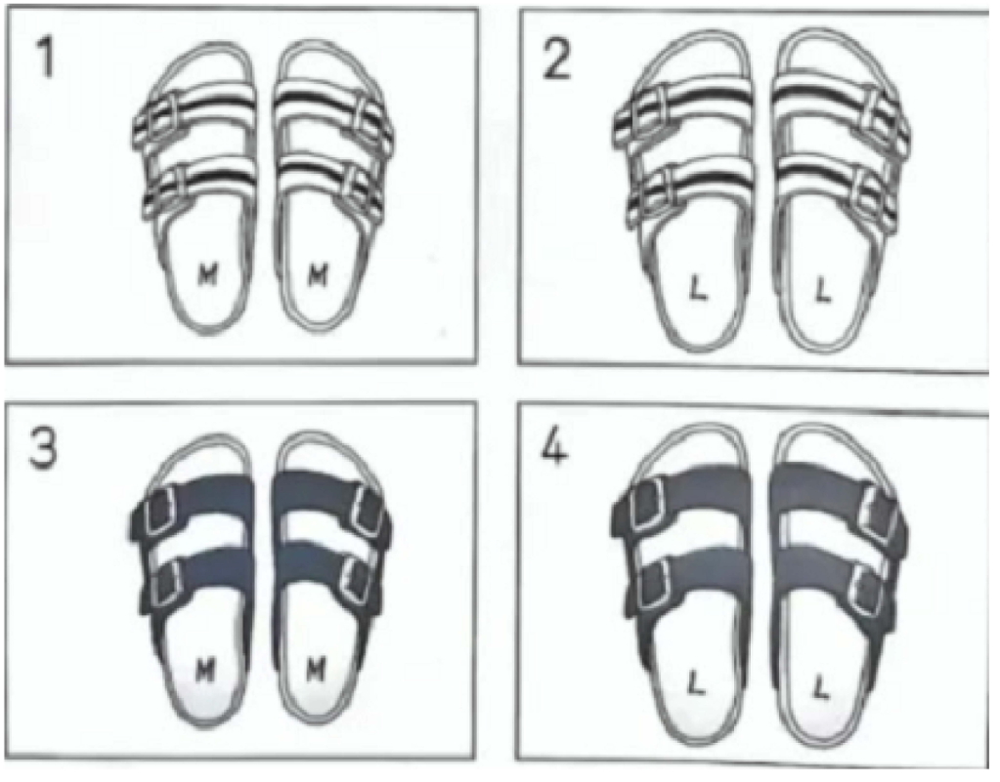
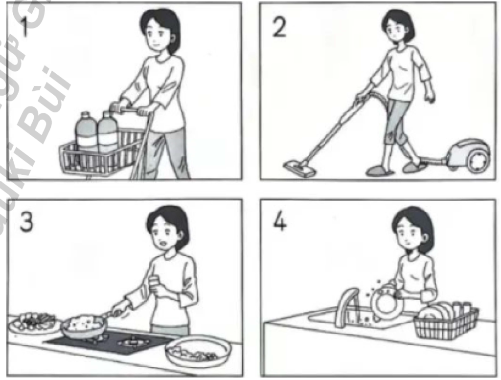
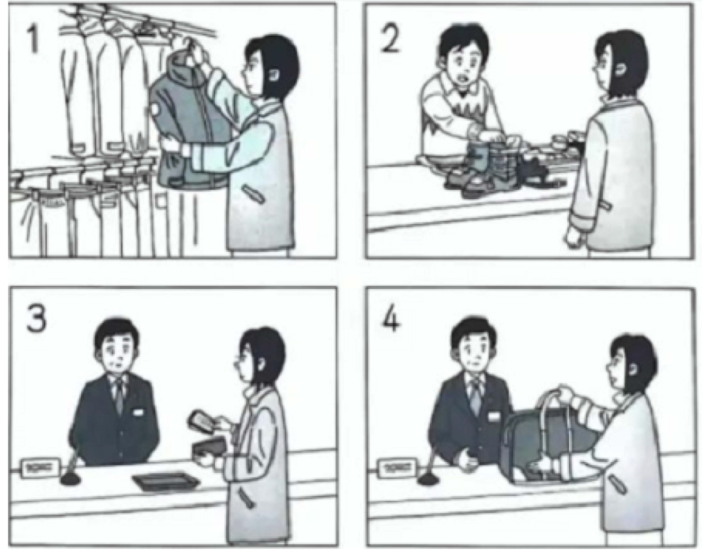
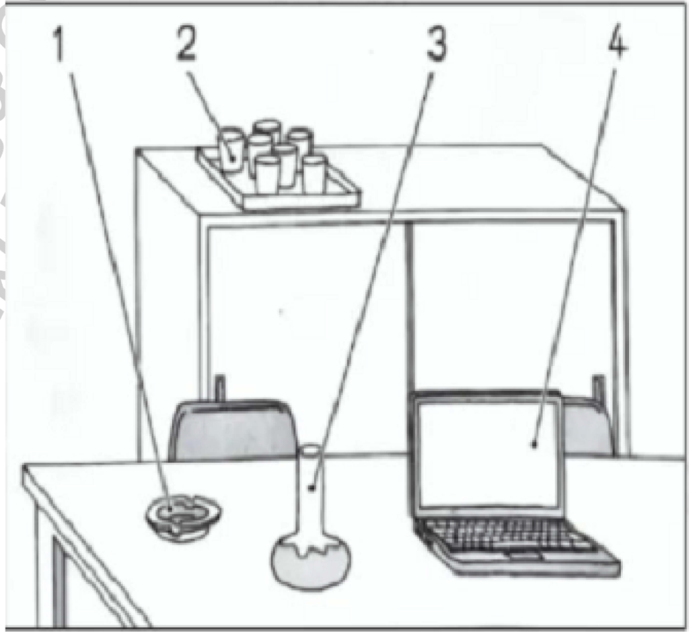
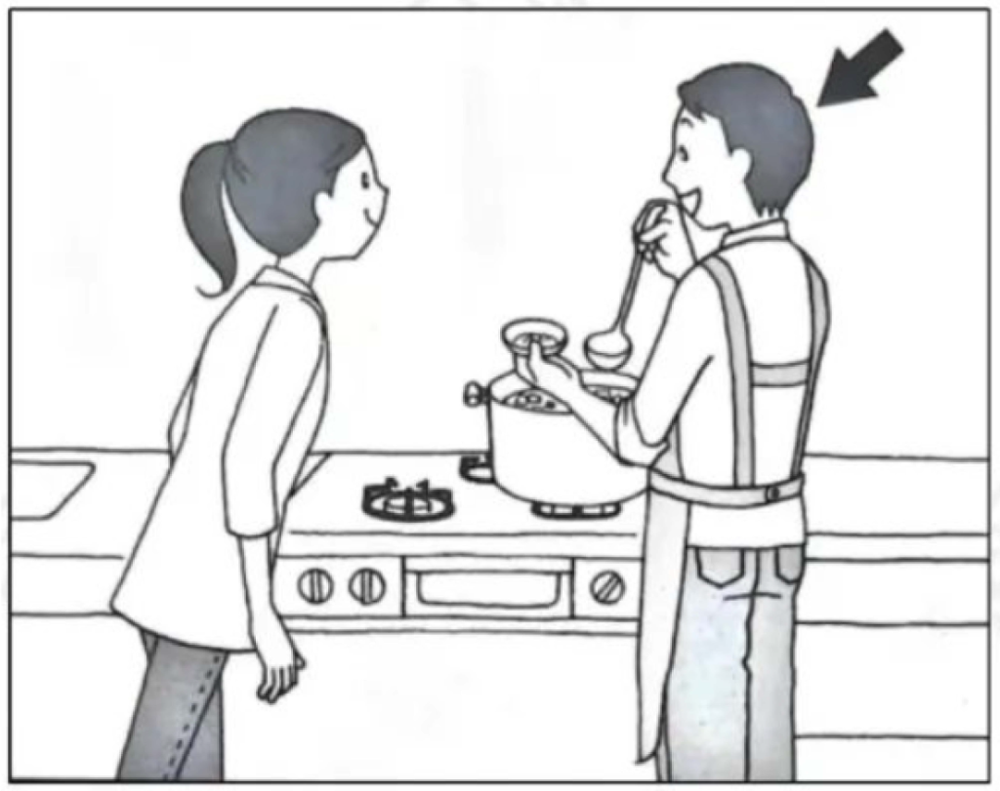
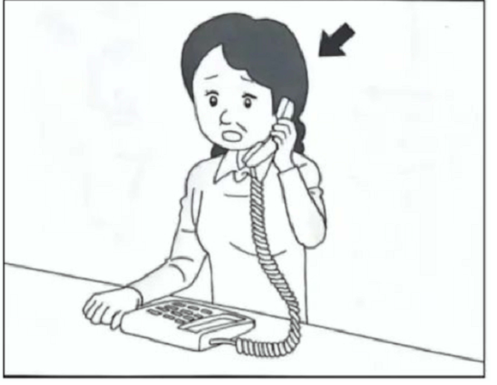
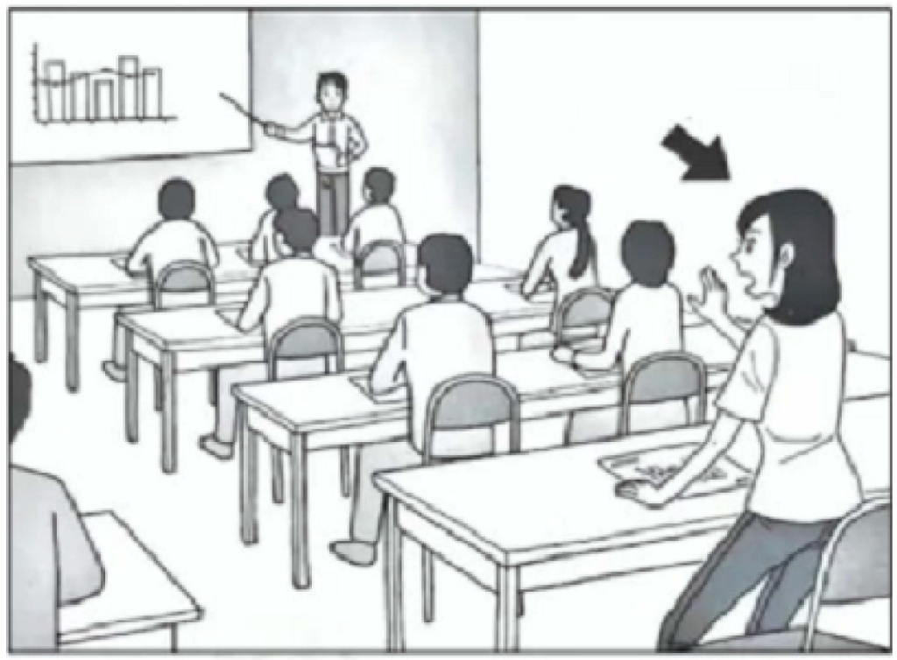
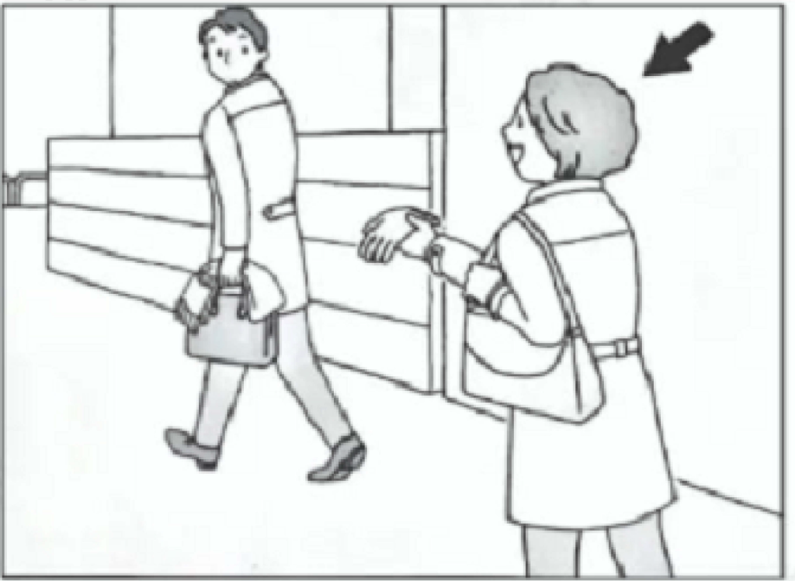
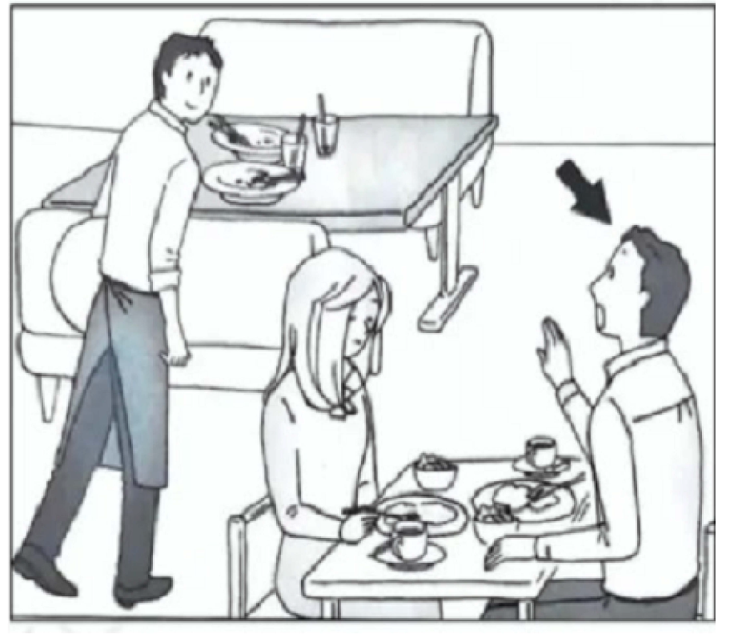

# JLPT N4 Mock Test – December 2021

## げんごちしき（もじ・ごい）

### もんだい１: Kanji Reading

> もんだい１　____の　ことばは　ひらがなで　どう　かきますか。1・2・3・4から　いちばん　いい　ものを　ひとつ　えらんで　ください。

#### Question 1

バスが８時に<u>出発</u>します。

1. しゅつはつ
2. しゅうはつ
3. **しゅっぱつ**
4. しゅうぱつ

**Correct answer:** 3. しゅっぱつ

**Correct Answer**

Answer 3: しゅっぱつ is correct.

**Question Translation**

"バスが８時に出発します。"
→ "The bus departs at 8 o'clock."

**Explanation**

The kanji "出発" is read as **しゅっぱつ**, which means *departure*. This is the correct reading based on the kanji used in the sentence.

**Other Options**

1. しゅつはつ – Not a standard reading of 出発.
2. しゅうはつ – Not a correct reading or word for 出発.
4. しゅうぱつ – Also not a correct reading for 出発.

Only **しゅっぱつ** matches the kanji **出発** in this context.

#### Question 2

すぐに、<u>答え</u>てください。

1. おぼえて
2. おしえて
3. かんがえて
4. **こたえて**

**Correct answer:** 4. こたえて

**Correct Answer**

Answer 4: こたえて is correct.

**Question Translation**

"すぐに、答えてください。"
→ "Please answer immediately."

**Explanation**

The kanji "答え" is read as **こたえ**, which means *answer* or *response*. This is the correct reading for the context of asking someone to respond or reply quickly.

**Other Options**

1. おぼえて – Means *remember* (kanji: 覚えて), and does not match 答え.
2. おしえて – Means *teach* or *inform* (kanji: 教えて), which isn't suitable here.
3. かんがえて – Means *think* or *consider* (kanji: 考えて), not an appropriate match.

Only **こたえて** matches the kanji **答え** in this context.

#### Question 3

あの人は<u>心</u>がきれいです。

1. きもち
2. あたま
3. かたち
4. **こころ**

**Correct answer:** 4. こころ

**Correct Answer**

Answer 4: こころ is correct.

**Question Translation**

"あの人は心がきれいです。"
→ "That person has a pure heart."

**Explanation**

The kanji "心" is read as **こころ**, which means *heart* or *mind*. This is the correct reading because it properly reflects the intended meaning of having a pure heart in the sentence.

**Other Options**

1. きもち – Means *feeling* or *mood* (kanji: 気持ち), and does not match 心.
2. あたま – Means *head* (kanji: 頭), which is unrelated to the concept of 心.
3. かたち – Means *shape* or *form* (kanji: 形), and is not appropriate for 心 in this context.

Only **こころ** matches the kanji **心** in this sentence.

#### Question 4

<u>最後</u>のページを見てください。

1. さいしょ
2. **さいご**
3. せいご
4. せいしょ

**Correct answer:** 2. さいご

**Correct Answer**

Answer 2: さいご is correct.

**Question Translation**

"最後のページを見てください。"
→ "Please look at the last page."

**Explanation**

The kanji "最後" is read as **さいご**, which means *last* or *final*. This reading is appropriate because the context refers to the last page.

**Other Options**

1. さいしょ – Means *beginning* (kanji: 最初), the opposite of 最後.
3. せいご – Not a standard reading or meaning for 最後.
4. せいしょ – Means *clean copy* or *fair copy* (kanji: 清書), not relevant here.

Only **さいご** matches the kanji **最後** and context in this sentence.

#### Question 5

このみちを行くと、少し<u>遠い</u>です。

1. おそい
2. ちかい
3. **とおい**
4. はやい

**Correct answer:** 3. とおい

**Correct Answer**

Answer 3: とおい is correct.

**Question Translation**

"このみちを行くと、少し遠いです。"
→ "If you go this way, it is a little far."

**Explanation**

The kanji "遠い" is read as **とおい**, which means *far* or *distant*. This is the correct reading based on the kanji and context in the sentence.

**Other Options**

1. おそい – Means *slow* or *late* (kanji: 遅い), and does not match 遠い.
2. ちかい – Means *close* or *near* (kanji: 近い), and does not match 遠い.
4. はやい – Means *fast* or *early* (kanji: 速い or 早い), and does not match 遠い.

Only **とおい** correctly matches the kanji **遠い** in this context.

#### Question 6

おととしの<u>冬</u>、日本を旅行しました。

1. あき
2. **ふゆ**
3. なつ
4. はる

**Correct answer:** 2. ふゆ

**Correct Answer**

Answer 2: ふゆ is correct.

**Question Translation**

"おととしの冬、日本を旅行しました。"
→ "I traveled to Japan the winter before last."

**Explanation**

The kanji "冬" is read as **ふゆ**, which means *winter*. This is the correct reading and fits the context of the sentence regarding the time of year.

**Other Options**

1. あき – This means *autumn* (kanji: 秋), which does not match the kanji for winter.
3. なつ – This translates to *summer* (kanji: 夏), and it is not correct for this kanji.
4. はる – This represents *spring* (kanji: 春), not suitable here.

Only **ふゆ** corresponds to the kanji **冬** in this context.

#### Question 7

あしたのじゅぎょうの<u>予習</u>をします。

1. **よしゅう**
2. ようしゅう
3. よしゅ
4. ようしゅ

**Correct answer:** 1. よしゅう

**Correct Answer**

Answer 1: よしゅう is correct.

**Question Translation**

"あしたのじゅぎょうの予習をします。"
→ "I will prepare for tomorrow's class."

**Explanation**

The kanji "予習" is read as **よしゅう**, which means *preparation in advance* or *pre-study*. This is the correct reading based on the context of preparing for a class.

**Other Options**

2. ようしゅう – Not a standard reading of 予習.
3. よしゅ – An incomplete reading, missing part of the intended reading.
4. ようしゅ – Also not a standard reading of 予習.

Only **よしゅう** matches the kanji **予習** in this context.

### もんだい2: Orthography

> もんだい2　_____の　ことばは　どう　かきますか。1・2・3・4から　いちばん　いい ものを　ひとつ　えらんで　ください。

#### Question 8

としょかんで<u>えいが</u>の本をかりました。

1. 映語
2. 英語
3. 英画
4. **映画**

**Correct answer:** 4. 映画

**Correct Answer**

Answer 4: 映画 is correct.

**Question Translation**

"としょかんでえいがの本をかりました。"
→ "I borrowed a book about movies at the library."

**Explanation**

The word "えいが" means *movie* or *film*, and the correct kanji representation is **映画**. This is the standard way to write "movie" in Japanese, commonly used in contexts involving cinema or film studies.

**Other Options**

1. 映語（えいご）– The reading of this kanji is "えいご", but it doesn’t convey a valid meaning. It seems like a mix-up of kanji, unlike the correct representation.

2. 英語（えいご）– The reading is "えいご", which means *English language*. This is unrelated to the intended meaning of "movies".

3. 英画（えいが）– This is read as "えいが", but it doesn’t correctly represent the word for "movies". The kanji 英 means *English*, leading to a misinterpretation.

Only **映画** accurately represents the word "えいが" in the context of borrowing a book about movies.

#### Question 9

すずきさんは何を<u>つくって</u>いますか。

1. 送って
2. 使って
3. **作って**
4. 売って

**Correct answer:** 3. 作って

**Correct Answer**

Answer 3: 作って is correct.

**Question Translation**

"すずきさんは何をつくっていますか。"
→ "What is Mr. Suzuki making?"

**Explanation**

The word "つくって" means *making* or *creating*, and the correct kanji representation is **作って**. It is used when referring to creating or making something, such as food, a piece of art, or a project.

**Other Options**

1. 送って（おくって）– The reading for this kanji is "おくって", and it means *sending*. It does not match the context as it relates to sending items, not making them.

2. 使って（つかって）– The reading is "つかって", meaning *using*. This is unrelated to the act of making something.

4. 売って（うって）– This is read as "うって", meaning *selling*. This does not fit the context of asking what Mr. Suzuki is making.

Only **作って** correctly represents the word "つくって" in this sentence.

#### Question 10

たくさん<u>うんどう</u>をしたので、つかれました。

1. **運動**
2. 連動
3. 運働
4. 連働

**Correct answer:** 1. 運動

**Correct Answer**

Answer 1: 運動 is correct.

**Question Translation**

"たくさんうんどうをしたので、つかれました。"
→ "I got tired because I exercised a lot."

**Explanation**

The word "うんどう" means *exercise* or *physical activity*, and the correct kanji representation is **運動**. It is commonly used to refer to physical activities or bodily exercise.

**Other Options**

2. 連動（れんどう）– The reading of this kanji is "れんどう", and it means *interlock* or *linkage*. This does not match the word "うんどう" related to bodily exercise.

3. 運働（うんどう）– While this kanji also reads as "うんどう", it is not a standard or correct way to write *exercise*. It does not convey the intended meaning.

4. 連働（れんどう）– This is read as "れんどう", similar to Answer 2, and it implies a kind of *linked movement*, which is not relevant to the intended context.

Only **運動** correctly represents the word "うんどう" in this sentence.

#### Question 11

あそこに大きな<u>ふね</u>が見えます

1. 寺
2. **船**
3. 鳥
4. 雲

**Correct answer:** 2. 船

**Correct Answer**

Answer 2: 船 is correct.

**Question Translation**

"あそこに大きなふねが見えます"
→ "I can see a large ship over there."

**Explanation**

The word "ふね" means *ship* or *boat*, and the correct kanji representation is **船**. This kanji is used to describe watercraft of varying sizes.

**Other Options**

1. 寺（てら）– The reading of this kanji is "てら", and it means *temple*. It does not match the word "ふね".

3. 鳥（とり）– The reading is "とり", and it means *bird*. It’s unrelated to the intended meaning.

4. 雲（くも）– This is read as "くも", meaning *cloud*. It doesn’t fit the word "ふね".

Only **船** correctly represents the word "ふね" in this sentence.

#### Question 12

わからない　かんじをじしょで 　<u>しらべる</u>

1. 作べる
2. 読べる
3. **調べる**
4. 見べる

**Correct answer:** 3. 調べる

**Correct Answer**

Answer 3: 調べる is correct.

**Question Translation**

"わからない漢字を辞書でしらべる"
→ "I look up the unknown kanji in the dictionary."

**Explanation**

The word "しらべる" means *to look up* or *to investigate*, and the correct kanji representation is **調べる**. This term is often used when referring to looking up information or researching.

**Other Options**

1. 作べる（つくべる）– The reading of this kanji is "つくべる", and it means *to make* or *to create*. It does not match the word "しらべる".

2. 読べる（よべる）– The reading is "よべる", which means *to read*. This does not fit the context of looking up information.

4. 見べる（みべる）– Read as "みべる", it suggests *to see* or *to view*. This is unrelated to the action of researching or investigating.

Only **調べる** correctly represents the word "しらべる" in this context of looking up something in a dictionary.

### もんだい３: Contextually-defined Expressions

> もんだい３　(　　　)に　なにを　いれますか。1・2・3・4から　いちばん　いい　ものを ひとつ　えらんで　ください。

#### Question 13

たくさん話したので（　　　）がいたいです。

1. **のど**
2. ひげ
3. ゆび
4. うで

**Correct answer:** 1. のど

**Correct Answer**

Answer 1: のど is correct. It means "throat."

**Question Translation**

I talked a lot, so my throat hurts.

**Explanation**

The sentence suggests that a part of the body is sore due to talking a lot. The body part most commonly associated with talking is the throat. Therefore, のど (throat) is the most appropriate choice to fit the context, as excessive talking can strain or cause pain in the throat.

**Why Other Options Are Incorrect**

- Answer 2: ひげ means "beard." It doesn’t relate to talking or becoming painful from talking.
- Answer 3: ゆび means "finger." This doesn’t connect to the act of talking and would not be affected by speaking.
- Answer 4: うで means "arm." Similar to the above, arms aren’t involved in the act of talking and wouldn’t typically become painful from it.

**Grammar/Vocabulary Note**

This question involves understanding the context of the activities described (talking) and the resulting physical effect (pain). Knowing common body parts and their associations with specific actions or sensations is important in these types of questions. Recognizing that のど (喉) is the kanji for throat (although written in hiragana here) helps in deducing the correct answer.

#### Question 14

のった電車はとても（　　　）いたので、すわれませんでした。

1. あつまって
2. **こんで**
3. たりて
4. くりかえして

**Correct answer:** 2. こんで

**Correct Answer**

Answer 2: こんで is correct. It means "crowded."

**Question Translation**

The train I got on was very crowded, so I couldn't sit down.

**Explanation**

The sentence describes a situation where the narrator couldn't sit on the train, indicating that the train was full of people. The verb 込む (こむ), when used in the form こんで, means "to be crowded" or "to be packed." This fits perfectly with the context of a train being too crowded to allow for available seats.

**Why Other Options Are Incorrect**

- Answer 1: あつまって comes from 集まる (あつまる), meaning "to gather." While it implies people, it does not capture the state of a train being crowded.
- Answer 3: たりて comes from 足りる (たりる), meaning "to be enough" or "to suffice," which does not convey the meaning of a crowded condition.
- Answer 4: くりかえして comes from 繰り返す (くりかえす), meaning "to repeat." This is unrelated to describing the state of a train or a crowded condition.

**Grammar/Vocabulary Note**

The verb 込む (こむ) is often used to describe 'packed' or 'crowded' states, such as in crowded trains, buses, or rooms. This usage is common in expressing situations where people or things are heavily gathered in one place, resulting in a lack of space.

#### Question 15

日本に行ったとき、きものをきたり、まつりでおどったり、いろいろな（　　　）をしました。

1. **けいけん**
2. しゅうかん
3. きょうみ
4. けっか

**Correct answer:** 1. けいけん

**Correct Answer**

Answer 1: けいけん is correct. It means "experience."

**Question Translation**

When I went to Japan, I wore a kimono, danced at festivals, and did various experiences.

**Explanation**

The sentence is describing different activities that the speaker did while visiting Japan. The word けいけん (経験) means "experience," which is appropriate here as it encapsulates the idea of engaging in various cultural activities and gaining personal experiences.

**Why Other Options Are Incorrect**

- Answer 2: しゅうかん (習慣) means "habit" or "custom." While it relates to cultural aspects, it doesn't fit well in this context as it doesn’t capture the idea of engaging in activities; rather, it describes something habitual.
- Answer 3: きょうみ (興味) means "interest." This word doesn't fit because the sentence is describing actions the speaker has already done, not just interests.
- Answer 4: けっか (結果) means "result." This doesn't fit the context either, as it doesn't align with the theme of activities or experiences but rather highlights outcomes of actions.

**Grammar/Vocabulary Note**

The noun けいけん (経験) is often used in sentences where the speaker wishes to convey that they have tried or engaged in new or various activities, emphasizing the experiential aspect. This is a common usage in discussions about traveling or new activities. Recognizing the context of how activities are presented can help identify the appropriate term, particularly in contexts involving cultural immersion or personal experience.

#### Question 16

どんなまんががすきか、小学生に（　　　）をしました。

1. コンサート
2. コンピューター
3. **アンケート**
4. アルコール

**Correct answer:** 3. アンケート

**Correct Answer**

Answer 3: アンケート is correct. It means "survey" or "questionnaire."

**Question Translation**

I conducted a survey with elementary school students about what kinds of comics they like.

**Explanation**

The sentence describes an activity conducted with elementary school students to find out their preferences regarding comics. The term アンケート (アンケート, ankēto) is a borrowed word from French meaning "survey" or "questionnaire," which fits perfectly in this context. It implies collecting information or opinions from a group of people, which is the intended action here.

**Why Other Options Are Incorrect**

- Answer 1: コンサート (コンサート, konsāto) means "concert." It refers to a musical performance event and doesn’t fit the context of gathering information or preferences from students.
- Answer 2: コンピューター (コンピューター, konpyūtā) means "computer." It refers to an electronic device for processing data and does not relate to conducting any form of questioning or data collection.
- Answer 4: アルコール (アルコール, arukōru) means "alcohol." This refers to a type of beverage or substance and is unrelated to conducting a survey or collecting opinions.

**Grammar/Vocabulary Note**

"アンケート" is commonly used in the context of gathering opinions or conducting research through questions to a target group, such as in market research or academic studies. Recognizing borrowed words, especially those used frequently in specific contexts, is important for understanding meaning in Japanese.

#### Question 17

わたしがかりているアパートの（　　　）は１か月７万円です。

1. ふりこみ
2. ちょきん
3. おつり
4. **やちん**

**Correct answer:** 4. やちん

**Correct Answer**

Answer 4: やちん (家賃) is correct. It means "rent."

**Question Translation**

The rent for the apartment I am renting is 70,000 yen per month.

**Explanation**

The sentence discusses the monthly cost for an apartment that the speaker is renting. The word "やちん" (家賃) specifically refers to the rent one pays for housing. It is the most appropriate term in this context as it directly relates to the cost associated with living in a rented property.

**Why Other Options Are Incorrect**

- Answer 1: ふりこみ (振込み) refers to a "bank transfer" or "payment," not specifically rent. It doesn’t describe a cost related to housing.
- Answer 2: ちょきん (貯金) means "savings." It’s unrelated to the specific context of rent payment.
- Answer 3: おつり (お釣り) means "change" (as in money returned after a purchase). It doesn’t fit the meaning of the sentence, which is about the cost of rent.

**Grammar/Vocabulary Note**

The term "やちん" is a compound word combining "家" (house) and "賃" (rent, hire), together meaning the rent paid for a house or apartment. Recognizing such compound words helps in understanding specific costs or payments in Japanese daily life contexts.

#### Question 18

このしゃしんに（　　　）いるのはわたしのりょうしんです。

1. かかって
2. ついて
3. **うつって**
4. とどいて

**Correct answer:** 3. うつって

**Correct Answer**

Answer 3: うつって (映って) is correct. It means "to be photographed or to appear in a photograph."

**Question Translation**

In this photo, the people who appear are my parents.

**Explanation**

The context of the sentence involves describing who is in a photograph. The verb 映って (うつって) is used to indicate that someone or something has been captured or is appearing in a photo. It fits perfectly in this context because the speaker is identifying the people in the photograph as their parents.

**Why Other Options Are Incorrect**

- Answer 1: かかって (掛かって) can mean "to be mounted/hung," "to take time," or "to be involved with," none of which make sense when talking about who is in a photo. It doesn’t convey the idea of appearing in a photo.
- Answer 2: ついて (付いて) means "attached" or "related," which doesn’t apply to this context. It does not capture the idea of being visible or present in a photograph.
- Answer 4: とどいて (届いて) means "to have delivered" or "to reach," which doesn’t fit the context of who is in a photo, as it does not relate to being visible or appearing.

**Grammar/Vocabulary Note**

映る (うつる) is a verb used in contexts related to images, photographs, and visually appearing or being projected, whether in a photograph or on a screen. Recognizing this verb is helpful for understanding contexts where visual representation is described, especially in modern contexts involving digital media and photography.

#### Question 19

しんかんせんのきっぷは、かたみちなら１万円、（　　　）なら２万円です。

1. かいてん
2. **おうふく**
3. うんてん
4. あんない

**Correct answer:** 2. おうふく

**Correct Answer**

Answer 2: おうふく is correct. It means "round trip."

**Question Translation**

The Shinkansen ticket costs 10,000 yen for a one-way trip, and 20,000 yen if it is a round trip.

**Explanation**

The context of the sentence involves purchasing a Shinkansen ticket with two potential pricing options: one for a "one-way" trip (かたみち) and one for a "round trip." The term おうふく (往復, おうふく) specifically refers to a round trip, which means traveling to a destination and returning. It fits the sentence perfectly as it complements かたみち, differentiating between a single journey and a return journey.

**Why Other Options Are Incorrect**

- Answer 1: かいてん (回転) means "rotation" or "revolution." It does not relate to travel or ticket types in this context.
- Answer 3: うんてん (運転) means "driving" or "operation." It refers to the act of operating a vehicle, not a type of journey.
- Answer 4: あんない (案内) means "guidance" or "information." It doesn't fit the context of describing a ticket type for a journey.

**Grammar/Vocabulary Note**

Understanding the difference between かたみち (片道) and おうふく (往復) is crucial, as these terms frequently appear in travel contexts. They help differentiate between one-way and round-trip tickets, a common distinction in transportation services. Recognizing such terms can be essential when discussing travel plans or purchasing tickets in Japanese.

#### Question 20

ひっこしのとき、さらはかみで（　　　）はこに入れます。

1. ひろって
2. かたづけて
3. つかまえて
4. **つつんで**

**Correct answer:** 4. つつんで

**Correct Answer**

Answer 4: つつんで is correct. It means "to wrap."

**Question Translation**

When moving, the plates are wrapped in paper and put into the box.

**Explanation**

The sentence describes a common practice during relocation: protecting fragile items, such as plates, by wrapping them before placing them in a box. The verb つつむ (包む) means "to wrap," which perfectly fits the context of wrapping plates in paper to protect them during a move.

**Why Other Options Are Incorrect**

- Answer 1: ひろって (拾って) means "to pick up." While it involves handling items, it doesn't fit the context of using paper or boxes for moving.
- Answer 2: かたづけて (片付けて) means "to tidy up" or "to put away." It's not specifically about wrapping or protection of items, so it doesn’t suit the context here.
- Answer 3: つかまえて (捕まえて) means "to catch" or "to seize." This action is unrelated to wrapping or packing for moving purposes.

**Grammar/Vocabulary Note**

包む (つつむ) is a commonly used verb meaning "to wrap" or "to cover," often used in contexts where items are being protected or packaged, such as wrapping gifts or securing items for transport. Recognizing common actions associated with moving, like wrapping fragile objects, helps in understanding relevant vocabulary and phrases.

### もんだい４: Paraphrases

> もんだい４　_____の　ぶんと　だいたい　おなじ　いみの　ぶんが　あります。1・2・3・4から　いちばん　いい　ものを　ひとつ　えらんで　ください。

#### Question 21

<u>この話はひみつです。</u>

1. この話をみんなにはなしてください。
2. **この話はだれにも言わないでください。**
3. この話をみんなにも聞きましょう。
4. この話はだれもしりたくないです。

**Correct answer:** 2. この話はだれにも言わないでください。

**Correct Answer**

Answer 2: この話はだれにも言わないでください。 This is correct. It means "Please do not tell this story to anyone."

**Question Translation**

This story is a secret.

**Explanation**

The given sentence indicates that the story is a secret, implying it should be kept confidential and not shared with others. The phrase "この話はだれにも言わないでください" translates to "Please do not tell this story to anyone," which aligns perfectly with maintaining the secrecy of the story as described in the original sentence.

**Why Other Options Are Incorrect**

- Answer 1: この話をみんなにはなしてください。means "Please tell this story to everyone." This contradicts the idea of keeping the story a secret, as telling everyone is the opposite of confidentiality.
- Answer 3: この話をみんなにも聞きましょう。means "Let's listen to this story with everyone." This implies sharing the story with others, which contradicts the secretive nature of the story.

- Answer 4: この話はだれもしりたくないです。means "No one wants to know this story." This doesn't relate to the secretive nature of the story; instead, it implies disinterest rather than confidentiality.

**Grammar/Vocabulary Note**

- ひみつ (秘密) means "secret."
- だれにも (誰にも) in this context translates to "to anyone," and combined with 言わないでください (don't tell), it forms a common way to instruct someone to keep information confidential. Recognizing the nuance of such phrases is crucial for understanding intention in Japanese communication.

#### Question 22

<u>もりさんはにこにこしていました。</u>

1. もりさんはやすんでいました。
2. もりさんはあそんでいました。
3. もりさんはうたっていました。
4. **もりさんはわらっていました。**

**Correct answer:** 4. もりさんはわらっていました。

**Correct Answer**

Answer 4: もりさんはわらっていました is correct. It means "Mori-san was smiling/laughing."

**Question Translation**

Mori-san was smiling.

**Explanation**

The phrase "にこにこしていました" refers to someone's facial expression, indicating that they were smiling or had a happy, pleasant demeanor. The verb "わらっていました" (笑っていました) directly translates to "was laughing," which is a suitable paraphrase for someone smiling, as both imply a cheerful expression.

**Why Other Options Are Incorrect**

- Answer 1: もりさんはやすんでいました means "Mori-san was resting." Resting does not inherently involve any facial expressions like smiling, so it doesn't match the given sentence.
- Answer 2: もりさんはあそんでいました means "Mori-san was playing." While playing might often be a joyful activity, it does not specifically imply the facial expression of smiling.
- Answer 3: もりさんはうたっていました means "Mori-san was singing." Although singing can be associated with happiness, it's not specifically linked to smiling or the facial expression described by "にこにこしていました."

**Grammar/Vocabulary Note**

The phrase "にこにこ" is an onomatopoeia in Japanese that describes a smiling face, indicating a gentle or cheerful demeanor. Understanding Japanese onomatopoeia is crucial, as they often convey specific nuances about actions or expressions that aren't directly translatable to English words. Additionally, recognizing verb conjugations like していました, indicating an ongoing or past action, is key in comprehending context and proper translations.

#### Question 23

<u>たなかさんはどくしんです。</u>

1. たなかさんはけっこんしています。
2. **たなかさんはけっこんしていません。**
3. たなかさんはひとりですんでいます。
4. たなかさんははたらいていません。

**Correct answer:** 2. たなかさんはけっこんしていません。

**Correct Answer**

Answer 2: たなかさんはけっこんしていません is correct. It means "Mr. Tanaka is not married."

**Question Translation**

Mr. Tanaka is single.

**Explanation**

The phrase "たなかさんはどくしんです" means "Mr. Tanaka is single." The term どくしん (独身) refers to a person who is not married. Therefore, the answer 2, "たなかさんはけっこんしていません" ("Mr. Tanaka is not married"), correctly paraphrases the original statement, as being "single" implies that someone is "not married."

**Why Other Options Are Incorrect**

- Answer 1: たなかさんはけっこんしています means "Mr. Tanaka is married." This contradicts the original statement because being married is the opposite of being single.
- Answer 3: たなかさんはひとりですんでいます means "Mr. Tanaka lives alone." While this could be true for someone who is single, it does not directly paraphrase the concept of marital status, which is explicitly about being "not married."
- Answer 4: たなかさんははたらいていません means "Mr. Tanaka is not working." This is unrelated to the original statement about marital status.

**Grammar/Vocabulary Note**

The word 独身 (どくしん) specifically refers to the marital status of an individual, meaning "single" or "unmarried." Understanding the nuances of terms relating to personal status, such as 結婚していません ("not married"), is key to distinguishing them from other unrelated personal information, like employment status or living arrangements.

#### Question 24

<u>これはやわらかいですね。</u>

1. **これはかたくないですね。**
2. これはにがくないですね。
3. これはつめたくないですね。
4. これはきたなくないですね。

**Correct answer:** 1. これはかたくないですね。

**Correct Answer**

Answer 1: これはかたくないですね。is correct. It means "This is not hard, is it?"

**Question Translation**

"This is soft, isn't it?"

**Explanation**

The original sentence "これはやわらかいですね。" means "This is soft, isn't it?" The correct paraphrase is the negation of its opposite. The opposite of "soft" (やわらかい) is "hard" (かたい). Therefore, "これはかたくないですね。" means "This is not hard, is it?" which effectively paraphrases the sense of "This is soft."

**Why Other Options Are Incorrect**

- Answer 2: これはにがくないですね。means "This is not bitter, is it?" "Bitter" (にがい) is unrelated to the concept of "soft," hence it doesn't convey the meaning of the original sentence.
- Answer 3: これはつめたくないですね。means "This is not cold, is it?" "Cold" (つめたい) does not relate to whether something is soft or hard.
- Answer 4: これはきたなくないですね。means "This is not dirty, is it?" "Dirty" (きたない) also bears no relation to the texture description of "soft."

**Grammar/Vocabulary Note**

In Japanese, adjectives often have clear opposites (e.g., やわらかい vs. かたい), and understanding these pairs helps in paraphrasing tasks. Negative forms (〜ない) can be used to express an opposite condition effectively, particularly in polite conversation or to soften assertions.

### もんだい5: Usage

> もんだい5　つぎの　ことばの　つかいかたで　いちばん　いい　ものを 1・2・3・4から ひとつ　えらんで　ください。

#### Question 25

れんらく

1. きこくしたら、おれいのでがみをやまださんに<u>れんらく</u>します。
2. アルバイトに行く日をカレンダーに<u>れんらく</u>しておきます。
3. はじめて会った人にめいしを<u>れんらく</u>して、あいさつをしました。
4. **あしたのかいぎの時間をはやしさんに<u>れんらく</u>しました。**

**Correct answer:** 4. あしたのかいぎの時間をはやしさんに<u>れんらく</u>しました。

**Correct Answer**

Answer 4 is correct.

**Word Translation**

連絡（れんらく） — contact, inform, communicate

**Correct Sentence Translation**

I informed Hayashi-san about tomorrow's meeting time.

**Explanation**

The word **連絡** is commonly used when you are informing, contacting, or communicating information to someone. "かいぎの時間を連絡しました" (I informed someone about the meeting time) is a natural expression in Japanese.

**Other Options**

② アルバイトに行く日をカレンダーに__れんらく__しておきます。
→ I will contact going-to-work days on the calendar.
🔶 Awkward Usage
"連絡" refers to communication between people, not marking dates on a calendar. A more appropriate verb would be "記入する" (to write down) or "記す" (to note).

③ はじめて会った人にめいしを__れんらく__して、あいさつをしました。
→ I contacted my business card to someone I met for the first time and greeted them.
❌ Incorrect Usage
"連絡" does not apply to physically handing over an object. Instead, use "渡す" (to hand over) or "交換する" (to exchange).

① きこくしたら、おれいのでがみをやまださんに__れんらく__します。
→ When I return to my country, I will contact Yamada-san with a thank-you letter.
❌ Incorrect Usage
While expressing gratitude, "連絡" isn't used for conveying letters. The proper term is "送る" (to send).

**Usage Note**

"連絡" is used for communication involving discussions, notifications, or passing information among people. It is not suitable for non-interactive contexts like writing on calendars or exchanging physical items.

#### Question 26

むしあつい

1. **ゆうべは<u>むしあつくて</u>、あまりねられませんでした。**
2. あのひとは<u>むしあつい</u>ので、すきではありません。
3. このりょうりは<u>むしあつい</u>ほうがおいしいです。
4. このコートは<u>むしあつくて</u>、きやすいです。

**Correct answer:** 1. ゆうべは<u>むしあつくて</u>、あまりねられませんでした。

**Correct Answer**

Answer 1 is correct.

**Word Translation**

むしあつい — humid, muggy

**Correct Sentence Translation**

Last night was so humid and muggy that I couldn't sleep well.

**Explanation**

The word **むしあつい** is used to describe the weather or atmosphere as being hot and humid, which often creates discomfort. In this context, it is naturally combined with sleeping difficulty, as high humidity can disturb sleep.

**Other Options**

② あのひとは__むしあつい__ので、すきではありません。
→ I don't like that person because they are humid.
❌ Incorrect Usage
"むしあつい" is not appropriate to describe a person. It exclusively refers to the physical atmosphere or environment. A better word might be "無愛想" (unfriendly) or "感じが悪い" (having a bad vibe).

③ このりょうりは__むしあつい__ほうがおいしいです。
→ This dish tastes better when it's humid.
❌ Incorrect Usage
"むしあつい" is not used for food. Food can be "熱い" (hot), but not "humid." A more suitable term might be "熱々" (steaming hot) for describing deliciousness when warm.

④ このコートは__むしあつくて__、きやすいです。
→ This coat is humid, making it easy to wear.
🔶 Awkward Usage
While a coat could potentially make you feel hot and stuffy, "むしあつい" does not fit well for clothing. A phrase like "温かくて" (warm and cozy) would be more appropriate for pleasant wearability, although it implies a positive feeling.

**Usage Note**

"むしあつい" is specifically associated with environmental conditions like weather, rather than people, objects, or food. It typically indicates high humidity combined with heat, often in a negative or discomforting context.

#### Question 27

けいかく

1. ひこうきのチケットは電話かメールで<u>けいかく</u>ができます。
2. あしたはゆうがたから雨がふる<u>けいかく</u>です。
3. **来月行くりょこうの<u>けいかく</u>がまだきまっていません。**
4. 来週はしごとがいそがしくなる<u>けいかく</u>です。

**Correct answer:** 3. 来月行くりょこうの<u>けいかく</u>がまだきまっていません。

**Correct Answer**

Answer 3 is correct.

**Word Translation**

計画（けいかく） — plan, planning

**Correct Sentence Translation**

The plan for the trip next month has not been decided yet.

**Explanation**

The word **計画** refers to a structured intention or arrangement, often used in contexts involving preparations or detailing future actions. In "旅行の計画" (travel plan), it conveys organizing or outlining actions and details for travel, which is a natural context for its use.

**Other Options**

② あしたはゆうがたから雨がふる__けいかく__です。
→ It is planned for rain to start tomorrow evening.
❌ Incorrect Usage
Weather is not something that is "planned"; rather, it is "forecasted" or "expected." The word "予報" (よほう) or "可能性" (かのうせい) would be more appropriate.

① ひこうきのチケットは電話かメールで__けいかく__ができます。
→ Flight tickets can be planned by phone or email.
❌ Incorrect Usage
Tickets are "booked" or "reserved," not "planned." The correct word would be "予約" (よやく).

④ 来週はしごとがいそがしくなる__けいかく__です。
→ It is planned to become busy with work next week.
🔶 Awkward Usage
Workloads typically aren't something "planned" in this sense; it would be more naturally expressed using "予定" (よてい) or "予想" (よそう).

**Usage Note**

"計画" implies deliberate, often detailed arrangement primarily for events, projects, or travels, where human intention and preparation are involved. It is inappropriate for situations lacking human planning, like weather or work obligations without an explicit initiative.

#### Question 28

そだてる

1. **母が<u>そだてた</u>花がきれいにさきました。**
2. 外国に行きたいので、お金を<u>そだてて</u>います。
3. おきゃくさんが来るので、あさからごちそうを<u>そだてました</u>。
4. １年前から<u>そだてている</u>ビルがもうすぐできます。

**Correct answer:** 1. 母が<u>そだてた</u>花がきれいにさきました。

**Correct Answer**

Answer 1 is correct.

**Word Translation**

育てる（そだてる） — to raise, to cultivate, to bring up

**Correct Sentence Translation**

The flowers my mother raised bloomed beautifully.

**Explanation**

The word **育てる** encompasses the act of raising or cultivating something living, such as plants or children. In this context, "母がそだてた花" (the flowers my mother raised) is a natural and accurate use of the word, as it involves the nurturing or cultivation of plants.

**Other Options**

② 外国に行きたいので、お金をそだてています。
→ I want to go abroad, so I am raising money.
❌ Incorrect Usage
"育てる" is not used for non-living things like money. A more suitable phrase would be "貯めています" (saving) or "集めています" (collecting).

③ おきゃくさんが来るので、あさからごちそうをそだてました。
→ Guests are coming, so I raised a feast since this morning.
❌ Incorrect Usage
"育てる" cannot be used with "ごちそう" (feast), as it is not something that can be raised or cultivated. Use "準備しました" (prepared) instead.

④ １年前からそだてているビルがもうすぐできます。
→ The building being raised for a year will soon be completed.
❌ Incorrect Usage
"育てる" is not appropriate for non-living structures like buildings. A natural term would be "建てています" (building) or "建設しています" (constructing).

**Usage Note**

"育てる" is generally reserved for living beings or organisms that require growth or nurturing, like plants, animals, or people. It is not applicable to actions related to money, inanimate objects, or buildings.

## 言語知識（文法）・読解

### もんだい1: Sentential Grammar 1 (Selecting grammar form)

> もんだい1　(　　　) に　何を　入れますか。1・2・3・4から　いちばん　いい　ものを 一つ　えらんで　ください。

#### Question 1

わたしもピアノを習うこと（　　　）しました。

1. へ
2. が
3. **に**
4. で

**Correct answer:** 3. に

**Correct Answer**

Answer 3: に is correct. It indicates the direction or purpose of the action, similar to "decided to do" something.

**Question Translation**

I decided to learn how to play the piano too.

**Explanation**

In this sentence, "～ことにする" is a common Japanese construction used to express making a decision. "に" indicates the target or purpose, which in this structure conveys the speaker's decision regarding an action. "習うことにしました" means "decided to learn," making "に" the appropriate particle to connect these ideas.

**Why Other Options Are Incorrect**

- Answer 1: へ (へ) indicates direction or destination, which is not applicable in this context since it doesn’t convey decision-making.
- Answer 2: が (が) is typically used to mark the subject of a sentence and does not work with "こと" in this decision-making construct.
- Answer 4: で (で) is used to indicate means, location, or a method of action. It doesn’t fit here because it doesn’t convey making a decision.

**Grammar/Vocabulary Note**

The grammar pattern "～ことにする" is used to express making decisions or resolutions. This structure is critical for discussing decisions and intentions in Japanese and requires the use of the particle "に" to mark the infinitive form of the verb being turned into a noun with "こと."

#### Question 2

山田「ジョンさんは日本にどのくらいいる予定ですか。」　ジョン「ざんねんですが、一週間（　　　）いられません。」

1. だけ
2. **しか**
3. くらい
4. でも

**Correct answer:** 2. しか

**Correct Answer**

Answer 2: しか is correct. It means "only (in a limiting sense)" and conveys a constraint or limitation in Japanese.

**Question Translation**

Yamada: "John, how long do you plan to be in Japan?"
John: "Unfortunately, I can’t stay (for) more than a week."

**Explanation**

In this context, しか is used to express limitation. The sentence is indicating that John's stay is restricted, and he cannot stay longer than a specified period. The structure "一週間しかいられません" means "I can only stay for a week," emphasizing the limitation on the duration John can remain in Japan.

**Why Other Options Are Incorrect**

- Answer 1: だけ means "only" but is used to indicate what is available rather than a restriction. "一週間だけいられません" translates awkwardly and incorrectly since だけ does not inherently convey the negative limitation that the context requires.
- Answer 3: くらい means "approximately" or "about" and does not convey limitation. Using it in the sentence as "一週間くらいいられません" would not express the intended limitation and sounds awkward.
- Answer 4: でも means "even" or "also" among other meanings, and does not fit in the context of expressing a limitation on duration. "一週間でもいられません" fails to convey the constraint needed for the sentence.

**Grammar/Vocabulary Note**

The grammar structure for expressing limitations or constraints involving negative verbs uses しか with the negative form of the verb. This is different from だけ, which pairs with positive verbs for expressing what is available or possible without emphasizing restriction. Recognizing when to use しか with a negative verb form helps clarify meaning in nuanced contexts.

#### Question 3

今日は午後から雨が降る（　　　）聞いたので、かさを持ってきました。

1. は
2. を
3. の
4. **と**

**Correct answer:** 4. と

**Correct Answer**

Answer 4: と is correct. It means "when" or "as" in this context.

**Question Translation**

I heard that it would rain in the afternoon today, so I brought an umbrella.

**Explanation**

The sentence structure indicates a reported speech or hearsay, for which the particle と is used. In this case, 雨が降ると (ame ga furu to) is a common way to indicate hearing something specific will happen, such as weather conditions. The structure [Sentence] + と + 聞いた (kiita) effectively translates to "I heard that [Sentence]."

**Why Other Options Are Incorrect**

- Answer 1: は is a topic marker and does not fit grammatically in this context since the phrase requires a particle for indirect speech or hearsay.
- Answer 2: を is an object particle and is used to indicate the direct object of an action. It does not fit here as "rain" isn't a direct object in this context.
- Answer 3: の is a possessive or nominalizing particle. Using it here would not grammatically complete the sentence as it does not introduce indirect speech.

**Grammar/Vocabulary Note**

The particle と is crucial for expressing indirect speech or thoughts (e.g., "I think that..." or "I heard that..."). It connects a quoted or stated idea with the main verb expressing communication or cognition such as 言う (iu, to say), 聞く (kiku, to hear), or 考える (kangaeru, to think). Understanding its use is essential for correctly forming reported speech in Japanese.

#### Question 4

私の兄は、テニスもサッカー（　　　）上手です。

1. が
2. **も**
3. で
4. を

**Correct answer:** 2. も

**Correct Answer**

Answer 2: も is correct. It means "also" or "too."

**Question Translation**

My older brother is good at both tennis and soccer.

**Explanation**

The sentence is listing two sports and indicating that the older brother is proficient in both. The particle "も" is used to add emphasis on inclusion, similar to the English "also" or "too." In this context, it highlights that in addition to tennis, the brother is also skilled at soccer.

**Why Other Options Are Incorrect**

- Answer 1: が is a subject marker, which indicates the subject of a sentence. Using が here wouldn't connect the proficiency in tennis and soccer, thus not conveying the intended meaning of "also."
- Answer 3: で is an instrumental particle often used to indicate means or location. It doesn't make sense to use it here as it doesn't properly link the items as the particle "も" does in this context of inclusion.
- Answer 4: を is an object marker, indicating the direct object of a verb. Since there's no verb action applied directly to "soccer" in this part of the sentence, を is inappropriate here.

**Grammar/Vocabulary Note**

The particle "も" is often used when indicating that something applies equally to multiple objects, subjects, or conditions. It's a key grammatical tool for expressions of inclusion and is essential in sentences where multiple positive attributes or elements are being highlighted.

#### Question 5

A「きのうの夜、（　　　）電話に出なかったんですか。」　

B「ごめんなさい。おふろに入っていました。」

1. どう
2. どうやって
3. どんな
4. **どうして**

**Correct answer:** 4. どうして

**Correct Answer**

Answer 4: どうして is correct. It means "why".

**Question Translation**

A: "Why didn’t you answer the phone last night?"

**Explanation**

The question is asking for a reason for not answering the phone. どうして (why) is used to inquire about the reason or cause of an action or situation. It is the most appropriate choice when seeking an explanation.

**Why Other Options Are Incorrect**

- Answer 1: どう means "how" in terms of condition or state, such as "how is something." It doesn't inquire about reasons, so it’s unsuitable here.
- Answer 2: どうやって means "how" in terms of method or means, as in asking about the way something is done. It seeks procedural information, not reasons, which doesn't fit the context of the question.
- Answer 3: どんな means "what kind of" and is used to inquire about the type or nature of something. It doesn't apply here because the question is about seeking a reason.

**Grammar/Vocabulary Note**

Understanding question words is crucial in Japanese. どうして is specifically used for asking "why" — often to understand motivations or reasons behind actions. This contrasts with どう and どうやって, which are about manner or method, and どんな, which is about type or kind.

#### Question 6

父は朝ごはんの前に（　　　）新聞を読む。

1. もうすぐ
2. **かならず**
3. なかなか
4. だんだん

**Correct answer:** 2. かならず

**Correct Answer**

Answer 2: かならず is correct. It means "certainly" or "without fail."

**Question Translation**

My father always reads the newspaper before breakfast.

**Explanation**

The sentence is describing a habitual action: the father reads the newspaper regularly before breakfast. "かならず" (必ず) means "certainly" or "without fail," suggesting that this action happens every time without exception. This usage fits the context as it emphasizes the regularity and certainty of reading the newspaper before having breakfast.

**Why Other Options Are Incorrect**

- Answer 1: もうすぐ means "soon" or "shortly." It implies something that is going to happen in the near future, which doesn't fit the context of a regular, habitual action like reading the newspaper every morning.
- Answer 3: なかなか means "considerably" or "not easily." It often implies difficulty or a degree of challenge in achieving something, which does not accurately describe a regular, certain action.
- Answer 4: だんだん means "gradually" or "little by little." This suggests a gradual process or a change over time, which does not apply to the established routine described in the sentence.

**Grammar/Vocabulary Note**

必ず (かならず) is often used when emphasizing an action that takes place without fail and is an important adverb for describing habitual actions or assurances in Japanese. Understanding frequent adverbs like this helps in identifying the routine nature of actions in sentence contexts.

#### Question 7

このアニメは世界（　　　）の子どもたちに人気がある。

1. など
2. ずつ
3. 間
4. **中**

**Correct answer:** 4. 中

**Correct Answer**

Answer 4: 中 (ちゅう) is correct. It means "throughout" or "all over."

**Question Translation**

This anime is popular among children all over the world.

**Explanation**

The phrase 世界中 (せかいじゅう) means "all over the world" or "throughout the world." In the context of this sentence, it is conveying that the anime is popular among children in many different countries worldwide. Thus, 中 (ちゅう) is the appropriate word as it indicates a widespread popularity across the world.

**Why Other Options Are Incorrect**

- Answer 1: など means "such as" or "etc." It suggests a list or examples, which doesn’t fit the sentence's meaning or grammatical structure about something being widespread or general.

- Answer 2: ずつ means "each" or "apiece." This word is typically used to describe allocation or distribution, which is not relevant in expressing worldwide popularity.

- Answer 3: 間 (あいだ) means "between" or "among." While 間 can sometimes be used to indicate a range of locations, it does not fit this context, which is describing popularity "throughout" or "all over" the world, rather than between specific places.

**Grammar/Vocabulary Note**

世界中 is a common expression used to indicate something that has a widespread reach or is global. It is essential to recognize how 中 can be used to express wide-ranging or comprehensive coverage, making it suitable for contexts involving global or extensive reach like in this sentence.

#### Question 8

このパソコンは何回（　　　）またすぐこわれる。

1. なおすまえ
2. なおすとき
3. **なおしても**
4. なおしてから

**Correct answer:** 3. なおしても

**Correct Answer**

Answer 3: なおしても is correct. It means "even if (you) repair (it)."

**Question Translation**

This computer breaks down again right away, no matter how many times (you) repair it.

**Explanation**

The sentence conveys a hypothetical or conditional situation where repairing the computer still results in it breaking again. "なおしても" (even if you repair it) is suitable here because it indicates that despite the action of repairing, the computer continues to have the same problem. This expression captures the idea of an outcome that occurs regardless of the action taken.

**Why Other Options Are Incorrect**

- Answer 1: なおすまえ means "before repairing." This doesn’t fit the context because it does not express the recurring result after repairing.
- Answer 2: なおすとき means "when repairing." It refers to the time of repair, not the situation following or resulting from it, making it unsuitable here.
- Answer 4: なおしてから means "after repairing." While it indicates a sequence, it doesn’t convey the inevitability or consistency of the problem (breaking again) after repairs.

**Grammar/Vocabulary Note**

The pattern "～ても" (～て-form of a verb + も) is a grammatical structure used to express a contrast or exception; it means "even if" or "no matter." This is essential in conveying that an expected result does not change despite a particular action or condition. Understanding this structure aids in interpreting sentences where outcomes are contrary to expectations.

#### Question 9

田中さんは先生に作文を（　　　）ようこんでいました。

1. ほめて
2. ほめてしまって
3. **ほめられて**
4. ほめさせて

**Correct answer:** 3. ほめられて

**Correct Answer**

Answer 3: ほめられて is correct. It means "being praised."

**Question Translation**

Tanaka-san was delighted because he was praised by the teacher for his composition.

**Explanation**

The sentence describes a situation where Tanaka-san experienced an event (being praised by the teacher) that caused a reaction (being delighted). The form ほめられて is the passive form of ほめる (to praise), which means "being praised." This is the correct choice because it places Tanaka-san as the recipient of the action performed by the teacher, fitting the context where Tanaka-san is delighted by receiving praise.

**Why Other Options Are Incorrect**

- Answer 1: ほめて means "praising" in the te-form. It suggests that Tanaka-san is doing the praising, which doesn’t fit the context of him being delighted.
- Answer 2: ほめてしまって means "ended up praising" in a complete or regrettable sense. This form is inappropriate here as it suggests an unintended action by Tanaka-san, not related to the context of receiving praise.
- Answer 4: ほめさせて means "making/letting someone praise." It indicates that Tanaka-san allowed or forced the teacher to praise, which does not make sense in depicting his delighted reaction as a result of being praised.

**Grammar/Vocabulary Note**

Understanding the passive form is crucial in Japanese as it changes the sentence's perspective to make the subject the receiver of the action. The verb ほめる becomes ほめられる in passive form, which is used here to convey that Tanaka-san was praised by the teacher, rather than him performing the act of praising or causing it.

#### Question 10

私は医者に（　　　）ためにいっしょうけんめい勉強しています。

1. **なる**
2. なり
3. なれる
4. なって

**Correct answer:** 1. なる

**Correct Answer**

Answer 1: なる is correct. It means "to become."

**Question Translation**

I am studying very hard in order to become a doctor.

**Explanation**

The sentence requires a verb that denotes purpose or goal, which is signaled by the phrase "ために" (tame ni), meaning "in order to." The correct form is the plain or dictionary form of the verb, which is "なる" (naru) in this context. "私は医者になるために" translates to "in order to become a doctor," fitting the sentence which describes a person's effort towards a specific goal.

**Why Other Options Are Incorrect**

- Answer 2: なり is the stem form of the verb "なる" (naru), often used when conjugating into other forms or attaching certain auxiliary verbs. It doesn’t directly convey the purpose as needed in the structure with "ために."
- Answer 3: なれる is the potential form of "なる" (meaning "to be able to become"), which isn’t used with "ために" in this context since it implies ability rather than intention, which doesn't suit the sentence's emphasis on effort for a goal.
- Answer 4: なって is the te-form of "なる" and it’s often used to connect clauses or for polite requests, rather than directly expressing purpose in the "ために" structure.

**Grammar/Vocabulary Note**

The expression "ために" (ために) is used to indicate purpose or reason, paired with the dictionary form of a verb to express doing something intentionally for a goal. Recognizing the verb form needed with "ために" is crucial for indicating goals or purposes correctly.

#### Question 11

A「すみません。山田さんのけいたい電話のばんごうを（　　　）。」　

B「いいですよ。090-11-1111です。」

1. **教えてくれませんか**
2. 教えましょうか
3. 教えてもいいです
4. 教えましょう

**Correct answer:** 1. 教えてくれませんか

**Correct Answer**

Answer 1: 教えてくれませんか is correct. It means "Could you tell me?"

**Question Translation**

A: "Excuse me. Could you tell me Mr. Yamada's cellphone number?"
B: "Sure. It's 090-11-1111."

**Explanation**

The sentence requires a polite request for information. "教えてくれませんか" (おしえてくれませんか) is a polite way of asking someone to tell or inform you about something, often used when requesting information or help. This phrase fits well in a context where the speaker is politely asking the other person to provide a phone number.

**Why Other Options Are Incorrect**

- Answer 2: 教えましょうか (おしえましょうか) means "Shall I tell you?" which implies the speaker is offering to provide information rather than asking for it. This doesn't match the context where A is requesting information.
- Answer 3: 教えてもいいです (おしえてもいいです) translates to "Is it okay if I tell you?" While it seeks approval, it implies that the speaker is in the position to provide information, not request it.
- Answer 4: 教えましょう (おしえましょう) means "I will tell you," indicating an intention to share information unprompted, not a request from the listener.

**Grammar/Vocabulary Note**

The phrase "教えてくれませんか" uses the potential negative form "くれませんか," which is a polite way to phrase requests in Japanese. It's important in formal or respectful speech when you are asking someone to do something for you. Understanding how to form requests courteously can be crucial in mastering polite Japanese communication.

#### Question 12

田中さんのけっこんパーティーが、今週の土曜日に（　　　）。

1. 開きます
2. 開きましょう
3. 開くでしょう
4. **開かれます**

**Correct answer:** 4. 開かれます

**Correct Answer**

Answer 4: 開かれます is correct. It means "will be held."

**Question Translation**

Tanaka-san's wedding party will be held this Saturday.

**Explanation**

The sentence context indicates something happening in the future related to an event, specifically Tanaka-san's wedding party. The verb 開く (ひらく) in the passive form, 開かれる (ひらかれる), means "to be opened" or "to be held," which is appropriate when a party or event is being organized by others. This form emphasizes the subject's experience of the action, which in this case is the wedding party being held.

**Why Other Options Are Incorrect**

- Answer 1: 開きます (ひらきます) is the plain form, meaning "to open" or "to hold." However, it does not convey the passive nuance, which is necessary in the context of an event being organized by others for Tanaka-san.
- Answer 2: 開きましょう (ひらきましょう) is the volitional form, meaning "let's open" or "let's hold." This suggests a suggestion or invitation to do something and does not fit the passive context needed when talking about a scheduled event.
- Answer 3: 開くでしょう (ひらくでしょう) uses the plain form with the auxiliary でしょう ("probably"), suggesting speculation about whether the event will happen. This is not a suitable choice because the sentence implies certainty about the event happening.

**Grammar/Vocabulary Note**

The passive form 開かれます is used for actions that are done to the subject, often implying that the subject (the wedding party) is not the one initiating the action. It's crucial when describing events planned or organized, especially by external parties, and helps convey the sense of an established scheduled activity. In passive constructions, verbs typically take on this structure with ～れる or ～られる added to the verb stem.

#### Question 13

（学校で）　

西山「森さんがアルバイトを始めたそうですよ。」　

中田「ああ、だから最近じゅぎょうのあと急いで（　　　）ね。」

1. **帰っているんです**
2. 帰っていることです
3. 帰っているからです
4. 帰っているところです

**Correct answer:** 1. 帰っているんです

**Correct Answer**

Answer 3: 帰っているからです is correct. It means "because he is going home."

**Question Translation**

Nishiyama: "I heard that Mori-san started a part-time job."
Nakada: "Ah, that's why he's been hurrying home recently after classes, because he is going home."

**Explanation**

The question is about choosing the correct grammar form to explain the reason why Mori-san is rushing home after class. 帰っているからです translates to "because he is going home," which provides a clear cause-and-effect explanation. The structure "からです" is used to give reasons, thus fitting the context where Nakada is explaining the observed behavior (rushing home) in response to a new situation (Mori-san's part-time job).

**Why Other Options Are Incorrect**

- Answer 1: 帰っているんです implies a statement or explanation but lacks the explicit cause-and-effect purpose indicated by からです, making it less fitting here.
- Answer 2: 帰っていることです is generally used to define or clarify an ongoing situation, often more abstractly, and does not directly link to providing a reason.
- Answer 4: 帰っているところです means "is in the process of going home," which indicates an action in progress but does not convey a reason for rushing, thus disrupting the causality needed.

**Grammar/Vocabulary Note**

The phrase "から" is frequently used in Japanese to give reasons or explanations, similar to "because" in English. Understanding how to structure sentences with "からです" for clarifying reasons is crucial in conveying why something is happening.

### もんだい2: Sentential Grammar 2 (Sentence composition)

> もんだい2　★　に　入る　ものは　どれですか。1・2・3・4から　いちばん　いい　ものを　一つ　えらんで　ください。

#### Question 14

A「すみません。山下さんが今 ____________★______わかりますか。」　B「となりのへやにいますよ。」

1. か
2. に
3. **いる**
4. どこ

**Correct answer:** 3. いる

**Answer (★ Position)**

Answer 3: いる

**Correct Order**

4 → 2 → 3 → 1
📌 どこ → に → いる → か

**Chunk-by-Chunk Breakdown**

④ どこ — "where"; the question word
② に — location particle for existence verbs like いる
③ いる — "to be (person/animal exists)" (★)
① か — question marker to embed a question inside another clause

**Reconstructed Sentence**

「すみません。山下さんが今**どこにいるか**わかりますか。」
→ "Excuse me, do you know where Mr. Yamashita is right now?"

**Why This Order Works**

The indirect question form requires the question word + particle + verb + か. "どこにいるか" naturally fits before "わかりますか" (do you know).

#### Question 15

来週、友だちがうちに____________★______になりました。

1. とまり
2. **来る**
3. に
4. こと

**Correct answer:** 2. 来る

**Answer (★ Position)**

Answer 2: 来る

**Correct Order**

3 → 1 → 2 → 4
📌 に → とまり → 来る → こと

**Chunk-by-Chunk Breakdown**

③ に — direction marker, indicating destination
① とまり — stem of とまる (to stay)
② 来る — "to come"; shows the action of visiting (★)
④ こと — nominalizes the phrase, allowing it to combine with になりました

**Reconstructed Sentence**

「来週、友だちがうちに**とまりに来ること**になりました。」
→ "It’s been decided that my friend will come and stay at my house next week."

**Why This Order Works**

The expression "～に来る" means "come to (do something)." Here, とまりに来る (come to stay) is nominalized by こと to fit with になりました, indicating a decided plan.

#### Question 16

（学校で）　先生「日本語Aのじゅぎょうの日は、じしょを____________★______ようにしてください。」

1. 持ってくる
2. 忘れない
3. **を**
4. の

**Correct answer:** 3. を

**Answer (★ Position)**

Answer 3: を

**Correct Order**

3 → 2 → 1 → 4
📌 を → 忘れない → 持ってくる → の

**Chunk-by-Chunk Breakdown**

③ を — object marker connecting "dictionary" (じしょ) to the verb
② 忘れない — "don’t forget"; imperative advice
① 持ってくる — "bring"; infinitive action of bringing
④ の — nominalizer linking the phrase with ようにしてください (please try to ~)

**Reconstructed Sentence**

「日本語Aのじゅぎょうの日は、じしょを**忘れないで持ってくるようにしてください。**」
→ "On days of Japanese A class, please make sure to bring your dictionary."

**Why This Order Works**

"じしょを忘れないで持ってくる" expresses “don’t forget to bring your dictionary.” The を marks the dictionary as the object of the verb sequence. The pattern ～ようにしてください is a polite instruction.

#### Question 17

私はいつもコーヒーは____________★______コーヒーも飲みたくなる。

1. **ときどき**
2. さとうを入れないで
3. あまい
4. 飲むが

**Correct answer:** 1. ときどき

**Answer (★ Position)**

Answer 1: ときどき

**Correct Order**

4 → 2 → 1 → 3
📌 飲むが → さとうを入れないで → ときどき → あまい

**Chunk-by-Chunk Breakdown**

④ 飲むが — "I drink, but"; contrasts with what follows
② さとうを入れないで — "without adding sugar"; adverbial form
① ときどき — "sometimes"; frequency adverb (★)
③ あまい — "sweet"; modifies コーヒー in the implied phrase

**Reconstructed Sentence**

「私はいつもコーヒーは**さとうを入れないで飲むが、ときどきあまいコーヒーも飲みたくなる。**」
→ "I usually drink coffee without sugar, but sometimes I feel like having sweet coffee."

**Why This Order Works**

"ときどき" (sometimes) modifies the entire second clause. The contrastive が links the two habits: usually sugarless, but occasionally sweet.

### もんだい３: Text Grammar

> もんだい3　[18]　から　[20]　に　何を　入れますか。文章の　意味を　考えて、1・2・3・4から　いちばん　いい　ものを 一つ　えらんで　ください。

留学生のイワンさんは作文を書いて、クラスのみんなの前で読みました。

**町の図書館**

スミルノフイワン

　みなさんはこの町にある森図書館を知っていますか。私は先月初めて知りました。日本人の[18]のです。
　森図書館には大学の図書館にはないものがあります。[19]、ようふくのざっしや映画のざっしです。私が好きな旅行のざっしもあります。ざっしの日本語は難しいです。でも、写真を見て、日本のことを知ることができるので、楽しいです。

　いろいろなCDやDVDもあります。先週借りたDVDは京都をしようかいするDVDです。古いお寺や大きい橋がきれいでした。私はまだ京都に行ったことがありません。DVDを見たあと、京都を[20]

　森図書館には楽しめるものがたくさんあります。 一度[21]。

**Passage translation**

International student Ivan-san wrote an essay and read it in front of the class.

**The Town Library**

Smirnov Ivan

　Do you all know the Mori Library in this town? I learned about it for the first time last month thanks to a Japanese friend.
　The Mori Library has things that the university library doesn’t have — for example, fashion magazines and movie magazines. It also has travel magazines, which I like. The Japanese in the magazines is difficult, but it’s fun because I can look at the pictures and learn about Japan.

　There are also many CDs and DVDs. The DVD I borrowed last week introduced Kyoto. The old temples and large bridges were beautiful. I’ve never been to Kyoto before, but after watching the DVD, I wanted to go there.

　The Mori Library has many enjoyable things. Please visit it at least once.

#### Question 18

1. ともだちが教えてあげた
2. **ともだちが教えてくれた**
3. ともだちに教えてあった
4. ともだちに教えておいた

**Correct answer:** 2. ともだちが教えてくれた

**Correct Answer**

Answer 2: ともだちが教えてくれた is correct. It means "a friend told me."

**Question Translation**

"Do you know the Mori Library in this town? I first found out about it last month. A Japanese friend told me about it."

**Explanation**

The phrase "ともだちが教えてくれた" appropriately conveys that the speaker's Japanese friend was the one who kindly provided information about the library. The verb "くれる" is used when someone performs an action for the benefit of the speaker, which aligns with the context of a friend informing the speaker about something they didn't know.

**Why Other Options Are Incorrect**

- Answer 1: ともだちが教えてあげた (a friend told someone) suggests the action was performed by the friend for another person's benefit. However, it's the speaker who received the information, so this usage is incorrect.
- Answer 3: ともだちに教えてあった (it had been told to a friend) implies someone told the friend's past action, not about a friend informing the speaker. This distorts the sentence's intended meaning.
- Answer 4: ともだちに教えておいた (I informed/made arrangements to tell a friend) suggests the speaker informed the friend, not the other way around.

**Grammar/Vocabulary Note**

The expression "教えてくれる" is a common way to say someone told or explained something to the speaker, with an implication of favor or kindness. It's important to recognize the subtleties of "くれる" in context, as it denotes actions done for the speaker's benefit. Understanding who is providing the information and for whose benefit is key in these sentence patterns.

#### Question 19

1. **たとえば**
2. ですから
3. それに
4. しかし

**Correct answer:** 1. たとえば

**Correct Answer**

Answer 1: たとえば is correct. It means "for example."

**Question Translation**

Do you know Mori Library in this town? I just found out about it last month. This is because of a Japanese friend of mine. There are things at the Mori Library that aren't in the university library. [For example], there are fashion magazines and movie magazines. My favorite travel magazines are also available. Japanese magazines are difficult, but since I can learn about Japan by looking at the pictures, it's fun.

**Explanation**

The sentence is presenting specific examples of what you can find at Mori Library that aren't available at the university library. The phrase "たとえば" (for example) aligns with this context, smoothly introducing a list of items.

**Why Other Options Are Incorrect**

- Answer 2: ですから means "therefore." This option suggests a cause-and-effect relationship, which doesn't fit the context of providing examples.
- Answer 3: それに means "in addition" or "moreover," which would suggest adding extra information to an already complete sentence. This option doesn’t serve the function of introducing examples.
- Answer 4: しかし means "however," indicating contrast, which is not the intention of introducing examples in this context.

**Grammar/Vocabulary Note**

The word "たとえば" is commonly used to provide specific instances or examples within general statements, helping to elucidate or clarify a point made in a previous sentence. Recognizing signal words that indicate examples is important for reading comprehension in Japanese.

#### Question 20

1. 旅行したところです
2. 旅行するようになりました
3. **旅行したくなりました**
4. 旅行していました

**Correct answer:** 3. 旅行したくなりました

**Correct Answer**

Answer 3: 旅行したくなりました (りょこうしたくなりました) is correct. It means "I wanted to travel."

**Question Translation**

"Do you know the Mori Library in this town? I first learned about it last month from a Japanese person. The Mori Library has things that the university library does not. For example, there are clothing magazines and movie magazines. There are also travel magazines, which I like. Japanese in magazines is difficult. However, it's enjoyable because I can learn about Japan by looking at the pictures. There are also various CDs and DVDs. The DVD I borrowed last week is about introducing Kyoto. The old temples and large bridges were beautiful. I have not yet been to Kyoto. After watching the DVD, I wanted to travel to Kyoto. The Mori Library has many things to enjoy. Please visit it once."

**Explanation**

The sentence in question is about the speaker's feelings after watching a DVD about Kyoto. The use of "たく" from "〜したい" (want to do) indicates a desire to do something that developed or changed over time. "旅行したくなりました" translates to "I wanted to travel," reflecting this desire to visit Kyoto after watching the DVD, which fits naturally in the context.

**Why Other Options Are Incorrect**

- Answer 1: 旅行したところです (りょこうしたところです) means "I just traveled." This implies a completed action, which doesn't match the context of developing a desire to travel.
- Answer 2: 旅行するようになりました (りょこうするようになりました) means "I started to travel." This indicates a habitual action or change in behavior over time, which doesn’t align with a single moment of realization or desire after watching the DVD.
- Answer 4: 旅行していました (りょこうしていました) means "I was traveling." This suggests a past continuous action, which does not fit as the sentence is about wanting to travel, not already having traveled.

**Grammar/Vocabulary Note**

The phrase "〜たくなる" (〜たくなりました) is derived from 〜たい (to want to do something), which implies a developing desire over time. This nuance is important because it indicates the change from not having a specific wish to developing the desire to do something.

Recognizing expressions of desire and their varying meanings contingent on context helps clarify what is being expressed, particularly in cultural or emotional descriptions.

#### Question 21

1. 行ってみるそうです
2. 行ってみるかもしれません
3. 行ってみたほうがいいですか
4. **行ってみてください**

**Correct answer:** 4. 行ってみてください

**Correct Answer**

Answer 4: 行ってみてください is correct. It means "Please try going."

**Question Translation**

Mori Library has many enjoyable things. Please try going there once.

**Explanation**

The passage is describing how the person discovered the library's various offerings and is recommending it to the audience. The phrase 行ってみてください suggests that the speaker is inviting or recommending the listeners to visit and try going to the library themselves. It is in keeping with the persuasive tone of the passage, as the speaker is encouraging others to experience the benefits of the library.

**Why Other Options Are Incorrect**

- Answer 1: 行ってみるそうです means "I heard they will try going." This doesn't fit the context where the speaker is directly addressing the audience, rather than reporting something they heard.
- Answer 2: 行ってみるかもしれません means "Maybe I'll try going." This does not align with the intent of the speaker recommending the action to others but rather implies uncertainty about the speaker's own actions.
- Answer 3: 行ってみたほうがいいですか means "Should we try going?" or "Is it better if we try going?" This poses a question, which contradicts the directive nature implied by recommending something enjoyable discovered by the speaker.

**Grammar/Vocabulary Note**

The phrase 行ってみてください combines the verb 行く ("to go") with みる ("to try" in a tentative sense), in te-form (行ってみて) followed by ください, which is a polite request form. This pattern is often used to politely suggest someone try doing something for themselves.

### もんだい4: Comprehension (Short passages)

> もんだい4　つぎの(1)から(4)の文章を読んで、質問に答えてください。答えは、1・2・3・4から、いちばんいいものを一つえらんでください。

(1)

この紙が日本語学校にはってあります。

バスケットボールをしませんか

　10月14日（日）の夜7時から9時まで、市の体育館でバスケットボールをしませんか。利用料金は2時間1,000円なので、10人集まれば、一人100円でできます。一緒にやりたい人は、今週中に私（ユン）のところに来て、クラスと名前を教えてください。

10月1日（月）
ユン・ジホン（Aクラス）

**Passage translation**

(1)

This notice is posted at the Japanese language school.

Would You Like to Play Basketball?

　Would you like to play basketball on Sunday, October 14th, from 7 p.m. to 9 p.m. at the city gymnasium? The usage fee is 1,000 yen for two hours, so if 10 people join, it will only cost 100 yen per person. If you’d like to join, please come to me (Yoon) by the end of this week and tell me your class and name.

October 1 (Monday)
Yoon Jihon (Class A)

#### Question 22

ユンさんと一緒にバスケットボールをしたい人は、まずどうしなければなりませんか。

1. 今週中に、バスケットボールをしたい人を10人集めます。
2. **今週中に、ユンさんのところに行ってクラスと名前を言います。**
3. 10月14日（日）までに、ユンさんに100円を払います。
4. 10月14日（日）の夜7時までに、体育館に行きます。

**Correct answer:** 2. 今週中に、ユンさんのところに行ってクラスと名前を言います。

**Correct Answer**

Answer 2: 今週中に、ユンさんのところに行ってクラスと名前を言います。 (This answer means: "By the end of this week, go to Yun-san and tell them your class and name.")

**Question Translation**

What must people who want to play basketball with Yun-san do first?

**Explanation**

In the passage, Yun-san invites people to play basketball on October 14. It clearly states, "一緒にやりたい人は、今週中に私（ユン）のところに来て、クラスと名前を教えてください。" This means, for someone who wants to participate, they must go to Yun-san and give their class and name by the end of the current week. This instruction is about identifying participants so the event can be organized accordingly.

**Why Other Options Are Incorrect**

- Answer 1: 今週中に、バスケットボールをしたい人を10人集めます。 (This means: "By the end of this week, gather 10 people who want to play basketball.") The passage doesn’t require individuals to gather others; it requires them to go to Yun-san with their details.
- Answer 3: 10月14日（日）までに、ユンさんに100円を払います。 (This means: "Pay 100 yen to Yun-san by October 14.") The passage mentions the cost per person if 10 people join but does not mention paying this cost as the initial action.
- Answer 4: 10月14日（日）の夜7時までに、体育館に行きます。 (This means: "Go to the gym by 7 PM on October 14.") This is when the event takes place, not the preliminary action required to participate.

**Grammar/Vocabulary Note**

- 今週中（こんしゅうちゅう） means "by the end of this week." It sets a deadline for going to Yun-san.
- The structure "～ところに来て、クラスと名前を教えてください" indicates imperative participation instructions, commonly seen in announcements or invitations for group activities.

(2)
私と妹はサッカークラブに入っています。毎日、授業のあとに練習があって、とても疲れますから、私は夜早く寝てしまいます。宿題をしないで学校に行ったこともあります。でも、妹は宿題が全部終わるまで寝ません。予習もします。すごいと思います。

**Passage translation**

(2)
My younger sister and I belong to a soccer club. We have practice every day after class, so I get very tired and end up going to bed early at night. There have been times when I went to school without doing my homework. But my sister doesn’t go to sleep until she finishes all her homework. She even prepares for the next lessons. I think she’s amazing.

#### Question 23

なぜ「私」は妹をすごいと思っていますか。

1. 妹は早起きをして、宿題と予習をしているから。
2. 妹は毎日、夜遅くまでサッカーの練習をしているから。
3. 妹は「私」より宿題を遅く始めても、いつも早く終わるから。
4. **妹はサッカーの練習のあとでも、宿題と予習をしてから寝るから。**

**Correct answer:** 4. 妹はサッカーの練習のあとでも、宿題と予習をしてから寝るから。

**Correct Answer**

Answer 4: 妹はサッカーの練習のあとでも、宿題と予習をしてから寝るから is correct. It means "Because even after soccer practice, my sister does her homework and prepares for the next classes before going to sleep."

**Question Translation**

Why does "I" think my sister is amazing?

**Explanation**

The passage describes how the narrator and their sister both belong to a soccer club. After practice, the narrator is very tired and sometimes goes to school without finishing homework. In contrast, the sister never goes to sleep until all her homework is done and even does preparation for her classes. This dedication and discipline are why the narrator thinks the sister is amazing. Answer 4 captures this context by describing the sister's routine of completing her homework and preparation before sleeping, emphasizing her remarkable commitment.

**Why Other Options Are Incorrect**

- Answer 1: 妹は早起きをして、宿題と予習をしているから ("Because my sister wakes up early to do homework and preparation") is incorrect because the passage emphasizes her completing these tasks before sleeping, not waking up early.
- Answer 2: 妹は毎日、夜遅くまでサッカーの練習をしているから ("Because my sister practices soccer until late every night") is incorrect because although she practices soccer, the reason the narrator finds her amazing is her ability to complete homework and preparation after practice, not just practicing late.
- Answer 3: 妹は「私」より宿題を遅く始めても、いつも早く終わるから ("Because even if my sister starts homework later than I do, she always finishes early") is incorrect because there's no mention in the passage of her finishing earlier if started late. The emphasis is on completing all tasks despite being tired from practice.

**Grammar/Vocabulary Note**

The terms 宿題 (しゅくだい, homework) and 予習 (よしゅう, preparation for classes) are key to understanding the sister's disciplined behavior, which is the primary reason the narrator admires her. Recognizing the sequence of actions described in the passage (practice, homework, preparation, then sleep) is crucial to understanding why the narrator thinks the sister is amazing.

(3)

友だちからメールがきました。

田中さん

こんにちは。

仕事で日本へ2週間くらい行くことになりました。大阪に1週間いて、それから 東京に行きます。
新東京ホテルにとまるので、いっしょにおすしを食べませんか。
ご都合を教えてください。

リン

**Passage translation**

(3)

An email arrived from a friend.

Tanaka-san

Hello.

I’ll be going to Japan for about two weeks for work. I’ll stay in Osaka for one week, and then go to Tokyo.
I’ll be staying at the New Tokyo Hotel, so would you like to have sushi together?
Please let me know your availability.

Lin

#### Question 24

田中さんはリンさんに返事を書きたいと思っていますが、こまっています。どうしてですか。

1. **リンさんが東京にいつ来るかわからないから。**
2. リンさんが東京になぜ来たのかわからないから。
3. リンさんが東京でどこにとまるかわからないから。
4. リンさんが東京で何を食べたいかわからないから。

**Correct answer:** 1. リンさんが東京にいつ来るかわからないから。

**Correct Answer**

Answer 1: リンさんが東京にいつ来るかわからないから is correct. It means "because he doesn't know when Lin will come to Tokyo."

**Question Translation**

Tanaka-san wants to write a reply to Lin-san, but he is troubled. Why is that?

**Explanation**

The correct answer is 1 because the passage explains that Lin-san will be in Osaka for one week and then go to Tokyo, but does not specify exactly when. Tanaka-san needs to know the specific timing in order to arrange meeting up. This lack of specific information about the date of Lin-san's arrival in Tokyo is the reason Tanaka-san is troubled about writing a response.

**Why Other Options Are Incorrect**

- Answer 2: リンさんが東京になぜ来たのかわからないから suggests that Tanaka-san doesn't know why Lin is coming to Tokyo. However, the passage clearly mentions that Lin is coming to Japan for work, so Tanaka-san does know why Lin is visiting, making this option incorrect.
- Answer 3: リンさんが東京でどこにとまるかわからないから implies Lin's accommodation is unknown, but the passage states that Lin will be staying at the New Tokyo Hotel. This makes the option incorrect since the location is stated in the email.
- Answer 4: リンさんが東京で何を食べたいかわからないから assumes a lack of knowledge about meal preferences. However, Lin explicitly invites Tanaka-san to eat sushi, indicating that this detail does not fit as the cause of Tanaka-san's worry.

**Grammar/Vocabulary Note**

The use of interrogation pronouns like "いつ" (when) combined with "かわからない" (do not know) frequently appears in contexts where specific information like time or date is missing or needed. Recognizing phrases indicating uncertainty about time or schedule is crucial in comprehension questions.

### もんだい5: Comprehension (Mid-size passages)

> もんだい5　つぎの文章を読んで、質問に答えてください。答えは、1・2・3・4から、いちばんいいものを一つえらんでください。

　3歳になる私の娘は絵をかくのが大好きです。でも、私は絵が上手ではないので娘と一緒に絵をかいたことはありません。ですから、娘はいつも一人で絵をかいています。先週、母がうちに来たとき、娘と絵をかいて遊んでくれました。母と二人で絵をかいている娘は、いつもよりずっと楽しそうでした。

　私も娘と一緒に絵をかいてあげたはうがいいかもしれないと考えていたとき、テレビで面白いものを見ました。「絵封筒」です。「絵封筒」は、封筒にはった切手の周りに自分で絵をかいて作ります。テレビで見た絵封筒の中には、上手な絵ではなくても、とてもいいものがありました。鳥の絵の切手の周りに、木をかいたものです。簡単にかいたものでしたが、かわいいと思いました。

　絵封筒なら、私にもできるかもしれないと思いました。ちょうど、母に娘の写真を送ろうと思っていたので、私もやってみました。犬の絵の切手をはって、周りに草や太陽をかきました。けっこううまくできました。

　絵封筒みたいに、娘のかいている絵の周りに私が簡単に絵をかくやり方だったら、私でもできそうです。<u>娘はきっと喜んでくれるでしよう</u>。

**Passage translation**

　My three-year-old daughter loves drawing pictures. However, since I’m not good at drawing, I’ve never drawn pictures together with her. So, she always draws alone. Last week, when my mother came to visit, she played with my daughter by drawing together. My daughter looked much happier than usual while drawing with her grandmother.

　When I was thinking that maybe I should try drawing together with my daughter too, I saw something interesting on TV — “Picture Envelopes.” A “Picture Envelope” is something you make by drawing around a postage stamp that you’ve put on an envelope. Among the picture envelopes shown on TV, even those that weren’t drawn very well looked really nice. One had a tree drawn around a bird stamp. It was drawn simply, but I thought it was cute.

　I thought maybe I could make a picture envelope too. Just then, I was planning to send my mother some photos of my daughter, so I tried it. I put on a stamp with a picture of a dog and drew grass and the sun around it. It turned out pretty well.

　If I use the same method — simply drawing around my daughter’s pictures like a picture envelope — I think I could do it too. <u>I’m sure my daughter will be delighted.</u>

#### Question 25

娘は絵をかくとき、いつもどうしていましたか。

1. **一人でかいていました。**
2. 母と二人でかいていました。
3. 「私」と二人でかいていました。
4. 「私」と母と三人でかいていました。

**Correct answer:** 1. 一人でかいていました。

**Correct Answer**

Answer 1: 一人でかいていました is correct. It means "She was drawing by herself."

**Question Translation**

How was the daughter drawing pictures?

**Explanation**

The passage describes that the author's three-year-old daughter loves drawing but the author hasn't drawn with her because they're not good at it. As a result, the daughter always draws alone: "ですから、娘はいつも一人で絵をかいています。" The passage describes an exception when the grandmother visited and drew with her, making her even happier. The correct answer aligns with the original condition described in the passage, not the exception.

**Why Other Options Are Incorrect**

- Answer 2: 母と二人でかいていました: "She was drawing with her mother." This describes the exception when the author's mother visited; it doesn't reflect the daughter's usual drawing behavior.
- Answer 3: 「私」と二人でかいていました: "She was drawing with me." The author states they have never drawn with the daughter because they aren't good at it, so this is incorrect.
- Answer 4: 「私」と母と三人でかいていました: "She was drawing with both the author and her mother." There is no mention of all three drawing together in the passage, making this option incorrect.

**Grammar/Vocabulary Note**

"一人で" (ひとりで) means "alone" or "by oneself." Knowing this phrase is essential as it clarifies the daughter's typical drawing situation: drawing without accompaniment from others. This phrase emphasizes that the activity is done independently.

#### Question 26

テレビを見たあと、「私」はどうやって絵封筒を作りましたか。

1. 封筒に鳥と木の絵をかきました。
2. 封筒に犬の絵の切手と、草と太陽の絵の切手をはりました。
3. 封筒にはった鳥の絵の切手の周りに、木の絵をかきました。
4. **封筒にはった犬の絵の切手の周りに、草や太陽の絵をかきました。**

**Correct answer:** 4. 封筒にはった犬の絵の切手の周りに、草や太陽の絵をかきました。

**Correct Answer**

Answer 4: 封筒にはった犬の絵の切手の周りに、草や太陽の絵をかきました。 It means "Around the stamp of a dog that was attached to the envelope, I drew pictures of grass and the sun."

**Question Translation**

After watching TV, how did "I" make the art envelope?

**Explanation**

The passage describes how the speaker watched a TV program about "絵封筒" (art envelopes), where you draw around stamps on envelopes. The speaker then decides to try this method, inspired by the program. Specifically, the speaker mentions sticking a dog stamp on the envelope and drawing grass and the sun around it. Therefore, Answer 4 correctly describes the action taken by the speaker in making the art envelope, matching the description in the passage.

**Why Other Options Are Incorrect**

- Answer 1: "封筒に鳥と木の絵をかきました。" suggests drawing both a bird and tree on an envelope. This does not match the action described by the speaker in the passage.
- Answer 2: "封筒に犬の絵の切手と、草と太陽の絵の切手をはりました。" indicates pasting both dog and grass/sun stamps, which are not part of the speaker's actions.
- Answer 3: "封筒にはった鳥の絵の切手の周りに、木の絵をかきました。" refers to drawing a tree around a bird stamp, which is mentioned as an example from the TV but not what the speaker did.

**Grammar/Vocabulary Note**

"絵封筒" (えふうとう) translates to "art envelope," a creative activity where one enhances envelopes by drawing around stamps. "切手" (きって) means "stamp," which is central to this art form. The passage also explores the theme of finding simple, enjoyable ways to engage in creative activities, highlighting the potential for shared enjoyment in crafting.

#### Question 27

<u>娘はきっと喜んでくれるでしよう</u>とありますが、どうして「私」は、娘が喜ぶと思っていますか。

1. 「私」の絵が上手になったから。
2. 「私」がきれいな封筒を作ったから。
3. **これからは「私」が娘と一緒に絵をかくから。**
4. これからは「私」が娘に絵を教えるから。

**Correct answer:** 3. これからは「私」が娘と一緒に絵をかくから。

**Correct Answer**

Answer 3: これからは「私」が娘と一緒に絵をかくから is correct. It means "Because from now on, 'I' will draw pictures together with my daughter."

**Question Translation**

Why does the narrator think that their daughter will be pleased?

**Explanation**

The passage discusses the narrator's daughter who loves drawing but usually does it alone because the narrator is not skilled at drawing. After watching a TV program about "絵封筒" (decorative envelopes), the narrator tries it and realizes that even simple drawings can be enjoyable. The key point is the narrator considering a way to participate in drawing with their daughter. Therefore, the narrator concludes that drawing together might make the daughter happy, which directly supports Answer 3: from now on, the narrator plans to draw together with their daughter, and thus believes the daughter will be pleased.

**Why Other Options Are Incorrect**

- Answer 1: 「私」の絵が上手になったから ("Because 'I' became good at drawing") is incorrect because it wasn't about becoming good at drawing but finding a way to enjoy drawing together that was important.
- Answer 2: 「私」がきれいな封筒を作ったから ("Because 'I' made a pretty envelope") is incorrect because the daughter's potential happiness is linked to the prospect of drawing together, not the prettiness of the envelope.
- Answer 4: これからは「私」が娘に絵を教えるから ("Because from now on, 'I' will teach my daughter how to draw") is incorrect because the narrative doesn't suggest the narrator will teach the daughter but engage in drawing activities together.

**Grammar/Vocabulary Note**

- 絵封筒 (えふうとう): "絵" means "drawing," and "封筒" (ふうとう) means "envelope." This term refers to decorative envelopes where drawings are added around the stamp.
- 喜んでくれる (よろこんでくれる): A compound of "喜ぶ" (to be happy) and the giving/receiving nuance of "くれる" indicating someone will do something favorably for the speaker or in this context, appreciating what was done for them.

### もんだい6: Information Retrieval

> もんだい6　右のページのお知らせを見て、下の質問に答えてください。答えは、1・2・3・4から、いちばんいいものを一つえらんでください。

パソコン教室のお知らせ

外国人のみなさんに、やさしい日本語でパソコンの使い方を説明します。

**月・日:** 9月8日(木)、15日(木)、22日(木)　(全部で3回)

**時間:** 18:00～20:00

**場所:** 山名中学校(コンピューター教室)

**料金:** 1500円(3回)

どんな人がパソコン教室で勉強できますか？

・日本語を100時間以上勉強したことがある人

・3回全部出られる人

※パソコンを持っていない人は、教室のパソコンが使えます。

パソコン教室で勉強したい人は、どうしますか？

・8月24日(木)までに電話で予約してください。

・9月1日(木)18時から、山名中学校で説明会を行います。説明会に出られない人は、予約のときに言ってください。

・料金は説明会のときに集めます。説明会に出られない人は、9月7日(水)までに払ってください。

山名市世界のともだち会

電話:094-5334-2987

**Passage translation**

Computer Class Announcement

We will explain how to use a computer in easy Japanese for foreign residents.

**Date:** September 8 (Thu), 15 (Thu), and 22 (Thu) (Total of 3 sessions)

**Time:** 18:00–20:00

**Place:** Yamana Junior High School (Computer Room)

**Fee:** 1500 yen (for 3 sessions)

Who can study in the computer class?

・People who have studied Japanese for more than 100 hours

・People who can attend all three sessions

※ Those who do not own a computer can use the computers in the classroom.

How can I join the computer class?

・Please make a reservation by phone by Thursday, August 24.

・An orientation meeting will be held on Thursday, September 1 at 6:00 p.m. at Yamana Junior High School. If you cannot attend, please let us know when you make your reservation.

・The fee will be collected at the orientation meeting. If you cannot attend, please pay by Wednesday, September 7.

Yamana City Friends of the World Association

Tel: 094-5334-2987

#### Question 28

次の4人の中で、パソコン教室で勉強できる人はだれですか。

|  | 日本語を勉強した 時間 | 教室に行けない日 | 自分のパソコン |
| --- | --- | --- | --- |
| ジェムさん | 150 時間 |  | ありません |
| マリオさん | 50 時間 |  | あります |
| ソニアさん | 200 時間 | 15日 | あります |
| リナさん | 120 時間 | 22日 | あります |

1. **ジェムさん**
2. マリオさん
3. ソニアさん
4. リナさん

**Correct answer:** 1. ジェムさん

**Explanation**

**Translation:**
Among the following four people, who can study at the computer class?

### ✅ Correct Answer
**ジェムさん (Jem)**

### 💡 Explanation

According to the computer class notice, the requirements are:

1. Must have studied **Japanese for 100 hours or more**.
2. Must be able to attend **all three classes** (Sept. 8, 15, and 22).
3. People **without a computer can use one** in the classroom.

| Name | Japanese Study Hours | Days Cannot Attend | Has Computer | Meets Requirements? |
|------|----------------------|--------------------|---------------|----------------------|
| ジェム (Jem) | 150 hours ✅ | None ✅ | No (OK, classroom computers available) ✅ | ✅ YES |
| マリオ (Mario) | 50 hours ❌ | None ✅ | Yes ✅ | ❌ Not enough Japanese study |
| ソニア (Sonia) | 200 hours ✅ | 15th ❌ | Yes ✅ | ❌ Absent on Sept. 15 |
| リナ (Rina) | 120 hours ✅ | 22nd ❌ | Yes ✅ | ❌ Absent on Sept. 22 |

---

### 🧩 Why the Other Answers Are Wrong

- **マリオさん (Mario):** Studied only **50 hours** of Japanese — less than the required **100 hours**.

- **ソニアさん (Sonia):** Cannot attend on **September 15**, so she misses one of the three sessions.

- **リナさん (Rina):** Cannot attend on **September 22**, also missing a required session.

---

### 🏁 Final Conclusion
✅ **Jem** is the only person who meets all the requirements and can study at the computer class.

#### Question 29

ジェーンさんは、パソコン教室で勉強したいと思っていますが、9月1日の説明会にジェーンさんは出られません。ジェーンさんは、いつまでにお金を払う必要がありますか。

1. 8月24日
2. 9月1日
3. **9月7日**
4. 9月8日

**Correct answer:** 3. 9月7日

**Explanation**

### 📝 Question Translation
Jane wants to study at the computer class, but she cannot attend the orientation on **September 1**.
By when does Jane need to pay the fee?

### 🧾 Reference from the Notice
From the class announcement:

> 「料金は説明会のときに集めます。説明会に出られない人は、**9月7日(水)**までに払ってください。」

**Translation:**
The fee will be collected at the orientation.
Those who **cannot attend the orientation** must **pay by September 7 (Wednesday)**.

---

### ✅ Correct Answer
**Answer Choice 3: 9月7日 (September 7)**

---

### 💡 Explanation
Jane cannot attend the **September 1** orientation, so she must pay **by September 7**, as stated in the notice.

| Answer Choice | Date | Reason |
|----------------|-------|---------|
| 8月24日 | August 24 | ❌ Deadline for reservation, not payment |
| 9月1日 | September 1 | ❌ Orientation date (she can’t attend) |
| 9月7日 | September 7 | ✅ Payment deadline for those who can’t attend |
| 9月8日 | September 8 | ❌ First class day, too late to pay |

---

### 🏁 Final Answer
✅ **9月7日 (September 7)**

## 聴解

### もんだい1: Task-based Comprehension

> もんだい1では、まず 　しつもんを　聞いて　ください。それから　話を　聞いて、もんだいようしの　1から4の　中から、いちばん　いい　ものを　一つ えらんで　ください。

#### Question 1

ばん

1. やさい
2. **さとう**
3. みず
4. しょうゆ

**Correct answer:** 2. さとう

**Transcript**

男の人（ひと）は肉（にく）を入（い）れた後（あと）に、何を入（い）れますか。

男： 最初に何を入（い）れるの？
女： その肉（にく）を入（い）れて。
男： その次（つぎ）は、野菜（やさい）？
女： あ、ちょっと待（ま）って、その前（まえ）に、砂糖（さとう）を入（い）れて、それから野菜（やさい）。
男： うん。
女： それで、次（つぎ）は水（みず）を入（い）れて、最後（さいご）は醤油（しょうゆ）ね。
男： うん、分（わ）かった。

**Explanation**

What does the man put in after adding the meat?

M: What do I put in first?
F: Put in the meat.
M: And next, the vegetables?
F: Ah, wait a moment — before that, add sugar, then the vegetables.
M: Okay.
F: Then next, add water, and finally soy sauce.
M: Got it.

#### Question 2

ばん

1. 1
2. 2
3. 3
4. **4**

**Correct answer:** 4. 4

**Transcript**

息子はどのサンダルを買（か）いますか。

息子： もしもし、今駅前（えきまえ）の靴屋（くつや）にいるんだけど、前（まえ）にお母（かあ）さんが欲（ほ）しいって言（い）っていたサンダルが千円（せんえん）も安（やす）くなってるよ。
母： え？本当（ほんとう）？買（か）って来（き）て。白（しろ）いのと黒（くろ）いのと、両方（りょうほう）ある？
息子： うん。どっちがいい？
母： 白（しろ）い方（ほう）が黒（くろ）い線（せん）が入（はい）っていてかっこいいけど、汚（よご）れやすいから、黒（くろ）にする。
息子： 分（わ）かった。[Ｍ]と[Ｌ]があるよ。
母： 大（おお）きい方（ほう）にして。そのサンダルは、前（まえ）に店（みせ）ではいたら、[Ｍ]は少（すこ）し小（ちい）さかったんだ。
息子： 分（わ）かった。

**Explanation**

Which sandals will the son buy?

Son: Hello, I’m at the shoe store in front of the station. The sandals you said you wanted before are 1,000 yen cheaper now!
Mother: Really? Buy them, please. Are there both white and black ones?
Son: Yeah. Which do you want?
Mother: The white ones with the black lines look cool, but they get dirty easily, so I’ll take the black ones.
Son: Got it. There are M and L sizes.
Mother: Get the bigger one. When I tried them in the store before, the M was a bit small.
Son: Okay.

#### Question 3

ばん

1. **1**
2. 2
3. 3
4. 4

**Correct answer:** 1. 1

**Transcript**

女の人（ひと）は何をしますか。

女： 明日（あした）のパーティー、何か手伝（てつだ）うことはない？部屋（へや）は片付（かたづ）けてある？
男： 大丈夫（だいじょうぶ）。明日（あした）の朝（あさ）掃除（そうじ）するつもりだから。
女： じゃあ、何か買（か）って行（い）こうか。
男： うん。食（た）べ物（もの）はたくさんあるから、じゃ、飲（の）み物（もの）をお願い（おねがい）。
女： 分（わ）かった。他には？料理（りょうり）は手伝（てつだ）わなくて大丈夫（だいじょうぶ）？
男： うん。料理（りょうり）は簡単（かんたん）なものだから。

**Explanation**

What will the woman do?

F: Is there anything I can help with for tomorrow’s party? Have you cleaned the room?
M: It’s fine. I’m planning to clean it tomorrow morning.
F: Then shall I buy something to bring?
M: Yeah. We already have plenty of food, so please bring drinks.
F: Okay. Anything else? Do you need help cooking?
M: No, the dishes are simple.

#### Question 4

ばん

1. **1**
2. 2
3. 3
4. 4

**Correct answer:** 1. 1

**Transcript**

女の人（ひと）はこの後（あと）まず何をしますか。

女： 予約（よやく）した森田（もりた）です。
男： すみません。まだ掃除（そうじ）中で、お部屋（へや）に案内（あんない）できるまで、1時間（じかん）ぐらいかかってしまいます。
女： じゃあその間（あいだ）にホテルのスキー教室（きょうしつ）で習（なら）えますか。
男： はい。スキーの服（ふく）と道具（どうぐ）はありますか。
女： 両方（りょうほう）借（か）りられますか。
男： はい、隣（となり）の部屋（へや）に服（ふく）がありますから、好（す）きなのを選（えら）んで、着（き）て行（い）ってください。スキー教室（きょうしつ）はホテルの裏（うら）です。道具（どうぐ）は教室（きょうしつ）で借（か）りられます。料金（りょうきん）は他（ほか）の料金（りょうきん）と一緒（いっしょ）に帰（かえ）りにお願い（おねがい）します。
女： 分（わ）かりました。
男： あ、荷物（にもつ）はこちらに置（お）いていきますか。
女： 自分（じぶん）の車（くるま）に入（い）れておくので、大丈夫（だいじょうぶ）です。

**Explanation**

What will the woman do first after this?

F: I’m Morita, I made a reservation.
M: I’m sorry, the room is still being cleaned. It’ll take about an hour before we can show you to your room.
F: Then, can I take a ski lesson at the hotel in the meantime?
M: Yes. Do you have ski clothes and equipment?
F: Can I rent both?
M: Yes, clothes are in the room next door. Choose what you like and wear them. The ski class is behind the hotel. You can rent the equipment there. Please pay the fee together with the other charges when you check out.
F: Understood.
M: Would you like to leave your luggage here?
F: No, I’ll keep it in my car.

#### Question 5

ばん

1. じぶんのうち
2. としょかん
3. **きょうしつ**
4. じむしょ

**Correct answer:** 3. きょうしつ

**Transcript**

男の学生（がくせい）はこれからどこへ行（い）きますか。

男： 宿題（しゅくだい）の作文（さくぶん）、出（だ）した？
女： 私（わたし）はもう出（だ）したよ。
男： 速（はや）いね。作文（さくぶん）を出（だ）す前（まえ）に直（なお）したいところがあるんだけど、辞書（じしょ）家（いえ）に忘（わす）れて来（き）たんだ。持（も）ってる？
女： 私（わたし）も持（も）っていないな、きっと図書館（としょかん）にあるよ。
男： そうか。でも、図書館（としょかん）のは古（ふる）いよ。いつもの辞書（じしょ）がいいから、やっぱり家（いえ）へ帰（かえ）ろう。
女： あ、楊（よう）さんも同（おな）じのを持（も）ってるから、借（か）りられると思（おも）うよ。次（つぎ）の授業（じゅぎょう）があるから、教室（きょうしつ）にいると思（おも）う。
男： あ、そうか。聞（き）いてみるよ。それから、作文（さくぶん）はどこに出（だ）すの？
女： 事務所（じむしょ）だよ。
男： ありがとう。

**Explanation**

Where will the male student go now?

M: Have you turned in your composition homework?
F: I already did.
M: That was fast. I want to fix a few parts before I submit mine, but I forgot my dictionary at home. Do you have one?
F: No, I don’t. There’s probably one in the library.
M: Hmm, but the ones there are old. I prefer my usual dictionary, so I’ll just go home.
F: Oh, Yang has the same one. You could probably borrow it. He should be in the classroom since there’s another class.
M: Oh, right. I’ll ask him. By the way, where do we submit the composition?
F: At the office.
M: Thanks.

#### Question 6

ばん

1. 1
2. 2
3. **3**
4. 4

**Correct answer:** 3. 3

**Transcript**

男の人（ひと）は何を片付（かたづ）けますか。

女： この部屋（へや）、会議（かいぎ）で使（つか）うから、いらないもの、片付（かたづ）けてくれる？
男： はい、あのう、灰皿（はいざら）はどうしましょうか。
女： ああ、置（お）いたままでいいわ。
男： はい、この[コップ]は？
女： それは[テーブル]の上（うえ）に並（なら）べて。
男： はい。
女： 今日は花（はな）がいらないから。
男： じゃ、花瓶（かびん）は使（つか）いませんね。[パソコン]はどうしましょう。
女： うん。使（つか）うから、出（だ）しておいて。

**Explanation**

What will the man clean up?

F: We’ll use this room for a meeting, so can you tidy up the things we don’t need?
M: Sure. What should I do with the ashtrays?
F: Leave them as they are.
M: Okay. What about these cups?
F: Line them up on the table.
M: Got it.
F: We don’t need flowers today.
M: Then we won’t use the vases. What about the computer?
F: We’ll use it, so leave it out.

#### Question 7

ばん

1. 1さつ
2. **2さつ**
3. 3さつ
4. 4さつ

**Correct answer:** 2. 2さつ

**Transcript**

この授業（じゅぎょう）で学生（がくせい）は自分（じぶん）でノートを何冊（さつ）用意（ようい）しますか。

先生（せんせい）： 授業（じゅぎょう）は来週（らいしゅう）から始（はじ）まります。教科書（きょうかしょ）は『日本語（にほんご）１』と『漢字（かんじ）１』というのを使（つか）います。ノートは黒板（こくばん）を写（うつ）すのに一冊（さつ）必要（ひつよう）です。他に毎週（まいしゅう）作文（さくぶん）をノートに書（か）いて出（だ）してもらうので、作文（さくぶん）のノートを一冊（さつ）用意（ようい）してください。漢字（かんじ）の練習（れんしゅう）に使（つか）うノートは、学校（がっこう）が用意（ようい）して、皆（みな）さんに渡（わた）します。漢字（かんじ）のノートは一年で三冊（さつ）使（つか）いますが、来週（らいしゅう）は初（はじ）めの一冊（さつ）だけ渡（わた）します。

**Explanation**

How many notebooks do students need to prepare themselves for this class?

Teacher: Classes will start next week. We’ll use the textbooks “Japanese 1” and “Kanji 1.” You’ll need one notebook to copy the blackboard. In addition, you’ll write a weekly composition in a notebook and submit it, so please prepare one notebook for compositions. The notebook for kanji practice will be prepared by the school and given to you. You’ll use three kanji notebooks during the year, but next week you’ll receive only the first one.

#### Question 8

ばん

1. 午前6時から　午前10時まで
2. **午前6時から　午後1時まで**
3. 午前10時から　午後1時まで
4. 午前10時から　午後5時まで

**Correct answer:** 2. 午前6時から　午後1時まで

**Transcript**

女の学生（がくせい）は明日（あした）何時（じ）から何時（じ）まで働（はたら）きますか。

男： 田中（たなか）さん、悪（わる）いんだけど、明日（あした）もアルバイトに来（き）られる？朝（あさ）は6時（じ）から10時（じ）までは山本（やまもと）くんは来（き）てくれるんだけど、10時（じ）から入（はい）れる人（ひと）がいないんだよ。夕方（ゆうがた）5時（じ）までなんだけど、どう？
女： あー、昼（ひる）から大学（だいがく）の授業（じゅぎょう）があるんです。でも、1時（じ）までなら、大丈夫（だいじょうぶ）です。
男： 1時（じ）まで、じゃ、山本（やまもと）くんに午後（ごご）来（き）てもらおう。明日（あした）は午後（ごご）でも大丈夫（だいじょうぶ）だと言（い）っていたから、1時（じ）に来（き）てもらうよ。それで、田中（たなか）さんに朝（あさ）6時（じ）からお願い（おねがい）したいんだけど。
女： 分（わ）かりました。頑張（がんば）って、5時（じ）に行（い）きます。

**Explanation**

What hours will the female student work tomorrow?

M: Tanaka, sorry, but can you come to work tomorrow too? Yamamoto will come from six to ten in the morning, but there’s no one from ten o’clock. The shift goes until five p.m.—how about it?
F: Hmm, I have university classes starting in the afternoon, but I can work until one o’clock.
M: Until one, okay. Then I’ll ask Yamamoto to come in the afternoon. He said tomorrow afternoon is fine, so I’ll have him come at one. I’d like you to work from six a.m.
F: Okay. I’ll do my best and be there at six.

### もんだい2: Comprehension of Key Points

> もんだい2では、まず　しつもんを　聞いて　ください。そのあと、もんだいようしを　見て　ください。読む　時間が　あります。それから　話を　聞いて、もんだいようしの　1から4の　中から、いちばん　いい　ものを 一つ えらんで　ください。

#### Question 1

1ばん

1. ようじがあるから
2. カラオケがきらいだから
3. 今週しけんがあるから
4. **のどがいたいから**

**Correct answer:** 4. のどがいたいから

**Transcript**

男の学生（がくせい）はどうしてカラオケに行（い）きませんか。

女： 今晩みんなでカラオケに行（い）くんだけど、一緒（いっしょ）に行（い）かない？
男： うん、悪（わる）いけど、今日（きょう）はちょっと。
女： 用事（ようじ）があるの？それとも、カラオケ、嫌（きら）いだった？
男： ううん。
女： じゃあどうして？あ、今週（こんしゅう）試験（しけん）があるって言（い）ってたね。
男： あ、試験（しけん）はね来週（らいしゅう）になったんだ。あのね、そうじゃなくて…昨日（きのう）もカラオケ行（い）ってね、それで喉（のど）が痛（いた）くて。
女： そうなんだ。

**Explanation**

Why doesn’t the male student go to karaoke?

F: We’re going to karaoke tonight. Want to come?
M: Hmm, sorry, not today.
F: Do you have something to do? Or do you dislike karaoke?
M: No.
F: Then why not? Oh, you said there’s a test this week.
M: The test was moved to next week. It’s not that — I went to karaoke yesterday too, and now my throat hurts.
F: I see.

#### Question 2

2ばん

1. **かいじょうのじゅんびをすること**
2. しあい前にれんしゅうをすること
3. かいじょうをかりること
4. しあい前にれんしゅうをすること

**Correct answer:** 1. かいじょうのじゅんびをすること

**Transcript**

男の学生（がくせい）は何を頼（たの）んでいますか。

男： 来週（らいしゅう）の土曜日（どようび）、うちの大学（だいがく）の体育館（たいいくかん）で試合（しあい）がありますが、前（まえ）の日（ひ）に体育館（たいいくかん）の準備（じゅんび）を手伝（てつだ）ってくれる人（ひと）はいませんか。いつもは練習（れんしゅう）で体育館（たいいくかん）を午後（ごご）6時（じ）から借（か）りていますが、金曜（きんよう）は4時（じ）から借（か）りられるので、時間（じかん）がある人（ひと）は4時（じ）に来（き）て、手伝（てつだ）ってください。試合（しあい）に出（で）る人（ひと）も出（で）ない人（ひと）もよろしくお願い（おねがい）します。

**Explanation**

What is the male student asking for?

M: There’s a match at our university gym next Saturday. We need people to help prepare the gym the day before. Normally, we borrow it from six p.m. for practice, but on Friday, we can use it from four. If you have time, please come at four and help. Whether you’re playing in the match or not, I’d appreciate your help.

#### Question 3

3ばん

1. すしがすきじゃないから
2. ぐあいがわるいから
3. **ひるごはんがおそかったから**
4. ダイエットしているから

**Correct answer:** 3. ひるごはんがおそかったから

**Transcript**

女の人（ひと）はどうしてあまり食（た）べないのですか。

男： あれ？あまり食（た）べてないね。どうしたの？お寿司（すし）好（す）きじゃないの？
女： ううん、そんなことはないけど…
男： じゃあ、どこか具合（ぐあい）でも悪（わる）いの？
女： ううん。今日（きょう）時間（じかん）がなくて、昼ご飯（ひるごはん）2時（じ）ごろだったの。
男： なんだ、ダイエットしてるのかと思（おも）ったよ。

**Explanation**

Why isn’t the woman eating much?

M: Huh? You’re not eating much. What’s wrong? Don’t you like sushi?
F: No, that’s not it…
M: Are you feeling unwell?
F: No. I just didn’t have time, so I had lunch around two o’clock.
M: Oh, I thought you were on a diet.

#### Question 4

4ばん

1. バスにのって行った
2. **車をうんてんして行った**
3. あるいて行った
4. じてんしゃで行った

**Correct answer:** 2. 車をうんてんして行った

**Transcript**

女の学生（がくせい）は昨日（きのう）どうやって買物（かいもの）に行（い）きましたか。

男： 高橋（たかはし）さん、おはよう。
女： おはよう。昨日（きのう）は今年（ことし）初（はじ）めての雪（ゆき）が降（ふ）ったね。
男： うん。昨日（きのう）南町（みなみまち）のバス停（ばすてい）の近（ちか）くで高橋（たかはし）さんに似（に）ている人（ひと）が車（くるま）を運転（うんてん）しているのを見（み）たんだけど。夕方（ゆうがた）ごろ南町（みなみまち）にいた？
女： うん。母（はは）に買物（かいもの）を頼（たの）まれて行（い）ったよ。南町（みなみまち）は近（ちか）いから、歩（ある）いて行（い）けるんだけど、昨日（きのう）は雪（ゆき）だったから、兄（あに）に車（くるま）を借（か）りたんだ。
男： 高橋（たかはし）さん、いつも自転車（じてんしゃ）に乗（の）っていて、車（くるま）には乗（の）らないと思（おも）っていたから、珍（めずら）しいと思（おも）ったんだ。

**Explanation**

How did the female student go shopping yesterday?

M: Good morning, Takahashi.
F: Morning. It snowed for the first time this year yesterday, didn’t it?
M: Yeah. I saw someone who looked like you driving a car near the bus stop in Minamimachi yesterday evening. Were you there?
F: Yeah, my mother asked me to go shopping. Minamimachi is close enough to walk, but since it was snowing, I borrowed my brother’s car.
M: Oh, I thought you always rode your bike and never drove, so I was surprised.

#### Question 5

5ばん

1. **火ようびと水ようび**
2. 火ようびと金ようび
3. 水ようびと金ようび
4. 火ようびと水ようびと金ようび

**Correct answer:** 1. 火ようびと水ようび

**Transcript**

課長は来週（らいしゅう）は何曜日（ようび）にオフィスにいますか。

女： 課長（かちょう）、社員旅行（しゃいんりょこう）について、係（かかり）のみんなと課長（かちょう）に相談（そうだん）したいことがあるんです。来週（らいしゅう）は京都（きょうと）の工場（こうじょう）にいらっしゃったりして、忙（いそが）しいと思（おも）いますが、何曜日（ようび）にオフィスにいらっしゃいますか。
課長（かちょう）： 来週（らいしゅう）は、えっと、月曜（げつよう）は休（やす）みだけど、火曜（かよう）はいるよ。水曜（すいよう）は京都（きょうと）に行（い）くけど、夕方（ゆうがた）6時（じ）まではいるから、大丈夫（だいじょうぶ）だよ。
女： 金曜（きんよう）に京都（きょうと）から戻（もど）ると伺（うかが）いましたが、あのう、何時（じ）ごろでしょうか。
課長（かちょう）： あ…こっちに着（つ）くのは夜（よる）だから、その日（ひ）はオフィスに寄（よ）らないで、家（いえ）に帰（かえ）るよ。
女： そうですか、じゃあ、みんなと相談（そうだん）して、また連絡（れんらく）します。

**Explanation**

On what day next week will the section chief be in the office?

F: Section chief, we’d like to discuss the company trip with you. You’ll be busy next week with visits to the Kyoto factory, but which day will you be in the office?
C: Let’s see. I’m off on Monday, but I’ll be here on Tuesday. On Wednesday I’ll go to Kyoto, but I’ll be in the office until six in the evening, so that’s fine.
F: I heard you’ll return from Kyoto on Friday — about what time?
C: Hmm, I’ll arrive here at night, so I’ll just go straight home instead of stopping by the office.
F: I see. I’ll discuss with everyone and contact you again.

#### Question 6

6ばん

1. 一日中雨
2. **一日中はれ**
3. 午前ははれ、午後は雨
4. 午前は雨、午後ははれ

**Correct answer:** 2. 一日中はれ

**Transcript**

明日（あした）の天気（てんき）はどうなると言（い）っていますか。

[アナウンサー]： 天気予報（てんきよほう）です。今日（きょう）は雨（あめ）が降（ふ）って、昨日（きのう）より寒（さむ）い一日（にち）でしたが、雨（あめ）は今晩（こんばん）には止（や）むでしょう。明日（あした）金曜日（きんようび）は一日中（にちじゅう）青（あお）い空（そら）が見（み）られるでしょう。晴（は）れの天気（てんき）は明後日（あさって）土曜日（どようび）の午前中（ごぜんちゅう）までで、午後（ごご）からは雨（あめ）が降（ふ）るでしょう。雨（あめ）は日曜日（にちようび）の午前（ごぜん）まで続（つづ）きますが、午後（ごご）は晴（は）れるでしょう。

**Explanation**

What does the forecast say about tomorrow’s weather?

Announcer: Here’s the weather report. Today it rained and was colder than yesterday, but the rain will stop tonight. Tomorrow, Friday, you’ll see blue skies all day. The clear weather will last until Saturday morning, then it will rain in the afternoon. The rain will continue until Sunday morning, but it will clear up in the afternoon.

#### Question 7

7ばん

1. 小学生のとき
2. 中学生のとき
3. 高校生のとき
4. **大学生のとき**

**Correct answer:** 4. 大学生のとき

**Transcript**

女の人（ひと）はいつ日本語（にほんご）の勉強（べんきょう）を始（はじ）めましたか。

男： あんさんはどうして日本語（にほんご）を習（なら）い始（はじ）めたんですか。
女： 小学生（しょうがくせい）の時（とき）、日本（にほん）のアニメを見（み）て、日本語（にほんご）に興味（きょうみ）を持（も）ったんです。
男： え？小学生（しょうがくせい）の時（とき）から、日本語（にほんご）を勉強（べんきょう）してたんですか。
女： いえいえ、習（なら）い始（はじ）めたのは大学生（だいがくせい）になってからです。中学生（ちゅうがくせい）の時（とき）から日本語（にほんご）で漫画（まんが）を読（よ）みたいと、ずっと思（おも）ってたんですけど。
男： そうですか、ずっと…。
女： はい、でもなかなか機会（きかい）がなくて、それで、高校生（こうこうせい）の時（とき）は日本語（にほんご）が勉強（べんきょう）できる大学（だいがく）に入（はい）りたくて、一生懸命勉強（べんきょう）しました。

**Explanation**

When did the woman start studying Japanese?

M: How did you come to start learning Japanese?
F: When I was an elementary school student, I watched Japanese anime and became interested in the language.
M: Really? So you started studying Japanese from elementary school?
F: No, I started learning it after entering university. Since junior high, I’d always wanted to read manga in Japanese.
M: I see, all that time...
F: Yes, but I never had the chance. So in high school, I studied hard to get into a university where I could study Japanese.

### もんだい3: Verbal Expressions

> もんだい3では、えを　見ながら　しつもんを　聞いて　ください。rn➡ （やじるし）の　人は 何と　言いますか。1から3の　中から、いちばん　いい　ものを 一つ　えらんで　ください。

#### Question 1

1. 1
2. **2**
3. 3

**Correct answer:** 2. 2

**Transcript**

料理を作（つく）りました。友達（ともだち）に美味（おい）しいかどうか聞（き）きたいです。何と言（い）いますか。

① これを食（た）べるつもり？
② ちょっと食（た）べてみて。
③ ぜひ見（み）たいんだよ。

**Explanation**

You made some food and want to ask your friend if it’s tasty. What do you say?

① Are you going to eat this?
② Try a little bit.
③ I really want to see it.

#### Question 2

1. 1
2. 2
3. **3**

**Correct answer:** 3. 3

**Transcript**

違（ちが）う電話番号（でんわばんごう）に電話（でんわ）してしまいました。何と言（い）いますか。

① すみません、違（ちが）いますよ。
② すみません、もう一度書（か）けてください。
③ すみません、間違（まちが）いました。

**Explanation**

You accidentally called the wrong number. What do you say?

① Sorry, that’s wrong.
② Sorry, please write it again.
③ Sorry, I called the wrong number.

#### Question 3

1. **1**
2. 2
3. 3

**Correct answer:** 1. 1

**Transcript**

友達（ともだち）が教室（きょうしつ）の前（まえ）で話（はな）しています。声（こえ）が小（ちい）さくて聞（き）こえません。友達（ともだち）に何と言（い）いますか。

① もう少（すこ）し大（おお）きい声（こえ）で話（はな）してもらえませんか。
② すみません、声（こえ）が少（すこ）し大（おお）きいと思（おも）います。
③ 声（こえ）が聞（き）こえますか。

**Explanation**

Your friend is talking in front of the classroom. Their voice is too quiet and you can’t hear. What do you say?

① Could you please speak a little louder?
② Sorry, I think your voice is a bit loud.
③ Can you hear my voice?

#### Question 4

1. **1**
2. 2
3. 3

**Correct answer:** 1. 1

**Transcript**

道（みち）で前（まえ）を歩（ある）いている人（ひと）の手袋（てぶくろ）を拾（ひろ）いました。何と言（い）いますか。

① 手袋（てぶくろ）、落（お）としましたよ。
② 手袋（てぶくろ）、拾（ひろ）いましょうか。
③ 手袋（てぶくろ）、忘（わす）れてしまったんですか。

**Explanation**

You picked up the gloves of someone walking in front of you on the street. What do you say?

① You dropped your gloves.
② Shall I pick up your gloves?
③ Did you forget your gloves?

#### Question 5

1. 1
2. 2
3. **3**

**Correct answer:** 3. 3

**Transcript**

喫茶店（きっさてん）です。広（ひろ）い席（せき）があいたので、広（ひろ）い席（せき）に行（い）きたいです。店（みせ）の人（ひと）に何と言（い）いますか。

① あのう、向（む）こうに行（い）きませんか。
② あのう、あちらの席（せき）に座（すわ）ってください。
③ あのう、あっちに移（うつ）りたいんですが…。

**Explanation**

You’re in a café, and a larger table has opened up. You want to move there. What do you say to the staff?

① Um, shall we go over there?
② Um, please sit over there.
③ Um, I’d like to move over there...

### もんだい4: Quick Response

> もんだい4では、えなどが　ありません。まず　ぶんを　聞いて　ください。それから、そのへんじを　聞いて、1から3の　中から、いちばん　いい　ものを 一つ　えらんで　ください。

#### Question 1

1. **1**
2. 2
3. 3

**Correct answer:** 1. 1

**Transcript**

もう夜（よる）遅（おそ）いですから。今日（きょう）はそろそろ失礼（しつれい）します。

① ぜひまた来（き）てくださいね。
② お邪魔（じゃま）します。
③ ああ、いらっしゃい。

**Explanation**

Since it’s already late, I’ll be leaving soon.

① Please come again.
② Excuse me for intruding.
③ Oh, welcome.

#### Question 2

1. 1
2. **2**
3. 3

**Correct answer:** 2. 2

**Transcript**

先週（せんしゅう）先生（せんせい）に借（か）りた本（ほん）は面白（おもしろ）かった？

① 面白（おもしろ）い先生（せんせい）だったよ。
② まだ全部（ぜんぶ）読（よ）んでいないんだ。
③ あまり白（しろ）くなかった。

**Explanation**

Was the book you borrowed from the teacher last week interesting?

① The teacher was interesting.
② I haven’t finished reading it yet.
③ It wasn’t very white.

#### Question 3

1. 1
2. 2
3. **3**

**Correct answer:** 3. 3

**Transcript**

前（まえ）にこのレストランに来（き）たことがありますか。

① レストランの前（まえ）にありました。
② 今来（き）たところです。
③ いいえ、初（はじ）めてです。

**Explanation**

Have you been to this restaurant before?

① It was in front of the restaurant.
② I just arrived.
③ No, it’s my first time.

#### Question 4

1. 1
2. **2**
3. 3

**Correct answer:** 2. 2

**Transcript**

林（はやし）さん、困（こま）ったときは何でも言（い）ってね。

① 大変（たいへん）だったね。
② うん、相談（そうだん）するね。
③ あんまり言（い）わないほうがいい？

**Explanation**

Hayashi, if you have any trouble, please tell me anything.

① That must have been tough.
② Okay, I’ll talk to you.
③ Should I not say too much?

#### Question 5

1. 1
2. 2
3. **3**

**Correct answer:** 3. 3

**Transcript**

この部屋（へや）ちょっと寒（さむ）いよ、エアコンの温度（おんど）上（あ）げてもいい？

① まだ上（あ）げていませんよ？
② すみませんが、消（け）さないでください。
③ お願（ねが）いします。私（わたし）も寒（さむ）いです。

**Explanation**

It’s a little cold in this room. Is it okay if I turn up the air conditioner?

① I haven’t raised it yet.
② Sorry, please don’t turn it off.
③ Please do. I’m cold too.

#### Question 6

1. 1
2. **2**
3. 3

**Correct answer:** 2. 2

**Transcript**

日本語（にほんご）の試験（しけん）、いつになったか知（し）っている？

① 九十分（ぷん）になったよ。
② 水曜日（すいようび）だよ。
③ 試験（しけん）があるよ。

**Explanation**

Do you know when the Japanese test will be?

① It became 90 minutes.
② It’s on Wednesday.
③ There’s a test.

#### Question 7

1. **1**
2. 2
3. 3

**Correct answer:** 1. 1

**Transcript**

田中（たなか）さん、荷物（にもつ）をいっぱい持（も）っているね。一つ持（も）とうか。

① 一人で持（も）てるので、大丈夫（だいじょうぶ）です。
② じゃ、一つ持（も）ちましょう。
③ 持（も）ってもらえないんですか。

**Explanation**

Tanaka, you’re carrying a lot of luggage. Shall I hold one for you?

① I can carry them by myself, so it’s okay.
② Okay, let’s each take one.
③ Won’t you carry it for me?

#### Question 8

1. 1
2. 2
3. **3**

**Correct answer:** 3. 3

**Transcript**

昨日（きのう）から[コンピューター]が壊（こわ）れているんです。

① でもまだ[インターネット]は使（つか）えませんよ。
② 早（はや）く直（なお）って良（よ）かったですね。
③ 私（わたし）の古（ふる）いのを使（つか）いますか。

**Explanation**

My computer has been broken since yesterday.

① But you still can’t use the internet.
② I’m glad it got fixed quickly.
③ Would you like to use my old one?
