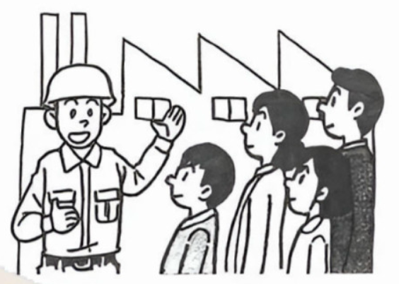
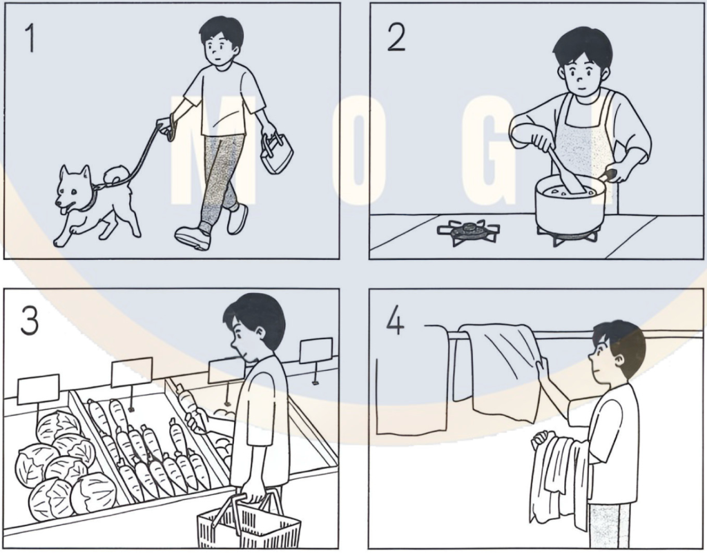
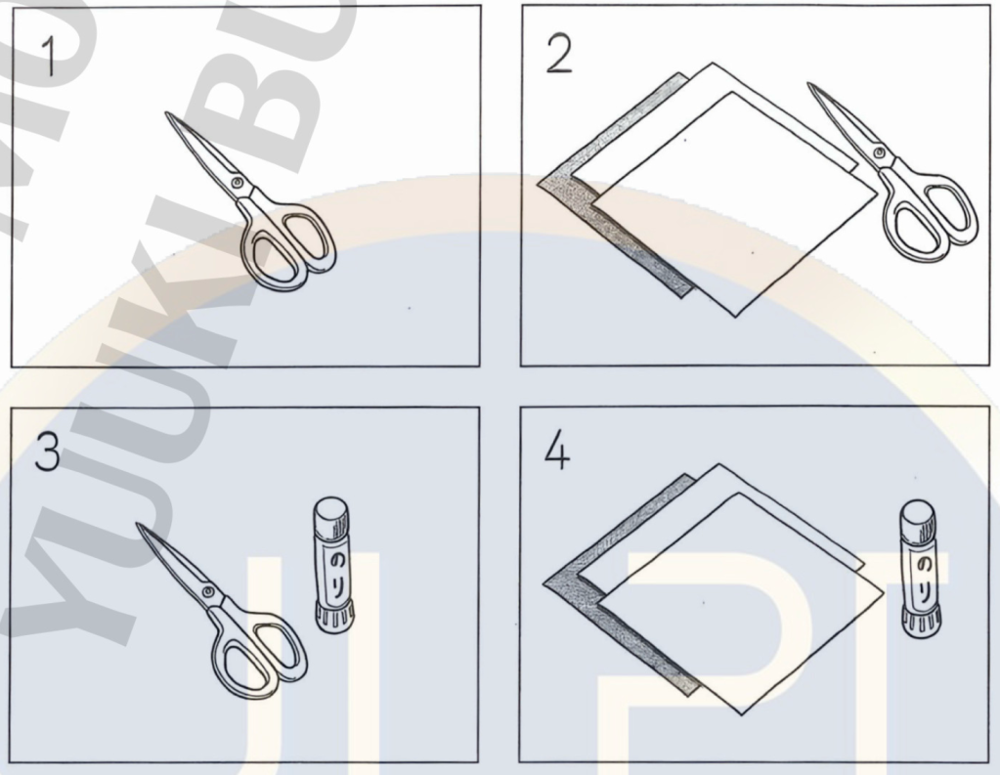
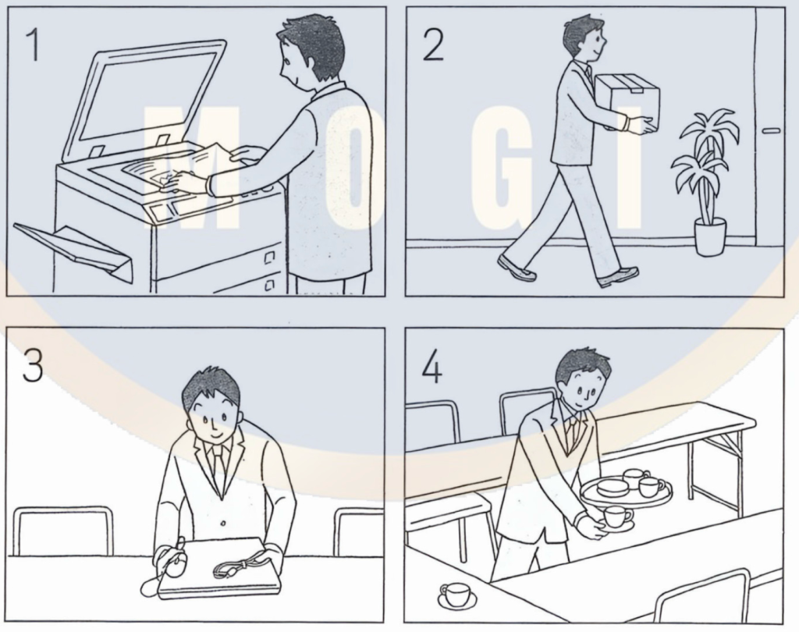
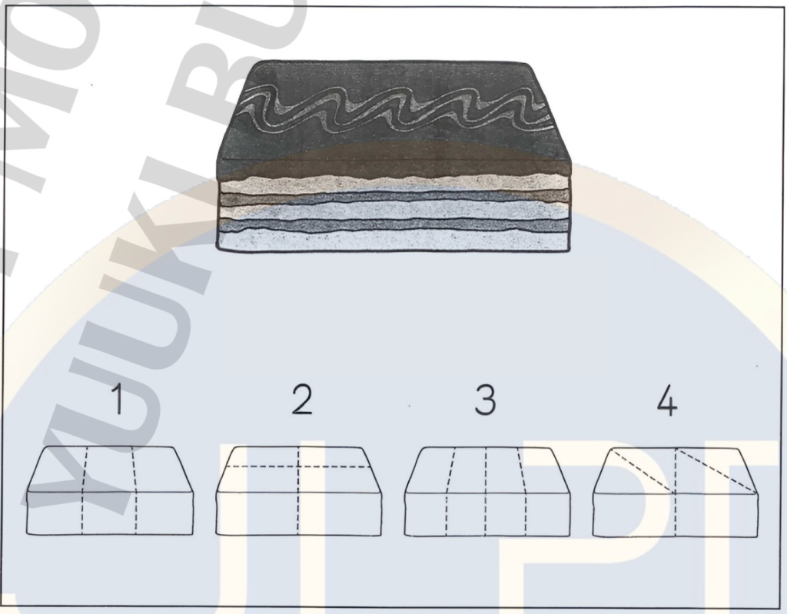
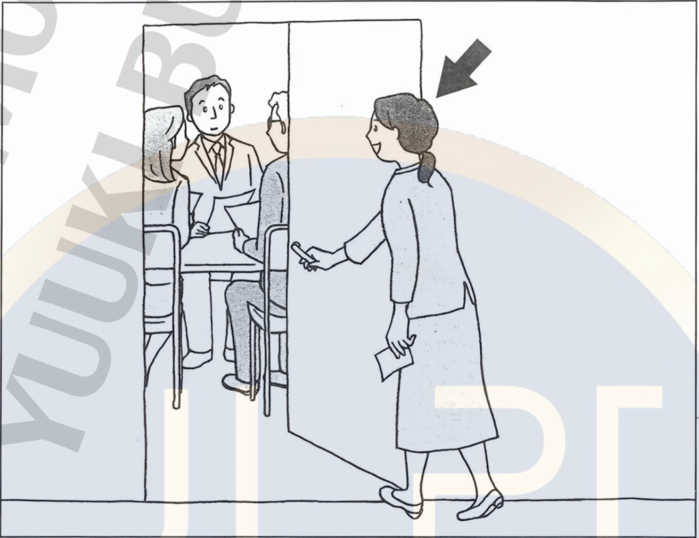
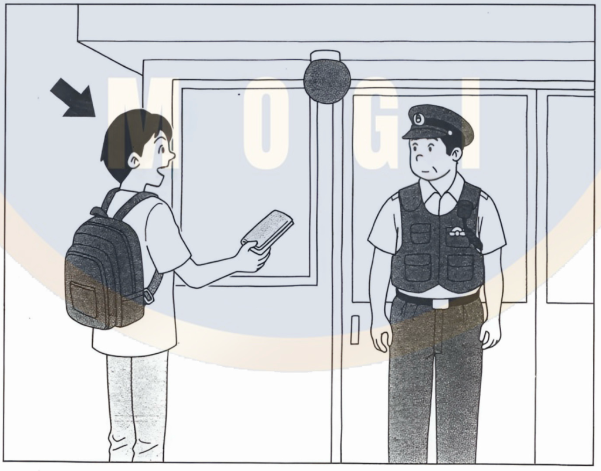
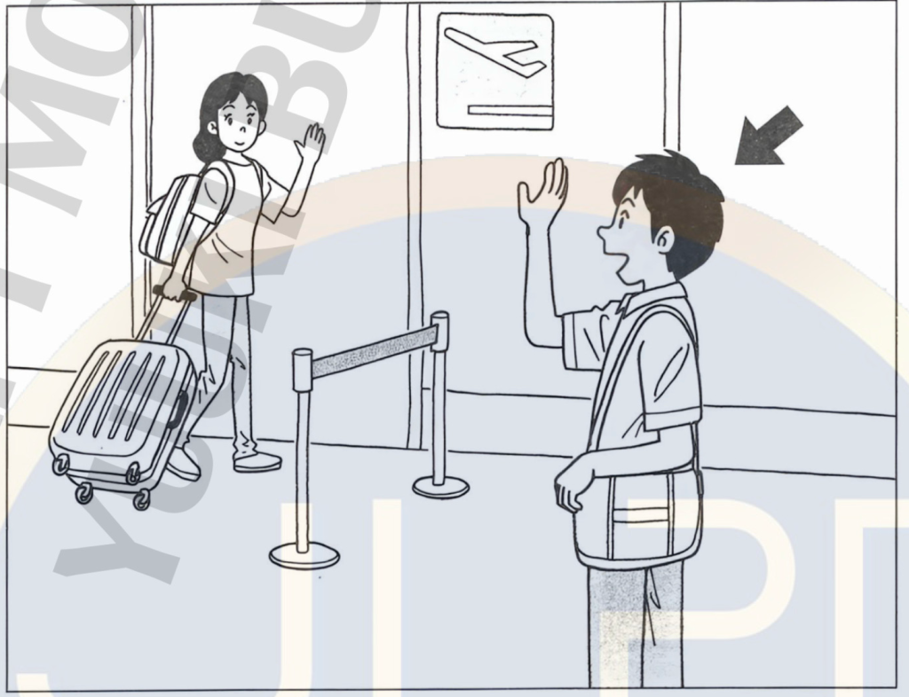
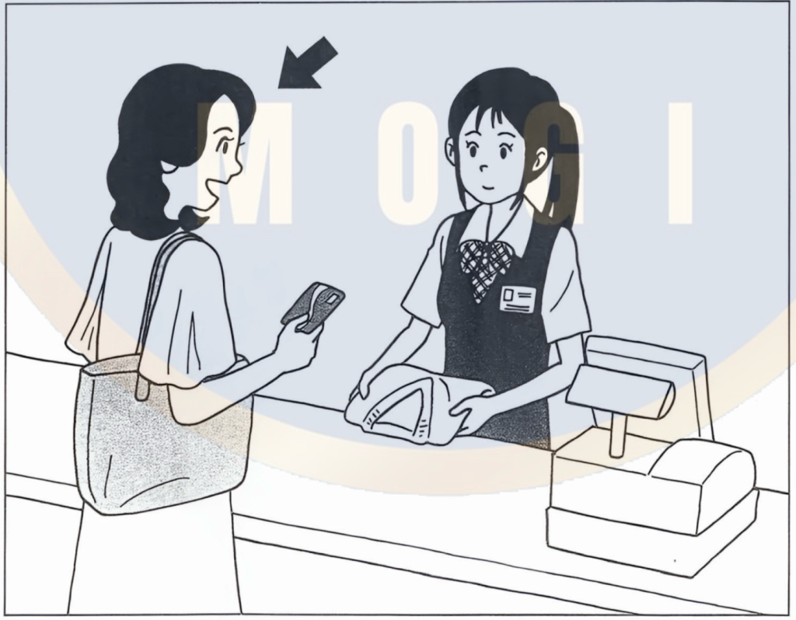
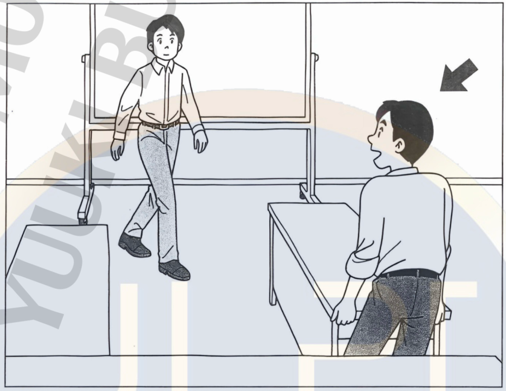

# JLPT N4 Mock Test – December 2024

## げんごちしき（もじ・ごい）

### もんだい１: Kanji Reading

> もんだい１　____の　ことばは　ひらがなで　どう　かきますか。1・2・3・4から　いちばん　いい　ものを　ひとつ　えらんで　ください。

#### Question 1

いえの　前で　<u>工事</u>を　して　います。

1. **こうじ**
2. こうごと
3. こじ
4. こごと

**Correct answer:** 1. こうじ

**Correct Answer**

Answer 1: こうじ is correct.

**Question Translation**

「いえの　前で　工事を　して　います。」
→ "They are doing construction in front of the house."

**Explanation**

The kanji **工事** means "construction" or "roadwork" and is read **こうじ**. In this sentence it describes the work being done in front of the house, so こうじ is the only natural reading.

**Other Options**

2. こうごと – Not a standard word or reading for 工事, so it is incorrect.
3. こじ – Can be a reading for other words such as 孤児 (or 故事), but it does not match the kanji **工事** or the meaning "construction".
4. こごと – Usually written **小言(こごと)** and means "scolding" or "complaint", which has different kanji and meaning from 工事.

#### Question 2

すずきさんは　そっちを　<u>持って</u>　ください。

1. はって
2. かぶって
3. **もって**
4. ひろって

**Correct answer:** 3. もって

**Correct Answer**

Answer 3: もって is correct.

**Question Translation**

「すずきさんは　そっちを　持って　ください。」
→ "Mr./Ms. Suzuki, please hold that side."

**Explanation**

The kanji **持つ** means "to hold" or "to carry". Its -て form is **持って(もって)**. In this sentence, 持ってください is a request form meaning "please hold/carry it", so もって is the correct reading.

**Other Options**

1. はって – Usually from **貼る/張る(はる)** meaning "to stick" or "to stretch", not "to hold".
2. かぶって – From **かぶる**, meaning "to put on (one's head)" or "to cover", not 持つ.
4. ひろって – From **拾う(ひろう)** meaning "to pick up (from the ground)", which has different kanji and meaning.

#### Question 3

おふろで　子どもの　<u>体</u>を　あらいます。

1. **からだ**
2. かお
3. あたま
4. かみ

**Correct answer:** 1. からだ

**Correct Answer**

Answer 1: からだ is correct.

**Question Translation**

「おふろで　子どもの　体を　あらいます。」
→ "I wash my child's body in the bath."

**Explanation**

The kanji **体** is read **からだ** and means "body". Here it clearly refers to washing the child's whole body, so からだ is the correct reading.

**Other Options**

2. かお – Usually written **顔(かお)** and means "face", which is only one part of the body and uses different kanji.
3. あたま – Written **頭(あたま)** and means "head", not the whole body.
4. かみ – Written **髪(かみ)** when it means "hair"; this also does not match the kanji 体 or the meaning here.

#### Question 4

来月　<u>入院</u>する　ことに　なりました。

1. りゅうえん
2. りゅういん
3. にゅうえん
4. **にゅういん**

**Correct answer:** 4. にゅういん

**Correct Answer**

Answer 4: にゅういん is correct.

**Question Translation**

「来月　入院する　ことに　なりました。」
→ "It has been decided that I will be hospitalized next month."

**Explanation**

The word **入院** means "hospitalization" or "to be admitted to a hospital" and is read **にゅういん**. In this sentence, 入院する clearly describes going into the hospital, so にゅういん is the correct reading.

**Other Options**

1. りゅうえん – Not a common reading for 入院 and not a standard word in this context.
2. りゅういん – Also not a standard word or reading for these kanji.
3. にゅうえん – Could be a reading for other kanji like 入園, but that means "entering a kindergarten/park", not "hospitalization", and it does not match 入院.

#### Question 5

この　アパートの　ほうが　少し　<u>広い</u>です。

1. ちかい
2. せまい
3. **ひろい**
4. とおい

**Correct answer:** 3. ひろい

**Correct Answer**

Answer 3: ひろい is correct.

**Question Translation**

「この　アパートの　ほうが　少し　広いです。」
→ "This apartment is a little more spacious."

**Explanation**

The kanji **広い** is read **ひろい** and means "spacious" or "wide". Since the sentence compares apartments by size, 広い (ひろい) is the correct reading.

**Other Options**

1. ちかい – Written **近い(ちかい)**, meaning "near"; it does not match the kanji 広.
2. せまい – Written **狭い(せまい)**, meaning "narrow" or "cramped", which is the opposite meaning of 広い.
4. とおい – Written **遠い(とおい)**, meaning "far"; again, the kanji and meaning are different from 広い.

#### Question 6

もう　<u>考えましたか</u>。

1. こたえました
2. **かんがえました**
3. おぼえました
4. かえました

**Correct answer:** 2. かんがえました

**Correct Answer**

Answer 2: かんがえました is correct.

**Question Translation**

「もう　考えましたか。」
→ "Have you already thought about it?" / "Have you decided yet?"

**Explanation**

The verb **考える(かんがえる)** means "to think" or "to consider". Its past tense is **考えました(かんがえました)**. This fits the question asking whether someone has already thought about or considered something.

**Other Options**

1. こたえました – From **答える(こたえる)**, meaning "to answer". The kanji would be 答えました, not 考えました.
3. おぼえました – From **覚える(おぼえる)**, meaning "to memorize" or "to remember"; it uses the kanji 覚, not 考.
4. かえました – Could be from **変える/替える(かえる)** meaning "to change", or **買える(かえる)** meaning "can buy"; neither matches 考え or the meaning of the sentence.

#### Question 7

わたしは　<u>親指</u>が　みじかいんです。

1. しんゆび
2. **おやゆび**
3. おやよび
4. しんよび

**Correct answer:** 2. おやゆび

**Correct Answer**

Answer 2: おやゆび is correct.

**Question Translation**

「わたしは　親指が　みじかいんです。」
→ "My thumbs are short."

**Explanation**

The word **親指** means "thumb" and is read **おやゆび**. 親 literally means "parent" and 指 means "finger", so together they describe the "main" or "parent" finger, the thumb.

**Other Options**

1. しんゆび – Not a standard reading or word for 親指.
3. おやよび – Not a correct reading; it does not exist as a natural word.
4. しんよび – Also not a correct reading or common word for these kanji.

### もんだい2: Orthography

> もんだい2　_____の　ことばは　どう　かきますか。1・2・3・4から　いちばん　いい ものを　ひとつ　えらんで　ください。

#### Question 8

今日は　<u>さむい</u>ですね。

1. 冬い
2. 暑い
3. 夏い
4. **寒い**

**Correct answer:** 4. 寒い

**Correct Answer**

Answer 4: 寒い is correct. It means "cold" (temperature).

**Question Translation**

「今日は　さむいですね。」
→ "It is cold today, isn't it?"

**Explanation**

The word さむい meaning "cold" (weather, air temperature) is correctly written with the kanji **寒い**. In this sentence the speaker is talking about today's temperature, so 寒い fits both the reading and the meaning.

**Why Other Options Are Incorrect**

1. 冬い – Literally "winter-ish", but **冬い** is not a standard Japanese word; ふゆ is usually written 冬 (noun), not used as an adjective like this.
2. 暑い – **暑い(あつい)** means "hot" (weather). This is the opposite of さむい and does not match the sentence.
3. 夏い – Literally "summer-ish", but **夏い** is not a standard word; なつ is usually written 夏 (noun), not as an adjective.

#### Question 9

日本は　今　<u>あさ</u>です。

1. 夕
2. **朝**
3. 昼
4. 夜

**Correct answer:** 2. 朝

**Correct Answer**

Answer 2: 朝 is correct. It means "morning".

**Question Translation**

「日本は　今　あさです。」
→ "It is morning in Japan now."

**Explanation**

The word あさ meaning "morning" is correctly written with the kanji **朝**. The sentence is talking about the current time of day in Japan, so 朝 is the right choice.

**Why Other Options Are Incorrect**

1. 夕 – Read ゆう, meaning "evening"; this does not match the reading あさ or the meaning "morning".
3. 昼 – Read ひる, meaning "noon" or "daytime"; the reading and meaning are different.
4. 夜 – Read よる, meaning "night"; again, this does not match あさ (morning).

#### Question 10

はやしさんの　<u>せつめい</u>は　わかりやすかったです。

1. 設名
2. 説名
3. 設明
4. **説明**

**Correct answer:** 4. 説明

**Correct Answer**

Answer 4: 説明 is correct. It means "explanation".

**Question Translation**

「はやしさんの　せつめいは　わかりやすかったです。」
→ "Mr./Ms. Hayashi's explanation was easy to understand."

**Explanation**

The noun せつめい meaning "explanation" or "description" is correctly written **説明** (説: explanation, 明: clear). In this sentence, 説明 naturally fits with わかりやすかった (was easy to understand).

**Why Other Options Are Incorrect**

1. 設名 – 設 means "establish" or "set up", and 名 means "name"; 設名 is not a standard Japanese word.
2. 説名 – Although the kanji are 説 (explain) and 名 (name), 説名 is not a standard word for "explanation".
3. 設明 – Also not a standard word; 設 (set up) + 明 (bright/clear) does not make the usual word せつめい.

#### Question 11

今、<u>くうこう</u>に　います。

1. **空港**
2. 銀行
3. 空行
4. 銀港

**Correct answer:** 1. 空港

**Correct Answer**

Answer 1: 空港 is correct. It means "airport".

**Question Translation**

「今、くうこうに　います。」
→ "I am at the airport now."

**Explanation**

The word くうこう meaning "airport" is correctly written **空港** (空: sky, 港: port). This matches the reading and the context of being at a place where planes arrive and depart.

**Why Other Options Are Incorrect**

2. 銀行 – Read ぎんこう, meaning "bank" (financial institution). The reading is different from くうこう and the meaning is different from "airport".
3. 空行 – Literally "empty line" or "blank line"; this combination is not used to mean "airport".
4. 銀港 – Literally "silver port"; this is not a standard word in Japanese.

#### Question 12

天気の　いい　日は　えきまで　<u>はしって</u>　います。

1. 徒って
2. 歩って
3. **走って**
4. 拐って

**Correct answer:** 3. 走って

**Correct Answer**

Answer 3: 走って is correct. It means "running" (te-form of "to run").

**Question Translation**

「天気の　いい　日は　えきまで　はしって　います。」
→ "On days with good weather, I run to the station."

**Explanation**

The verb はしる "to run" is written **走る**, so the -て form "はしって" should be written **走って**. This matches the idea of moving quickly to the station by running.

**Why Other Options Are Incorrect**

1. 徒って – 徒 is used in words like 徒歩(とほ, on foot), but 徒って as a verb form is not used and does not match はしって.
2. 歩って – 歩 is from 歩く(あるく, to walk), but 歩って is not the correct て-form; it should be 歩いて. Also, the reading はしって is for 走って, not 歩って.
4. 拐って – From 拐う(さらう/かどわかす, to kidnap or abduct). This has a completely different meaning and is not read はしって.

### もんだい３: Contextually-defined Expressions

> もんだい３　(　　　)に　なにを　いれますか。1・2・3・4から　いちばん　いい　ものを ひとつ　えらんで　ください。

#### Question 13

この　レストランには　日本語の（　　　）しか　ないので、どんな　りょうりか　わかりません。

1. レシート
2. アルバム
3. チップ
4. **メニュー**

**Correct answer:** 4. メニュー

**Correct Answer**

Answer 4: メニュー is correct. It means "menu".

**Question Translation**

「この　レストランには　日本語の（　　　）しか　ないので、どんな　りょうりか　わかりません。」
→ "This restaurant only has a Japanese ( ), so I do not know what kind of dishes they have."

**Explanation**

In a restaurant, the thing that shows the list of dishes is a **menu**, so メニュー is the natural word. If the menu is only in Japanese, a person who cannot read Japanese will not understand what dishes there are.

**Why Other Options Are Incorrect**

1. レシート – "receipt"; you receive this after paying, not when choosing dishes.
2. アルバム – "album"; usually for photos or music, not for ordering food.
3. チップ – "tip"; money given as a gratuity, not something that explains what dishes there are.

#### Question 14

テストが　あるので、じゅぎょうで　ならった　ことばを（　　　）します。

1. よしゅう
2. **ふくしゅう**
3. けんがく
4. けんぶつ

**Correct answer:** 2. ふくしゅう

**Correct Answer**

Answer 2: ふくしゅう is correct. It means "review" (to study something again).

**Question Translation**

「テストが　あるので、じゅぎょうで　ならった　ことばを（　　　）します。」
→ "Because there is a test, I will ( ) the words I learned in class."

**Explanation**

Before a test, you usually **review** what you learned. The word for "review (study again)" is **復習(ふくしゅう)**, so ふくしゅうします is correct.

**Why Other Options Are Incorrect**

1. よしゅう – **予習(よしゅう)** means "preparation" or "studying something before class", not reviewing after you already learned it.
3. けんがく – **見学(けんがく)** means "study visit" or "observation" (e.g., a factory tour). It is not about reviewing vocabulary.
4. けんぶつ – **見物(けんぶつ)** means "sightseeing" or "watching" something for fun, not studying for a test.

#### Question 15

その　まどは　われて　いて　あぶないので、（　　　）ください。

1. つかまえないで
2. なげないで
3. **さわらないで**
4. つつまないで

**Correct answer:** 3. さわらないで

**Correct Answer**

Answer 3: さわらないで is correct. It means "do not touch".

**Question Translation**

「その　まどは　われて　いて　あぶないので、（　　　）ください。」
→ "That window is broken and dangerous, so please ( )."

**Explanation**

When something is broken and dangerous (like broken glass), the natural instruction is "Please **do not touch** it." So **さわらないでください** fits the context.

**Why Other Options Are Incorrect**

1. つかまえないで – "Please do not catch (it)." Used for catching animals or people, not windows.
2. なげないで – "Please do not throw (it)." This does not match the idea that the window is already broken and dangerous.
4. つつまないで – "Please do not wrap (it)." Wrapping something is not the main danger; the problem is touching the broken glass.

#### Question 16

わたしと　おとうとは、あそんで　いる　ときに（　　　）を　して、母に　しかられました。

1. **けんか**
2. そうだん
3. かいわ
4. あいさつ

**Correct answer:** 1. けんか

**Correct Answer**

Answer 1: けんか is correct. It means "fight" or "quarrel".

**Question Translation**

「わたしと　おとうとは、あそんで　いる　ときに（　　　）を　して、母に　しかられました。」
→ "My younger brother and I got into a ( ) while we were playing and were scolded by our mother."

**Explanation**

Children who are playing sometimes get into a **fight** or **argument**, and then an adult scolds them. The word **けんか(喧嘩)** fits this situation perfectly.

**Why Other Options Are Incorrect**

2. そうだん – **相談(そうだん)** means "consultation" or "discussion" to get advice, which is not a reason to be scolded.
3. かいわ – **会話(かいわ)** means "conversation"; just talking while playing is normal and not something to be scolded for.
4. あいさつ – **あいさつ** means "greeting"; we do not usually get scolded for greeting someone.

#### Question 17

こんばん　どこで　しょくじを　するか（　　　）。

1. **きめましょう**
2. はいりましょう
3. はらいましょう
4. さそいましょう

**Correct answer:** 1. きめましょう

**Correct Answer**

Answer 1: きめましょう is correct. It means "let's decide".

**Question Translation**

「こんばん　どこで　しょくじを　するか（　　　）。」
→ "Let's ( ) where to have a meal tonight."

**Explanation**

When talking about choosing a place to eat, you say "let's decide where". So **決めましょう(きめましょう)**, the volitional form of 決める "to decide", is natural.

**Why Other Options Are Incorrect**

2. はいりましょう – "let's go in / enter"; you enter a restaurant after you have already decided where to go.
3. はらいましょう – "let's pay"; you pay after eating, not before deciding the place.
4. さそいましょう – "let's invite"; inviting someone is different from deciding the place.

#### Question 18

いいと　おもうか、よくないと　おもうか、じぶんの　いけんを（　　　）言って　ください。

1. たいてい
2. ちょうど
3. **はっきり**
4. けっこう

**Correct answer:** 3. はっきり

**Correct Answer**

Answer 3: はっきり is correct. It means "clearly".

**Question Translation**

「いいと　おもうか、よくないと　おもうか、じぶんの　いけんを（　　　）言って　ください。」
→ "Whether you think it is good or not good, please say your own opinion ( )."

**Explanation**

The speaker wants the listener to say their opinion **clearly**, without being vague. The adverb **はっきり** means "clearly, distinctly", so はっきり言ってください is a common and natural expression.

**Why Other Options Are Incorrect**

1. たいてい – "usually" or "generally"; it describes frequency, not the manner of speaking.
2. ちょうど – "exactly" or "just" (in amount, time, etc.); it does not describe how clearly you speak.
4. けっこう – "fine", "pretty (good)", or "no, thank you" depending on context; it does not fit before 言って in this meaning.

#### Question 19

となりの　うちの　犬は　とても　大きいので、ちょっと（　　　）です。

1. ぬるい
2. **こわい**
3. かゆい
4. ひどい

**Correct answer:** 2. こわい

**Correct Answer**

Answer 2: こわい is correct. It means "scary" or "frightening".

**Question Translation**

「となりの　うちの　犬は　とても　大きいので、ちょっと（　　　）です。」
→ "The neighbor's dog is very big, so it is a little ( )."

**Explanation**

A very large dog can be a bit **scary**. The adjective **こわい** means "scary" or "frightening", which matches the feeling described here.

**Why Other Options Are Incorrect**

1. ぬるい – "lukewarm"; used for temperature of water, drinks, etc., not for a dog.
3. かゆい – "itchy"; describes a physical sensation on your skin, not your feeling toward a dog.
4. ひどい – "awful" or "terrible"; can describe bad situations or behavior, but here the natural emotion is "scary", not "terrible".

#### Question 20

その　日は（　　　）が　わるいので、行けません。

1. りゆう
2. かんけい
3. きょうみ
4. **つごう**

**Correct answer:** 4. つごう

**Correct Answer**

Answer 4: つごう is correct. It means "(personal) convenience" or "schedule".

**Question Translation**

「その　日は（　　　）が　わるいので、行けません。」
→ "I cannot go that day because my ( ) is bad."

**Explanation**

When talking about whether a date or time works for you, you use **都合(つごう)**, meaning "one's convenience" or "schedule circumstances". 都合が悪い means "it is inconvenient" or "that day does not work for me".

**Why Other Options Are Incorrect**

1. りゆう – **理由(りゆう)** means "reason". You might have a reason, but the set phrase is 都合が悪い, not 理由が悪い.
2. かんけい – **関係(かんけい)** means "relation" or "connection"; 関係が悪い usually refers to a bad relationship between people, not to scheduling.
3. きょうみ – **興味(きょうみ)** means "interest"; having or not having interest is different from being able to go that day.

### もんだい４: Paraphrases

> もんだい４　_____の　ぶんと　だいたい　おなじ　いみの　ぶんが　あります。1・2・3・4から　いちばん　いい　ものを　ひとつ　えらんで　ください。

#### Question 21

<u>これは　とても　だいじな　ものです。</u>

1. これは　とても　よい　ものです。
2. これは　とても　ゆうめいな　ものです。
3. これは　とても　たかい　ものです。
4. **これは　とても　たいせつな　ものです。**

**Correct answer:** 4. これは　とても　たいせつな　ものです。

**Correct Answer**

Answer 4 is correct. It means "This is a very important thing." (using a synonym).

**Question Translation**

「これは　とても　だいじな　ものです。」
→ "This is a very important thing."

**Explanation**

The word **だいじな** means "important" or "precious". The expression **たいせつな** also means "important" or "precious", so sentence 4 keeps the same meaning with different wording.

**Why Other Options Are Incorrect**

1. これは　とても　よい　ものです。– "This is a very good thing." This talks about quality (good) rather than importance.
2. これは　とても　ゆうめいな　ものです。– "This is a very famous thing." Being famous is different from being important.
3. これは　とても　たかい　ものです。– "This is a very expensive thing." Price (expensive) is not the same as importance.

#### Question 22

<u>そふは　よろこんで　いました。</u>

1. そふは　げんきそうでした。
2. **そふは　うれしそうでした。**
3. そふは　いそがしそうでした。
4. そふは　つまらなそうでした。

**Correct answer:** 2. そふは　うれしそうでした。

**Correct Answer**

Answer 2 is correct. It means "Grandfather looked happy."

**Question Translation**

「そふは　よろこんで　いました。」
→ "Grandfather was pleased / happy."

**Explanation**

The verb **よろこぶ** means "to be glad" or "to be pleased". よろこんでいました shows a state of happiness. Sentence 2, うれしそうでした ("looked happy"), expresses almost the same meaning in a paraphrased form.

**Why Other Options Are Incorrect**

1. そふは　げんきそうでした。– "Grandfather looked healthy/energetic." This focuses on his physical condition, not his happiness.
3. そふは　いそがしそうでした。– "Grandfather looked busy." Busy is unrelated to the meaning of よろこんでいました.
4. そふは　つまらなそうでした。– "Grandfather looked bored." This has the opposite nuance to being pleased.

#### Question 23

<u>あすの　ほうが　いいです。</u>

1. **あしたの　ほうが　いいです。**
2. あさっての　ほうが　いいです。
3. ひるの　ほうが　いいです。
4. よるの　ほうが　いいです。

**Correct answer:** 1. あしたの　ほうが　いいです。

**Correct Answer**

Answer 1 is correct. It means "Tomorrow is better." using another word for "tomorrow".

**Question Translation**

「あすの　ほうが　いいです。」
→ "Tomorrow is better." / "I prefer tomorrow."

**Explanation**

The word **あす** is a more formal way to say "tomorrow". **あした** is the everyday casual word for "tomorrow". So sentence 1, あしたのほうがいいです, has the same meaning.

**Why Other Options Are Incorrect**

2. あさっての　ほうが　いいです。– "The day after tomorrow is better." This changes the day from tomorrow to the day after tomorrow.
3. ひるの　ほうが　いいです。– "Noon is better." This talks about time of day, not the next day.
4. よるの　ほうが　いいです。– "Night is better." This also changes the meaning to time of day instead of which day.

#### Question 24

<u>たなかさんに　おれいを　言いました。</u>

1. たなかさんに　「おめでとう」と　言いました。
2. たなかさんに　「ごめんなさい」と　言いました。
3. **たなかさんに　「ありがとう」と　言いました。**
4. たなかさんに　「はじめまして」と　言いました。

**Correct answer:** 3. たなかさんに　「ありがとう」と　言いました。

**Correct Answer**

Answer 3 is correct. It means "I said 'thank you' to Mr./Ms. Tanaka."

**Question Translation**

「たなかさんに　おれいを　言いました。」
→ "I expressed my thanks to Mr./Ms. Tanaka."

**Explanation**

The noun **おれい** means "thanks" or "expression of gratitude". Saying おれいを言いました to someone usually means you said **ありがとう** to them. So sentence 3 is the natural paraphrase.

**Why Other Options Are Incorrect**

1. たなかさんに　「おめでとう」と　言いました。– "I said 'Congratulations' to Mr./Ms. Tanaka." おめでとう expresses congratulations, not thanks.
2. たなかさんに　「ごめんなさい」と　言いました。– "I said 'I'm sorry' to Mr./Ms. Tanaka." This is an apology, not gratitude.
4. たなかさんに　「はじめまして」と　言いました。– "I said 'Nice to meet you' to Mr./Ms. Tanaka." This is used when you first meet someone, not for saying thanks.

### もんだい5: Usage

> もんだい5　つぎの　ことばの　つかいかたで　いちばん　いい　ものを 1・2・3・4から ひとつ　えらんで　ください。

#### Question 25

こしょう

1. **この　せんたくきは　<u>こしょう</u>して　いますから、つかえません。**
2. めがねを　おとしたら、<u>こしょう</u>しました。
3. 子どもの　シャツが　<u>こしょう</u>したので、なおしました。
4. 食べすぎて、おなかを　<u>こしょう</u>して　しまいました。

**Correct answer:** 1. この　せんたくきは　<u>こしょう</u>して　いますから、つかえません。

**Correct Answer**

Answer 1 is correct.

**Word Translation**

こしょう（故障） — breakdown, malfunction (mainly for machines or equipment)

**Correct Sentence Translation**

この　せんたくきは　こしょうして　いますから、つかえません。
→ "This washing machine is broken, so it cannot be used."

**Explanation**

故障する is most commonly used for **machines, devices, or equipment** that stop working properly (cars, computers, washing machines, etc.). A washing machine that cannot be used because it is broken is a textbook example of 故障, so sentence 1 is the only fully natural and standard usage.

**Other Options**

2. めがねを　おとしたら、こしょうしました。
→ "When I dropped my glasses, they had a breakdown."
🔶 Unnatural usage
For glasses, Japanese normally says こわれました (broke) rather than こしょうしました. 故障 is not usually used for simple items like glasses.

3. 子どもの　シャツが　こしょうしたので、なおしました。
→ "My child's shirt had a breakdown, so I fixed it."
❌ Incorrect usage
Clothes do not "malfunction"; they might tear or get dirty. Natural expressions would be やぶれた (tore) or よごれた (got dirty), not こしょうした.

4. 食べすぎて、おなかを　こしょうして　しまいました。
→ "I overate and caused my stomach to have a breakdown."
🔶 Very unnatural in everyday Japanese
Although 故障 can sometimes be used metaphorically for body parts in sports/medical contexts, the common everyday expression after eating too much is **おなかをこわしました** (upset my stomach), not おなかをこしょうしました.

**Usage Note**

故障する is best remembered as "to break down (for machines/equipment)". For fragile objects like glasses or clothes, use こわれる or やぶれる; for stomach/body, use こわす/こわす・こわす expressions instead.

#### Question 26

けしき

1. この　たてものは、<u>けしき</u>は　ふるいですが、中は　きれいです。
2. この　店の　ケーキは、おいしくて　<u>けしき</u>も　かわいいです。
3. **この　まちは　山も　うみも　あって、<u>けしき</u>が　きれいです。**
4. きむらさんの　きょうだいは　<u>けしき</u>が　にて　います。

**Correct answer:** 3. この　まちは　山も　うみも　あって、<u>けしき</u>が　きれいです。

**Correct Answer**

Answer 3 is correct.

**Word Translation**

けしき（景色） — scenery, landscape, view

**Correct Sentence Translation**

この　まちは　山も　うみも　あって、けしきが　きれいです。
→ "This town has both mountains and sea, and the scenery is beautiful."

**Explanation**

景色 refers to the **natural view or landscape** you can see in a place — mountains, sea, town views, etc. A town with mountains and sea giving a beautiful view is exactly the situation where 景色 is used, so sentence 3 is correct and natural.

**Other Options**

1. この　たてものは、けしきは　ふるいですが、中は　きれいです。
→ "This building's けしき is old, but the inside is clean."
❌ Incorrect usage
For a building, you would talk about 見た目 (appearance), デザイン (design), or たてものじたい being old. 景色 is not used for the appearance of the building itself.

2. この　店の　ケーキは、おいしくて　けしきも　かわいいです。
→ "The cakes at this shop are delicious, and their けしき is also cute."
❌ Incorrect usage
Cakes do not have "scenery". You would say かたち (shape), デザイン, or 見た目がかわいい, not 景色.

4. きむらさんの　きょうだいは　けしきが　にて　います。
→ "Kimura's siblings' けしき is similar."
❌ Incorrect usage
For people looking similar, you say 顔がにている (their faces look alike) or かお立ちがにている. 景色 is never used for a person's face.

#### Question 27

そだてる

1. この　ほんだなは　じぶんで　<u>そだてました</u>。
2. 休みの　日は　よく　子どもと　ケーキを　<u>そだてます</u>。
3. としょかんで　じゅぎょうの　しゅくだいの　レポートを　<u>そだてます</u>。
4. **わたしは　にわで　いろいろな　花を　<u>そだてて</u>　います。**

**Correct answer:** 4. わたしは　にわで　いろいろな　花を　<u>そだてて</u>　います。

**Correct Answer**

Answer 4 is correct.

**Word Translation**

そだてる（育てる） — to raise, to bring up, to grow (plants/animals/children)

**Correct Sentence Translation**

わたしは　にわで　いろいろな　花を　そだてて　います。
→ "I grow various kinds of flowers in my garden."

**Explanation**

育てる is used when you **nurture living things** — children, animals, or plants. Growing flowers in your garden is a perfect example of 育てる, so sentence 4 is the only natural choice.

**Other Options**

1. この　ほんだなは　じぶんで　そだてました。
→ "I そだてました this bookshelf myself."
❌ Incorrect usage
A bookshelf is not a living thing. You would say 作りました (made it) or 組み立てました (assembled it), not 育てました.

2. 休みの　日は　よく　子どもと　ケーキを　そだてます。
→ "On my days off, I often そだてます cakes with my child."
❌ Incorrect usage
Cakes are made, not raised. The correct verb is 作ります (make/bake), not 育てます.

3. としょかんで　じゅぎょうの　しゅくだいの　レポートを　そだてます。
→ "I そだてます my homework report for class at the library."
❌ Incorrect usage
Reports are written or prepared: レポートを書きます or 作ります. 育てる is not used for documents.

#### Question 28

ざあざあ

1. 外は　かぜが　<u>ざあざあ</u>　ふいて　いて、うるさいです。
2. **今日は　雨が　<u>ざあざあ</u>　ふって　いるので、出かけたくないです。**
3. こうえんで　<u>ざあざあ</u>　さわいで　いる　人たちが　います。
4. さとうさんの　話を　聞いて、みんな　<u>ざあざあ</u>　わらいました。

**Correct answer:** 2. 今日は　雨が　<u>ざあざあ</u>　ふって　いるので、出かけたくないです。

**Correct Answer**

Answer 2 is correct.

**Word Translation**

ざあざあ — onomatopoeia for heavy rain pouring down

**Correct Sentence Translation**

今日は　雨が　ざあざあ　ふって　いるので、出かけたくないです。
→ "It is raining heavily (pouring) today, so I do not want to go out."

**Explanation**

ざあざあ is a sound word used mainly for **heavy rain pouring down**. In sentence 2, 雨がざあざあふっている matches this meaning perfectly, so this is the correct and natural usage.

**Other Options**

1. 外は　かぜが　ざあざあ　ふいて　いて、うるさいです。
→ "Outside, the wind is ざあざあ blowing and it is noisy."
❌ Incorrect usage
For strong wind, Japanese normally uses びゅうびゅう or ごうごう. ざあざあ is not used for wind.

3. こうえんで　ざあざあ　さわいで　いる　人たちが　います。
→ "There are people ざあざあ making a racket in the park."
❌ Incorrect usage
For noisy people, you would say がやがや or わいわい, not ざあざあ.

4. さとうさんの　話を　聞いて、みんな　ざあざあ　わらいました。
→ "After hearing Mr./Ms. Sato's story, everyone laughed ざあざあ."
❌ Incorrect usage
For loud laughing, words like げらげら or あはは are used. ざあざあ is not used for laughter.

**Usage Note**

ざあざあ is strongly associated with **heavy rain**. Remember the pattern 雨がざあざあ降る as a fixed expression.

## 言語知識（文法）・読解

### もんだい1: Sentential Grammar 1 (Selecting grammar form)

> もんだい1　(　　　) に　何を　入れますか。1・2・3・4から　いちばん　いい　ものを 一つ　えらんで　ください。

#### Question 1

A「今から　サッカーを　しませんか。」

B「すみません、ともだち（　　　）待たせて　いるので、また　今度（こんど）　さそって　ください。」

1. **を**
2. の
3. へ
4. で

**Correct answer:** 1. を

**Explanation**

Correct Answer
Answer 1: を is correct. It makes the phrase ともだちを待たせている, meaning 'I am keeping my friend waiting.'

Question Translation
A: 『今からサッカーをしませんか。』
→ 'How about playing soccer now?'
B: 『すみません、ともだちを待たせているので、また今度さそってください。』
→ 'Sorry, I am keeping my friend waiting, so please invite me again next time.'

Explanation
The verb 待たせる means 'to make someone wait.' The person who is made to wait takes the object marker を: ともだちを待たせている = '(I) am making my friend wait.' This explains why を is needed between ともだち and 待たせている.

Why Other Options Are Incorrect
2. の – 'friend's' (possessive). ともだちの待たせている is ungrammatical and does not form a natural phrase.
3. へ – 'to, toward'. ともだちへ待たせている is not used; へ cannot mark the person who is made to wait.
4. で – 'at, by, with'. ともだちで待たせている does not make sense here; で does not mark the target of 待たせる.

Grammar/Vocabulary Note
待つ (to wait) → 待たせる (to make someone wait) is a causative form. The person who is caused to do the action is usually marked with を or に, but with 待たせる, the pattern ともだちを待たせる is very common and natural.

#### Question 2

（ケーキ屋（や）で）

客「すみません。いちごの　ケーキと、チョコレートの　ケーキを　二つ　（　　　）　ください。」

1. と
2. が
3. **ずつ**
4. など

**Correct answer:** 3. ずつ

**Explanation**

Correct Answer
Answer 3: ずつ is correct. It means 'each' or 'apiece.'

Question Translation
客: 『すみません。いちごのケーキと、チョコレートのケーキを二つずつください。』
→ 'Excuse me. Please give me two strawberry cakes and two chocolate cakes.'

Explanation
The pattern 'AとBを二つずつください' means 'Please give me two of A and two of B.' The word ずつ is used with numbers to show 'each' or 'apiece.'

Why Other Options Are Incorrect
1. と – 'and'. 二つとください is incorrect grammar and does not show the meaning 'each.'
2. が – subject marker 'が'. 二つがください is ungrammatical in this request pattern.
4. など – 'etc., and so on'. 二つなどください sounds strange; など does not fit in a specific order like this.

Grammar/Vocabulary Note
Number + ずつ is a useful pattern: 一人ずつ (one person each), 三枚ずつ (three sheets each), 一つずつ (one each), etc. It often appears in shopping and distribution contexts.

#### Question 3

今日　ともだちと　冬休（ふゆやす）みの　旅行（りょこう）（　　　）そうだんしました。

1. **について**
2. に
3. のほうが
4. が

**Correct answer:** 1. について

**Explanation**

Correct Answer
Answer 1: について is correct. It means 'about' or 'regarding.'

Question Translation
『今日、ともだちと冬休みの旅行についてそうだんしました。』
→ 'Today, I discussed the winter vacation trip with my friend.'

Explanation
The pattern Noun + について means 'about Noun' or 'regarding Noun.' Here, 冬休みの旅行についてそうだんする is 'to consult/discuss about the winter vacation trip.'

Why Other Options Are Incorrect
2. に – 'to, at'. 冬休みの旅行にそうだんしました is unnatural; そうだんする normally takes と (person) and について (topic), not に for the topic.
3. のほうが – 'is more ... than'. 冬休みの旅行のほうがそうだんしました is ungrammatical and does not fit the meaning.
4. が – subject marker 'が'. 冬休みの旅行がそうだんしました is incorrect; the person, not the trip, does the action そうだんする.

Grammar/Vocabulary Note
そうだんする is often used as 'AさんとBについてそうだんする' (to consult with A about B). Remember both the person (と) and the topic (について).

#### Question 4

（会社で）

森（もり）「中村（なかむら）さんを　さがして　いるんですが、どこに　いる（　　　）　わかりますか。」

石川（いしかわ）「すみません、わかりません。」

1. は
2. **か**
3. を
4. が

**Correct answer:** 2. か

**Explanation**

Correct Answer
Answer 2: か is correct. It marks the embedded question 'where (he) is.'

Question Translation
森: 『中村さんをさがしているんですが、どこにいるか分かりますか。』
→ 'I am looking for Nakamura-san. Do you know where he is?'

Explanation
In Japanese, when a question is embedded inside another sentence (like 'Do you know where he is?'), the question part ends with か, not かどうか or the question mark alone. So どこにいるか分かりますか is the natural pattern.

Why Other Options Are Incorrect
1. は – topic marker 'as for'. どこにいるは分かりますか is ungrammatical.
3. を – object marker. どこにいるを分かりますか is incorrect; を cannot mark an embedded question.
4. が – subject marker. どこにいるが分かりますか is not a correct structure for embedded questions.

Grammar/Vocabulary Note
Embedded question pattern: 'Xか知っていますか / 分かりますか / 覚えていますか' = 'Do you know/remember whether X / what X is / where X is.' The verb before か stays in plain form.

#### Question 5

A「外が　うるさいですね。（　　　）音（おと）ですか。」

B「ああ、工事（こうじ）の　音（おと）ですよ。」

1. どの
2. どんな
3. **なんの**
4. なんで

**Correct answer:** 3. なんの

**Explanation**

Correct Answer
Answer 3: なんの is correct. It means 'what kind of / what ...'s.'

Question Translation
A: 『外がうるさいですね。なんの音ですか。』
→ 'It is noisy outside, isn’t it? What noise is that? / What is that sound?'
B: 『ああ、工事の音ですよ。』
→ 'Ah, that is the sound of construction.'

Explanation
When asking 'What kind of sound? / The sound of what?', なんの音 is natural. Here, the answer is 工事の音 (the sound of construction), so asking 'なんの音ですか' fits perfectly.

Why Other Options Are Incorrect
1. どの – 'which (one)'. どの音ですか means 'which sound is it (among several)?', used when choosing from known options, not when asking 'the sound of what.'
2. どんな – 'what kind of'. どんな音ですか is more about the quality of the sound (for example, 'a loud sound, a scary sound'), not its source like 'construction.'
4. なんで – 'why, for what reason'. なんで音ですか is ungrammatical here; なんで is used for reasons, not for asking 'the sound of what.'

Grammar/Vocabulary Note
なんの + noun asks 'what kind of / what ...'s' with focus on type or source. For example: なんの仕事ですか (What kind of job?), なんの料理ですか (What kind of dish / what cuisine?).

#### Question 6

A「足の　けがは　だいじょうぶですか。まだ　痛（いた）いですか。」

B「だいじょうぶです。（　　　）痛く　ありません。」

1. **もう**
2. よく
3. かならず
4. だんだん

**Correct answer:** 1. もう

**Explanation**

Correct Answer
Answer 1: もう is correct. It means 'anymore' in negative sentences or 'already.'

Question Translation
A: 『足のけがはだいじょうぶですか。まだ痛いですか。』
→ 'Is your leg injury okay? Does it still hurt?'
B: 『だいじょうぶです。もう痛くありません。』
→ 'It is okay. It does not hurt anymore.'

Explanation
もう + negative verb often means 'not ~ anymore.' もう痛くありません directly answers まだ痛いですか and means 'It does not hurt anymore.'

Why Other Options Are Incorrect
2. よく – 'well, often'. よく痛くありません is unnatural; よく is not used to modify 痛い in this way.
3. かならず – 'surely, always'. かならず痛くありません is not natural Japanese; かならず normally modifies positive verbs (for example, かならず行きます).
4. だんだん – 'gradually'. だんだん痛くありません is ungrammatical; だんだん is used with changes like だんだん痛くなくなりました (It gradually stopped hurting).

Grammar/Vocabulary Note
まだ vs もう is a common pair:
・まだ痛いです = It still hurts.
・もう痛くありません = It does not hurt anymore.

#### Question 7

雨が　少し　降って　いましたが、駅（えき）から　家（いえ）まで　近（ちか）いので、かさを　（　　　）　帰（かえ）りました。

1. ささなかった
2. ささなくて
3. ささなく
4. **ささないで**

**Correct answer:** 4. ささないで

**Explanation**

Correct Answer
Answer 4: ささないで is correct. It means 'without using (an umbrella).'

Question Translation
『雨が少し降っていましたが、駅から家まで近いので、かさをささないで帰りました。』
→ 'It was raining a little, but since it is close from the station to my house, I went home without using an umbrella.'

Explanation
The pattern Vないで + verb means 'do the second action without doing the first action.' Here, かさをささないで帰りました expresses 'went home without opening/using an umbrella.'

Why Other Options Are Incorrect
1. ささなかった – 'did not use (umbrella)'. かさをささなかった帰りました is ungrammatical; ささなかった needs から or ので, for example, かさをささなかったので帰りました.
2. ささなくて – 'not using and / because (I) did not use'. かさをささなくて帰りました is unnatural; ささなくて usually needs a continuation like かさをささなくてぬれました (I did not use an umbrella, so I got wet).
3. ささなく – plain negative stem. かさをささなく帰りました is incorrect; it must be ささないで or ささずに in this meaning.

Grammar/Vocabulary Note
Vないで and Vずに both mean 'without doing V.' For example, 朝ごはんを食べないで出かけました / 朝ごはんを食べずに出かけました.

#### Question 8

姉（あね）は　赤（あか）ちゃんが　昼寝（ひるね）を（　　　）あいだに、料理（りょうり）を　します。

1. して　いく
2. して　きた
3. **して　いる**
4. して　いた

**Correct answer:** 3. して　いる

**Explanation**

Correct Answer
Answer 3: している is correct. It makes 昼寝をしているあいだに, 'while (the baby) is taking a nap.'

Question Translation
『姉は赤ちゃんが昼寝をしているあいだに、料理をします。』
→ 'My older sister cooks while the baby is taking a nap.'

Explanation
The pattern Vているあいだに means 'while (someone is) doing V.' Here, 赤ちゃんが昼寝をしているあいだに describes the time when the sister cooks.

Why Other Options Are Incorrect
1. していく – 'do and then go' or 'gradually continue doing.' 昼寝をしていくあいだに is not natural here.
2. してきた – 'has done (up to now)'. 昼寝をしてきたあいだに does not match the meaning 'while (the baby) is napping.'
4. していた – 'was doing'. 昼寝をしていたあいだに sounds like a past, completed time frame; the sentence is describing a general habit, so しているあいだに is better.

Grammar/Vocabulary Note
Vているあいだ (に) = 'while doing V.' It often appears with parallel actions: テレビを見ているあいだに寝てしまいました (I fell asleep while watching TV).

#### Question 9

Yホテルは　ペットと　いっしょに（　　　）が　できます。

1. 泊（と）まる
2. **泊（と）まること**
3. 泊（と）まれる
4. 泊（と）まれること

**Correct answer:** 2. 泊（と）まること

**Explanation**

Correct Answer
Answer 2: 泊まること is correct. It makes 泊まることができます, 'can stay.'

Question Translation
『Yホテルはペットといっしょに泊まることができます。』
→ 'At Y Hotel, you can stay together with your pet.'

Explanation
The pattern V辞書形 + ことができます means 'can do V.' Here, 泊まることができます expresses 'it is possible to stay.' 泊まること acts as a noun.

Why Other Options Are Incorrect
1. 泊まる – 'to stay'. 泊まるができます is ungrammatical; ができます needs a noun or こと.
3. 泊まれる – potential form 'can stay'. 泊まれるができます is incorrect; it redundantly combines potential form and ができます.
4. 泊まれること – 'the fact of being able to stay'. 泊まれることができます is unnatural and too heavy; ができます already expresses possibility.

Grammar/Vocabulary Note
Two common patterns for 'can do':
・V辞書形ことができます → 日本語を話すことができます (I can speak Japanese).
・V可能形 → 日本語が話せます (I can speak Japanese). Do not combine these two in one verb phrase.

#### Question 10

（道（みち）で）

A「急（いえ）げば、次（つぎ）の　でんしゃに　間に合いそうだよ。走（はし）ろうか。」

B「（　　　）たぶん　間（ま）に合（あ）わないよ。歩（ある）いて　行かない？」

1. 走（はし）るのに
2. 走（はし）ってから
3. 走（はし）るより
4. **走（はし）っても**

**Correct answer:** 4. 走（はし）っても

**Explanation**

Correct Answer
Answer 4: 走っても is correct. It means 'even if we run.'

Question Translation
A: 『急げば、次の電車に間に合いそうだよ。走ろうか。』
→ 'If we hurry, it looks like we can catch the next train. Shall we run?'
B: 『走ってもたぶん間に合わないよ。歩いて行かない？』
→ 'Even if we run, we probably will not make it. Shall we just walk?'

Explanation
The pattern Vても expresses 'even if V.' 走っても間に合わない means 'even if we run, we will not make it.' This matches the speaker's negative opinion.

Why Other Options Are Incorrect
1. 走るのに – 'although we run / for running'. 走るのにたぶん間に合わないよ is unnatural in this context; のに usually expresses a stronger contradiction.
2. 走ってから – 'after running'. 走ってからたぶん間に合わないよ does not make sense; after running, you should arrive, not 'probably not make it.'
3. 走るより – 'rather than running / more than running'. 走るよりたぶん間に合わないよ is ungrammatical and illogical.

Grammar/Vocabulary Note
Vても is very common for 'even if / even though': 雨が降っても行きます (I will go even if it rains).

#### Question 11

最近（さいきん）、私は　仕事（しごと）が　いそがしくて、なかなか　ともだちと（　　　）。

1. 会える
2. **会えない**
3. 会う
4. 会った

**Correct answer:** 2. 会えない

**Explanation**

Correct Answer
Answer 2: 会えない is correct. It means 'cannot meet.'

Question Translation
『最近、私は仕事がいそがしくて、なかなかともだちと会えない。』
→ 'Recently I have been busy with work, and I can hardly meet my friends.'

Explanation
The phrase なかなか〜ない means 'hardly / not easily.' It must be followed by a negative form. 会えない (cannot meet) fits perfectly, showing that it is difficult to meet friends.

Why Other Options Are Incorrect
1. 会える – 'can meet'. なかなか会える sounds contradictory; なかなか is usually used with negatives.
3. 会う – 'to meet'. なかなか会う is incomplete; it needs ことができない or some negative form.
4. 会った – 'met'. なかなか会った is ungrammatical; a past form cannot follow なかなか in this pattern.

Grammar/Vocabulary Note
なかなか + negative verb: なかなか時間が取れない (I can hardly find time), なかなか眠れない (I can hardly sleep).

#### Question 12

（会社で）

田中（たなか）「林（はやし）さんが　来月（らいげつ）（　　　）よ。」

青木（あおき）「え、そうなんですか。」

1. **けっこんするそうです**
2. けっこんしたことが　あります
3. けっこんしたいです
4. けっこんしようと　思います

**Correct answer:** 1. けっこんするそうです

**Explanation**

Correct Answer
Answer 1: けっこんするそうです is correct. It means 'I heard (he/she) is going to get married.'

Question Translation
田中: 『林さんが来月けっこんするそうですよ。』
→ 'I heard Hayashi-san is getting married next month.'
青木: 『え、そうなんですか。』
→ 'Oh, really?'

Explanation
そうです after the plain form of a verb (けっこんするそうです) expresses reported information: 'I hear that ~' or 'It is said that ~.' This fits the context of sharing news about Hayashi-san.

Why Other Options Are Incorrect
2. けっこんしたことがあります – 'has been married before / has the experience of being married.' This talks about past experience, not a plan for next month.
3. けっこんしたいです – 'wants to get married.' 来月けっこんしたいです sounds like quoting a desire, but the sentence is about a decided event, not just a wish.
4. けっこんしようと思います – 'is thinking of getting married / planning to get married.' 来月けっこんしようと思いますよ is awkward here; also, そうです for reported speech is the standard pattern in this kind of office gossip.

Grammar/Vocabulary Note
Reported information pattern: 普通形 + そうです (not the そうです that means 'looks/seems'). For example, 雨が降るそうです (I heard it will rain), 田中さんは来ないそうです (I heard Tanaka will not come).

#### Question 13

（学校で）

先生「あしたから　漢字（かんじ）の　じゅぎょうが　始（はじ）まるので、漢字（かんじ）の　教科書（きょうかしょ）を（　　　）。」

1. 忘（わす）れないでしょうか
2. 忘（わす）れるかもしれませんよ
3. 忘（わす）れても　しかたないですね
4. **忘（わす）れないように　して　ください**

**Correct answer:** 4. 忘（わす）れないように　して　ください

**Explanation**

Correct Answer
Answer 4: 忘れないようにして ください is correct. It means 'Please try not to forget.'

Question Translation
先生: 『あしたから漢字のじゅぎょうが始まるので、漢字の教科書を忘れないようにしてください。』
→ 'Since kanji class starts tomorrow, please try not to forget your kanji textbook.'

Explanation
Vないようにする means 'to try to avoid doing V / to make sure not to do V.' Adding ください makes it a polite request: 忘れないようにしてください = 'Please make sure not to forget it.' This fits a teacher's instruction to students.

Why Other Options Are Incorrect
1. 忘れないでしょうか – 'I wonder if you will not forget it.' This sounds like the teacher is just wondering, not giving a clear instruction.
2. 忘れるかもしれませんよ – 'You might forget it, you know.' This only warns, but does not tell students what to do.
3. 忘れてもしかたないですね – 'Even if you forget it, it cannot be helped.' This says the opposite of what a teacher wants; it allows forgetting.

Grammar/Vocabulary Note
ようにする is a useful pattern: V辞書形ようにする (try to do V) and Vないようにする (try not to do V). Example: 毎日日本語を勉強するようにしています (I try to study Japanese every day).

### もんだい2: Sentential Grammar 2 (Sentence composition)

> もんだい2　★　に　入る　ものは　どれですか。1・2・3・4から　いちばん　いい　ものを　一つ　えらんで　ください。

#### Question 14

（田中（たなか）さんの　家（いえ）で）

山下（やました）「ねえ、田中（たなか）さんが　＿＿＿ ＿＿＿ ★ ＿＿＿　言う　黒い　虫（むし）が　台所（だいどころ）に　いましたよ。」

田中（たなか）「えっ！」

1. 名前を
2. **のも**
3. 聞く
4. いやだと

**Correct answer:** 2. のも

**Explanation**

Answer (★ Position)
Answer 2: のも is correct.

Correct Order
1 → 3 → 2 → 4
名前を → 聞く → のも ★ → いやだと

Chunk-by-Chunk Breakdown
1. 名前を – 'the name' (object of the verb 聞く).
3. 聞く – 'to ask / to hear.' Together with 1: 名前を聞く = 'to ask (its) name / to hear its name.'
2. のも – nominalises the whole phrase 名前を聞く and adds 'also/even', turning it into 'even the act of hearing its name.'
4. いやだと – 'says (it is) unpleasant / I hate it.' It connects to 言う: いやだと言う = '(she) says it is disgusting / she hates it.'

Reconstructed Sentence
山下: 『ねえ、田中さんが名前を聞くのもいやだと言う黒い虫が台所にいましたよ。』
→ 'Hey, that black bug that Tanaka says she even hates hearing the name of was in the kitchen.'

Why This Order Works
・名前を聞く forms the basic action: 'to hear/ask its name.'
・のも nominalises that action and adds the nuance 'even doing that (is unpleasant).'
・いやだと言う modifies 黒い虫, giving 'the black bug that she says is so disgusting that even hearing its name is unpleasant.'
This exactly describes a very disliked bug in natural Japanese.

#### Question 15

＿＿＿ ＿＿＿ ★ ＿＿＿　が　あるので、図書館（としょかん）へ　行って　きます。

1. 本
2. に
3. **返さないと　いけない**
4. 今日中

**Correct answer:** 3. 返さないと　いけない

**Explanation**

Answer (★ Position)
Answer 3: 返さないといけない is correct.

Correct Order
4 → 2 → 3 → 1
今日中 → に → 返さないといけない ★ → 本

Chunk-by-Chunk Breakdown
4. 今日中 – 'by today / within today.'
2. に – time marker; 今日中に = 'by the end of today.'
3. 返さないといけない – 'must return / have to return.' This is the obligation phrase and is the ★ chunk.
1. 本 – 'book.' It completes the noun phrase: 今日中に返さないといけない本 = 'the book that I have to return by today.'

Reconstructed Sentence
『今日中に返さないといけない本があるので、図書館へ行ってきます。』
→ 'I have a book that I must return by today, so I am going to the library.'

Why This Order Works
・今日中に sets the deadline for the action.
・返さないといけない expresses necessity/obligation.
・本 comes last to create a relative clause: '(the) book that I have to return by today.'
This forms a natural, grammatically correct noun phrase in Japanese.

#### Question 16

妹（いもうと）「ねえ、週末（しゅうまつ）に　お花見（はなみ）に　行かない？」

姉（あね）「いいね。私は　土曜日（どようび）でも　＿＿＿　＿＿＿　★　＿＿＿　いい？」

妹「じゃあ、土曜日（どようび）に　行こうか。」

1. **いいけど**
2. どっちでも
3. 日曜日（にちようび）でも
4. どっちが

**Correct answer:** 1. いいけど

**Explanation**

Answer (★ Position)
Answer 1: いいけど is correct.

Correct Order
3 → 2 → 1 → 4
日曜日でも → どっちでも → いいけど ★ → どっちが

Chunk-by-Chunk Breakdown
3. 日曜日でも – 'even Sunday / Sunday is also okay.' It pairs with 土曜日でも earlier: 土曜日でも日曜日でも.
2. どっちでも – 'either is fine.' Refers to Saturday or Sunday.
1. いいけど – 'is fine, though.' This is the ★ chunk and softens the statement, making it more conversational.
4. どっちが – 'which one' (but here, it is actually the start of the following phrase どっちがいい?, already shown in the question as いい?). Together with the given いい?, it becomes どっちがいい? = 'Which is better?'

Reconstructed Sentence
姉: 『いいね。私は土曜日でも日曜日でもどっちでもいいけど、どっちがいい?』
→ 'Sounds good. For me, Saturday or Sunday, either is fine, but which is better for you?'

Why This Order Works
・土曜日でも日曜日でも sets up two possible days.
・どっちでもいいけど expresses 'either is fine (for me), though.'
・どっちがいい? asks the listener to choose.
This order produces very natural, everyday Japanese for making plans.

#### Question 17

（教室（きょうしつ）で）

先生「来週（らいしゅう）の　じゅぎょうまでに、23ページと　24ページを　読んで、わからない　言葉（ことば）が　＿＿＿　＿＿＿　★　＿＿＿　ください。」

1. 意味（いみ）を
2. あったら
3. おいて
4. **調（しら）べて**

**Correct answer:** 4. 調（しら）べて

**Explanation**

Answer (★ Position)
Answer 4: 調べて is correct.

Correct Order
2 → 1 → 4 → 3
あったら → 意味を → 調べて ★ → おいて

Chunk-by-Chunk Breakdown
2. あったら – 'if there are / if you have.' Refers to わからない言葉 (unknown words).
1. 意味を – 'the meaning' (object of 調べる).
4. 調べて – 'look up / check' in te-form. This is the ★ chunk.
3. おいて – 'in advance / beforehand.' When added to 調べて, 調べておいて means 'look it up ahead of time.'

Reconstructed Sentence
先生: 『来週のじゅぎょうまでに、23ページと24ページを読んで、わからない言葉があったら意味を調べておいてください。』
→ 'By next week’s class, read pages 23 and 24, and if there are any words you do not understand, please look up their meanings in advance.'

Why This Order Works
・わからない言葉があったら sets the condition 'if there are unknown words.'
・意味を調べておいて gives the teacher’s instruction 'look up the meanings beforehand.'
The combination 調べておいてください is a very natural way for a teacher to give homework in Japanese.

### もんだい３: Text Grammar

> もんだい3　[18]　から　[21]　に　何を　入れますか。文章の　意味を　考えて、1・2・3・4から　いちばん　いい　ものを 一つ　えらんで　ください。

下（した）の　文章（ぶんしょう）は、留学生（りゅうがくせい）の　作文（さくぶん）です。

**私が　会いたい人**

コルナリ　エリカ

　私が　会いたい人は、国に　いる　ともだちの　リタと　サラです。二人　[18]　二年前に　国の　大学の　日本語の　クラスで　初めて　会いました。私たちは　みんな　映画が　好きです。それで、いろいろ　話すように　なって、休みの　日は　よく　三人で　映画を　見に　行ったり、食事を　したり　して　いました。ときどき　日本の　映画も　見ました。

　今、私は　東京（とうきょう）に　いるので、リタと　サラに　会えません。でも、冬休（ふゆやす）みに　なれば　会えます。二人が　東京（とうきょう）に　[19]　のです。私は　二人と　いっしょに　映画館（えいがかん）で　映画を　見るつもりです。[20]、私の　好（す）きな　食堂（しょくどう）や　そば屋（や）に　二人を　つれて　いきたいです。

　二人と　いろいろな　所（ところ）に　行ったり、たくさん　話したり　して、冬休（ふゆやす）みを　[21]。

**Passage translation**

The passage below is an essay written by an international student.

**The people I want to meet**

Cornari Erika

The people I want to meet are my friends Rita and Sara, who are in my country. I first met the two of them [18] two years ago in a Japanese class at a university in my country. We all like movies. So we started talking about many things, and on our days off we often went, the three of us, to watch movies and to eat together.
Sometimes we watched Japanese movies too.

Right now I am in Tokyo, so I cannot meet Rita and Sara. But when the winter vacation comes, I will be able to see them. That is because the two of them will [19] to Tokyo. I plan to watch a movie with them at a movie theater. [20] I also want to take them to my favorite cafeteria and soba restaurant.

I want to go to various places with them, talk a lot, and [21] my winter vacation.

#### Question 18

1. より
2. ずつ
3. でも
4. **には**

**Correct answer:** 4. には

**Explanation**

Correct Answer
Answer 4: には is correct. Here, 二人には二年前に〜会いました means 'I met the two (of them) two years ago.'

Question Translation (relevant part)
『私が会いたい人は、国にいるともだちのリタとサラです。二人には二年前に国の大学の日本語のクラスで初めて会いました。』
→ 'The people I want to meet are my friends Rita and Sara who are in my country. I first met the two of them two years ago in a Japanese class at a university in my country.'

Explanation
会う usually takes に to mark the person you meet: 人に会う = 'to meet a person.' Adding は makes that person the topic: 二人には会いました = 'As for the two of them, I met them ...'. Here, 二人には二年前に会いました is a natural way to say 'I met the two two years ago.'

Why Other Options Are Incorrect
1. より – 'than, from'. 二人より二年前に会いました would mean 'I met them two years earlier than the two', which is strange and not the intended meaning.
2. ずつ – 'each, apiece'. 二人ずつ二年前に会いました does not fit the context; the sentence is not about 'two people each.'
3. でも – 'even, or something like'. 二人でも二年前に会いました is unnatural here and does not match the simple meaning 'I met the two (friends) two years ago.'

Grammar/Vocabulary Note
Person + に会う is the basic pattern: 友だちに会う, 先生に会いました. With は added (Person + には), it highlights that person as the topic or contrast: 田中さんには昨日会いましたが、山田さんには会いませんでした.

#### Question 19

1. 来て　もらう
2. **来て　くれる**
3. 行って　きて　もらう
4. 行って　きて　くれる

**Correct answer:** 2. 来て　くれる

**Explanation**

Correct Answer
Answer 2: 来てくれる is correct. It means '(they) will come (to me / for me).'

Question Translation (relevant part)
『今、私は東京にいるので、リタとサラに会えません。でも、冬休みになれば会えます。二人が東京に来てくれるのです。』
→ 'Right now, I am in Tokyo, so I cannot meet Rita and Sara. But when winter vacation comes, I will be able to see them. They are going to come to Tokyo to see me.'

Explanation
来てくれる expresses that someone comes to the speaker’s place and that the speaker feels it is a favor or something nice for them. The friends are coming to Tokyo (where the writer is), so 来てくれるのです is natural.

Why Other Options Are Incorrect
1. 来てもらう – 'have (someone) come (for my benefit).' 二人が東京に来てもらうのです is unnatural; with が, the subject is doing the action, but もらう expresses the speaker receiving a favor, so the subject should be the speaker, not 二人.
3. 行ってきてもらう – 'have (someone) go and come back.' 東京に行ってきてもらうのです would mean 'I will have them go to Tokyo and come back (for me),' which does not fit the context of friends coming to the writer.
4. 行ってきてくれる – 'go and come back for me.' 東京に行ってきてくれるのです means 'they will go to Tokyo and come back for me,' which is not the intended meaning.

Grammar/Vocabulary Note
くれる vs もらう:
・来てくれる: 'they come (for me)' – focus on what others kindly do.
・来てもらう: 'I get them to come' – focus on what I receive from them. The subject and particle pattern around もらう is different.

#### Question 20

1. **それから**
2. だから
3. たとえば
4. では

**Correct answer:** 1. それから

**Explanation**

Correct Answer
Answer 1: それから is correct. It means 'and then / after that.'

Question Translation (relevant part)
『私は二人といっしょに映画館で映画を見るつもりです。それから、私の好きな食堂やそば屋に二人をつれていきたいです。』
→ 'I plan to watch a movie at the cinema together with the two of them. And then I want to take them to my favorite cafeteria and soba shop.'

Explanation
The writer lists two plans in order: first watching a movie, then going to eat. それから is the natural connector for 'and then / after that,' linking sequential actions.

Why Other Options Are Incorrect
2. だから – 'so, therefore'. 映画を見るつもりです。だから、食堂やそば屋に… would mean 'I plan to watch a movie. Therefore I will take them to eat,' which is not a logical cause–result relationship here; it is just a sequence.
3. たとえば – 'for example'. 'I plan to watch a movie. For example, I want to take them to my favorite restaurant' is strange; these are not examples but separate actions.
4. では – 'well then, in that case.' It does not connect two planned actions in a natural way here.

Grammar/Vocabulary Note
それから is a very common connector in narratives and daily conversation for listing actions in time order: 朝ごはんを食べました。それから、学校へ行きました (I ate breakfast. Then I went to school).

#### Question 21

1. 楽（たの）しんで　います
2. 楽（たの）しんで　いることです
3. **楽（たの）しもうと　思（おも）います**
4. 楽（たの）しもうと　思（おも）うことです

**Correct answer:** 3. 楽（たの）しもうと　思（おも）います

**Explanation**

Correct Answer
Answer 3: 楽しもうと思います is correct. It means 'I plan to enjoy it / I intend to have fun.'

Question Translation (relevant part)
『二人といろいろな所に行ったり、たくさん話したりして、冬休みを楽しもうと思います。』
→ 'By going to various places with the two of them and talking a lot, I intend to enjoy my winter vacation.'

Explanation
楽しもう is the volitional form ('let’s enjoy / will enjoy'), and 楽しもうと思います expresses the speaker’s intention or plan: 'I think I will enjoy it / I intend to enjoy it.' This fits the writer’s future plan for winter vacation.

Why Other Options Are Incorrect
1. 楽しんでいます – 'am enjoying.' 冬休みを楽しんでいます describes a current ongoing state; the passage is about future plans, not something happening now.
2. 楽しんでいることです – 'it is the fact that (I) am enjoying (it).' This is a noun phrase and does not fit naturally at the end of this sentence.
4. 楽しもうと思うことです – 'it is the thing that I intend to enjoy.' This is overly long and unnatural; the simple 楽しもうと思います is the normal expression.

Grammar/Vocabulary Note
Volitional form + と思います is often used to express the speaker’s intention: 来年日本へ行こうと思います (I intend to go to Japan next year), もっと勉強しようと思います (I think I will study more).

### もんだい4: Comprehension (Short passages)

> もんだい4　つぎの(1)から(4)の文章を読んで、質問に答えてください。答えは、1・2・3・4から、いちばんいいものを一つえらんでください。

（１）

これは、大学の友だちからアリさんに届いたメールです。

アリさん

こんばんは。

風邪（かぜ）をひいてしまったようで、熱（ねつ）があります。

明日の朝、病院（びょういん）に行ってから大学に行くので、午前中の授業（じゅぎょう）は休みます。

すみませんが、先生に伝えてください。それから、あとで授業（じゅぎょう）のノートを貸してくれませんか。

よろしくお願いします。

ジョン

**Passage translation**

(1)

This is an email that arrived for Ali from a friend at university.

Ali

Good evening.

It seems I have caught a cold and I have a fever.

Tomorrow morning I will go to the hospital and then go to the university, so I will be absent from classes in the morning.

I'm sorry, but please tell the teacher. Also, could you lend me your class notes later?

Thank you.

John

#### Question 22

ジョンさんは　アリさんに　何を　頼みましたか。

1. 病気（びょうき）に　なったので、　家に　来て　ほしい。
2. 明日（あした）の　朝、一緒（いっしょ）に病院（びょういん）に　行って　ほしい。
3. 先生（せんせい）に　午前（ごぜん）の　授業（じゅぎょう）に　遅（おく）れると　伝（つた）えて　ほしい。
4. **明日（あした）の　授業（じゅぎょう）の　ノートを　貸（か）して　ほしい。**

**Correct answer:** 4. 明日（あした）の　授業（じゅぎょう）の　ノートを　貸（か）して　ほしい。

**Explanation**

Correct Answer:
Answer 4 is correct. It means that John wants Ali to lend him the notes for tomorrow's class.

Question Translation:
「ジョンさんは　アリさんに　何を　頼みましたか。」→ What did John ask Ali to do?

Explanation:
In the email, John says he has caught a cold and has a fever, so he will go to the hospital tomorrow morning and then go to the university. He will miss the morning classes and says 「すみませんが、先生に伝えてください。それから、あとで授業のノートを貸してくれませんか。」. This shows that he is asking Ali to lend him the notes from tomorrow's class, which matches option 4.

Why Other Options Are Incorrect:
1. 「病気になったので、　家に　来て　ほしい。」→ Because he got sick, he wants Ali to come to his house.
The email never says John wants Ali to visit his house, so this is incorrect.

2. 「明日の　朝、一緒に病院に行って　ほしい。」→ He wants Ali to go to the hospital together with him tomorrow morning.
John only says that he himself will go to the hospital; he does not ask Ali to go with him.

3. 「先生に　午前の授業に遅れると伝えてほしい。」→ He wants Ali to tell the teacher that he will be late for the morning class.
John says 「午前中の授業は休みます」, which means he will be absent from the morning classes, not just late, so this does not match the email.

4. 「明日の授業のノートを貸してほしい。」→ He wants Ali to lend him the notes for tomorrow's class.
This is exactly what John asks at the end of the email, so this is the correct choice.

Grammar/Vocabulary Note:
・「～てしまったようで」 expresses that something seems unfortunately to have happened (here, it seems he has caught a cold).
・「～てください」 is a direct polite request, and 「～てくれませんか」 is an even softer, more polite way to ask someone to do something for you.
・「休みます」 in the context of classes means to be absent from class.

（２）

　アルバイトを始めた高校生の息子（むすこ）が、もらったお金で花を買ってきてくれました。息子（むすこ）はギターを買うためにアルバイトを始めました。でも、初（はじ）めてもらったお金では、親に何か買おうと思っていたそうです。<u>驚（おどろ）きました</u>が、うれしかったです。

**Passage translation**

(2)

My high school son, who started a part-time job, bought flowers for me with the money he received. He started the part-time job in order to buy a guitar, but he said that with the first money he got, he wanted to buy something for his parents. <u>I was surprised</u>, but happy.

#### Question 23

<u>驚（おどろ）きました</u>と　ありますが、どうして　驚きましたか。

1. 息子（むすこ）が　アルバイトで、たくさん　お金を　もらって　きたから
2. 息子（むすこ）が　自分（じぶん）で　ギターを　買（か）うために　アルバイトを　始（はじ）めたから
3. **ギターを　買（か）いたいと　言って　いた息子（むすこ）が、花を　買（か）って　きて　くれたから**
4. ほしいと　言って　いたのに、息子（むすこ）が　ギターを　もう買（か）わないことに　したから

**Correct answer:** 3. ギターを　買（か）いたいと　言って　いた息子（むすこ）が、花を　買（か）って　きて　くれたから

**Explanation**

Correct Answer:
Answer 3 is correct. It means that the son who had said he wanted to buy a guitar instead bought flowers for his parent.

Question Translation:
「『驚きました』と　ありますが、どうして　驚きましたか。」→ It says 'I was surprised'; why was the writer surprised?

Explanation:
The son started a part time job in order to buy a guitar. However, with the very first money he received, he decided to buy flowers for his parent instead of using it for himself. This unexpected kindness is why the writer says they were surprised and happy, which matches option 3.

Why Other Options Are Incorrect:
1. 「息子が　アルバイトで、たくさん　お金を　もらって　きたから」→ Because the son brought home a lot of money from his part time job.
The passage does not say he received a large amount of money. The surprise is about what he bought with the money, not the amount.

2. 「息子が　自分で　ギターを　買うために　アルバイトを　始めたから」→ Because the son started a part time job so that he could buy a guitar by himself.
This is simply the reason he started working and is explained calmly. It is not presented as something surprising.

3. 「ギターを　買いたいと　言って　いた息子が、花を　買って　きて　くれたから」→ Because the son, who had been saying he wanted to buy a guitar, bought flowers for the parent instead.
This directly matches the story: he used his first pay to buy flowers for his parent, which surprised and pleased the writer. This is the correct answer.

4. 「ほしいと　言って　いたのに、息子が　ギターを　もう買わないことに　したから」→ Because even though he had said he wanted one, the son decided not to buy a guitar anymore.
The passage never says he decided not to buy a guitar. It only says that the first money he received was used to buy a present for his parent.

Grammar/Vocabulary Note:
・「～てもらったお金」 means the money that someone received.
・「～と思っていたそうです」 shows what someone had been thinking or planning.
・「買ってきてくれました」 expresses that someone went and bought something and brought it back for the speaker, showing kindness.

（３）

（会社で）

　中西（なかにし）さんが席（せき）に戻ったとき、机（つくえ）の上に、このメモが置いてありました。

中西（なかにし）さん

　大森銀行の山田さんから電話がありました。

　来週の大森銀行の会議（かいぎ）に、私たちの会社から行く５人の名前を知りたいそうです。名札（なふだ）を作るために名前を正しく知りたいので、メールで教えてもらいたいと言っていました。

　よろしくお願いします。

３月１２日　１３：１５
イム

**Passage translation**

(3)

(At the company)

When Mr. Nakanishi returned to his seat, this memo was on his desk.

Mr. Nakanishi

There was a phone call from Mr. Yamada at Omori Bank.

He wants to know the names of the five people from our company who will attend next week's meeting at Omori Bank. Because he wants to make name tags and needs to know the names correctly, he asked to be told by email.

Thank you in advance.

March 12 13:15
Im

#### Question 24

この　メモを　読（よ）んで、中西（なかにし）さんは　何を　しなければ　なりませんか。

1. 山田さんに　電話で、会議（かいぎ）に　行く　5人の　名前（なまえ）を　知らせます。
2. **山田さんに　メールで、会議（かいぎ）に　行く　5人の　名前（なまえ）を　知らせます。**
3. 山田さんに　メールで、会議（かいぎ）に　行く　5人の　名札（なふだ）を　作ることを　頼（たの）みます。
4. 山田さんから　もらった　メールを　見て、会議（かいぎ）に　行く　5人の　名札（なふだ）を　作ります。

**Correct answer:** 2. 山田さんに　メールで、会議（かいぎ）に　行く　5人の　名前（なまえ）を　知らせます。

**Explanation**

Correct Answer:
Answer 2 is correct. It means that Nakanishi should tell Yamada by email the names of the five people who will go to the meeting.

Question Translation:
「この　メモを　読んで、中西さんは　何を　しなければ　なりませんか。」→ After reading this memo, what does Nakanishi have to do?

Explanation:
In the memo, Im writes that there was a phone call from Yamada of Omori Bank. Yamada wants to know the names of the five people who will attend next week's meeting from their company, so that he can make name tags correctly. He says that he wants to be told the names by email. Therefore, what Nakanishi must do is send Yamada an email with the five names, which is option 2.

Why Other Options Are Incorrect:
1. 「山田さんに　電話で、会議に　行く　5人の　名前を　知らせます。」→ Call Yamada and tell him by phone the names of the five people who will go to the meeting.
The memo says that Yamada wants to know the names by email, not by phone, so this is incorrect.

2. 「山田さんに　メールで、会議に　行く　5人の　名前を　知らせます。」→ Email Yamada and tell him the names of the five people who will go to the meeting.
This matches exactly what Yamada requested in the memo, so this is the correct option.

3. 「山田さんに　メールで、会議に　行く　5人の　名札を　作ることを　頼みます。」→ Email Yamada and ask him to make the name tags for the five people who will go to the meeting.
Yamada has already said he will make name tags, but he needs the names. The memo is not asking Nakanishi to request name tags; it is asking Nakanishi to send the names.

4. 「山田さんから　もらった　メールを　見て、会議に　行く　5人の　名札を　作ります。」→ Look at the email received from Yamada and make the name tags for the five people who will go to the meeting.
In the memo, there is no mention of an email from Yamada, only a phone call. Also, Nakanishi is not supposed to make the name tags; Yamada will make them.

Grammar/Vocabulary Note:
・「～そうです」 can report what someone else said or wants to know.
・「正しく知りたいので」 shows the reason: because he wants to know the names correctly.
・「メールで教えてもらいたいと言っていました」 means he said that he wants to be told by email.

### もんだい5: Comprehension (Mid-size passages)

> もんだい5　つぎの文章を読んで、質問に答えてください。答えは、1・2・3・4から、いちばんいいものを一つえらんでください。

これはカタリーナさんが書いた作文です。

**京都旅行**

カタリーナ・ゴメス

　先週、一人で京都に旅行に行ってきました。私は日本に来る前に、テレビで庭中（にわじゅう）の木の葉（は）が赤くなっているお寺を見て、秋に京都に行ってみたいと思っていたのです。

　旅行に行く前に、友達（ともだち）の小林さんを誘（さそ）ってみましたが、秋の京都は人気があって人が多いから<u>①行かない</u>と言われました。ちょっと残念（ざんねん）でしたが、私の気持ちは変わりませんでした。

　昼ごろ京都駅に着いて、すぐにテレビで見たお寺に行きました。しかし、人が多すぎて、お寺の庭（にわ）はゆっくり見られませんでした。とても残念（ざんねん）でした。ほかのお寺や神社（じんじゃ）にも行ってみましたが同じでした。小林さんの話は本当（ほんとう）でした。

　でも、夜、旅館（りょかん）で<u>② いいこと</u>を知りました。私は旅館の人に、ずっと行きたかったお寺に行ったのに、こんでいてよく見られなかったと話しました。すると、「そのお寺には朝６時から入れますよ。」と教えてくれました。朝はあまり人がいないのだそうです。

　次（つぎ）の朝、私は６時にお寺に行きました。今度は人が少なくて、すばらしい庭（にわ）を楽しめました。ずっと見たいと思っていた景色（けしき）がゆっくり見られて、うれしかったです。

　秋の京都は人が多かったですが、<u>③いい旅行になりました</u>。

**Passage translation**

This is a composition written by Katarina.

**Trip to Kyoto**

Katarina Gomez

Last week, I went on a trip to Kyoto by myself. Before I came to Japan,
I saw on TV a temple where all the leaves on the trees in the garden had turned red, and I had been wanting to visit Kyoto in the autumn.

Before the trip, I tried inviting my friend Kobayashi, but she said that because Kyoto in the autumn is popular and crowded, she would <u>① not go</u>. I was a little disappointed, but I did not change my mind.

Around noon I arrived at Kyoto Station and went straight to the temple I had seen on TV. However, there were too many people and I could not take my time looking at the temple garden. I was very disappointed. I tried going to other temples and shrines, but it was the same. What
Kobayashi had said was true.

But that night at the ryokan I found out <u>② something good</u>.
I told the staff at the ryokan that even though I had gone to the temple I had always wanted to visit, it had been crowded and I could not see it well. Then they told me, "You can go into that temple from six in the morning." Apparently there are not many people there in the morning.

The next morning, I went to the temple at six o'clock. This time there were few people and I was able to enjoy the wonderful garden. I was happy that I could take my time looking at the scenery I had always wanted to see.

Although there were many people in Kyoto in autumn, <u>③ it turned out to be a good trip</u>.

#### Question 25

小林さんに<u>①行かない</u>と言われたあと、「私」はどう思いましたか。

1. **一人でも　秋の　京都に　行きたい。**
2. やはり　小林さんと　秋の　京都に　行きたい。
3. 京都で　なくても　いいから、小林さんと　旅行に　行きたい。
4. ほかの季節（きせつ）に　京都に　行きたい。

**Correct answer:** 1. 一人でも　秋の　京都に　行きたい。

**Explanation**

Correct Answer:
Answer 1 is correct. It means that she still wants to go to Kyoto in autumn even if she goes alone.

Question Translation:
「小林さんに『行かない』と言われたあと、『私』はどう思いましたか。」→ After Kobayashi said 'I am not going', what did the writer think?

Explanation:
The writer had seen on TV a temple in Kyoto with red autumn leaves and had wanted to visit Kyoto in autumn. She invited her friend Kobayashi, but Kobayashi refused, saying that autumn Kyoto is very popular and crowded. The writer says 「ちょっと残念でしたが、私の気持ちは変わりませんでした。」, meaning she was a little disappointed, but her feelings did not change. Her strong wish is to visit Kyoto in autumn, so she still wants to go even if it is by herself. This matches option 1.

Why Other Options Are Incorrect:
1. 「一人でも　秋の　京都に　行きたい。」→ I want to go to Kyoto in autumn even if I go alone.
This matches the idea that her feelings did not change; she still wants to see autumn Kyoto, even without Kobayashi. This is the correct answer.

2. 「やはり　小林さんと　秋の　京都に　行きたい。」→ After all, I want to go to Kyoto in autumn with Kobayashi.
The passage does not say she still insists on going with Kobayashi. Instead, it emphasises that her wish to go to autumn Kyoto itself did not change.

3. 「京都で　なくても　いいから、小林さんと　旅行に　行きたい。」→ It does not have to be Kyoto; I just want to travel with Kobayashi.
She never says she is willing to give up Kyoto. She is focused on Kyoto in autumn, not on travelling with Kobayashi anywhere.

4. 「ほかの季節に　京都に　行きたい。」→ I want to go to Kyoto in another season.
She specifically wants to see the autumn leaves, and nothing suggests she changed her plan to another season.

Grammar/Vocabulary Note:
・「残念でしたが」 links the feeling of disappointment with what comes next.
・「気持ちは変わりませんでした」 literally means her feelings did not change; it shows a strong, continuing desire.

#### Question 26

<u>②いいこと</u>とありますが、どんなことですか。

1. 「私」が　行った　お寺より、朝早くから　開いて　いる　お寺が　あること
2. 「私」が　行った　お寺より、庭（にわ）が　きれいで、すいて　いる　お寺が　あること
3. **「私」が　行った　お寺は、朝早くから　開いて　いて、朝は　すいて　いること**
4. 「私」が　行った　お寺は、昼でも　すいて　いる　日が　あること

**Correct answer:** 3. 「私」が　行った　お寺は、朝早くから　開いて　いて、朝は　すいて　いること

**Explanation**

Correct Answer:
Answer 3 is correct. It means that the temple she went to is open from early in the morning and is not crowded in the morning.

Question Translation:
「『②いいこと』とありますが、どんなことですか。」→ It says '② a good thing'; what is that good thing?

Explanation:
At the ryokan, the writer tells the staff that she went to the temple she had always wanted to visit, but it was crowded and she could not see the garden well. The ryokan staff then tells her 「そのお寺には朝６時から入れますよ。朝はあまり人がいないのだそうです。」. The 'good thing' she learned is that this same temple opens from 6 a.m. and that there are not many people there in the morning, so she can enjoy it quietly. This matches option 3.

Why Other Options Are Incorrect:
1. 「『私』が　行った　お寺より、朝早くから　開いて　いる　お寺が　あること」→ That there is a temple which opens earlier in the morning than the temple she went to.
The passage is talking about the same temple she visited, not a different temple that opens earlier.

2. 「『私』が　行った　お寺より、庭が　きれいで、すいて　いる　お寺が　あること」→ That there is a temple whose garden is more beautiful and less crowded than the temple she went to.
There is no mention of another, more beautiful temple; the information is only about when her chosen temple is less crowded.

3. 「『私』が　行った　お寺は、朝早くから　開いて　いて、朝は　すいて　いること」→ That the temple she went to opens from early in the morning and that it is not crowded in the morning.
This clearly matches what the ryokan staff explained, so this is the correct answer.

4. 「『私』が　行った　お寺は、昼でも　すいて　いる　日が　あること」→ That there are days when the temple she went to is not crowded even at midday.
The passage does not say anything about some uncrowded days at midday; it contrasts the crowded daytime with the quieter early morning.

Grammar/Vocabulary Note:
・「いいことを知りました」 means she learned or found out something good or fortunate.
・「～そうです」 is used here to report information she heard from someone (the ryokan staff).

#### Question 27

<u>③いい旅行になりました</u>とありますが、どうしてですか。

1. **行きたかった　お寺に　行って、秋の庭（にわ）を　ゆっくり　楽しめたから**
2. 旅行の　前には　知らなかった　お寺で、秋の庭（にわ）を　ゆっくり　楽しめたから
3. すばらしい　秋の庭（にわ）を　ゆっくり　楽しめる　旅館に　泊（と）まれたから
4. 人が　多くて　にぎやかな　朝の　京都の　お寺を　楽しめたから

**Correct answer:** 1. 行きたかった　お寺に　行って、秋の庭（にわ）を　ゆっくり　楽しめたから

**Explanation**

Correct Answer:
Answer 1 is correct. It means that the trip was good because she went to the temple she had wanted to visit and could slowly enjoy the autumn garden.

Question Translation:
「『③いい旅行になりました』とありますが、どうしてですか。」→ It says '③ it turned out to be a good trip'; why is that?

Explanation:
After learning that the temple opens from 6 a.m., the writer goes there at 6 the next morning. She says that this time there were few people, she could enjoy the wonderful garden, and she was happy that she could slowly see the scenery she had always wanted to see. Because she was finally able to enjoy the autumn garden at the temple she had long wished to visit, she feels that it became a good trip. This matches option 1.

Why Other Options Are Incorrect:
1. 「行きたかった　お寺に　行って、秋の庭を　ゆっくり　楽しめたから」→ Because she went to the temple she had wanted to go to and was able to enjoy the autumn garden slowly.
This summarises exactly what happened in the morning visit, so it is the correct reason.

2. 「旅行の　前には　知らなかった　お寺で、秋の庭を　ゆっくり　楽しめたから」→ Because she was able to enjoy an autumn garden slowly at a temple she had not known about before the trip.
In fact, she had known about the temple from TV before coming to Japan and had wanted to go there for a long time, so this is wrong.

3. 「すばらしい　秋の庭を　ゆっくり　楽しめる　旅館に　泊まれたから」→ Because she was able to stay at a ryokan where she could slowly enjoy a wonderful autumn garden.
The ryokan just gave her information; the garden she enjoyed was at the temple, not at the ryokan.

4. 「人が　多くて　にぎやかな　朝の　京都の　お寺を　楽しめたから」→ Because she enjoyed a crowded and lively Kyoto temple in the morning.
The opposite is true: she enjoyed the garden because there were few people in the early morning.

Grammar/Vocabulary Note:
・「いい旅行になりました」 uses 「～になりました」 to show that something ended up that way or turned out that way.
・「ずっと見たいと思っていた景色」 expresses a long held desire, meaning the scenery she had wanted to see for a long time.

### もんだい6: Information Retrieval

> もんだい6　右のページのお知らせを見て、下の質問に答えてください。答えは、1・2・3・4から、いちばんいいものを一つえらんでください。

工場見学に行きませんか！

大人（おとな）も 子ども（こ）も一緒に楽しめます。

ご家族（かぞく）やお 友達（ともだち）とどうぞ。

A　タナカ自動車川北工場

【見学時間】10時〜11時

【必要時間（ひつようじかん）】1時間

【見学できる曜日】火、水、金、日

【予約（よやく）】必要（ひつよう）（5日前までに電話してください。）

【見学できる人の数】

2人〜25人（12歳以下の人は、

大人（おとな）と一緒に来てください。）

早田市川北1-5
0511-07-8369

B　キムラしょうゆ工場

【見学時間】①10時〜　②13時〜　③16時〜

【必要時間（ひつようじかん）】30分

【見学できる曜日】月〜土。

【予約（よやく）】必要（ひつよう）ありません

【見学できる人の数】

何人でも

西野市東9-8
0518-29-1234

C　毎朝新聞月山工場

【見学時間】13時半〜（見学時間の15分前までに来てください。）

【必要時間（ひつようじかん）】1時間

【見学できる曜日】月〜金、日

【予約（よやく）】必要（ひつよう）（1週間前までに電話してください。）

【見学できる人の数】

小学生：150人まで

中学生以上：80人まで

月山町南5789
0516-54-2109

D　前川ミルク工場

【見学できる時間】9時〜16時

【必要時間（ひつようじかん）】約1時間半

【見学できる曜日】月、水、木、日

【予約（よやく）】必要（ひつよう）（前の日までに電話してください。）

【見学できる人の数】

60人まで

安口町前川41-6-3
0512-22-7410

nihonez

**Passage translation**

Why not go on a factory tour!

Adults and children can enjoy it together.

Please come with your family or friends.

A Tanaka Motor Company Kawakita Factory

[Tour time] 10:00〜11:00

[Required time] 1 hour

[Days available] Tuesday, Wednesday, Friday, Sunday

[Reservation] Required (Please call at least 5 days in advance.)

[Number of visitors]

2–25 people (Visitors 12 or younger,

please come with an adult.)

早田市川北1-5
0511-07-8369

B Kimura Soy Sauce Factory

[Tour times] ① 10:00〜 ② 13:00〜 ③ 16:00〜

[Required time] 30 minutes

[Days available] Monday〜Saturday

[Reservation] Not required

[Number of visitors]

Any number of people

西野市東9-8
0518-29-1234

C Maiasa Newspaper Tsukiyama Plant

[Tour time] From 13:30 (Please arrive by 15 minutes before the tour time.)

[Required time] 1 hour

[Days available] Monday〜Friday, Sunday

[Reservation] Required (Please call at least 1 week in advance.)

[Number of visitors]

Elementary school students: up to 150 people

Junior high school students and older: up to 80 people

月山町南5789
0516-54-2109

D Maekawa Milk Factory

[Visiting hours] 9:00〜16:00

[Required time] About 1 hour and 30 minutes

[Days available] Monday, Wednesday, Thursday, Sunday

[Reservation] Required (Please call by the day before.)

[Number of visitors]

Up to 60 people

安口町前川41-6-3
0512-22-7410

nihonez

#### Question 28

ミンさんは、留学生（りゅうがくせい）クラブの　人30人と　一緒（いっしょ）に　行ける　工場見学を　探しています。曜日は　水、木、土なら　いつでも　いいですが、１時間以内で　見学できる　ところが　いいです。ミンさんたちが　選（えら）べる　工場見学は　どれですか。

1. AとBとC
2. **BとC**
3. BとCとD
4. Dだけ

**Correct answer:** 2. BとC

**Explanation**

Correct Answer:
Answer 2 is correct. Min can choose factories B and C.

Question Translation:
The question explains that Min is looking for a factory tour where 30 people from the international students club can go together. Wednesday, Thursday, or Saturday are all fine, but the tour should take no more than one hour. The question asks: Which factory tours can Min and the others choose?

Explanation:
Conditions:
・Group size: 30 people.
・Day: Wednesday, Thursday, or Saturday.
・Necessary time: within one hour.

Check each factory:
A: Tanaka Motor Kawakita Factory
- Days: Tuesday, Wednesday, Friday, Sunday.
- Time needed: 1 hour.
- People: 2 to 25.
Although Wednesday is possible and the time is 1 hour, the maximum number is 25, so 30 people cannot go together. A does not meet the group size condition.

B: Kimura Soy Sauce Factory
- Days: Monday to Saturday.
- Time needed: 30 minutes.
- People: Any number.
On Wednesday, Thursday, or Saturday, they can visit, the time is within 1 hour, and any number of people is allowed, so 30 people is fine. B meets all the conditions.

C: Mainichi Newspaper Tsukiyama Factory
- Days: Monday to Friday, Sunday.
- Time needed: 1 hour.
- People: Up to 150 elementary school students or up to 80 junior high school students and older.
Wednesday and Thursday are possible, the time is exactly 1 hour (which is still within 1 hour), and 30 people is less than the limit, so C also meets all the conditions.

D: Maekawa Milk Factory
- Days: Monday, Wednesday, Thursday, Sunday.
- Time needed: about 1 hour and a half.
The required time is about 1.5 hours, which is longer than 1 hour, so it does not meet the time condition.

Therefore, only factories B and C are possible. This matches answer 2.

Why Other Options Are Incorrect:
1. 「AとBとC」→ A, B, and C.
Factory A cannot accept 30 people because its limit is 25, so A does not satisfy the conditions.

2. 「BとC」→ B and C.
Both B and C satisfy all conditions (day, group size, and time within 1 hour), so this is the correct choice.

3. 「BとCとD」→ B, C, and D.
Factory D needs about 1 hour and a half, which is longer than 1 hour, so D cannot be chosen.

4. 「Dだけ」→ Only D.
D does not meet the time condition, and it is not the only possible choice. B and C are also available.

Grammar/Vocabulary Note:
・「～以内」 means within or no more than a certain amount (here, within 1 hour).
・「～なら　いつでも　いい」 means any time is fine as long as it is within the stated condition.
・「必要時間」 is the required time needed to finish the tour.

#### Question 29

ボブさんは、あさって（日曜日）の午後に工場見学に行きたいと思って、どこがいいか探（さが）しています。ボブさんが今から選（えら）べる工場見学はどれですか。

1. AとCとD
2. Bだけ
3. BとD
4. **Dだけ**

**Correct answer:** 4. Dだけ

**Explanation**

Correct Answer:
Answer 4 is correct. Bob can choose only factory D.

Question Translation:
「ボブさんは、あさって（日曜日）の午後に工場見学に行きたいと思って、どこがいいか探しています。ボブさんが今から選べる工場見学はどれですか。」→ Bob wants to go on a factory tour the day after tomorrow (Sunday) afternoon and is looking for a good place. Which factory tour can Bob choose from now?

Explanation:
The day after tomorrow is Sunday, so today in the story is Friday. Bob wants to go on Sunday afternoon. We must check which factories:
・are open for visits on Sunday,
・have visiting times in the afternoon, and
・can still be reserved from now (Friday), given the reservation rules.

A: Tanaka Motor Kawakita Factory
- Day: Sunday is available.
- Time: 10:00 to 11:00 (morning only, not afternoon).
- Reservation: Required by phone at least 5 days before. From Friday for Sunday there are only 2 days left, so it is too late. A cannot be chosen.

B: Kimura Soy Sauce Factory
- Days: Monday to Saturday.
Sunday is not available, so Bob cannot go on Sunday.

C: Mainichi Newspaper Tsukiyama Factory
- Days: Monday to Friday, Sunday.
- Time: From 13:30 (afternoon, so good).
- Reservation: Required by phone at least 1 week before. From Friday for Sunday is only 2 days ahead, not 1 week, so Bob cannot reserve now.

D: Maekawa Milk Factory
- Days: Monday, Wednesday, Thursday, Sunday.
- Time: 9:00 to 16:00 (afternoon is included).
- Reservation: Required by phone by the previous day. From Friday for Sunday is 2 days ahead, which satisfies the rule of 'by the day before'. Therefore, D is the only factory that Bob can still choose now for Sunday afternoon.

Why Other Options Are Incorrect:
1. 「AとCとD」→ A, C, and D.
A has only a morning tour and must be reserved 5 days in advance, so Bob cannot choose it now. C must be reserved 1 week in advance, so it is also impossible. Only D is really available.

2. 「Bだけ」→ Only B.
Factory B does not offer tours on Sunday at all, so Bob cannot go there on Sunday.

3. 「BとD」→ B and D.
As above, B is not open for visits on Sunday, so it cannot be chosen, leaving only D.

4. 「Dだけ」→ Only D.
D is open on Sunday afternoon and can still be reserved from Friday, so this is the only possible choice and therefore the correct answer.

Grammar/Vocabulary Note:
・「あさって」 means the day after tomorrow. Here it is specified as Sunday, so we can infer that today is Friday.
・「今から選べる」 emphasises that we must also consider the reservation deadlines, not just the visiting days and times.

## 聴解

### もんだい1: Task-based Comprehension

> もんだい1では、まず 　しつもんを　聞いて　ください。それから　話を　聞いて、もんだいようしの　1から4の　中から、いちばん　いい　ものを　一つ えらんで　ください。

#### Question 1

1ばん

1. 500円
2. **700円**
3. 1000円
4. 1200円

**Correct answer:** 2. 700円

**Transcript**

美術館（びじゅつかん）のチケット売（う）り場（ば）で、外国人（がいこくじん）の女（おんな）の人（ひと）と係（かかり）の人（ひと）が話（はな）しています。女（おんな）の人（ひと）はいくら払（はら）いますか。

女： あのう、今日（きょう）は文化（ぶんか）の日（ひ）なので、チケットが安（やす）くなると聞（き）いたんですが、本当（ほんとう）ですか。
男： はい。いつもは、お1人1200円（えん）ですが、今日（きょう）は1000円（えん）です。失礼（しつれい）ですが、日本（にほん）へはご旅行（りょこう）ですか。
女： そうです。
男： 外国（がいこく）から旅行（りょこう）で来（き）ている方（かた）は、パスポートがあればいつでも700円（えん）になりますよ。
女： え？1200円（えん）のチケットが500円（えん）も安（やす）くなるんですか。
男： はい。
女： あ、パスポートあります。1枚（まい）ください。

女（おんな）の人（ひと）はいくら払（はら）いますか。

**Explanation**

At the art museum ticket counter, a foreign woman and a staff member are talking. How much does the woman pay?

F: Um, I heard that because today is Culture Day, the tickets are cheaper. Is that true?
M: Yes. Usually it is 1,200 yen per person, but today it is 1,000 yen. Excuse me, but are you visiting Japan as a tourist?
F: Yes, I am.
M: People who are traveling here from overseas can always get a 700-yen ticket if they have their passport.
F: Huh? So a 1,200-yen ticket becomes 500 yen cheaper?
M: Yes.
F: Oh, I have my passport. One ticket, please.

How much does the woman pay?

#### Question 2

2ばん

1. **1**
2. 2
3. 3
4. 4

**Correct answer:** 1. 1

**Transcript**

電話（でんわ）でお母（かあ）さんと息子（むすこ）が話（はな）しています。息子（むすこ）はこの後（あと）何（なに）をしますか。

母： もしもし。
息子： うん。
母： ああ、太郎（たろう）の声（こえ）が聞（き）こえた。散歩（さんぽ）に連（つ）れて行（い）ってあげた？
息子： ううん。
母： じゃあ、連（つ）れて行（い）ってあげて。今（いま）から帰（かえ）ってすぐ夕飯（ゆうはん）作（つく）るね。
息子： うん。晩御飯（ばんごはん）の買（か）い物（もの）もしておこうか。
母： お父（とう）さんが帰（かえ）りにスーパーに寄（よ）ってくれるから大丈夫（だいじょうぶ）。もうすぐ帰（かえ）ると思（おも）うよ。
母： 洗濯物（せんたくもの）は家（いえ）の中（なか）に入（い）れてくれた？
息子： うん。
母： ありがとう。じゃ、頼（たの）んだよ。

息子（むすこ）はこの後（あと）何（なに）をしますか。

**Explanation**

On the phone, a mother and her son are talking. What will the son do after this?

M: Hello?
S: Yeah.
M: Ah, I heard Taro's voice. Did you take him for a walk?
S: No, not yet.
M: Then please take him for a walk. I'll come home now and make dinner right away.
S: Okay. Should I also do the shopping for dinner?
M: It's fine. Dad will stop by the supermarket on his way home. I think he'll be back soon.
M: Did you bring the laundry inside the house?
S: Yeah.
M: Thanks. I'm counting on you, then.

What will the son do after this?

#### Question 3

3ばん

1. 1
2. 2
3. **3**
4. 4

**Correct answer:** 3. 3

**Transcript**

日本語（にほんご）のクラスで先生（せんせい）が話（はな）しています。学生（がくせい）は明日（あした）何（なに）を持（も）って来（こ）なければなりませんか。

来週（らいしゅう）このクラスに小学生（しょうがくせい）が遊（あそ）びに来（き）ます。明日（あした）、子供（こども）たちにプレゼントするものを作（つく）りたいと思（おも）います。綺麗（きれい）な色（いろ）の紙（かみ）を使（つか）って、子供（こども）たちが好（す）きそうな動物（どうぶつ）を作（つく）ります。紙（かみ）は学校（がっこう）で準備（じゅんび）しますから持（も）ってこなくてもいいです。皆（みな）さんはハサミを持（も）ってきてください。あ、のりも要（い）りますから、忘（わす）れないでください。

学生（がくせい）は明日（あした）、何（なに）を持（も）ってこなければなりませんか。

**Explanation**

In a Japanese class, the teacher is speaking. What must the students bring tomorrow?

F: Next week, some elementary school students will come to visit this class. Tomorrow, I'd like us to make something to give the children as a present. We'll use pretty colored paper to make animals that the children will probably like. The paper will be prepared by the school, so you don't need to bring any. Please bring scissors. Oh, you'll also need glue, so don't forget it.

What must the students bring tomorrow?

#### Question 4

4ばん

1. 1
2. 2
3. **3**
4. 4

**Correct answer:** 3. 3

**Transcript**

会社（かいしゃ）で男（おとこ）の人（ひと）と女（おんな）の人（ひと）が話（はな）しています。男（おとこ）の人（ひと）は最初（さいしょ）に何（なに）をしますか。男（おとこ）の人（ひと）です。

男： 田中（たなか）さん、仕事（しごと）終（お）わりましたか。
女： いいえ、まだです。
男： じゃお手伝（てつだ）いしましょうか。
女： ありがとうございます。
男： 何（なに）が残（のこ）ってるんですか。
女： 資料（しりょう）をコピーしたり、小包（こづつ）みを2階（かい）に持（も）って行（い）ったりしなければならないし、会議室（かいぎしつ）のパソコンやコーヒーカップも片付（かたづ）けないといけないんです。
男： そうですか。
女： うーん、じゃあ、会議室（かいぎしつ）のパソコンを片付（かたづ）けてもらえませんか。わたしはコーヒーカップを片付（かたづ）けます。
男： いいですよ。
女： その後（あと）、小包（こづつ）みも持（も）って行（い）ってもらえますか。
男： わかりました。

男（おとこ）の人（ひと）は最初（さいしょ）に何（なに）をしますか。

**Explanation**

At a company, a man and a woman are talking. What will the man do first? The question is about the man.

M: Ms. Tanaka, have you finished your work?
F: No, not yet.
M: Then shall I help you?
F: Thank you very much.
M: What do you still have left to do?
F: I have to copy these documents, take the small packages up to the second floor, and also clean up the computers and coffee cups in the meeting room.
M: I see.
F: Hmm, then could you clean up the computers in the meeting room? I'll clean up the coffee cups.
M: Sure.
F: After that, could you also take the small packages upstairs?
M: Got it.

What will the man do first?

#### Question 5

5ばん

1. 1
2. 2
3. 3
4. **4**

**Correct answer:** 4. 4

**Transcript**

パーティーで男（おとこ）の人（ひと）と女（おんな）の人（ひと）が話（はな）しています。女（おんな）の人（ひと）はケーキをどう切（き）りますか。

男： ケーキを持（も）ってきたよ。
女： ありがとう。じゃあ私（わたし）が切（き）る。3人（にん）だから3つにするね。
男： 後（あと）で僕（ぼく）の弟（おとうと）も来（く）るから4つにして。
女： あ、ごめん忘（わす）れていた。どう切（き）る？
男： んー、真（ま）ん中（なか）で1回（かい）切（き）って2つにして、それから両方（りょうほう）3角（かく）に切（き）る？
女： ああ、その方（ほう）が切（き）りやすいかもしれない。やってみる。

女（おんな）の人（ひと）はケーキをどう切（き）りますか。

**Explanation**

At a party, a man and a woman are talking. How will the woman cut the cake?

M: I brought the cake.
F: Thanks. Then I'll cut it. There are three of us, so I'll make three pieces.
M: My younger brother will come later, so make four pieces.
F: Oh, sorry, I forgot. How should I cut it?
M: Hmm, first cut it once down the middle to make two pieces, then cut both halves into three-cornered slices.
F: Ah, that might be easier to cut. I'll try that.

How will the woman cut the cake?

#### Question 6

6ばん

1. たいいくかん行き
2. **どうぶつえん行き**
3. びょういん前行き
4. 中山こうえん行き

**Correct answer:** 2. どうぶつえん行き

**Transcript**

バス停（バスてい）で、女（おんな）の人（ひと）と男（おとこ）の人（ひと）が話（はな）しています。女（おんな）の人（ひと）はこの後（あと）、まずどのバスに乗（の）りますか。

女： あのう、すみません。中山（なかやま）体育館（たいいくかん）へ行（い）くバスはここから乗（の）れますか。
男： ああ、ここからは体育館（たいいくかん）まで行（い）くバスは出（で）ていないんですよ。ええと、このバス停（バスてい）から動物園（どうぶつえん）行（い）きというバスに乗（の）って、3つ目（め）の病院前（びょういんまえ）というバス停（バスてい）で乗り換（のりか）えるんです。
女： どこ行（い）きのバスに乗り換（のりか）えるんですか。
男： ええと、中山（なかやま）公園（こうえん）行（い）きです。
女： ありがとうございました。

女（おんな）の人（ひと）はこの後（あと）、まずどのバスに乗（の）りますか。

**Explanation**

At a bus stop, a woman and a man are talking. Which bus will the woman get on first after this?

F: Um, excuse me. Can I take a bus from here to Nakayama Gymnasium?
M: Ah, there is no bus from here that goes all the way to the gym. Umm, from this stop you should get on the bus bound for the zoo, then transfer at the third stop, called 'Hospital-mae'.
F: At that stop, which bus do I transfer to?
M: Let's see, the one bound for Nakayama Park.
F: Thank you very much.

Which bus will the woman get on first after this?

#### Question 7

7ばん

1. **さとう**
2. レモン
3. しお
4. あぶら

**Correct answer:** 1. さとう

**Transcript**

夫（おっと）と妻（つま）が料理（りょうり）をしながら話（はな）しています。夫（おっと）はこの後（あと）、ドレッシングに何（なに）を入（い）れますか。

夫（おっと）： サラダのドレッシングができたんだけど、味（あじ）を見（み）てくれる？少（すこ）し薄（うす）いかもしれない。
妻（つま）： ううん、そうだね。もう少（すこ）し砂糖（さとう）を足（た）してみて。味（あじ）が濃（こ）くなるよ。
夫（おっと）： そうか、レモンが足（た）りないんだと思（おも）ってたよ。塩（しお）も足（た）した方（ほう）がいい？
妻（つま）： 砂糖（さとう）以外（いがい）は十分（じゅうぶん）だからもう入（い）れないで。このドレッシングはもう油（あぶら）が入（はい）っているけど、次（つぎ）からは油（あぶら）を入（い）れる前（まえ）に味（あじ）をチェックした方（ほう）がいいよ。
夫（おっと）： あ、そうか。ありがとう。

夫（おっと）はこの後（あと）、ドレッシングに何（なに）を入（い）れますか。

**Explanation**

A husband and wife are cooking while talking. What will the husband add to the dressing after this?

M: The salad dressing is done. Can you taste it for me? It might be a little weak.
F: Yeah, you're right. Try adding a little more sugar. The flavor will become stronger.
M: I see. I thought it didn't have enough lemon. Should I add more salt too?
F: Everything except the sugar is enough already, so don't add anything else. This dressing already has oil in it, but from now on you should taste it before adding the oil.
M: Oh, I see. Thanks.

What will the husband add to the dressing after this?

#### Question 8

8ばん

1. えき
2. デパート
3. **ほんや**
4. カラオケの店

**Correct answer:** 3. ほんや

**Transcript**

電話（でんわ）で男（おとこ）の人（ひと）と女（おんな）の人（ひと）が話（はな）しています。男（おとこ）の人（ひと）はこの後（あと）どこで女（おんな）の人（ひと）と会（あ）いますか。

男： もしもし、林（はやし）さん、もう桜駅（さくらえき）に着（つ）いた？
女： うん、今日（きょう）は早（はや）く来（き）て駅（えき）の近（ちか）くのデパートで買い物（かいもの）をしていたんだ。少（すこ）し前（まえ）にデパートを出（で）て、今（いま）雑誌（ざっし）を買（か）いに駅前（えきまえ）の本屋（ほんや）に来（き）たところ。
男： そう。僕（ぼく）、今（いま）タクシーで桜駅（さくらえき）に向（む）かっているんだけど、道（みち）が混（こ）んでいて二十（にじゅう）分（ぷん）ぐらい遅（おく）れそうなんだ。ごめん。
女： じゃあここで待（ま）っているから駅（えき）に着（つ）いたら来（き）て。
男： わかった。
女： 隣（となり）に大（おお）きなカラオケの店（みせ）があるからすぐ分（わ）かると思（おも）うよ。
男： うん。ごめんね。

男（おとこ）の人（ひと）はこの後（あと）どこで女（おんな）の人（ひと）と会（あ）いますか。

**Explanation**

On the phone, a man and a woman are talking. After this, where will the man meet the woman?

M: Hello, Ms. Hayashi, have you already arrived at Sakura Station?
F: Yeah. I came early today and was shopping at the department store near the station. I left the department store a little while ago, and now I'm at the bookstore in front of the station to buy a magazine.
M: I see. I'm in a taxi heading to Sakura Station now, but the roads are crowded, so I think I'll be about twenty minutes late. Sorry.
F: Then I'll wait here, so come when you get to the station.
M: Okay.
F: There's a big karaoke place next door, so I think you'll find it right away.
M: Yeah. Sorry about this.

After this, where will the man meet the woman?

### もんだい2: Comprehension of Key Points

> もんだい2では、まず　しつもんを　聞いて　ください。そのあと、もんだいようしを　見て　ください。読む　時間が　あります。それから　話を　聞いて、もんだいようしの　1から4の　中から、いちばん　いい　ものを 一つ えらんで　ください。

#### Question 1

1ばん

1. 月ようびと　金ようび
2. **月ようびと　土ようび**
3. 金ようびと　土ようび
4. 月ようびと　金ようびと　土ようび

**Correct answer:** 2. 月ようびと　土ようび

**Transcript**

女（おんな）の学生（がくせい）と店（みせ）の人（ひと）が話（はな）しています。女（おんな）の学生（がくせい）は来週（らいしゅう）何曜日（ようび）にアルバイトに来（き）ますか。

学生（がくせい）：お先（さき）に失礼（しつれい）します。
店（みせ）の人（ひと）：あ、中山（なかやま）さん。中山（なかやま）さんがアルバイトに来（き）ているのは週（しゅう）に1回（かい）月曜日（げつようび）ですね。
学生（がくせい）：はい。
店（みせ）の人（ひと）：来週（らいしゅう）だけ金曜日（きんようび）と土曜日（どようび）にも来（こ）られませんか。週（しゅう）3回（かい）、ちょっと忙（いそが）しいから。
学生（がくせい）：えーと。
店（みせ）の人（ひと）：3回（かい）がダメなら2回（かい）でもいいですが。
学生（がくせい）：そうですか。じゃあ、金曜日（きんようび）は授業（じゅぎょう）があるので来（こ）られないんですが、土曜日（どようび）は大丈夫（だいじょうぶ）です。
店（みせ）の人（ひと）：じゃあ、お願い（おねがい）します。
女（おんな）の学生（がくせい）は来週（らいしゅう）何曜日（ようび）にアルバイトに行（い）きますか。

**Explanation**

A female student and a shop employee are talking. On which day of next week will the female student come to her part-time job?

Student: Excuse me, I’ll be leaving now.
Shop worker: Oh, Nakayama. Right now you come for your part-time job once a week on Mondays, right?
Student: Yes.
Shop worker: Just for next week, could you also come on Friday and Saturday? Next week will be a little busy.
Student: Umm…
Shop worker: If three times is not possible, twice a week is fine too.
Student: I see. Well, I can’t come on Friday because I have class, but Saturday is fine.
Shop worker: Okay, please do.
On which day of next week will the female student go to her part-time job?

#### Question 2

2ばん

1. **きびしい人で、しごとが　できる**
2. きびしい人で、しごとが　できない
3. やさしい人で、しごとが　できる
4. やさしい人で、しごとが　できない

**Correct answer:** 1. きびしい人で、しごとが　できる

**Transcript**

女（おんな）の人（ひと）と男（おとこ）の人（ひと）が話（はな）しています。男（おとこ）の人（ひと）は新（あたら）しい課長（かちょう）はどんな人（ひと）だと言（い）っていますか。

女（おんな）：今度（こんど）うちの課（か）に来（き）た山田（やまだ）課長（かちょう）、厳（きび）しくない？
男（おとこ）：うん、確（たし）かにね。でも仕事（しごと）はすごくできるよ。
女（おんな）：前（まえ）の課長（かちょう）は優（やさ）しくて話（はな）しやすかったのに、山田（やまだ）課長（かちょう）は全然（ぜんぜん）違（ちが）うね。私（わたし）、優（やさ）しい人（ひと）の方（ほう）がいいなあ。
男（おとこ）：でも会社（かいしゃ）には厳（きび）しい人（ひと）も必要（ひつよう）だよ。大丈夫（だいじょうぶ）。すぐ慣（な）れるよ。

男（おとこ）の人（ひと）は新（あたら）しい課長（かちょう）はどんな人（ひと）だと言（い）っていますか。

**Explanation**

A woman and a man are talking. What does the man say the new section chief is like?

Woman: Isn’t Yamada, the new section chief in our department, strict?
Man: Yeah, he certainly is. But he’s really good at his job.
Woman: Our previous section chief was kind and easy to talk to, but Yamada is completely different. I prefer someone kind.
Man: But a company also needs strict people. It’s okay, you’ll get used to him soon.

What does the man say the new section chief is like?

#### Question 3

3ばん

1. 雨の　おとが　すきだから
2. **新しい　かさを　つかいたいから**
3. 店で　コーヒーが　ただに　なるから
4. 店が　すいて　いるから

**Correct answer:** 2. 新しい　かさを　つかいたいから

**Transcript**

レストランで女（おんな）の学生（がくせい）と男（おとこ）の学生（がくせい）が話（はな）しています。女（おんな）の学生（がくせい）はどうして雨（あめ）が降（ふ）って嬉（うれ）しいと言（い）っていますか。女（おんな）の学生（がくせい）です。

女（おんな）：あ、外（そと）見（み）て。雨（あめ）が降（ふ）っている。嬉（うれ）しいな。
男（おとこ）：え、木村（きむら）さんも雨（あめ）が好（す）き？僕（ぼく）も雨（あめ）が好（す）きだよ。雨（あめ）の音（おと）が好（す）きなんだ。
女（おんな）：そう。私（わたし）は新（あたら）しい傘（かさ）を買（か）ったから早（はや）く使（つか）いたくて。今日（きょう）持（も）ってきたんだ。
男（おとこ）：ああ、今日（きょう）は朝（あさ）から降（ふ）りそうだったからね。
女（おんな）：うん。
男（おとこ）：この店（みせ）ね、雨（あめ）の日（ひ）はコーヒーが1杯（はい）ただになるんだよ。
女（おんな）：そう、いいサービスだね。雨（あめ）の日（ひ）は、お客（きゃく）さんが少（すく）ないからお店（みせ）もいろいろ考（かんが）えてるんだね。

女（おんな）の学生（がくせい）はどうして雨（あめ）が降（ふ）って嬉（うれ）しいと言（い）っていますか。

**Explanation**

In a restaurant, a female student and a male student are talking. Why does the female student say she is happy that it is raining? You will hear the female student.

Woman: Oh, look outside. It’s raining. I’m so happy.
Man: Huh, you like the rain too, Kimura? I like rain as well. I love the sound of it.
Woman: Yeah. I bought a new umbrella, so I’ve been wanting to use it soon. I brought it with me today.
Man: Yeah, it looked like it was going to rain since this morning.
Woman: Right.
Man: At this place, on rainy days, coffee is free for one cup.
Woman: Really? That’s a nice service. On rainy days there are fewer customers, so the shop comes up with all kinds of ideas, huh.

Why does the female student say she is happy that it is raining?

#### Question 4

4ばん

1. 先生に　しつもんする
2. インターネットで　しらべる
3. 友だちに　しつもんする
4. **としょかんの　本で　しらべる**

**Correct answer:** 4. としょかんの　本で　しらべる

**Transcript**

日本語（にほんご）の学校（がっこう）で、男（おとこ）の学生（がくせい）と女（おんな）の学生（がくせい）が話（はな）しています。2人（にん）はまず何をしますか。

男（おとこ）：今日（きょう）習（なら）った文法（ぶんぽう）、難（むずか）しくてよくわからなかったよ。
女（おんな）：私（わたし）も後（あと）で先生（せんせい）のところに質問（しつもん）に行（い）くかもしれない。
男（おとこ）：僕（ぼく）も一緒（いっしょ）に行（い）く。休（やす）み時間（じかん）にインターネットで調（しら）べてみたけど、わからなかった。
女（おんな）：うん。でも先生（せんせい）に聞（き）く前（まえ）に、自分（じぶん）で文法（ぶんぽう）の本（ほん）で調（しら）べてみようと思（おも）うんだ。友達（ともだち）が教（おし）えてくれた文法（ぶんぽう）の本（ほん）が図書館（としょかん）にあって、前（まえ）に読（よ）んだ時（とき）、すごくわかりやすかったんだ。
男（おとこ）：僕（ぼく）も一緒（いっしょ）にいい？
女（おんな）：うん。本（ほん）を見（み）てもわからなかったら先生（せんせい）のところへ行（い）こう。

2人（にん）はまず何をしますか。

**Explanation**

At a Japanese language school, a male student and a female student are talking. What will they do first?

Man: The grammar we learned today was difficult, so I didn’t really understand it.
Woman: Me too. I might go to the teacher later to ask some questions.
Man: I’ll go with you. I tried looking it up on the internet during the break, but I couldn’t figure it out.
Woman: Yeah. But before we ask the teacher, I’m thinking of checking it myself in a grammar book. There’s a grammar book in the library that a friend told me about, and when I read it before, it was really easy to understand.
Man: Can I look at it together with you too?
Woman: Sure. If we still don’t understand even after looking at the book, let’s go to the teacher.

What will the two of them do first?

#### Question 5

5ばん

1. **メニューが　読めなかったこと**
2. 店の人の　せつめいが　分からなかったこと
3. すきな　りょうりが　なかったこと
4. りょうりの　たのみかたが　分からなかったこと

**Correct answer:** 1. メニューが　読めなかったこと

**Transcript**

女（おんな）の留学生（りゅうがくせい）と男（おとこ）の学生（がくせい）が話（はな）しています。女（おんな）の留学生（りゅうがくせい）がレストランで困（こま）ったのはどんなことですか。

女（おんな）：昨日（きのう）レストランに行（い）ったんだけど、メニューがほとんど漢字（かんじ）で書（か）いてあるから読（よ）めなくて、どんな料理（りょうり）か全然（ぜんぜん）わからなかったよ。
男（おとこ）：店（みせ）の人（ひと）に聞（き）いてみた？
女（おんな）：ううん。どんな料理（りょうり）か1つずつ聞（き）くのは悪（わる）いから聞（き）かなかった。でも初（はじ）めは困（こま）ったけど、自分（じぶん）の好（す）きな数字（すうじ）が七（なな）だから、メニューの上（うえ）から七番目（ななばんめ）のものを頼（たの）んだら、魚（さかな）の料理（りょうり）ですごく美味（おい）しかったよ。
男（おとこ）：それはよかったね。

女（おんな）の留学生（りゅうがくせい）がレストランで困（こま）ったのはどんなことですか。

**Explanation**

A female international student and a male student are talking. What problem did the female international student have at the restaurant?

Woman: I went to a restaurant yesterday, but the menu was almost all written in kanji, so I couldn’t read it and had no idea what kind of dishes they were.
Man: Did you try asking the staff?
Woman: No. I thought it would be rude to ask what every single dish was, so I didn’t. I was confused at first, but since my favorite number is seven, I ordered the seventh item from the top of the menu, and it was a fish dish and really delicious.
Man: That’s good to hear.

What problem did the female international student have at the restaurant?

#### Question 6

6ばん

1. 16日の　あさ
2. 16日の　ゆうがた
3. 18日の　あさ
4. **18日の　ゆうがた**

**Correct answer:** 4. 18日の　ゆうがた

**Transcript**

会社（かいしゃ）で男（おとこ）の人（ひと）と女（おんな）の人（ひと）が話（はな）しています。会議（かいぎ）はいつになりましたか。

男（おとこ）：小川（おがわ）さん、部長（ぶちょう）との会議（かいぎ）の日（ひ）を決（き）めたいんだけど、部長（ぶちょう）は来週（らいしゅう）月曜（げつよう）の16日（にち）か水曜（すいよう）の18日（にち）で朝（あさ）か夕方（ゆうがた）が都合（つごう）がいいそうだよ。小川（おがわ）さんの都合（つごう）はどう？
女（おんな）：16日（にち）は何時（なんじ）でもいいですよ。18日（にち）は夕方（ゆうがた）なら大丈夫（だいじょうぶ）ですけど、午前中（ごぜんちゅう）は休（やす）みを取（と）る予定（よてい）です。
男（おとこ）：それなら水曜（すいよう）にしよう。会議（かいぎ）が遅（おく）れれば、資料（しりょう）を作（つく）る時間（じかん）が多（おお）く持（も）てるから。
女（おんな）：そうですね。

会議（かいぎ）はいつになりましたか。

**Explanation**

At a company, a man and a woman are talking. When was the meeting decided to be?

Man: Ogawa, I’d like to decide the date for the meeting with the department manager. He says he’s available next week on Monday the 16th or Wednesday the 18th, in the morning or in the evening. What times work for you?
Woman: On the 16th, any time is fine. On the 18th, evening is okay, but I plan to take the morning off.
Man: Then let’s make it Wednesday. If the meeting is later, we’ll have more time to prepare the materials.
Woman: Right.

When was the meeting decided to be?

#### Question 7

7ばん

1. **べんきょう**
2. ギター
3. うた
4. りょうり

**Correct answer:** 1. べんきょう

**Transcript**

男（おとこ）の人（ひと）が友達（ともだち）のたかし君（くん）の結婚式（けっこんしき）で話（はな）しています。男（おとこ）の人（ひと）はたかし君（くん）に何を教（おし）えてもらいましたか。

たかし君（くん）、ようこさん、ご結婚（けっこん）おめでとうございます。僕（ぼく）とたかし君（くん）は高校（こうこう）の時（とき）からの友達（ともだち）です。たかし君（くん）はクラスで1番（ばん）頭（あたま）が良（よ）くて、よく僕（ぼく）に勉強（べんきょう）を教（おし）えてくれました。僕（ぼく）はギターの弾（ひ）き方（かた）を教（おし）えたんですが、たかし君（くん）はすぐ僕（ぼく）より上手（じょうず）になって、ギターを弾（ひ）きながら歌（うた）も歌（うた）っていました。それだけじゃなくて料理（りょうり）も上手（じょうず）です。
たかし君（くん）、ようこさんにぜひ料理（りょうり）教（おし）えて、いえ、おいしい料理（りょうり）を作（つく）ってあげてください。

男（おとこ）の人（ひと）はたかし君（くん）に何を教（おし）えてもらいましたか。

**Explanation**

A man is speaking at his friend Takashi’s wedding. What did the man learn from Takashi?

Takashi, Yoko, congratulations on your marriage. Takashi and I have been friends since high school. In our class, Takashi was the smartest, and he often taught me my schoolwork. I taught him how to play the guitar, but he soon became better than me and would play the guitar while singing as well. Not only that, he’s also good at cooking.
Takashi, please teach Yoko how to cook—no, please make her lots of delicious food.

What did the man learn from Takashi?

### もんだい3: Verbal Expressions

> もんだい3では、えを　見ながら　しつもんを　聞いて　ください。rn➡ （やじるし）の　人は 何と　言いますか。1から3の　中から、いちばん　いい　ものを 一つ　えらんで　ください。

#### Question 1

1ばん

1. 1
2. **2**
3. 3

**Correct answer:** 2. 2

**Transcript**

今（いま）、会議（かいぎ）をしている部長（ぶちょう）に伝（つた）えたいことがあります。会議室（かいぎしつ）に入（はい）ります。なんと言（い）いますか。

1 あの会議（かいぎ）の時（とき）がいいですか。
2 会議中（かいぎちゅう）失礼（しつれい）します。
3 すみませんが、今（いま）会議（かいぎ）をしています。

**Explanation**

Right now, you have something you want to tell the department manager who is in a meeting. You go into the meeting room. What do you say?

1 Is that meeting time okay?
2 Excuse me for interrupting the meeting.
3 Sorry, we’re in a meeting right now.

#### Question 2

2ばん

1. 1
2. **2**
3. 3

**Correct answer:** 2. 2

**Transcript**

道（みち）で財布（さいふ）を拾（ひろ）ったので、交番（こうばん）に持（も）ってきました。なんと言（い）いますか。

1 財布（さいふ）を拾（ひろ）ったことがあります。
2 道（みち）に財布（さいふ）が落（お）ちていました。
3 これを道（みち）で落（お）としてしまいました。

**Explanation**

You picked up a wallet on the street and brought it to the police box. What do you say?

1 I have picked up a wallet before.
2 There was a wallet lying on the street.
3 I accidentally dropped this on the street.

#### Question 3

3ばん

1. 1
2. 2
3. **3**

**Correct answer:** 3. 3

**Transcript**

友達（ともだち）が外国（がいこく）へ旅行（りょこう）に行（い）きます。友達（ともだち）に何と言（い）いますか。

1 お帰（かえ）り。
2 じゃあ行（い）ってくるね。
3 楽（たの）しんできて。

**Explanation**

Your friend is going on a trip abroad. What do you say to your friend?

1 Welcome back.
2 Okay, I’m off then.
3 Have fun on your trip.

#### Question 4

4ばん

1. 1
2. **2**
3. 3

**Correct answer:** 2. 2

**Transcript**

服（ふく）を買（か）います。クレジットカードを使（つか）いたいです。何と言（い）いますか。

1 カードを出（だ）してください。
2 カードで払（はら）えますか。
3 カードを使（つか）わなくてもいいですか。

**Explanation**

You are buying clothes. You want to use a credit card. What do you say?

1 Please take out your card.
2 Can I pay by card?
3 Is it okay if I don’t use a card?

#### Question 5

5ばん

1. **1**
2. 2
3. 3

**Correct answer:** 1. 1

**Transcript**

会議室（かいぎしつ）から机（つくえ）を運（はこ）びます。一緒（いっしょ）に持（も）ってもらいたいです。なんと言（い）いますか。

1 そっち側（がわ）を持（も）ってくれる？
2 その机（つくえ）で一緒（いっしょ）にやる？
3 それは重（おも）いから手伝（てつだ）うよ。

**Explanation**

You are carrying a desk from the meeting room. You want someone to help you carry it. What do you say?

1 Can you hold that side?
2 Shall we work together at that desk?
3 That’s heavy, so I’ll help you.

### もんだい4: Quick Response

> もんだい4では、えなどが　ありません。まず　ぶんを　聞いて　ください。それから、そのへんじを　聞いて、1から3の　中から、いちばん　いい　ものを 一つ　えらんで　ください。

#### Question 1

1ばん

1. 1
2. 2
3. **3**

**Correct answer:** 3. 3

**Transcript**

かぜですか。どうぞお大事（だいじ）に。
1 おかげさまで。
2 こちらこそ。
3 ありがとうございます。

**Explanation**

Do you have a cold? Please take care of yourself.
1 Thanks to you.
2 Likewise.
3 Thank you very much.

#### Question 2

2ばん

1. **1**
2. 2
3. 3

**Correct answer:** 1. 1

**Transcript**

アンさん、アンさんは、日本（にほん）の山（やま）に登（のぼ）ったことがありますか。
1 ええ。去年（きょねん）初（はじ）めて登（のぼ）りました。
2 山（やま）は楽（たの）しかったですか。
3 バスで行（い）ったと聞（き）きました。

**Explanation**

An, have you ever climbed a mountain in Japan?
1 Yes. I climbed one for the first time last year.
2 Did you enjoy the mountain?
3 I heard you went by bus.

#### Question 3

3ばん

1. **1**
2. 2
3. 3

**Correct answer:** 1. 1

**Transcript**

子供（こども）の頃（ころ）の夢（ゆめ）はなんでしたか。
1 歌手（かしゅ）になりたかったです。
2 とても元気（げんき）でした。
3 時々（ときどき）見（み）ています。

**Explanation**

What was your dream when you were a child?
1 I wanted to become a singer.
2 I was very energetic.
3 I watch it sometimes.

#### Question 4

4ばん

1. 1
2. **2**
3. 3

**Correct answer:** 2. 2

**Transcript**

ねえ、明日（あした）の6時（じ）に会（あ）う約束（やくそく）を7時（じ）に変（か）えてもいい？
1 6時（じ）だね。わかった。
2 7時（じ）でも大丈夫（だいじょうぶ）だよ。
3 6時（じ）と7時（じ）、どっちがいい？

**Explanation**

Hey, is it okay if we change our plan to meet at six o’clock tomorrow to seven o’clock?
1 So, six o’clock. Got it.
2 Seven o’clock is fine too.
3 Which is better, six or seven o’clock?

#### Question 5

5ばん

1. 1
2. 2
3. **3**

**Correct answer:** 3. 3

**Transcript**

松田（まつだ）さん、松田（まつだ）さんの靴（くつ）、歩（ある）きやすそうだね。
1 本当（ほんとう）に安（やす）いよ。
2 でも、歩（ある）きたいよ。
3 うん。足（あし）が全然（ぜんぜん）疲（つか）れないよ。

**Explanation**

Matsuda, your shoes look easy to walk in.
1 They were really cheap.
2 But I want to walk.
3 Yeah, my feet don’t get tired at all.

#### Question 6

6ばん

1. **1**
2. 2
3. 3

**Correct answer:** 1. 1

**Transcript**

マリアさんは、いつもどうやって漢字（かんじ）を覚（おぼ）えるんですか。
1 たくさん書（か）いて覚（おぼ）えています。
2 たぶん300字（じ）ぐらいだと思（おも）います。
3 新聞（しんぶん）を読（よ）むとき必要（ひつよう）ですから。

**Explanation**

Maria, how do you usually memorize kanji?
1 I memorize them by writing a lot.
2 I think it’s about 300 characters.
3 Because they’re necessary when I read the newspaper.

#### Question 7

7ばん

1. 1
2. **2**
3. 3

**Correct answer:** 2. 2

**Transcript**

空（そら）を見（み）て。今夜（こんや）は雪（ゆき）が降（ふ）ってもおかしくないね。
1 いつから降（ふ）っている？
2 ああ、降（ふ）りそうだね。
3 本当（ほんとう）に降（ふ）らない？

**Explanation**

Look at the sky. It wouldn’t be strange if it snowed tonight.
1 Since when has it been snowing?
2 Yeah, it looks like it’s going to snow.
3 Are you sure it won’t snow?

#### Question 8

8ばん

1. 1
2. 2
3. **3**

**Correct answer:** 3. 3

**Transcript**

あ、事務所（じむしょ）の窓（まど）を開（あ）けたままかもしれない。
1 じゃあ、窓（まど）を開（あ）けに行（い）こうか？
2 閉（し）めてきたんだね。良（よ）かった。
3 一緒（いっしょ）に見（み）に行（い）ってみる？

**Explanation**

Oh, I might have left the office window open.
1 Then shall we go and open the window?
2 So you closed it. That’s good.
3 Shall we go and see it together?
