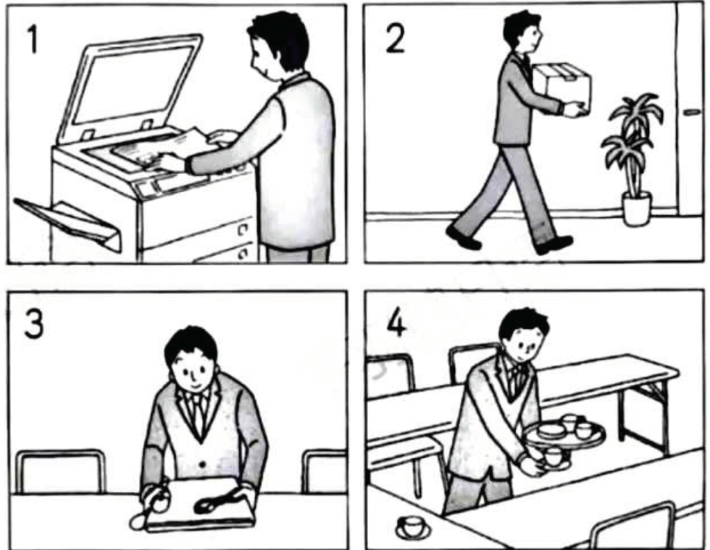
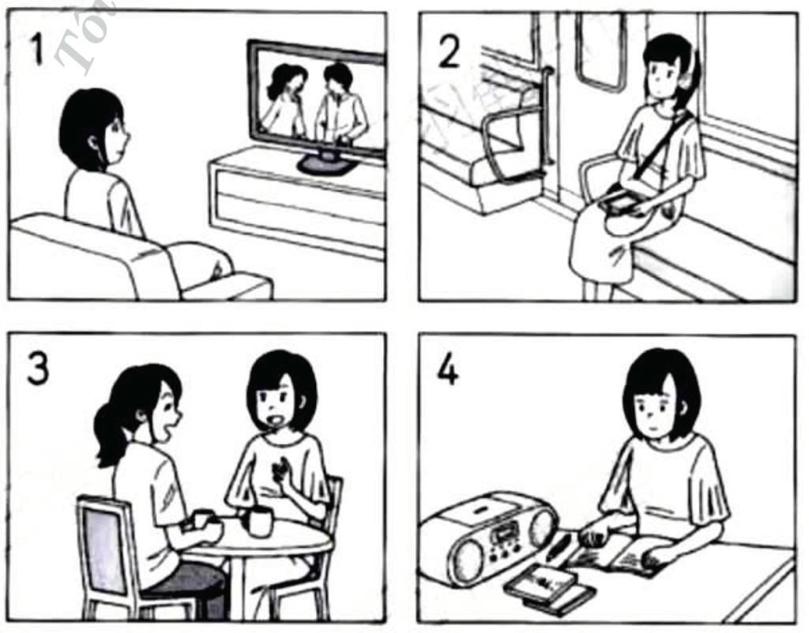
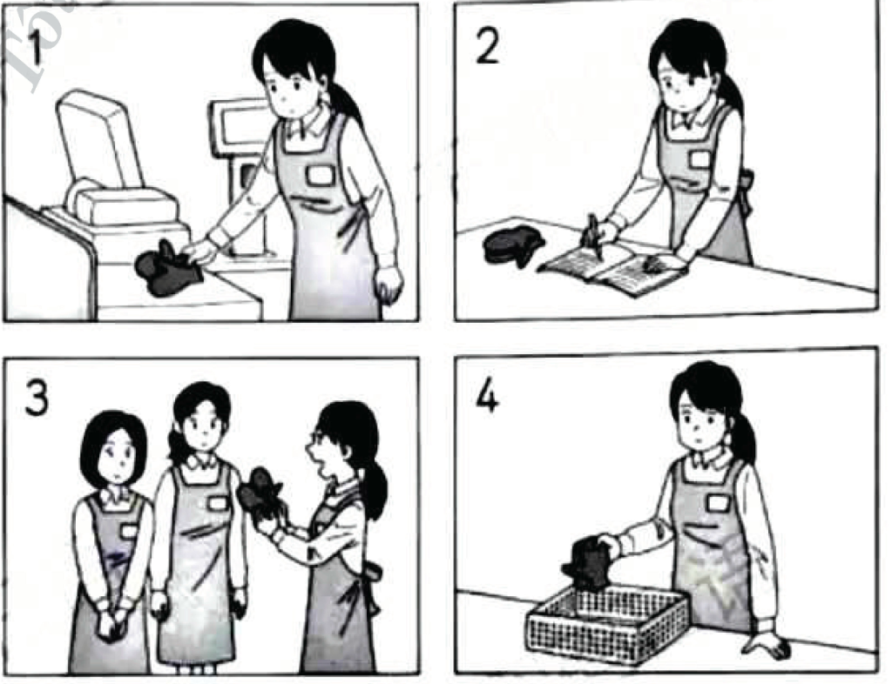
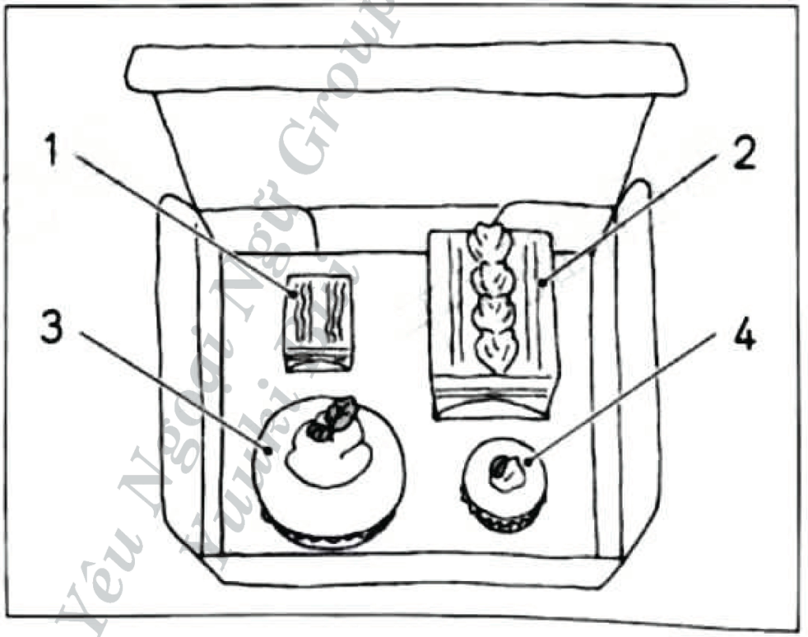
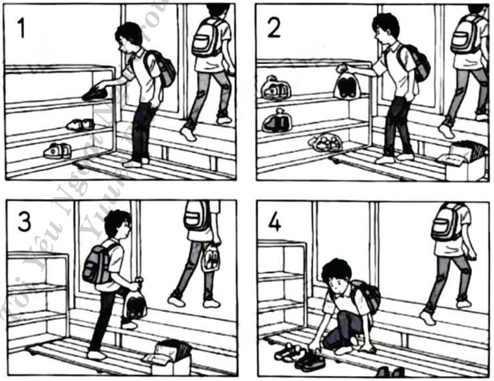
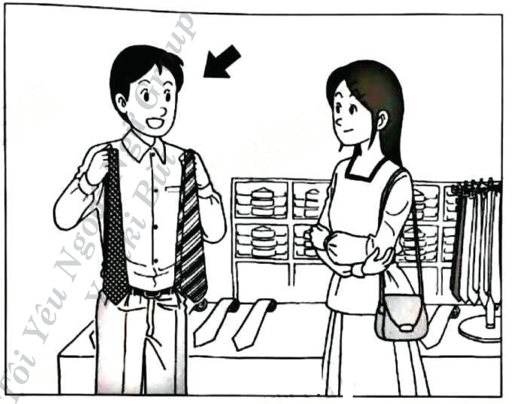
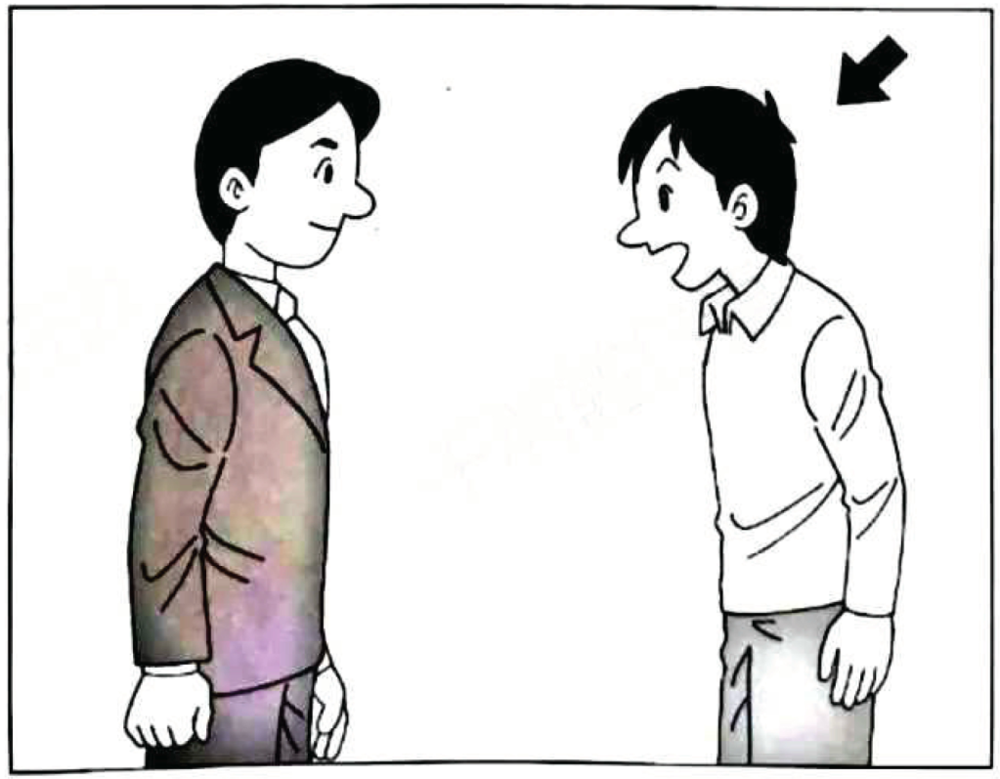
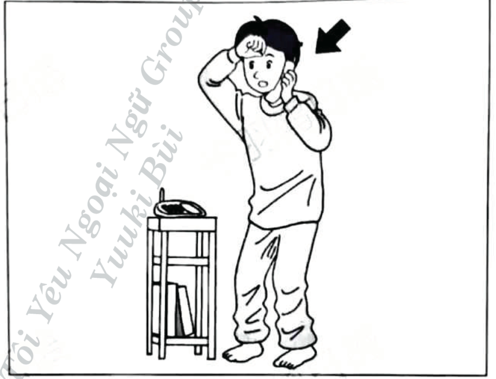
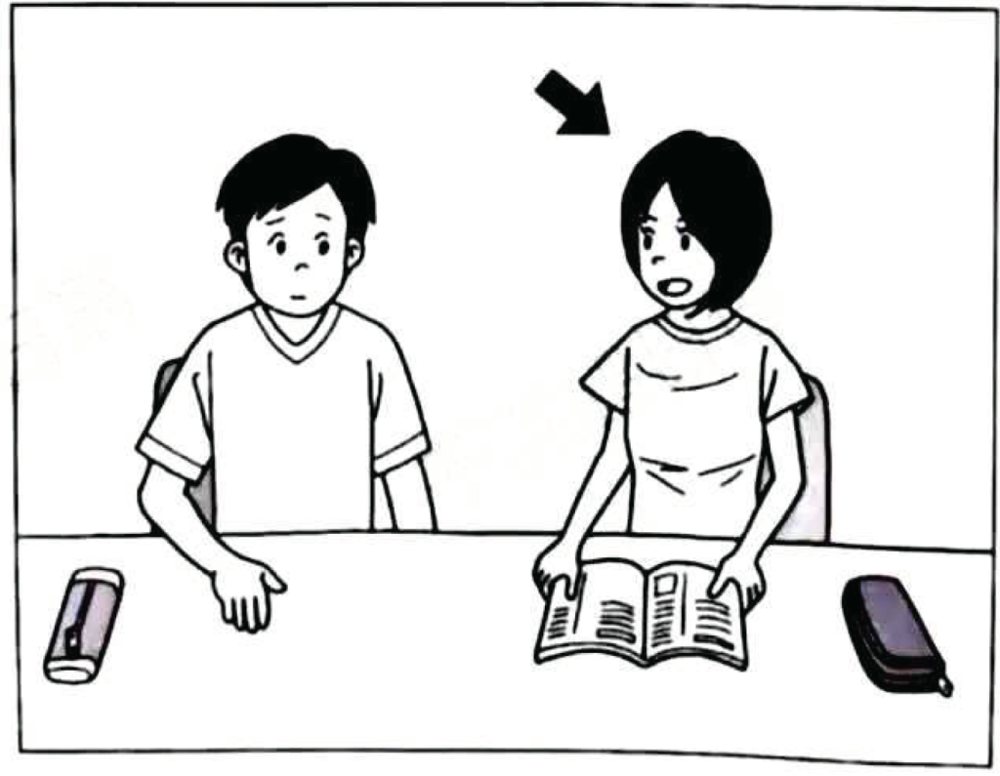
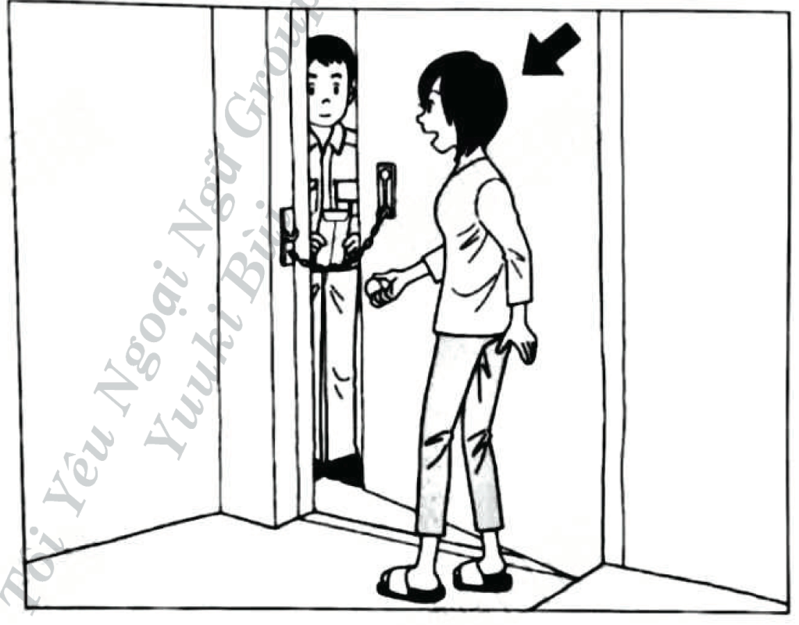

# JLPT N4 Mock Test – July 2021

## げんごちしき（もじ・ごい）

### もんだい１: Kanji Reading

> もんだい１　____の　ことばは　ひらがなで　どう　かきますか。1・2・3・4から　いちばん　いい　ものを　ひとつ　えらんで　ください。

#### Question 1

きのう　３時間<u>以上</u>　べんきょうしました。

1. いがい
2. **いじょう**
3. いない
4. いか

**Correct answer:** 2. いじょう

**Correct Answer**

Answer 2: いじょう is correct.

**Question Translation**

"きのう　３時間以上　べんきょうしました。"
→ "Yesterday, I studied for more than three hours."

**Explanation**

The kanji "以上" is read as **いじょう**, which means *more than* or *above*. This is the correct reading based on the context, indicating studying for more than a specified amount of time.

**Other Options**

1. いがい – Means *except for* or *other than* (kanji: 以外), and does not fit the context here.
3. いない – Means *within* or *not exceeding* (kanji: 以内), which is the opposite of the intended meaning.
4. いか – Means *below* or *less than* (kanji: 以下), not matching the meaning of 以上.

Only **いじょう** corresponds to the kanji **以上** in this context.

#### Question 2

もう少し　<u>近い</u>　ほうが　いいです。

1. **ちかい**
2. はやい
3. ひろい
4. ふとい

**Correct answer:** 1. ちかい

**Correct Answer**

Answer 1: ちかい is correct.

**Question Translation**

"もう少し　近い　ほうが　いいです。"
→ "It would be better if it were a little closer."

**Explanation**

The kanji "近い" is read as **ちかい**, which means *close* or *near*. This fits the context of the sentence, which suggests a preference for something being closer.

**Other Options**

2. はやい – Means *fast* or *early* (kanji: 速い/早い), not appropriate here.
3. ひろい – Means *wide* or *spacious* (kanji: 広い), does not match 近い.
4. ふとい – Means *thick* or *fat* (kanji: 太い), unrelated to closeness.

Only **ちかい** matches the kanji **近い** in this sentence.

#### Question 3

あしたは　<u>都合</u>が　わるいです。

1. とごう
2. つがい
3. **つごう**
4. とがい

**Correct answer:** 3. つごう

**Correct Answer**

Answer 3: つごう is correct.

**Question Translation**

"あしたは　都合が　わるいです。"
→ "Tomorrow, my schedule is inconvenient."

**Explanation**

The kanji "都合" is read as **つごう**, which typically means *convenience*, *circumstances*, or *schedule*. This is the correct reading based on the kanji in the sentence.

**Other Options**

1. とごう – Not a standard reading of 都合.
2. つがい – Means *pair* (kanji: 番), and does not match 都合.
4. とがい – Not a standard reading of 都合.

Only **つごう** matches the kanji **都合** in this context.

#### Question 4

ドアを　<u>引いて</u>　ください。

1. ふいて
2. **ひいて**
3. ついて
4. おいて

**Correct answer:** 2. ひいて

**Correct Answer**

Answer 2: ひいて is correct.

**Question Translation**

"ドアを　引いて　ください。"
→ "Please pull the door."

**Explanation**

The kanji "引いて" is read as **ひいて**, which means *to pull*. This is the correct reading based on the kanji and context of the sentence, instructing someone to pull the door.

**Other Options**

1. ふいて – Implies *to wipe* or *to blow* (kanji: 吹いて), not suitable here.
3. ついて – Suggests *to attach* or *to stick* (kanji: 付いて or 着いて), not matching 引いて.
4. おいて – Means *to place* or *to leave* (kanji: 置いて), unrelated to 引いて.

Only **ひいて** correctly matches the kanji **引いて** in this context.

#### Question 5

<u>女性</u>の　おてあらいは　あちらです。

1. しょせい
2. だんせい
3. **じょせい**
4. たんせい

**Correct answer:** 3. じょせい

**Correct Answer**

Answer 3: じょせい is correct.

**Question Translation**

"女性の おてあらいは あちらです。"
→ "The women's restroom is over there."

**Explanation**

The kanji "女性" is read as **じょせい**, which means *woman* or *female*. This is the correct reading based on the context of the sentence referring to a women's restroom.

**Other Options**

1. しょせい – Not a standard reading of 女性.
2. だんせい – Refers to *man* or *male* (kanji: 男性), which is incorrect here.
4. たんせい – Not a standard reading of 女性 and does not apply to this context.

Only **じょせい** matches the kanji **女性** in this context.

#### Question 6

いつから　<u>習って</u>　いるんですか。

1. おそわって
2. かよって
3. おこなって
4. **ならって**

**Correct answer:** 4. ならって

**Correct Answer**

Answer 4: ならって is correct.

**Question Translation**

"いつから　習って　いるんですか。"
→ "Since when have you been learning?"

**Explanation**

The kanji "習って" is read as **ならって**, which means *learning* or *studying*. This is the correct reading of the kanji in the context of asking about a learning process.

**Other Options**

1. おそわって – Means *being taught* (kanji: 教わって) and does not fit in this context.
2. かよって – Means *commuting* or *attending* (kanji: 通って) but is not appropriate here.
3. おこなって – Means *conducting* or *performing* (kanji: 行って) and does not match 習って.

Only **ならって** matches the kanji **習って** and the meaning of the sentence.

#### Question 7

あそこに　いるのは　はやしさんの<u>お姉さん</u>です。

1. **おねえさん**
2. おにいさん
3. おねさん
4. おにさん

**Correct answer:** 1. おねえさん

**Correct Answer**

Answer 1: おねえさん is correct.

**Question Translation**

"あそこにいるのははやしさんのお姉さんです。"
→ "The person over there is Hayashi's older sister."

**Explanation**

The kanji "お姉さん" is read as **おねえさん**, which means *older sister*. This is the correct reading based on the kanji in the sentence.

**Other Options**

2. おにいさん – Means *older brother* (kanji: お兄さん), not a match here.
3. おねさん – Incorrect reading and not standard for older sister.
4. おにさん – Not a standard reading for お姉さん and could imply "demon" (鬼).

Only **おねえさん** matches the kanji **お姉さん** in this context.

### もんだい2: Orthography

> もんだい2　_____の　ことばは　どう　かきますか。1・2・3・4から　いちばん　いい ものを　ひとつ　えらんで　ください。

#### Question 8

おとといの　<u>よる</u>　パーティーに　行きました。

1. 晩
2. **夜**
3. 挽
4. 液

**Correct answer:** 2. 夜

**Correct Answer**

Answer 2: 夜 is correct.

**Question Translation**

"おとといのよるパーティーに行きました。"
→ "I went to a party the night before last."

**Explanation**

The word "よる" means *night*, and the correct kanji representation is **夜**. This kanji is frequently used in contexts involving evening or nighttime activities.

**Other Options**

1. 晩（ばん）– The reading of this kanji is "ばん", and it means *evening* or *nighttime*, similar in meaning but is not the direct kanji for "よる".

3. 挽（ひく）– This kanji is read as "ひく", meaning *to grind* or *to mill*. It’s unrelated to the intended meaning of "よる".

4. 液（えき）– The reading is "えき", and it means *liquid*. It does not relate to "よる" at all.

Only **夜** correctly represents the word "よる" in this sentence.

#### Question 9

あの　<u>しろい</u>　車が　わたしのです。

1. 赤い
2. 青い
3. 黒い
4. **白い**

**Correct answer:** 4. 白い

**Correct Answer**

Answer 4: 白い is correct.

**Question Translation**

"あの　しろい　車が　わたしのです。"
→ "That white car is mine."

**Explanation**

The word "しろい" means *white*, and the correct kanji representation is **白い**. It is used to describe the color white, which appropriately matches the word "しろい" in this sentence.

**Other Options**

1. 赤い（あかい）– The reading of this kanji is "あかい", which means *red*. It doesn’t match the word "しろい".

2. 青い（あおい）– This is read as "あおい", meaning *blue*. It does not correspond with "しろい".

3. 黒い（くろい）– The reading is "くろい", and it means *black*. It is not the correct match for "しろい".

Only **白い** correctly represents the word "しろい" in this context.

#### Question 10

<u>しょくどう</u>は　あの　たてものの　中です。

1. 食室
2. 飯室
3. **食堂**
4. 飯堂

**Correct answer:** 3. 食堂

**Correct Answer**

Answer 3: 食堂 is correct.

**Question Translation**

"しょくどうは　あの　たてものの　中です。"
→ "The cafeteria is inside that building."

**Explanation**

The word "しょくどう" means *cafeteria* or *dining hall*, and the correct kanji representation is **食堂**. It is used for places where meals are served, such as a school or workplace cafeteria.

**Other Options**

1. 食室 (しょくしつ) – The reading of this kanji is "しょくしつ", which could mean *food room*. However, it is not commonly used to mean cafeteria.

2. 飯室 (はんしつ) – The reading is "はんしつ", and it could imply a *meal room*. However, it is not a standard term for cafeteria.

4. 飯堂 (はんどう) – This is read as "はんどう", which doesn’t have a valid meaning related to "しょくどう" and generally not used.

Only **食堂** correctly represents the word "しょくどう" as a cafeteria or dining hall in this sentence.

#### Question 11

まどを　<u>しめて</u>　ください。

1. 開めて
2. **閉めて**
3. 問めて
4. 開めて

**Correct answer:** 2. 閉めて

**Correct Answer**

Answer 2: 閉めて is correct. It means “close (it),” as in “Please close the window.”

**Question Translation**

Please close the window.

**Explanation**

- しめて (shimete) for doors/windows is written with the kanji 閉めて (from 閉める), meaning “to close.”
- Here, まど (window) takes the transitive verb 閉める, so 閉めて is the correct orthography.

Reading and meaning: 閉めて（しめて）= “close (it).”

**Why Other Options Are Incorrect**

- Answer 1: 開めて — Not a valid spelling. “To open” would be 開けて（あけて）, and it’s also the opposite meaning of “close.”
- Answer 3: 問めて — Not a standard Japanese word; 問める does not exist.
- Answer 4: 開めて — Same as Answer 1; invalid spelling and wrong meaning.

**Grammar/Vocabulary Note**

- ～てください is a polite request form: “please do X.”
- For “close,” note the distinctions: - 閉める: close doors/windows/stores (まどを閉める) - 締める: tighten/turn off (e.g., ねじを締める, ガスを締める) - 絞める: strangle/wring/squeeze (首を絞める) - 閉じる: often for eyes/books/abstract “closing” (目を閉じる, 本を閉じる)

#### Question 12

なかさんは　<u>しんせつ</u>です。

1. **親切**
2. 新切
3. 親功
4. 新功

**Correct answer:** 1. 親切

**Correct Answer**

Answer 1: 親切 is correct.

**Question Translation**

"なかさんは　しんせつです。"
→ "Mr. Naka is kind."

**Explanation**

The word "しんせつ" means *kind* or *considerate*, and the correct kanji representation is **親切**. This kanji is typically used to describe a person's character or actions.

**Other Options**

2. 新切（しんせつ）– The reading is "しんせつ", but this is not a valid word in Japanese, as 新 means *new* and 切 means *cut*.

3. 親功（しんせつ）– This is read as "しんこう", combining 親 (*parent* or *intimacy*) and 功 (*achievement*), but this combination doesn't convey the intended meaning.

4. 新功（しんせつ）– Also read as "しんこう", where 新 means *new* and 功 means *achievement*, unrelated to describing kindness.

Only **親切** appropriately represents the word "しんせつ" in this context.

### もんだい３: Contextually-defined Expressions

> もんだい３　(　　　)に　なにを　いれますか。1・2・3・4から　いちばん　いい　ものを ひとつ　えらんで　ください。

#### Question 13

このどうぐは、あの　きかいを　なおす　ために（　　　）です。

1. ねっしん
2. ていねい
3. **ひつよう**
4. とくべつ

**Correct answer:** 3. ひつよう

**Correct Answer**

Answer 3: ひつよう (必要) is correct. It means "necessary."

**Question Translation**

This tool is necessary to repair that machine.

**Explanation**

The sentence is discussing the role or importance of a tool in the context of repairing a machine. The word "必要" (ひつよう) is used to describe something that is required or essential for a particular purpose, which in this case is the repair of the machine. Therefore, "必要" is the most suitable word to convey that the tool is indispensable for the task.

**Why Other Options Are Incorrect**

- Answer 1: ねっしん (熱心) means "enthusiastic" or "zealous." This word describes a person's mindset or approach and is unrelated to the necessity of a tool for repair.
- Answer 2: ていねい (丁寧) means "polite" or "careful." While "丁寧" describes the manner in which a task is done, it does not indicate the necessity of a tool for performing that task.
- Answer 4: とくべつ (特別) means "special." Although a tool might be special in certain contexts, the sentence focuses on whether the tool is necessary for the repair, not its special nature.

**Grammar/Vocabulary Note**

The word "必要" (ひつよう) is fundamental when expressing the necessity or requirement of an item or action in Japanese. It is often used in a wide range of contexts to convey necessity. Understanding the context in which "必要" is used helps differentiate it from other similar expressions, underscoring the importance of a tool or item in achieving a particular goal.

#### Question 14

この　プールは（　　　）ですから、子どもは　およがないで　ください。

1. かたい
2. おもい
3. **ふかい**
4. にがい

**Correct answer:** 3. ふかい

**Correct Answer**

Answer 3: ふかい is correct. It means "deep."

**Question Translation**

This pool is deep, so children should not swim in it.

**Explanation**

The sentence is warning children not to swim in the pool, suggesting a safety concern related to the pool’s depth. The context implies that something about the pool makes it unsuitable or dangerous for children, and depth is a common reason. The word ふかい (深い) means "deep," fitting the context as it explains the potential danger that would prohibit children from swimming.

**Why Other Options Are Incorrect**

- Answer 1: かたい (硬い) means "hard" or "solid." This doesn’t fit as a reason for preventing children from swimming, as it describes texture, not a safety concern related to depth.
- Answer 2: おもい (重い) means "heavy." Although it could relate to weight, it doesn't logically apply to describing a pool in a way that affects children's ability to swim.
- Answer 4: にがい (苦い) means "bitter." This describes taste and is irrelevant to a pool's condition or suitability for swimming.

**Grammar/Vocabulary Note**

The adjective 深い (ふかい) is crucial in contexts where depth relates to safety, such as swimming pools or bodies of water. Recognizing familiar adjectives and their applications within everyday scenarios is key for comprehension in JLPT questions dealing with contextually-defined expressions.

#### Question 15

その　はがきに　この　きってを（　　　）ください。

1. かけて
2. **はって**
3. ぬって
4. すてて

**Correct answer:** 2. はって

**Correct Answer**

Answer 2: はって is correct. It means "to attach" or "to stick."

**Question Translation**

Please stick this stamp on that postcard.

**Explanation**

The context of the sentence involves putting a stamp (きって) on a postcard (はがき). The verb はる (貼る) means "to stick" or "to attach," which is appropriate when discussing affixing stamps to postcards or letters.

**Why Other Options Are Incorrect**

- Answer 1: かけて (書けて) means "to write." This doesn't fit the context as the sentence is about affixing a stamp, not writing something.
- Answer 3: ぬって means "to paint" or "to spread." This does not suit the context as applying a stamp does not involve spreading or painting.
- Answer 4: すてて (捨てて) means "to throw away." This action is inappropriate in the given context where sticking a stamp on a postcard is required.

**Grammar/Vocabulary Note**

The verb はる (貼る) is essential in contexts involving attaching or sticking objects onto surfaces. It pairs with nouns like きって (stamps), シール (stickers), or ポスター (posters). Understanding how different verbs change meaning based on context is crucial for these sorts of questions.

#### Question 16

えきまえの　ほんやは　あさ8時から（　　　）して　います

1. **えいぎょう**
2. せいさん
3. ぼうえき
4. ゆしゅつ

**Correct answer:** 1. えいぎょう

**Correct Answer**

Answer 1: えいぎょう (営業) is correct. It means "business" or "operation."

**Question Translation**

The bookstore in front of the station is open for business from 8 a.m.

**Explanation**

In the sentence, the context is about the operating hours of a bookstore. The phrase "あさ8時から" indicates a starting time, and the only term that fits the context of opening hours or running a business is 営業 (えいぎょう), which refers to being open for business or operational activities. Therefore, it correctly completes the sentence by indicating that the bookstore is conducting business starting from 8 a.m.

**Why Other Options Are Incorrect**

- Answer 2: せいさん (生産) means "production." It typically refers to the creation or manufacturing of goods, which is not relevant to the context of a store opening.
- Answer 3: ぼうえき (貿易) means "trade," especially international trade. While related to business, it does not directly relate to a store's operational hours or being open to customers.
- Answer 4: ゆしゅつ (輸出) means "export." It refers to sending goods to another country, which again is unrelated to the operation hours of a bookstore.

**Grammar/Vocabulary Note**

営業 (えいぎょう) is a common term used to describe the operation or business activities of a shop or company. It reflects when a business is open and serving customers, such as "営業時間" (えいぎょうじかん), meaning "business hours." Recognizing this term helps in understanding and discussing business operations and schedules.

#### Question 17

この　みちを　まっすぐ（　　　）と、右がわに　としょかんが　あります。

1. でかける
2. うごく
3. たずねる
4. **すすむ**

**Correct answer:** 4. すすむ

**Correct Answer**

Answer 4: すすむ is correct. It means "to go forward" or "to proceed."

**Question Translation**

If you proceed straight on this road, there will be a library on the right side.

**Explanation**

The sentence gives directions indicating what will happen after moving straight along the road. The verb すすむ (進む) fits this context perfectly as it means "to proceed" or "to continue moving in a direction," which aligns with the instruction to go straight down the road.

**Why Other Options Are Incorrect**

- Answer 1: でかける (出かける) means "to go out" or "to leave." It implies leaving a starting location, rather than continuing along a specified path.
- Answer 2: うごく (動く) means "to move" or "to change position." While related to movement, it is too general and doesn't specifically denote the directed or purposeful motion implied by すすむ.
- Answer 3: たずねる (訪ねる) means "to visit" or "to inquire." This option implies seeking out a place or person, not the simple action of proceeding straight along a road.

**Grammar/Vocabulary Note**

すすむ (進む) is commonly used in directional contexts to indicate moving forward or continuing along a path. It’s essential to choose verbs that capture the nuances of direction or manner when dealing with instructions or descriptive sentences in Japanese.

#### Question 18

どちらの　けいかくが　いいと　おもうか、みんなの（　　　）聞きました。

1. やくそく
2. **いけん**
3. あいさつ
4. ひみつ

**Correct answer:** 2. いけん

**Correct Answer**

Answer 2: いけん is correct. It means "opinion."

**Question Translation**

Which plan do you think is good? I asked everyone for their opinion.

**Explanation**

The sentence is discussing asking people about which plan they think is better. In this context, you would seek people's "opinions." The word "いけん" (意見) translates directly to "opinion," fitting perfectly as the action described is about gathering input or feedback from others regarding their thoughts on the plans.

**Why Other Options Are Incorrect**

- Answer 1: やくそく (約束) means "promise." This does not fit the context because you are not asking people for their promises regarding the plans.
- Answer 3: あいさつ (挨拶) means "greeting." This is irrelevant to the context since you are asking for an evaluative response rather than a social greeting.
- Answer 4: ひみつ (秘密) means "secret." This makes no sense in this context because asking everyone to give their "secret" related to which plan they prefer doesn't align logically with the communication intent expressed by the sentence.

**Grammar/Vocabulary Note**

The word "意見" is commonly used in Japanese to refer to someone's viewpoint, feedback, or assessment of a situation. It is essential to differentiate it from similar-sounding terms that have entirely different meanings. Notably, "意見" is used for contexts involving decision-making or evaluations, such as discussions, meetings, and consultations.

#### Question 19

きのう　うちの　ねこが　子どもを　３びき（　　　）。

1. しました
2. だしました
3. やりました
4. **うみました**

**Correct answer:** 4. うみました

Certainly! Let's analyze the given JLPT question on Contextually-defined Expressions.

**Correct Answer**

Answer 4: うみました is correct. It means "gave birth."

**Question Translation**

Yesterday, my cat gave birth to three kittens.

**Explanation**

The sentence discusses the event involving the family cat and the birth of kittens. The verb "生みました" (うみました) refers specifically to the act of giving birth or producing offspring, which fits perfectly in this context where it describes the cat giving birth to three kittens.

**Why Other Options Are Incorrect**

- Answer 1: しました (did) is a general verb meaning "did" or "performed," which lacks specificity and does not fit the context of an animal giving birth.
- Answer 2: だしました (took out) generally means "to take out" or "to release," which is inappropriate in describing the process of giving birth.
- Answer 3: やりました (did/gave) is a casual verb meaning "did" or sometimes "gave" when used with beneficiaries, but it does not convey the specific action of giving birth.

**Grammar/Vocabulary Note**

The verb "生む" (うむ) is specifically used for "giving birth" or "producing" and is an important term to know when discussing childbirth or the production of something new, such as offspring. Recognizing correct verbs for actions related to childbirth is crucial for accurate expression and communication in Japanese.

#### Question 20

しけんの（　　　）が　よかったので、うれしいです。

1. **けっか**
2. ごうかく
3. けんいん
4. せいこう

**Correct answer:** 1. けっか

**Correct Answer**

Answer 1: けっか (結果) is correct. It means "result."

**Question Translation**

I am happy because the results of the exam were good.

**Explanation**

The sentence discusses the outcome of an exam situation, expressing happiness due to positive exam results. "けっか" (結果) is commonly used to describe the result or outcome of tests and other situations, making it the best fit for this context.

**Why Other Options Are Incorrect**

- Answer 2: ごうかく (合格) means "pass" or "passing." While related to exams, it refers specifically to the act of passing rather than the result itself. "Result" encompasses both passing and failing results, which is more inclusive of the intended meaning.
- Answer 3: けんいん (検印) means "inspection stamp." This term is not related to the context of taking or receiving results from an exam.
- Answer 4: せいこう (成功) means "success." While this term is positive, it’s more general and not specific to exam outcomes. "結果" is more appropriate when referring directly to results, regardless of whether they are successful or not.

**Grammar/Vocabulary Note**

Understanding the difference between broader terms like "結果" (result) and specific actions or states like "合格" (passing) or "成功" (success) is crucial for selecting the correct expression based on context. "結果" encompasses the full scope of possible outcomes, making it distinctively appropriate for discussing exam results.

### もんだい４: Paraphrases

> もんだい４　_____の　ぶんと　だいたい　おなじ　いみの　ぶんが　あります。1・2・3・4から　いちばん　いい　ものを　ひとつ　えらんで　ください。

#### Question 21

<u>さいきん　いそがしくて、うんどうできません。</u>

1. さいきん　いそがしくて、本を　読んで　いません。
2. さいきん　いそがしくて、休んで　いません。
3. さいきん　いそがしくて、うちの　しごとを　して　いません。
4. **さいきん　いそがしくて、スポーツを　して　いません。**

**Correct answer:** 4. さいきん　いそがしくて、スポーツを　して　いません。

**Correct Answer**

Answer 4: スポーツをしていません is correct. It means "I haven't been doing sports recently because I have been busy."

**Question Translation**

Recently, I have been busy and haven't been able to exercise.

**Explanation**

The key phrase in the original sentence is "うんどうできません" (I can't exercise). Answer 4, スポーツをしていません, translates to "I haven't been doing sports," which directly corresponds to being unable to exercise. In Japanese, うんどう (運動) often refers to physical exercise or activity, and スポーツ is a common synonym, making this paraphrase appropriate.

**Why Other Options Are Incorrect**

- Answer 1: 本を読んでいません translates to "I haven't been reading books." This option doesn't relate to exercise or physical activity, which is the main focus of the original sentence.
- Answer 2: 休んでいません means "I haven't been resting." While it implies being busy, it doesn't relate to the inability to exercise.
- Answer 3: うちのしごとをしていません translates to "I haven't been doing housework." This focuses on tasks at home, not exercise or sports, which was the original context.

**Grammar/Vocabulary Note**

The word 運動 (うんどう) means "exercise," often referring to any physical activity. A common paraphrase is スポーツ (sports), which implies similar physical actions. In such questions, recognizing similar or synonymous vocabulary is crucial in identifying the correct answer.

#### Question 22

<u>くうこうは　ここから　とおいですか。</u>

1. **ひこうきに　のる　ところは　ここから　とおいですか。**
2. ふねに　のる　ところは　ここから　とおいですか。
3. たべものを　買う　ところは　ここから　とおいですか。
4. きっぷを　買う　ところは　ここから　とおいですか。

**Correct answer:** 1. ひこうきに　のる　ところは　ここから　とおいですか。

**Correct Answer**

Answer 1: ひこうきに　のる　ところは　ここから　とおいですか。is correct. It means "Is the place where you board the airplane far from here?"

**Question Translation**

Is the airport far from here?

**Explanation**

The original sentence asks about the distance to the airport. Answer 1 is a paraphrase that refers to the place where one boards an airplane, which is effectively the airport. "ひこうきに　のる　ところ" translates to "the place to board an airplane," which aligns with the concept of an airport. This maintains both the meaning and context of the original question.

**Why Other Options Are Incorrect**

- Answer 2: ふねに　のる　ところ refers to "the place to board a ship." It doesn't match the context because the question is about an airport (for planes), not a seaport (for ships).
- Answer 3: たべものを　買う　ところ means "the place to buy food." This doesn't match the context as it shifts the focus from transportation to food purchasing, which is unrelated to airports.
- Answer 4: きっぷを　買う　ところ means "the place to buy tickets." While related to travel, it doesn't specifically refer to the airport or imply the location for boarding a plane.

**Grammar/Vocabulary Note**

The phrase "にのるところ" (に乗るところ) is a critical phrase for understanding locations related to modes of transportation—such as the boarding point for planes, trains, or ships. Recognizing such context-specific phrases helps in accurately paraphrasing sentences related to travel and transportation.

#### Question 23

<u>もりさんに　たのみました。</u>

1. もりさんに　れんらくしました。
2. もりさんに　へんじしました。
3. **もりさんに　おねがいしました。**
4. りさんに　しょうかいしました。

**Correct answer:** 3. もりさんに　おねがいしました。

**Correct Answer**

Answer 3: もりさんに　おねがいしました is correct. It means "asked Mori-san for a favor."

**Question Translation**

I asked Mori-san for a favor.

**Explanation**

The verb たのみました (頼みました) means "asked someone" for something or a favor. The word おねがいしました (お願いしました) shares a similar meaning, involving making a request or asking someone to do something. In this context, using おねがいしました perfectly conveys the intended meaning of making a request to Mori-san.

**Why Other Options Are Incorrect**

- Answer 1: もりさんに　れんらくしました means "contacted Mori-san." While it involves communication, it doesn't capture the nuance of making a request.
- Answer 2: もりさんに　へんじしました means "replied to Mori-san." This would imply Mori-san initiated communication, which is not the same as making a request.
- Answer 4: もりさんに　しょうかいしました means "introduced to Mori-san." This describes introducing someone else, which is unrelated to the action of asking for a favor.

**Grammar/Vocabulary Note**

Understanding verbs that convey requests or communication is essential. In this context, both 頼む (たのむ) and お願いする (おねがいする) are associated with making requests, but お願いする often carries a more polite or considerate tone, which may be a reason it is favored here.

#### Question 24

<u>けさから　雨が　ざあざあ　ふって　います。</u>

1. けさから　つめたい　雨が　ふって　います。
2. けさから　こまかい　雨が　ふって　います。
3. けさから　雨が　しずかに　ふって　います。
4. **けさから　雨が　つよく　ふって　います。**

**Correct answer:** 4. けさから　雨が　つよく　ふって　います。

**Correct Answer**

Answer 4: けさから　雨が　つよく　ふって　います is correct. It means "The rain has been falling heavily since this morning."

**Question Translation**

"The rain has been falling heavily since this morning."

**Explanation**

The phrase "ざあざあ" is an onomatopoeic expression used to describe the sound and intensity of heavy rain. Therefore, it conveys the idea of rain falling heavily, making the main focus on the intensity of the rainfall. The term "つよく" (強く) means "strongly" or "heavily," which accurately paraphrases "ざあざあ" in terms of intensity and effect.

**Why Other Options Are Incorrect**

- Answer 1: つめたい (冷たい) means "cold" and describes the temperature rather than the intensity or sound of the rain. It does not accurately convey the heavy rainfall suggested by "ざあざあ."
- Answer 2: こまかい (細かい) means "fine" or "small," which suggests a light drizzle rather than heavy rain, making it unsuitable to describe "ざあざあ" rain.
- Answer 3: しずかに (静かに) means "quietly," which contradicts the idea of heavy and potentially noisy rainfall indicated by "ざあざあ."

**Grammar/Vocabulary Note**

In Japanese, onomatopoeia like "ざあざあ" are often used to vividly describe sensory experiences, and understanding these terms is crucial for interpreting the intended meaning in context. "つよく" (強く) serves as an adverb modifying how the rain is falling, fitting perfectly with the idea of heavy rain. Recognizing these expressions is key to discerning the nuances in descriptions of weather and other phenomena.

### もんだい5: Usage

> もんだい5　つぎの　ことばの　つかいかたで　いちばん　いい　ものを 1・2・3・4から ひとつ　えらんで　ください。

#### Question 25

しんぱい

1. たなか「先週　ひさしぶりに　ともだちに　あったんです。」 やまだ「それは　<u>しんぱい</u>ですね。」
2. たなか「先週　わたしに　たんじょうびの　プレゼントが　とどいたんです。」 やまだ「それは　<u>しんぱい</u>ですね。」
3. たなか「先週　かって　いた　いぬが　しんだんです。」 やまだ「それは　<u>しんぱい</u>ですね。」
4. **たなか「先週　あにが　にゅういんしたんです。」 やまだ「それは　<u>しんぱい</u>ですね。」**

**Correct answer:** 4. たなか「先週　あにが　にゅういんしたんです。」 やまだ「それは　<u>しんぱい</u>ですね。」

**Correct Answer**

Answer 4 is correct.

**Word Translation**

心配（しんぱい） — worry, concern

**Correct Sentence Translation**

Tanaka: "Last week, my older brother was hospitalized."
Yamada: "That's concerning."

**Explanation**

The word **心配** is used to express worry or concern, especially regarding situations that could entail danger, health issues, or unexpected problems. In this context, hearing that someone’s brother was hospitalized naturally elicits concern, making "心配" the appropriate expression.

**Other Options**

① たなか「先週　ひさしぶりに　ともだちに　あったんです。」
やまだ「それは　__しんぱい__ですね。」
→ Tanaka: "Last week, I met with a friend for the first time in a while." Yamada: "That's concerning."
❌ Incorrect Usage
Meeting a friend after a long time is generally a positive experience and not something that would cause concern. A natural response might be "よかったですね" (that's nice).

② たなか「先週　わたしに　たんじょうびの　プレゼントが　とどいたんです。」
やまだ「それは　__しんぱい__ですね。」
→ Tanaka: "Last week, I received a birthday present." Yamada: "That's concerning."
❌ Incorrect Usage
Receiving a birthday present is typically a joyful event, not a worrying one. A more appropriate response would be "それは　うれしいですね" (that's delightful).

③ たなか「先週　かって　いた　いぬが　しんだんです。」
やまだ「それは　__しんぱい__ですね。」
→ Tanaka: "Last week, my dog passed away." Yamada: "That's concerning."
🔶 Awkward Usage
While the situation is indeed sad and might elicit sympathy, "心配" is not the best choice. A better expression would be "大変でしたね" (that's so hard).

**Usage Note**

"心配" is suitable for reacting to situations that genuinely warrant concern or anxiety, such as illness or trouble. It is not used for positive or happy events.

#### Question 26

せまい

1. **この　みちは　<u>せまい</u>ので、車は　とおれません。**
2. この　ズボンは　わたしには　少し　<u>せまい</u>です。
3. 小さい　じを　書く　ときは、<u>せまい</u>　ペンが　いいです。
4. その　やさいは　<u>せまく</u>　きって　ください。

**Correct answer:** 1. この　みちは　<u>せまい</u>ので、車は　とおれません。

**Correct Answer**

Answer 1 is correct.

**Word Translation**

せまい — narrow, tight

**Correct Sentence Translation**

The road is narrow, so cars cannot pass through.

**Explanation**

The term **せまい** is primarily used to describe physical spaces that have limited width, making them tight or narrow. "せまい道" (narrow road) is a natural expression, as it directly relates to the physical limitation of space that affects functionality, such as vehicle passage.

**Other Options**

② この　ズボンは　わたしには　少し　せまいです。
→ These pants are a bit narrow for me.
🔶 Awkward Usage
While it is almost correct, "せまい" sounds unnatural when describing clothing fit. The word "きつい" (tight) is more appropriately used to describe snug or tight clothing.

③ 小さい　じを　書く　ときは、せまい　ペンが　いいです。
→ A narrow pen is good for writing small letters.
❌ Incorrect Usage
"せまい" is not used to describe tools like pens or any objects. Instead, "細い" (thin) is correct for objects with a smaller width or diameter.

④ その　やさいは　せまく　きって　ください。
→ Please cut the vegetables narrowly.
❌ Incorrect Usage
"せまい" does not apply to cutting or the size of pieces. "細かく" (finely) or "薄く" (thinly) would be more appropriate when referring to how vegetables should be cut.

**Usage Note**

"せまい" is best applied to physical spaces (e.g., streets, rooms) indicating restricted width. When describing fitting clothing or object dimensions, substitute words such as "きつい" or "細い" convey the meaning more accurately.

#### Question 27

こしょう

1. 水を　あげるのを　わすれて、花が　<u>こしょう</u>して　しまいました。
2. **その　パソコンは　<u>こしょう</u>して　いるので、つかえません。**
3. この　ぎゅうにゅうは　<u>こしょう</u>して　いるので、飲まないで　ください。
4. テーブルから　おちて、コップが　<u>こしょう</u>しました。

**Correct answer:** 2. その　パソコンは　<u>こしょう</u>して　いるので、つかえません。

**Correct Answer**

Answer 2 is correct.

**Word Translation**

故障（こしょう） — malfunction, breakdown

**Correct Sentence Translation**

That computer is broken, so it cannot be used.

**Explanation**

The word **故障** specifically refers to mechanical or technical malfunctions. Using "故障している" (is broken) is natural and appropriate when discussing a non-functioning computer, as it vividly describes a technical failure.

**Other Options**

① 水を あげるのを わすれて、花が __こしょう__して しまいました。
→ I forgot to water it, and the flower has broken down.
❌ Incorrect Usage
"故障" is not used for living things like flowers. Instead, "枯れた" (withered) or simply "死んだ" (died) should be used.

③ この ぎゅうにゅうは __こしょう__して いるので、飲まないで ください。
→ This milk is broken, so please do not drink it.
❌ Incorrect Usage
"故障" does not apply to food. Use "腐っている" (spoiled) to describe milk that is no longer drinkable.

④ テーブルから おちて、コップが __こしょう__しました。
→ The cup was broken after falling from the table.
🔶 Awkward Usage
"故障" is not used for breakage due to physical damage of non-mechanical items. Use "割れた" (broken/shattered) for crockery like cups.

**Usage Note**

"故障" is specific to non-living mechanical or electronic devices encountering issues, where something stops working due to internal problems. It's not suited for biological items, physical damage, or spoilage.

#### Question 28

たおれる

1. たいふうで　山が　<u>たおれました</u>。
2. おとうとは　こうつうじこで　足が　<u>たおれました</u>。
3. **大きい　じしんで　ほんだなが　<u>たおれました</u>。**
4. 先生の　びょうきで　じゅぎょうが　<u>たおれました</u>。

**Correct answer:** 3. 大きい　じしんで　ほんだなが　<u>たおれました</u>。

**Correct Answer**

Answer 3 is correct.

**Word Translation**

倒れる（たおれる） — to fall over, to collapse

**Correct Sentence Translation**

The bookshelf fell over in the big earthquake.

**Explanation**

The word **倒れる** is used when something physically collapses or falls over. In the context of an earthquake, objects like **本棚** (bookshelf) can naturally **倒れる** due to the shaking.

**Other Options**

② おとうとは　こうつうじこで　足が　倒れました。
→ My brother's leg collapsed in a traffic accident.
❌ Incorrect Usage
"倒れる" isn't used for body parts like legs. Instead, "けがをした" (was injured) or "折れた" (broke) would be appropriate.

① たいふうで　山が　倒れました。
→ The mountain collapsed in the typhoon.
🔶 Awkward Usage
"倒れる" is awkward for mountains since mountains don't typically "fall over." A better expression might be "崩れる" (erode) or "土砂崩れが起きた" (landslide occurred).

④ 先生の　びょうきで　じゅぎょうが　倒れました。
→ The classes collapsed because the teacher was sick.
❌ Incorrect Usage
"倒れる" cannot be applied to abstract things like classes. "中止になった" (was canceled) is more natural.

**Usage Note**

"倒れる" applies to physical objects like poles, trees, buildings, etc. It does not apply to body parts, abstract concepts, or natural formations like mountains in the sense of falling over. Always consider the physical ability to "collapse" when using **倒れる**.

## 言語知識（文法）・読解

### もんだい1: Sentential Grammar 1 (Selecting grammar form)

> もんだい1　(　　　) に　何を　入れますか。1・2・3・4から　いちばん　いい　ものを 一つ　えらんで　ください。

#### Question 1

田中さんは　かぜ（　　　）仕事を　休みました。

1. を
2. **で**
3. に
4. が

**Correct answer:** 2. で

**Correct Answer**

Answer 2: で is correct. It means "because of" or "due to" in this context.

**Question Translation**

Mr. Tanaka took the day off work because of a cold.

**Explanation**

In this sentence, で is used to indicate the reason or cause for an action, which is Mr. Tanaka taking a day off work. The phrase かぜで (kaze de) translates as "because of a cold," which is the most appropriate connection between Tanaka having a cold and his decision to rest from work.

**Why Other Options Are Incorrect**

- Answer 1: を is a particle used to mark the direct object of a verb in Japanese. It cannot be used to indicate a reason or cause for taking a day off.
- Answer 3: に is used to indicate a direction, time, or the indirect object of a verb, but it doesn't express causality.
- Answer 4: が is often used as the subject marker. It doesn't fit here as the construction requires indicating the cause of the action.

**Grammar/Vocabulary Note**

The particle で is commonly used to express the reason or cause in a situation, especially when it's related to taking an action due to a specific condition or circumstance. Recognizing how particles work in various contexts is crucial for selecting the correct option on the JLPT.

#### Question 2

私は　毎朝、天気予報を　見て、駅まで　自転車で　行くか　バスで　行く（　　　）決めます。

1. を
2. と
3. **か**
4. が

**Correct answer:** 3. か

**Correct Answer**

Answer 3: か is correct. It means "whether" or is used to indicate a choice between alternatives.

**Question Translation**

Every morning, I watch the weather forecast and decide whether to go to the station by bicycle or by bus.

**Explanation**

The correct answer "か" is used to present a choice or an option between alternatives. In this sentence, it connects the two options: going by bicycle or going by bus, making it clear that the decision is dependent on the weather forecast. This is a typical use of the particle “か” to link choices in Japanese.

**Why Other Options Are Incorrect**

- Answer 1: を (wo) is an object marker and does not indicate choice. It cannot connect alternatives or indicate whether to do one thing or another.
- Answer 2: と (to) is typically used to mean "and" or to indicate a direct quote, so it doesn’t convey the idea of choosing between actions.
- Answer 4: が (ga) is a subject marker and does not indicate choice or alternatives. It cannot correctly link two distinct options in this context.

**Grammar/Vocabulary Note**

The particle "か" is often used in sentences where choices or questions are presented. In this structure, "〜か〜か" translates to "whether or" in English and helps in framing decisions or options between two or more possibilities. Recognizing this pattern is essential for understanding how choices are articulated in Japanese.

#### Question 3

バターは　ぎゅうにゅう（　　　）作られます。

1. の
2. を
3. **から**
4. には

**Correct answer:** 3. から

**Correct Answer**

Answer 3: から is correct. It means "from" or "made from."

**Question Translation**

Butter is made from milk.

**Explanation**

The sentence describes the process of making butter, which involves using milk as a source material. The grammatical particle から is used to indicate the material or origin from which something is made. In this context, ぎゅうにゅうから作られます (gyuunyuu kara tsukuraremasu) means "made from milk," correctly conveying that milk is the starting material for butter.

**Why Other Options Are Incorrect**

- Answer 1: の (no) shows possession or belonging, like "of" in English, but doesn't indicate the transformation of materials, so it doesn’t work here.
- Answer 2: を (wo) indicates the direct object of an action. It doesn’t fit because it doesn’t convey the meaning of transformation or origin of materials.
- Answer 4: には (ni wa) is used for emphasis or contrast with a subject/topic marker, but it doesn’t indicate the material source in this context.

**Grammar/Vocabulary Note**

The pattern "X から作られる" indicates that a product is made from a specific material, with から showing the origin or source. Recognizing から in the context of describing how things are made is crucial for understanding processes and compositions in Japanese.

#### Question 4

（かばん屋で）

客「すみません、この　スーツケース（　　　）同じくらいの　大きさで、もっと　軽いのは　ありますか。」

1. が
2. に
3. を
4. **と**

**Correct answer:** 4. と

**Correct Answer**

Answer 4: と is correct. It means "and" or "with" in this context.

**Question Translation**

(Customer at a bag shop)
Customer: "Excuse me, do you have a suitcase that is about the same size as this one and lighter?"

**Explanation**

The sentence is comparing the size of a suitcase with another, while also stating an additional condition (that it should be lighter). In Japanese, 「〜と同じくらい」is a common grammar pattern used to express that something is "about the same as" something else. Here, と is functioning as a conjunction that introduces the item (スーツケース) being compared.

**Why Other Options Are Incorrect**

- Answer 1: が is a subject marker and doesn't make sense in this context since we need a conjunction for comparison.
- Answer 2: に is often used to indicate direction or purpose and doesn't fit here since it cannot be used for comparison.
- Answer 3: を is an object marker used for direct objects, which is not appropriate here because we are forming a comparative expression.

**Grammar/Vocabulary Note**

The pattern "〜と同じくらい" is used to compare two items in terms of similarity, often in size, quantity, or quality. Recognizing this pattern is essential for making comparisons in Japanese.

#### Question 5

田中「リーさんは　日本でも　ちゅうか料理を　食べて　いますか。」

リー「いいえ。（　　　）に　来てから　食べて　いません。」

1. あっち
2. どっち
3. **こっち**
4. そっち

**Correct answer:** 3. こっち

**Correct Answer**

Answer 3: こっち is correct. It means "here" or "this place."

**Question Translation**

Tanaka: "Rii-san, do you eat Chinese food in Japan?"
Rii: "No. I haven't eaten it since I came here."

**Explanation**

The context of the conversation suggests that Rii is referring to the place they are currently in, meaning "here," hence, こっち, which refers to "this place" or "here" (where the speaker is), is the most appropriate. In the context of discussing arrival in a location, using こっち emphasizes that Rii hasn't eaten Chinese food since moving to the current location (Japan).

**Why Other Options Are Incorrect**

- Answer 1: あっち means "that way" or "over there" (away from both speaker and listener). It doesn’t fit in this context because it suggests a location not related to where either is located.
- Answer 2: どっち means "which one" or "which way." It doesn't fit because it implies a choice or direction, not referring to the place of discussion.
- Answer 4: そっち means "that way" or "there" (closer to the listener). While closer than あっち, it still inaccurately describes the current location of the speaker, as opposed to こっち, which clearly refers to "here."

**Grammar/Vocabulary Note**

In Japanese, the ko-so-a-do series helps indicate locations and directions relative to the speaker and listener. "こっち" is used for proximity to the speaker ("here"), whereas "そっち" refers to proximity to the listener ("there"), and "あっち" indicates a far-away location ("over there"). Recognizing these distinctions is crucial for understanding spatial references in conversations.

#### Question 6

私は　アイスクリームが　大好きです。（　　　）いちごの　アイスクリームが　好きです。

1. **とくに**
2. かならず
3. よく
4. だんだん

**Correct answer:** 1. とくに

**Correct Answer**

Answer 1: とくに is correct. It means "particularly" or "especially."

**Question Translation**

I love ice cream. I especially like strawberry ice cream.

**Explanation**

The sentence is emphasizing a specific preference within a general category. とくに (特に) is used to specify a particular aspect or example that stands out from the rest. In this context, the speaker loves all ice cream but has a special preference for strawberry ice cream. Thus, とくに appropriately highlights this preference.

**Why Other Options Are Incorrect**

- Answer 2: かならず (必ず) means "always" or "without fail." This doesn’t fit because the sentence is not about an obligation but a preference.
- Answer 3: よく means "often" or "frequently." It doesn’t fit the sentence because the speaker is not saying how often they eat ice cream, but rather their preference within ice cream flavors.
- Answer 4: だんだん (段々) means "gradually" or "little by little." This doesn’t fit because the sentence is not about a gradual change in preference but an established liking.

**Grammar/Vocabulary Note**

The adverb とくに is often used to highlight or emphasize one aspect among many. It is a useful adverb in Japanese for expressing particular favoritism or importance in a list of items or features. Additionally, understanding the context can help determine the most appropriate adverb to use, enhancing comprehension and communication in Japanese.

#### Question 7

きのうは　私は　一日（　　　）家に　いました。

1. しか
2. ごろ
3. 間
4. **中**

**Correct answer:** 4. 中

**Correct Answer**

Answer 4: 中 is correct. It means "throughout" or "during."

**Question Translation**

Yesterday, I was at home throughout the whole day.

**Explanation**

The sentence is expressing that the speaker stayed at home for the entire duration of the day. The word 中 (ちゅう) fits this context as it indicates the whole period of a specific timeframe. In this case, 一日中 (いちにちじゅう) is a phrase that means "all day long" or "throughout the day," which appropriately conveys the intended meaning of staying home for the entire day.

**Why Other Options Are Incorrect**

- Answer 1: しか is often used with a negative verb form to express "only" or "just," indicating a limitation (e.g., しかない, meaning "there is only"). It doesn't fit here since it would require negation and doesn't convey the duration.
- Answer 2: ごろ means "around" or "approximately," often used to describe an approximate time or period (e.g., 三時ごろ, meaning "around three o'clock"). It doesn't indicate the entirety of a day, making it unsuitable for the context.
- Answer 3: 間 (あいだ) means "between" or "period." While it can sometimes be used to refer to a period or interval, it is not typically paired with 一日 in this context to mean "throughout the whole day."

**Grammar/Vocabulary Note**

The use of 中 (ちゅう) with time expressions, like 一日中 (いちにちじゅう), is a common way to indicate that an action or state persisted for the entire duration of that time period. Recognizing such patterns is important for interpreting the sentence's meaning accurately.

#### Question 8

A「週末は　何か予定が　ありますか。」

B「ええ、（　　　）ともだちと　テニスを　しようと　思って　います。」

1. 晴れて
2. 晴れたり
3. 晴れると
4. **晴れたら**

**Correct answer:** 4. 晴れたら

**Correct Answer**

Answer 4: 晴れたら is correct. It means "if it clears up" or "if it's sunny."

**Question Translation**

A: "Do you have any plans for the weekend?"
B: "Yes, if it's sunny, I'm thinking of playing tennis with a friend."

**Explanation**

The sentence concerns conditions for a plan. The phrase 晴れたら (はれたら) is the conditional form meaning "if it’s sunny." It is used to express a condition that needs to be met before the speaker follows through with the plan (playing tennis). This fits the context of making plans dependent on the weather.

**Why Other Options Are Incorrect**

- Answer 1: 晴れて (はれて) means "clear up" or "be sunny" but is the te-form, which doesn't express a conditional sentence on its own and doesn’t properly convey a condition for a future action "to think of playing tennis" in this context.
- Answer 2: 晴れたり (はれたり) means "sunny (and...)" and is used to list multiple actions or states, usually with alternation (like "sunny and sometimes rainy"), which doesn’t match the singular condition required here.
- Answer 3: 晴れると (はれると) means "when it becomes sunny" and can imply a habitual or automatic result, rather than a personal, intended future action based on a condition, which is needed here.

**Grammar/Vocabulary Note**

The conditional -たら form is used to describe conditions that, once met, lead to a certain action. It is commonly used for hypothetical situations and plans, especially when discussing weather-dependent activities. Recognizing forms commonly used for expressing conditions can help you understand the sequence of events and choices in Japanese.

#### Question 9

わたしは　いい　仕事を　見つけて　両親を（　　　）ことができました。

1. 安心する
2. **安心させる**
3. 安心して　いる
4. 安心させて　いる

**Correct answer:** 2. 安心させる

**Correct Answer**

Answer 2: 安心させる is correct. It means "to make someone feel relieved."

**Question Translation**

I was able to find a good job and relieve my parents.

**Explanation**

The sentence context involves the speaker finding a job that affects their parents' emotional state. The verb 安心させる (あんしんさせる) is a causative form, which means "to cause someone to feel relieved." This choice appropriately indicates the speaker caused their parents to feel relieved by finding a good job.

**Why Other Options Are Incorrect**

- Answer 1: 安心する (あんしんする) means "to feel relieved." However, it doesn't fit here because the sentence implies causing the parents to feel relieved, not the speaker themselves.
- Answer 3: 安心している (あんしんしている) means "to be relieved." This form is not causative; it suggests the parents are already relieved without the speaker's action.
- Answer 4: 安心させている (あんしんさせている) is a progressive form of causation, "is making someone feel relieved." It might suggest an on-going action rather than a completed one, which doesn’t fit the context of having already found a job.

**Grammar/Vocabulary Note**

The causative form in Japanese (させる) is used to imply making or letting someone do something. In this context, 安心させる is used to imply that the speaker’s action resulted in their parents feeling relieved. Understanding verbs in their causative form helps discern who is causing whom to feel or do something, which is crucial in complex sentences.

#### Question 10

A「みんな　集まりましたか。」

B「田中さんが　まだ（　　　）。」

1. **来ません**
2. 来ませんでした
3. 来ました
4. 来るでしょう

**Correct answer:** 1. 来ません

**Correct Answer**

Answer 1: 来ません is correct. It means "has not come" or "is not coming."

**Question Translation**

A: "Has everyone gathered?"
B: "Tanaka-san has not come yet."

**Explanation**

The question is asking about Tanaka-san's current status regarding his attendance. Answer 1, 来ません, is in the present negative form and indicates that Tanaka-san is still not present, which is consistent with the phrase "まだ" (yet), suggesting an expected future action that hasn't occurred yet.

**Why Other Options Are Incorrect**

- Answer 2: 来ませんでした is past tense, meaning "did not come." It suggests a completed action and doesn't align with "まだ" since "yet" implies an expectation for the future rather than a completed action.
- Answer 3: 来ました means "has come" or "came," which contradicts the expectation set by "まだ," as it indicates that Tanaka-san is already present.
- Answer 4: 来るでしょう means "will probably come." While it deals with expected future action, it does not align with the immediate observation "まだ" suggests regarding current absence.

**Grammar/Vocabulary Note**

The use of まだ (まだ) in sentences often indicates a state or action that is expected to change. It is commonly paired with the negative form of verbs to express that something has not happened yet but is anticipated to happen in the future. Understanding verb conjugation helps recognize subtle differences in meaning, particularly regarding tense and certainty.

#### Question 11

ジョン「サムさん、しゅくだいは　出しましたか。」

サム「ええ。今、先生に　出して（　　　）。」

1. いきました
2. **きました**
3. いました
4. ありました

**Correct answer:** 2. きました

**Correct Answer**

Answer 2: きました is correct. It means "(I) have come to (do something)."

**Question Translation**

John: "Sam, have you submitted your homework?"
Sam: "Yes, I've just come back after submitting it to the teacher."

**Explanation**

The correct answer is "きました" because it is the form of the verb "来る" (くる) which means "to come." In this context, it implies that Sam has just returned after submitting his homework. This form is often used in Japanese to express completion of an action just before now, typically when someone comes back after performing that action.

**Why Other Options Are Incorrect**

- Answer 1: いきました (行きました) means "went." It would imply Sam went somewhere, but doesn't indicate that he came back, failing to convey the completion of an action from the listener's perspective.
- Answer 3: いました (居ました) means "was (there)" and does not fit because it's used to indicate state or existence at a location, not completing an action.
- Answer 4: ありました (ありました) is used for inanimate objects, meaning "there was," which does not work in this context as it's about people and actions, not objects.

**Grammar/Vocabulary Note**

In Japanese, the verb "来る" (くる) as a suffix can be used to indicate that someone has returned after completing an action. It's a part of the "〜てくる" form, which combines the te-form verb and "くる" to express a completed action that has just happened before the present. Understanding how "くる" is used in these constructions is key to grasping nuanced action completion in Japanese.

#### Question 12

（映画館の　前で）

A「山田さん　おそいですね。」

B「そうですね。電車が　おくれて　いる（　　　）。」

1. のかもしれません
2. つもりです
3. ことに　なります
4. **ところです**

**Correct answer:** 4. ところです

**Explanation**

**Translation**
(In front of the movie theater)
A: "Yamada-san is late, isn't he?"
B: "Yes, he is. The train is currently delayed."

**Pattern**: 〜ているところです = "in the process of ~" / "currently ~"
Meaning: "The train is currently delayed" / "The train is in a state of being delayed right now"
This explains the present situation and why Yamada-san is late RIGHT NOW
It's a natural explanation for someone's lateness

**Why the others are INCORRECT**
1. のかもしれません ❌

Would make: 電車が おくれて いる のかもしれません
Meaning: "Maybe the train is delayed" / "The train might be delayed"
Problem: This is uncertain/speculation. But person B is explaining why Yamada IS late (not "might be" late). They're stating a fact, not guessing.

2. つもりです ❌

Would make: 電車が おくれて いる つもりです
Meaning: "The train intends to be delayed"
Problem: つもり means "intention/plan" and can only be used with people/animate subjects who can have intentions. A train cannot "intend" or "plan" to be delayed! This is grammatically impossible.

3. ことに なります ❌

Would make: 電車が おくれて いる ことに なります
Meaning: "It has been decided that the train is delayed" / "It turns out that..."
Problem: ことになる suggests a decision was made or a result was determined. It sounds unnatural here. You'd use this more for rules/decisions/outcomes, not for describing a current state.

#### Question 13

A「もしもし、タクシーを　1台　おねがい（　　　）。」

B「はい。場所は　どちらですか。」 A「西山びょういんまで　来て　ください。」

1. **したいんですが**
2. しますが
3. したいんですか
4. しますか

**Correct answer:** 1. したいんですが

**Correct Answer**

Answer 1: したいんですが is correct. It is a polite way to express a request or desire, meaning "I would like to request (a taxi)."

**Question Translation**

A: "Hello, I would like to request a taxi, please."
B: "Sure. Where would you like it to be?"
A: "Please come to Nishiyama Hospital."

**Explanation**

In Japanese, the phrase "したいんですが" is used to express a desire or intention in a polite manner, often when making requests or asking for favors. This form combines the volitional form したい (want to do) with a politeness marker んですが, making it suitable for a request. Here, A is asking for a taxi, which naturally fits the context of making a request politely.

**Why Other Options Are Incorrect**

- Answer 2: しますが means "I will do it, but..." It sounds abrupt without clear context after "but," and is not typically used to make polite requests.
- Answer 3: したいんですか means "Do you want to do it?" It is an inquiry about someone else's desire and doesn’t fit here because A is expressing their own desire, not asking B.
- Answer 4: しますか means "Will you do it?" and is a straightforward question, not suitable for making a polite request.

**Grammar/Vocabulary Note**

The structure "～たい" expresses a desire to do something. Adding "んですが" softens the sentence, often used in requests or to introduce one's intention politely, signifying that more information or a request will follow. This pattern is especially useful in maintaining politeness in conversations.

### もんだい2: Sentential Grammar 2 (Sentence composition)

> もんだい2　★　に　入る　ものは　どれですか。1・2・3・4から　いちばん　いい　ものを　一つ　えらんで　ください。

#### Question 14

弟は　映画が　好きで、ビデオ　＿＿＿　＿＿＿　★　＿＿＿　。

1. 持って　います
2. **も**
3. を
4. 200本

**Correct answer:** 2. も

**Answer (★ Position)**

Answer 2: も

**Correct Order**

3 → 4 → 2 → 1
ビデオ を (3) 200本 (4) も (2) 持っています(1)。

**Chunk-by-Chunk Breakdown**

③ を: Object Particle. It connects to the word written in the sentence (ビデオ). You are marking "Video" as the object that is being owned.
④ 200本 In Japanese, the quantity often comes after the object particle.
② も Emphasis Particle. When も follows a number/counter, it means "as many as!" or implies surprise at the high amount. It must attach directly to the number.
① 持って　います : Verb. Why: The sentence needs a verb to end. "To have/own."

**Reconstructed Sentence**

弟は　映画が　好きで、ビデオ　を　200本　も　持って います。
→ "My younger brother likes movies and has as many as 200 videos."

#### Question 15

わたしは　日本の　料理を、はしを　＿＿＿　＿＿＿　★　＿＿＿　しました。

1. 使って
2. 食べたくて
3. 練習を
4. **使い方の**

**Correct answer:** 4. 使い方の

**Correct Answer**

4. 使い方の

**The full sentence order is 1 → 2 → 4 → 3.**

使って (1)

食べたくて (2)

★ 使い方の (4)

練習を (3)

**Full Sentence**
わたしは　日本の　料理を、はしを　使って　食べたくて　★使い方の　練習を　しました。
"I wanted to eat Japanese food using chopsticks, so I practiced how to use them."

**Structure Breakdown**
はしを使って: Using chopsticks.

日本の料理を食べたくて: Wanting to eat Japanese food. (Note: The object "Japanese food" is placed at the start for emphasis, but connects to the verb "want to eat").

使い方の練習をしました: Did practice of "how to use" (them).

#### Question 16

A「新しい　アパートは　どう？」

B「ちょっと　駅から　＿＿＿　＿＿＿　★　＿＿＿　ところだよ。」

1. **静かで**
2. 遠い
3. けど
4. いい

**Correct answer:** 1. 静かで

**Answer (★ Position)**

Answer 1: 静かで

**Correct Order**

2 → 3 → 1 → 4
📌 遠い → けど → 静かで → いい

**Chunk-by-Chunk Breakdown**

② 遠い — “far”; sets up a contrast
③ けど — “but”; contrastive connector
① 静かで — (Quiet and...)
④ いい — “good”; evaluation

**Reconstructed Sentence**

「ちょっと駅から**遠いけど静かでいいところだよ。**」
→ "It’s a bit far from the station, but it’s a nice and quiet place."

**Why This Order Works**

Why This Order Works "遠いけど" (It is far, but...) introduces a contrast. This is followed by "静かでいい" (quiet and nice), where the te-form "で" naturally links the two positive qualities (quiet + good).

#### Question 17

外国に　住んで　いる　＿＿＿　＿＿＿　★　＿＿＿　思う。

1. けっこんすると
2. プレゼントを　送ろうと
3. 友だち
4. **聞いたので**

**Correct answer:** 4. 聞いたので

**Answer (★ Position)**

Answer 4: 聞いたので

**Correct Order**

③ → ① → ④ → ② 📌

**Chunk-by-Chunk Breakdown**

③ 友だち — "My friend" (The noun modified by "living abroad").
① けっこんすると — "that (they) are getting married" (The content of what was heard).
④ 聞いたので — "Because I heard..." (The reason for the action). (★ This is the Answer)
② プレゼントを送ろうと — "(I) think I will send a present" (The volitional/intention).

**Reconstructed Sentence**

外国に 住んで いる [ 3 友だち ] が [ 1 けっこんすると ] ★ [ 4 聞いたので ] 、 [ 2 プレゼントを 送ろうと ] 思う。

### もんだい３: Text Grammar

> もんだい3　[18]　から　[20]　に　何を　入れますか。文章の　意味を　考えて、1・2・3・4から　いちばん　いい　ものを 一つ　えらんで　ください。

下の　文章は、留学生の作文である。

**初めての　野球**

パホモフ　セリク

　日本に　来る　前に　まんがで　野球という　スポーツを　知って、きょうみを　もちました。でも、私の　国では、野球を　して　いる　人を　見たことが　ありません。道具も　ないので、野球は　できませんでした。

　先週の　土曜日　ともだちが　入って　いる　野球クラブの　見学に行きました。クラブの人たちに　さそわれて、ずっと　やりたかった　野球の　練習を　初めて　することに　なりました。[18]　野球が　できることに　なって、うれしかったです。ボールを　打つのは　難しかったです。でも、クラブの　人たちが　やさしく[19]。野球は　やはり　おもしろい　スポーツだと　思いました。[20]　クラブに入ることに　しました。

これから　毎日　クラブで　たくさん　練習します。そして、いつか試合に　[21]。

**Passage translation**

The following text is an essay written by an international student.

**My First Baseball Experience**

Pakhomov Serik

Before coming to Japan, I learned about a sport called baseball through manga, and I became interested in it. However, in my country, I had never seen anyone playing baseball. Since we didn’t have any equipment, I couldn’t try playing it.

Last Saturday, I went to observe a baseball club that my friend belongs to. The club members invited me to join, and I got the chance to practice baseball for the first time, something I had always wanted to do. [18] I was very happy that I could finally play baseball. Hitting the ball was difficult, but the club members were kind [19]. I thought baseball was, as expected, a very fun sport. [20] I decided to join the club.

From now on, I’ll practice a lot with the club every day. And someday, I hope to [21] play in a game.

#### Question 18

1. もっと
2. **やっと**
3. また
4. まだ

**Correct answer:** 2. やっと

**Correct Answer**

Answer 2: やっと is correct. It means "finally" or "at last."

**Question Translation**

"Finally being able to play baseball made me happy."

**Explanation**

The passage discusses the writer's long-standing interest in baseball, which they could not pursue in their home country due to the lack of equipment. After arriving in Japan, the writer's opportunity to finally practice baseball with a club fulfills a long-cherished desire. "やっと" (やっと, finally) fits perfectly here, expressing the culmination of desire and effort — the feeling of achieving something after a long wait or difficulty.

**Why Other Options Are Incorrect**

- Answer 1: もっと (more) indicates a desire for more of something or an increase in degree, which doesn't make sense here as it doesn’t convey the fulfillment of a long-time desire.
- Answer 3: また (again) implies repetition and would not convey the sense of anticipation being fulfilled for the first time.
- Answer 4: まだ (still/yet) implies continuation of a state or action that has not ended. It does not express the sense of finally achieving something.

**Grammar/Vocabulary Note**

The word "やっと" is often used in contexts where a goal has finally been reached after difficulties, waiting, or efforts. Understanding the nuance of "やっと" is key to grasping the writer's emotional journey toward fulfilling their interest in baseball.

#### Question 19

1. **教えて　くれました**
2. 教えて　あげました
3. 教えて　もらいました
4. 教えて　やりました

**Correct answer:** 1. 教えて　くれました

**Correct Answer**

Answer 1: 教えて　くれました is correct. It means "taught me" in a way that emphasizes the kindness or consideration of the doer.

**Question Translation**

The club members kindly taught me.

**Explanation**

The sentence is discussing the author's experience with baseball and emphasizes the friendly and approachable nature of the club members who taught the author how to play. Using 教えて　くれました highlights that the club members did something beneficial for the author, emphasizing their kindness and the fact that they provided help willingly.

**Why Other Options Are Incorrect**

- Answer 2: 教えて　あげました means "taught them" and indicates the speaker did something for someone else’s benefit. It doesn’t fit as the speaker was the one being taught.
- Answer 3: 教えて　もらいました means "received teaching," putting the focus on the author rather than the kindness of the club members. However, it shifts the nuance from the club members' kindness to the speaker's receipt of the action, which doesn't align as well with the sentence’s sentiment.
- Answer 4: 教えて　やりました means "taught them" and implies the speaker did something for someone, which is the opposite of what happened.

**Grammar/Vocabulary Note**

The -てくれる form is frequently used in Japanese to express when someone does something for the speaker’s benefit, highlighting the action as kind or considerate. Understanding the nuance of these helping verbs in context is essential to grasp the source of the action and the implied relationship.

#### Question 20

1. たとえば
2. それに
3. けれども
4. **それで**

**Correct answer:** 4. それで

**Correct Answer**

Answer 4: それで is correct. It translates to "so" or "therefore."

**Question Translation**

I decided to join the club. From now on, I'll practice a lot at the club every day. And someday, [I want to] participate in a match.

**Explanation**

The passage describes the sequence of events experienced by the narrator relating to the baseball club, starting from gaining interest, attending a practice session, enjoying the experience, and then deciding to join the club. The sentence before [20] mentions the narrator finding the sport enjoyable. "それで" serves as a logical connector to indicate that the enjoyment led to the decision to join the club. It provides cause-and-effect reasoning suitable for connecting these statements.

**Why Other Options Are Incorrect**

- Answer 1: たとえば means "for example." This doesn’t fit the context as the sentence isn't providing an example but a conclusion based on previous statements.
- Answer 2: それに means "moreover" or "in addition." It implies adding information rather than showing a cause-effect relationship, which is not suitable since the previous sentence's enjoyment leads directly to joining the club.
- Answer 3: けれども means "but" or "however," indicating contrast. There is no contrast between enjoying the sport and deciding to join; therefore, it’s unsuitable in this direct sequential scenario.

**Grammar/Vocabulary Note**

The conjunction "それで" (sorede) is commonly used to indicate a reason or cause leading to a certain result. It's important in forming coherent narratives by linking cause and effect. Recognizing this can help understand logical relationships in texts.

#### Question 21

1. 出るからです
2. 出るためです
3. **出て　みたいです**
4. 出て　みることです

**Correct answer:** 3. 出て　みたいです

**Correct Answer**

Answer 3: 出てみたいです is correct. It means "I want to try participating."

**Question Translation**

This text describes the experience of a foreign student in Japan who has developed an interest in baseball after reading manga. He explains that although baseball is unfamiliar in his home country, he finally had the chance to practice it and decided to join a club. The sentence translates to: "I will practice a lot at the club every day from now on. And someday, I want to try participating in a match."

**Explanation**

The phrase 出てみたいです (dete mitai desu) perfectly suits the context because it expresses the speaker's desire to try participating in a baseball game. Given that the essay often describes new experiences and plans, the use of みたい (mitai), which conveys curiosity or aspiration to experience something first-hand, is appropriate here.

**Why Other Options Are Incorrect**

- Answer 1: 出るからです (deru kara desu) means "because I will participate." This statement is more conclusive and doesn’t match the aspirational tone focusing on future wishes.
- Answer 2: 出るためです (deru tame desu) means "in order to participate." This suggests a firm plan or purpose rather than a hopeful desire or personal wish.
- Answer 4: 出てみることです (dete miru koto desu) means "it is to try participating." This construction feels awkward here because it states a general action rather than expressing a specific, personal future wish.

**Grammar/Vocabulary Note**

The verb みたい (mitai) added to the て-form of a verb indicates a desire or intention to try doing something. It's a common, useful structure to express future-oriented wishes or intentions, especially when conveying a sense of exploration or personal challenge. Recognizing this structure helps in understanding expressions of personal aspiration in Japanese.

### もんだい4: Comprehension (Short passages)

> もんだい4　つぎの(1)から(4)の文章を読んで、質問に答えてください。答えは、1・2・3・4から、いちばんいいものを一つえらんでください。

**(1)**

　嫌なことがあったら、私の友達は日記に書くそうです。嫌な気持ちを外に出せるから忘れられると言っています。でも、私はカラオケに行って、好きな歌を歌います。昔いているときに嫌なことを思い出してしまうので、日記には書きません。

**Passage translation**

**(1)**

When something unpleasant happens, my friend writes about it in her diary. She says that by letting out her bad feelings, she can forget them. But I go to karaoke and sing my favorite songs instead. I don’t write in a diary because when I look at it later, it makes me remember unpleasant things from the past.

#### Question 22

「私」の友達は、嫌なことがあったとき、どうしますか。

1. 忘れるために、友達に話します。
2. 忘れるために、カラオケで歌います。
3. **忘れるために、日記に書きます。**
4. 覚えておくために、日記に書きます。

**Correct answer:** 3. 忘れるために、日記に書きます。

**Correct Answer**

Answer 3: 忘れるために、日記に書きます。 It means "In order to forget, writes in a diary."

**Question Translation**

What does "my" friend do when something unpleasant happens?

**Explanation**

The passage states that when something unpleasant happens, the speaker's friend writes in a diary. This is because writing allows them to release negative feelings and forget about them. The phrase "忘れられると言っています" in the passage directly correlates with the action of writing in the diary for the purpose of forgetting unpleasant events. Thus, the correct answer is that the friend writes in the diary to forget.

**Why Other Options Are Incorrect**

- Answer 1: 忘れるために、友達に話します。 This means "In order to forget, talks to friends." The passage does not mention talking to friends as a method used by the speaker's friend to forget unpleasant things.
- Answer 2: 忘れるために、カラオケで歌います。 This means "In order to forget, sings at karaoke." The passage states this is what the speaker does, not the friend.
- Answer 4: 覚えておくために、日記に書きます。 This means "In order to remember, writes in a diary." This is the opposite of the passage's description, where writing in the diary is used to forget, not to remember.

**Grammar/Vocabulary Note**

The key phrase "忘れるために" (わすれるために) means "in order to forget." This indicates the reason or purpose behind an action. Understanding this phrase is crucial in determining why the friend writes in a diary. "日記" is read as "にっき" and means "diary." Recognizing these terms helps in comprehending the context and actions described in the passage.

（２）

お知らせ

<u>「日本語会話」（月曜日から金曜日の1時から2時半まで）は、</u>

来週の火曜日と木曜日だけ授業時間が変わります。

・火曜日：1時半から2時半まで

・木曜日：12時半から2時半まで

木曜日は昼休みが短くなりますが、おくれないで来てください。

**Passage translation**

(2)

Notice

<u>The “Japanese Conversation” class (Monday to Friday, from 1:00 to 2:30)</u>

will have different class times only next Tuesday and Thursday.

・Tuesday: 1:30 to 2:30

・Thursday: 12:30 to 2:30

On Thursday, the lunch break will be shorter, but please come on time.

#### Question 23

来週の授業について、正しいものはどれですか。

1. 来週の火曜日は、いつもより長く授業を受けます。
2. **来週の木曜日は、いつもより早く授業に行きます。**
3. 来週の火曜日と木曜日は、いつもより長く授業を受けます。
4. 来週の火曜日と木曜日は、いつもより早く授業に行きます。

**Correct answer:** 2. 来週の木曜日は、いつもより早く授業に行きます。

**Correct Answer**

Answer 2: 来週の木曜日は、いつもより早く授業に行きます。 It means "Next Thursday, I will go to class earlier than usual."

**Question Translation**

Which of the following statements about next week's classes is correct?

**Explanation**

The passage specifies that for the "Japanese Conversation" class, held from Monday to Friday from 1:00 to 2:30 PM, the schedule changes next Tuesday and Thursday. On Thursday, the class starts at 12:30 PM, which is earlier than the usual 1:00 PM start time. Therefore, students will need to arrive earlier than usual on Thursday.

**Why Other Options Are Incorrect**

- Answer 1: 来週の火曜日は、いつもより長く授業を受けます。 means "Next Tuesday, I will have a longer class than usual." This is incorrect because on Tuesday the class is actually shorter, from 1:30 to 2:30 PM, instead of the usual 1:00 to 2:30 PM.
- Answer 3: 来週の火曜日と木曜日は、いつもより長く授業を受けます。 means "Next Tuesday and Thursday, I will have longer classes than usual." This is incorrect because the passage mentions the class on Tuesday is shorter, and only Thursday maintains the usual end time of 2:30 PM.
- Answer 4: 来週の火曜日と木曜日は、いつもより早く授業に行きます。 means "Next Tuesday and Thursday, I will go to class earlier than usual." This is incorrect because only Thursday requires coming earlier, not Tuesday.

**Grammar/Vocabulary Note**

The passage contains key time expressions and changes to a schedule:
- 火曜日 (かようび, Tuesday) and 木曜日 (もくようび, Thursday).
- The expressions "いつもより長く" (itsu mo yori nagaku, longer than usual) and "いつもより早く" (itsu mo yori hayaku, earlier than usual) are important for comparing the usual schedule to the altered one.
- Pay close attention to time shifts indicated in Japanese texts to deduce schedule changes or compare usual vs. adjusted routines.

**(3)**

**（会社で）**

石田さんの机の上に、このメモが置いてあります。

石田さん

　青木部長によばれて、今から部長会議に出ることになりました。

　部長会議の弁当は、私が11時半に「こま屋」に取りに行く予定でしたが、行けなくなったので、行ってきてください。お金は払ってあります。

　弁当は、私の机に置いておいてください。

　すみませんが、よろしくお願いします。

　　　　　　　　　　　　　　　　　　　　　　　　　　10月4日10:30

　　　　　　　　　　　　　　　　　　　　　　　　　　　　　　　　ロン

**Passage translation**

**(3)**

**(At the company)**

This note is on Ishida-san’s desk.

To Ishida-san

I was called by Manager Aoki and will attend the managers’ meeting from now.

I was supposed to pick up the lunch boxes for the meeting at “Komaya” at 11:30, but I can’t go, so please go instead. I’ve already paid.

Please leave the lunch boxes on my desk.

Sorry for the trouble, and thank you.

　　　　　　　　　　　　　　　　　　　　　　　　　　October 4, 10:30

　　　　　　　　　　　　　　　　　　　　　　　　　　　　　　　　Ron

#### Question 24

ロンさんは石田さんに何を頼みましたか。

1. ロンさんと一緒に、部長会議に出ること。
2. 11時半に、弁当を部長会議に持って行くこと。
3. 「こま屋」が弁当を持ってきたら、弁当代を払うこと。
4. **弁当を「こま屋」に取りに行って、ロンさんの机に置くこと**

**Correct answer:** 4. 弁当を「こま屋」に取りに行って、ロンさんの机に置くこと

**Correct Answer**

Answer 4: 弁当を「こま屋」に取りに行って、ロンさんの机に置くこと is correct. It means "To go to 'Komaya' to pick up the bento and place it on Ron's desk."

**Question Translation**

What did Ron-san ask Ishida-san to do?

**Explanation**

The passage explains that Ron was called to a manager meeting and could not pick up the bento as initially planned. Thus, Ron requested Ishida to go to "Komaya" to pick up the bento and then leave it on Ron's desk. The key points are: picking up the bento and placing it on Ron's desk, as instructed in the memo.

**Why Other Options Are Incorrect**

- Answer 1: ロンさんと一緒に、部長会議に出ること means "To attend the manager meeting with Ron." This is incorrect because the passage talks about Ron attending the meeting alone and needing someone to pick up the bento, not to attend the meeting.
- Answer 2: 11時半に、弁当を部長会議に持って行くこと means "To take the bento to the manager meeting at 11:30." This option is inaccurate because the memo asks to leave the bento on Ron’s desk, not to take it to the meeting.
- Answer 3: 「こま屋」が弁当を持ってきたら、弁当代を払うこと means "To pay for the bento when 'Komaya' delivers it." This is incorrect as it is stated in the memo that the payment has already been taken care of, and the task is to pick up, not wait for delivery.

**Grammar/Vocabulary Note**

- 弁当 (べんとう): A term commonly used in Japanese to refer to a lunch box or packed meal.
- "取りに行く" (とりにいく): A phrase meaning "to go and pick up." Understanding this helps clarify the action required in the memo, distinguishing from other choices.

### もんだい5: Comprehension (Mid-size passages)

> もんだい5　つぎの文章を読んで、質問に答えてください。答えは、1・2・3・4から、いちばんいいものを一つえらんでください。

**(1)**

　私の趣味は山に登ることです。山のいちばん上で景色を見ながら昼ご飯を食べるのが、私の楽しみです。

　先週、会社の先輩の内村さんと話していて、内村さんも山が好きなことがわかりました。それで、私がよく行く山に、一緒に行くことになりました。

　週末、私たちは山の近くの駅で会って、山に向かいました。1時間ぐらい登ったとき、内村さんが止まって、「珍しい花が咲いていますね。ここで少し休みませんか。」と言ったので、休むことにしました。

　内村さんは「少し」と言ったのに、ずっと花の写真を撮っていて、12時になってしまいました。それで、私たちは弁当を食べました。私は<u>①ちょっと残念</u>でした。山の上で食べたかったからです。弁当を食べながら、内村さんは撮った写真を見せてくれました。とてもきれいだったので、私も撮ってみたくなりました。

　昼ご飯のあとで、内村さんは山の花の上手な撮り方を教えてくれました。私も少し撮ってみて、楽しくなりました。そして、2時間ぐらい写真を撮って、山をおりました。山に行って、上まで登らないで帰ったのは初めてでした。でも、とてもいい一日でした。

　内村さんと山に行って、私は<u>②山の新しい楽しみ</u>を知りました。また一緒に山に行きたいと思います。

**Passage translation**

**(1)**

My hobby is climbing mountains. My favorite thing is eating lunch at the top while looking at the scenery.

Last week, while talking with my senior at work, Uchimura-san, I found out that he also likes mountains. So, we decided to go to a mountain I often visit together.

On the weekend, we met at a station near the mountain and started climbing. After about an hour, Uchimura-san stopped and said, “A rare flower is blooming. Shall we take a short rest here?” So, we decided to rest.

Although he said “a short rest,” he kept taking pictures of the flowers, and before we knew it, it was noon. So, we ate our lunch. I was <u>①a little disappointed</u> because I had wanted to eat at the top of the mountain. While eating, Uchimura-san showed me the photos he had taken. They were so beautiful that I wanted to try taking some myself.

After lunch, Uchimura-san taught me how to take good pictures of mountain flowers. I tried taking some photos, and it was really fun. Then, after about two hours of taking pictures, we went down the mountain. It was my first time going to a mountain and coming back without reaching the top, but it was a really great day.

By going to the mountain with Uchimura-san, I discovered <u>②a new way to enjoy mountains</u>. I want to go again with him.

#### Question 25

どうして「私」は内村さんと一緒に山に行くことにしましたか。

1. 内村さんが山で昼ご飯を作ってくれると言ったから
2. 内村さんに山を好きになってもらいたかったから。
3. **内村さんも山が好きなことがわかったから。**
4. 内村さんの好きな山に登ってみたかったから

**Correct answer:** 3. 内村さんも山が好きなことがわかったから。

**Correct Answer**

Answer 3: 内村さんも山が好きなことがわかったから is correct. It means "because I found out that Uchimura-san also likes mountains."

**Question Translation**

Why did "I" decide to go to the mountain with Uchimura-san?

**Explanation**

The passage explains that while talking with company senior Uchimura-san, "I" found out that Uchimura-san also enjoys mountains. This mutual interest led to the decision to go to the mountain together. Answer 3 directly reflects this scenario from the passage.

**Why Other Options Are Incorrect**

- Answer 1: 内村さんが山で昼ご飯を作ってくれると言ったから (because Uchimura-san said he would make lunch in the mountains). There's no mention in the passage of Uchimura-san offering to make lunch. Instead, they ate lunch after taking pictures.
- Answer 2: 内村さんに山を好きになってもらいたかったから (because "I" wanted Uchimura-san to like mountains). The passage indicates Uchimura-san already likes mountains, so "I" wasn't trying to make him like them.
- Answer 4: 内村さんの好きな山に登ってみたかったから (because "I" wanted to climb Uchimura-san’s favorite mountain). There's no indication that they were going to a mountain particularly favored by Uchimura-san; rather, "I" decided to take Uchimura-san to a mountain where "I" often went.

**Grammar/Vocabulary Note**

The phrase "一緒に行くことになりました" implies a decision or agreement was made between both parties to go together. The passage relies on understanding mutual interests and making plans based on those interests, which is common in Japanese cultural and linguistic contexts.

#### Question 26

どうして<u>①ちょっと残念</u>でしたか。

1. **山のいちばん上で弁当が食べられなかったから。**
2. 持ってきた弁当がおいしくなかったから。
3. 咲いていた花があまりきれいではなかったから。
4. 花の写真を撮る時間が短かったから。

**Correct answer:** 1. 山のいちばん上で弁当が食べられなかったから。

**Correct Answer**

Answer 1: 山のいちばん上で弁当が食べられなかったから. It means "because they couldn't eat their lunch at the top of the mountain."

**Question Translation**

Why was it a little disappointing?

**Explanation**

The passage indicates that the author enjoys eating lunch at the top of the mountain, as it is part of their enjoyment during a mountain hike. In this specific scenario, they had to eat their bento before reaching the top because their companion, Uchimura-san, spent time taking photos of the flowers. Therefore, they couldn't experience eating at the summit, which was their usual pleasure and expectation, leading to a feeling of disappointment.

**Why Other Options Are Incorrect**

- Answer 2: 持ってきた弁当がおいしくなかったから (because the bento they brought wasn't tasty) is incorrect because the passage never mentions anything about the taste of the bento.
- Answer 3: 咲いていた花があまりきれいではなかったから (because the flowers that bloomed weren't very pretty) is incorrect as the passage states that the flowers were very beautiful and the author was influenced by their companion’s interest in taking photos of them.
- Answer 4: 花の写真を撮る時間が短かったから (because the time spent taking photos of flowers was short) is incorrect since the narrative describes spending quite a significant amount of time taking photos, and it wasn't a disappointment factor for the author.

**Grammar/Vocabulary Note**

- ちょっと残念 (ちょっとざんねん) means "a little disappointing." This expression is used to convey mild disappointment.
- The context highlights the cultural importance of specific experiences, like reaching a peak in hiking, which are interwoven with personal joy and expectations. Understanding these nuances helps in comprehending implied emotions in a story.

#### Question 27

<u>②山の新しい楽しみ</u>とありますが、どんな楽しみですか。

1. 山の上で景色を見る楽しみ。
2. 山の上で昼ご飯を食べる楽しみ。
3. 山の登り方を人に教える楽しみ。
4. **山に咲いている花の写真を撮る楽しみ。**

**Correct answer:** 4. 山に咲いている花の写真を撮る楽しみ。

**Correct Answer**

Answer 4: 山に咲いている花の写真を撮る楽しみ is correct. It means "the enjoyment of taking photos of flowers blooming on the mountain."

**Question Translation**

The question asks, "Regarding the 'new way to enjoy the mountains,' what kind of enjoyment is it?"

**Explanation**

The passage describes how the author, who usually enjoys mountaintop views and meals, discovered a new passion when he went hiking with his colleague, Uchimura, who enjoys taking photos of mountain flowers. This newfound enjoyment is clearly outlined when Uchimura shares his passion for photography, teaches the author how to take good flower photos, and they spend time taking pictures instead of reaching the mountain top. Thus, the new enjoyment is specifically related to photographing flowers, which makes answer 4 the best fit.

**Why Other Options Are Incorrect**

- Answer 1: 山の上で景色を見る楽しみ ("enjoyment of seeing the scenery from the mountaintop") doesn't fit because the author already has this enjoyment and sought to experience something new.
- Answer 2: 山の上で昼ご飯を食べる楽しみ ("enjoyment of eating lunch at the top of the mountain") was the author's initial pleasure, not the new one discovered with Uchimura.
- Answer 3: 山の登り方を人に教える楽しみ ("enjoyment of teaching people how to climb mountains") is not discussed in the passage at all. The passage focuses on learning photography, not teaching mountain climbing.

**Grammar/Vocabulary Note**

The phrase "山の新しい楽しみ" (やまのあたらしいたのしみ) highlights a shift in the author's mountain experience, indicating a newfound activity or perspective. Recognizing shifts in activities or emotions is crucial for understanding comprehensions in passages.

### もんだい6: Information Retrieval

> もんだい6　右のページのお知らせを見て、下の質問に答えてください。答えは、1・2・3・4から、いちばんいいものを一つえらんでください。

おべんとうを作りましょう！

外国人と日本人、30人以内。

子供（こども）を連（つ）れて来てもいいです。

・時間：毎週（火）10：00～12：30

・場所：スーパー「みどり」4階（かい）

・お金：1回500円

テニスをしましょう！

18歳（さい）以上の人。外国人15人以内、

日本人15人以内。

・時間：毎週（水）15：00～18：00

・場所：山川運動場

・お金：1か月500円

ジョギングをしましょう！

15歳（さい）以上の外国人と日本人。

子供（こども）を連（つ）れて来てもいいです。

・時間：毎週（土）10：30～12：00

・集まる場所：山川公園入口

・お金：ただです。

日本語で話しましょう！

15歳（さい）以上の人。外国人30人以内、

日本人30人以内。

・時間：毎週（日）14：00～16：00

・場所：山川市図書館（としょかん）3階（かい）

・お金：1回100円

**Passage translation**

Let’s Make Bento Lunches!

For foreigners and Japanese people, up to 30 participants.

You may bring your children.

・Time: Every Tuesday, 10:00–12:30

・Place: Supermarket “Midori,” 4th floor

・Fee: 500 yen per session

Let’s Play Tennis!

For people aged 18 and over. Up to 15 foreigners

and 15 Japanese participants.

・Time: Every Wednesday, 15:00–18:00

・Place: Yamakawa Sports Ground

・Fee: 500 yen per month

Let’s Go Jogging!

For foreigners and Japanese aged 15 and over.

You may bring your children.

・Time: Every Saturday, 10:30–12:00

・Meeting Place: Entrance of Yamakawa Park

・Fee: Free of charge

Let’s Speak in Japanese!

For people aged 15 and over. Up to 30 foreigners

and 30 Japanese participants.

・Time: Every Sunday, 14:00–16:00

・Place: Yamakawa City Library, 3rd floor

・Fee: 100 yen per session

#### Question 28

料理の教室はいくらかかりますか。

1. 1か月　500円
2. **1回　500円**
3. 1回　100円
4. ただ

**Correct answer:** 2. 1回　500円

**Explanation**

**English Translation:**
How much does the cooking class cost?

---

### 💡 Explanation
From the event information:

> 「おべんとうを作りましょう！」
> ・お金：**1回500円**
**Meaning:**
The cooking (bento-making) class costs **500 yen per session**.

---

### ✅ Correct Answer
**Answer Choice 2: 1回 500円**

---

### 🧩 Why the Others Are Wrong
| Choice | Meaning | Why Wrong |
|---------|----------|-----------|
| 1か月 500円 | 500 yen per month | ❌ That’s for the tennis class, not cooking |
| 1回 500円 | 500 yen per session | ✅ Correct |
| 1回 100円 | 100 yen per session | ❌ That’s for the Japanese class |
| ただ | Free | ❌ That’s for the jogging activity |

#### Question 29

リーさんは、朝9時から夕方5時まではたらいています。休みは水曜日と日曜日です。いつもすわって仕事をしているので、運動したいと思っています。リーさんは、どの教室に行きますか。

1. 料理
2. **テニス**
3. ジョギング
4. 日本語

**Correct answer:** 2. テニス

**Explanation**

**English Translation:**
Lee works from 9 a.m. to 5 p.m. His days off are Wednesday and Sunday. Because he always sits while working, he wants to exercise. Which class will Lee go to?

### 💡 Explaination

| Class | Day | Time | Activity Type | Suitable for Lee? |
|--------|------|------|----------------|------------------|
| 料理 (Cooking) | Tuesday | 10:00–12:30 | Not exercise | ❌ He’s working |
| テニス (Tennis) | Wednesday | 15:00–18:00 | Exercise | ✅ His day off |
| ジョギング (Jogging) | Saturday | 10:30–12:00 | Exercise | ❌ He’s working |
| 日本語 (Japanese Conversation) | Sunday | 14:00–16:00 | Not exercise | ✅ Day off, but not exercise-related |

Lee wants **exercise**, so the best match is **tennis**, which is on his day off (Wednesday).

**✅ Answer Choice 2: テニス (Tennis)**

### 🧩 Why the Others Are Wrong
| Choice | Meaning | Why Wrong |
|---------|----------|-----------|
| 料理 | Cooking | ❌ Not exercise and during work hours |
| テニス | Tennis | ✅ Exercise and on his day off |
| ジョギング | Jogging | ❌ Exercise but on Saturday (a workday) |
| 日本語 | Japanese | ❌ Not exercise |

## 聴解

### もんだい1: Task-based Comprehension

> もんだい1では、まず 　しつもんを　聞いて　ください。それから　話を　聞いて、もんだいようしの　1から4の　中から、いちばん　いい　ものを　一つ えらんで　ください。

#### Question 1

1ばん

1. 1
2. 2
3. **3**
4. 4

**Correct answer:** 3. 3

#### Question 2

2ばん

1. 21日　午後6時
2. 21日　午後6時半
3. **22日　午後6時**
4. 22日　午後6時半

**Correct answer:** 3. 22日　午後6時

#### Question 3

3ばん

1. 1
2. **2**
3. 3
4. 4

**Correct answer:** 2. 2

#### Question 4

4ばん

1. 2こ
2. 3こ
3. **4こ**
4. 5こ

**Correct answer:** 3. 4こ

#### Question 5

5ばん

1. 1
2. **2**
3. 3
4. 4

**Correct answer:** 2. 2

#### Question 6

6ばん

1. **1**
2. 2
3. 3
4. 4

**Correct answer:** 1. 1

#### Question 7

7ばん

1. ゆうびんきょく
2. **えき**
3. こうえん
4. 会社

**Correct answer:** 2. えき

#### Question 8

8ばん

1. 1
2. 2
3. **3**
4. 4

**Correct answer:** 3. 3

### もんだい2: Comprehension of Key Points

> もんだい2では、まず　しつもんを　聞いて　ください。そのあと、もんだいようしを　見て　ください。読む　時間が　あります。それから　話を　聞いて、もんだいようしの　1から4の　中から、いちばん　いい　ものを 一つ えらんで　ください。

#### Question 1

1ばん

1. **いつしょに　しょくじを　する人**
2. 花や　ようふくを　プレゼントする人
3. てがみや　カードを　おくる人
4. ケーキを　つくる人

**Correct answer:** 1. いつしょに　しょくじを　する人

#### Question 2

2ばん

1. アルバイトの　時間を　まちがえたから
2. **みちが　こんでいたから**
3. じゅぎょうが　おそく　おわったから
4. けいたいでんわを　とりに　かえったから

**Correct answer:** 2. みちが　こんでいたから

#### Question 3

3ばん

1. よやくの　時間を　かえたいから
2. 行く　人の　かずが　かわったから
3. **サラダの　しゅるいを　かえたいから**
4. ケーキの　しゅるいを　かえたいから

**Correct answer:** 3. サラダの　しゅるいを　かえたいから

#### Question 4

4ばん

1. **子どもが　生まれたから**
2. しごとが　いそがしかったから
3. りょこうに　行ったから
4. 安い　チケットが　なかったから

**Correct answer:** 1. 子どもが　生まれたから

#### Question 5

5ばん

1. ながさが　みじかかったこと
2. じが　きたなかったこと
3. **ぶんぽうを　まちがえたこと**
4. かんじが　書けなかったこと

**Correct answer:** 3. ぶんぽうを　まちがえたこと

#### Question 6

6ばん

1. りょかんのアルバイト
2. **たてものを　見る　りょこう**
3. りょうりを　おしえる　しごと
4. ダンスのべんきょう

**Correct answer:** 2. たてものを　見る　りょこう

#### Question 7

7ばん

1. 毎日
2. 1週間に　2かい
3. 1週間に　1かい
4. **1ヶ月に　1かい**

**Correct answer:** 4. 1ヶ月に　1かい

### もんだい3: Verbal Expressions

> もんだい3では、えを　見ながら　しつもんを　聞いて　ください。rn➡ （やじるし）の　人は 何と　言いますか。1から3の　中から、いちばん　いい　ものを 一つ　えらんで　ください。

#### Question 1

ばん

1. **1**
2. 2
3. 3

**Correct answer:** 1. 1

#### Question 2

ばん

1. 1
2. 2
3. **3**

**Correct answer:** 3. 3

#### Question 3

ばん

1. 1
2. **2**
3. 3

**Correct answer:** 2. 2

#### Question 4

ばん

1. **1**
2. 2
3. 3

**Correct answer:** 1. 1

#### Question 5

ばん

1. 1
2. **2**
3. 3

**Correct answer:** 2. 2

### もんだい4: Quick Response

> もんだい4では、えなどが　ありません。まず　ぶんを　聞いて　ください。それから、そのへんじを　聞いて、1から3の　中から、いちばん　いい　ものを 一つ　えらんで　ください。

#### Question 1

1. 1
2. 2
3. **3**

**Correct answer:** 3. 3

#### Question 2

1. 1
2. 2
3. **3**

**Correct answer:** 3. 3

#### Question 3

1. **1**
2. 2
3. 3

**Correct answer:** 1. 1

#### Question 4

1. **1**
2. 2
3. 3

**Correct answer:** 1. 1

#### Question 5

1. **1**
2. 2
3. 3

**Correct answer:** 1. 1

#### Question 6

1. 1
2. **2**
3. 3

**Correct answer:** 2. 2

#### Question 7

1. 1
2. **2**
3. 3

**Correct answer:** 2. 2

#### Question 8

1. **1**
2. 2
3. 3

**Correct answer:** 1. 1
