# JLPT N4 Mock Test – July 2024

## げんごちしき（もじ・ごい）

### もんだい１: Kanji Reading

> もんだい１　____の　ことばは　ひらがなで　どう　かきますか。1・2・3・4から　いちばん　いい　ものを　ひとつ　えらんで　ください。

#### Question 1

ちょっと<u>待って</u>ください。

1. さわって
2. のこって
3. たって
4. **まって**

**Correct answer:** 4. まって

**Correct Answer**

Answer 4: まって is correct.

**Question Translation**

"ちょっと待ってください。"
→ "Please wait a moment."

**Explanation**

The kanji "待って" is read as **まって**, which means *to wait*. This is the correct reading based on the context of asking someone to wait.

**Other Options**

1. さわって – Means *to touch* (kanji: 触って), not appropriate here.
2. のこって – Means *to remain* or *to be left* (kanji: 残って), and does not match the context.
3. たって – Means *to stand* (kanji: 立って), also incorrect in this sentence.

Only **まって** fits the kanji **待って** in this context of waiting.

#### Question 2

そこの<u>薬</u>をとってください。

1. しお
2. いと
3. **くすり**
4. ふくろ

**Correct answer:** 3. くすり

**Correct Answer**

Answer 3: くすり is correct.

**Question Translation**

"そこの薬をとってください。"
→ "Please take the medicine over there."

**Explanation**

The kanji "薬" is read as **くすり**, which means *medicine*. This is the correct reading based on the kanji used in the sentence and the context.

**Other Options**

1. しお – Means *salt* (kanji: 塩), and does not match 薬.
2. いと – Means *thread* (kanji: 糸), and does not match 薬.
4. ふくろ – Means *bag* (kanji: 袋), and does not match 薬.

Only **くすり** suits the kanji **薬** and the sentence context.

#### Question 3

もう少し<u>早い</u>ほうがいいです。

1. ながい
2. おそい
3. **はやい**
4. みじかい

**Correct answer:** 3. はやい

**Correct Answer**

Answer 3: はやい is correct.

**Question Translation**

"もう少し早いほうがいいです。"
→ "It would be better if it were a bit faster."

**Explanation**

The kanji "早い" is read as **はやい**, which means *fast* or *early*. This is the correct reading based on the kanji in the sentence and fits the context of wanting something to be faster.

**Other Options**

1. ながい – Means *long* (kanji: 長い), not appropriate here.
2. おそい – Means *slow* or *late* (kanji: 遅い), the opposite of 早い.
4. みじかい – Means *short* (kanji: 短い), does not match 早い.

Only **はやい** matches the kanji **早い** in this context.

#### Question 4

きれいな<u>海</u>ですね。

1. そら
2. **うみ**
3. ほし
4. とり

**Correct answer:** 2. うみ

**Correct Answer**

Answer 2: うみ is correct.

**Question Translation**

"きれいな海ですね。"
→ "The sea is beautiful, isn't it?"

**Explanation**

The kanji "海" is read as **うみ**, which means *sea* or *ocean*. This reading fits the context of the sentence describing the beauty of the sea.

**Other Options**

1. そら – Means *sky* (kanji: 空), not suitable here.
3. ほし – Means *star* (kanji: 星), incorrect for 海.
4. とり – Means *bird* (kanji: 鳥), does not match 海.

Only **うみ** matches the kanji **海** in this context.

#### Question 5

とうきょうに<u>一度</u>行ったことがあります。

1. いつか
2. いつかい
3. **いちど**
4. いちび

**Correct answer:** 3. いちど

**Correct Answer**

Answer 3: いちど is correct.

**Question Translation**

"とうきょうに一度行ったことがあります。"
→ "I have been to Tokyo once."

**Explanation**

The kanji "一度" is read as **いちど**, which means *once* or *one time*. This reading is appropriate because it refers to the number of times an event has occurred.

**Other Options**

1. いつか – Means *someday* or *at some point* (kanji: 何時か), not applicable here.
2. いつかい – not a standard word
4. いちび – not a standard word

Only **いちど** corresponds correctly with the kanji **一度** in the given sentence.

#### Question 6

あとで<u>教えて</u>ください。

1. かぞえて
2. **おしえて**
3. かんがえて
4. こたえて

**Correct answer:** 2. おしえて

**Correct Answer**

Answer 2: おしえて is correct.

**Question Translation**

"あとで教えてください。"
→ "Please tell me later."

**Explanation**

The kanji "教えて" is read as **おしえて**, which means *to teach* or *to tell* someone something. This reading is appropriate because the sentence asks someone to inform or tell something later.

**Other Options**

1. かぞえて – Means *to count* (kanji: 数えて), and does not fit here.
3. かんがえて – Means *to think* (kanji: 考えて), unrelated to "教えて."
4. こたえて – Means *to answer* (kanji: 答えて), but does not match the context of being told information.

Only **おしえて** matches the kanji **教えて** in this context.

#### Question 7

けさは天気<u>予報</u>を見ませんでした。

1. **よほう**
2. ようほう
3. ようぼう
4. よぼう

**Correct answer:** 1. よほう

**Correct Answer**

Answer 1: よほう is correct.

**Question Translation**

"けさは天気予報を見ませんでした。"
→ "I didn’t watch the weather forecast this morning."

**Explanation**

The kanji "予報" is read as **よほう**, which means *forecast*, particularly in the context of weather. This is the correct reading based on how these kanji are typically used together.

**Other Options**

2. ようほう – Not a standard reading of 予報, and doesn't convey the correct meaning.
3. ようぼう – Suggests a different word altogether, usually associated with 要望, meaning *request* or *demand*.
4. よぼう – A repeated option and incorrect here as it does not match the standard reading of 予報.

Only **よほう** correctly matches the kanji **予報** in this context.

### もんだい2: Orthography

> もんだい2　_____の　ことばは　どう　かきますか。1・2・3・4から　いちばん　いい ものを　ひとつ　えらんで　ください。

#### Question 8

このへやは<u>あつい</u>ですね。

1. 寒い
2. **暑い**
3. 明い
4. 暗い

**Correct answer:** 2. 暑い

**Correct Answer**

Answer 2: 暑い is correct.

**Question Translation**

"このへやはあついですね。"
→ "This room is hot, isn't it?"

**Explanation**

The word "あつい" in this context means *hot*. The correct kanji for this meaning when talking about the temperature is **暑い**.

**Other Options**

1. 寒い（さむい）– The reading is "さむい", and it means *cold*. This is the opposite temperature condition and not suitable here.

3. 明い（あかるい）– Read as "あかるい", it means *bright* or *cheerful*. It's unrelated to the temperature context.

4. 暗い（くらい）– This is read as "くらい" and means *dark* or *gloomy*. It doesn’t pertain to temperature.

Only **暑い** correctly captures the meaning of "hot" in this sentence.

#### Question 9

ロボットがこわれて<u>うごかなく</u>なった。

1. **動かなく**
2. 働かなく
3. 助かなく
4. 勤かなく

**Correct answer:** 1. 動かなく

**Correct Answer**

Answer 1: 動かなく is correct.

**Question Translation**

"ロボットがこわれてうごかなくなった。"
→ "The robot broke down and stopped moving."

**Explanation**

The word "うごかなく" means *not moving* or *stopped moving*, and the correct kanji representation is **動かなく**. It is used when something mechanical or animate ceases to be in motion.

**Other Options**

2. 働かなく（はたらかなく）– The reading is "はたらかなく", meaning *not working* or *not laboring*. This is used for human or animal work, not mechanical movement.

3. 助かなく（たすかなく）– Read as "たすかなく", it implies *not helping* or *not aiding*, which is unrelated to movement.

4. 勤かなく（つとめかなく）– This is read "つとめかなく", meaning *not employed* or *not serving*. It does not fit the word "うごかなく".

Only **動かなく** correctly represents the word "うごかなく" in this context about a robot.

#### Question 10

100グラム<u>いか</u>ならだいじょうぶです。

1. 意上
2. 以上
3. 意下
4. **以下**

**Correct answer:** 4. 以下

**Correct Answer**

Answer 4: 以下 is correct.

**Question Translation**

"100グラムいかならだいじょうぶです。"
→ "If it's 100 grams or less, it's okay."

**Explanation**

The word "いか" means *less than* or *not exceeding*, and the correct kanji representation is **以下**. It is used to indicate a quantity, size, or level that is equal to or below a specified amount.

**Other Options**

1. 意上（いじょう）– Although similar in reading "いじょう", it actually does not exist in this context. It seems to be a mixed writing. The correct form for "or more" is **以上**.

2. 以上（いじょう）– The reading is "いじょう", meaning *or more*. This is opposite to "いか", thus incorrect for this context.

3. 意下（いか）– This is a non-standard writing for "いか", mixing the character "意". It does not represent *less than* correctly.

Only **以下** conveys the meaning of "いか" in this sentence accurately.

#### Question 11

どんな<u>おと</u>でしたか。

1. **音**
2. 色
3. 声
4. 味

**Correct answer:** 1. 音

**Correct Answer**

Answer 1: 音 is correct.

**Question Translation**

"どんなおとでしたか。"
→ "What kind of sound was it?"

**Explanation**

The word "おと" means *sound*, and the correct kanji representation is **音**. This kanji is used when referring to sounds in general.

**Other Options**

2. 色（いろ）– The reading of this kanji is "いろ", and it means *color*. It does not match "おと".

3. 声（こえ）– The reading is "こえ", meaning *voice*. While related to sounds, it specifically indicates the human voice, not general sounds.

4. 味（あじ）– This is read as "あじ", meaning *taste* or *flavor*, which is entirely unrelated to "おと".

Only **音** correctly represents the word "おと" in the context of this sentence.

#### Question 12

このまちは<u>こうつう</u>がふべんです。

1. 交道
2. 公通
3. **交通**
4. 公道

**Correct answer:** 3. 交通

**Correct Answer**

Answer 3: 交通 is correct.

**Question Translation**

"このまちはこうつうがふべんです。"
→ "Transportation in this town is inconvenient."

**Explanation**

The word "こうつう" means *transportation* or *traffic*, and the correct kanji representation is **交通**. It is used to refer to the movement of vehicles and people.

**Other Options**

1. 交道（こうどう）– The reading of this kanji is "こうどう", which is not a standard combination and doesn’t have a clear meaning. It does not match "こうつう".

2. 公通（こうつう）– Although the reading "こうつう" fits, the kanji combination does not convey the correct meaning of *transportation*. "公" often means *public*.

4. 公道（こうどう）– This is read as "こうどう" and means *public road*. While related to transportation, it does not mean "transportation" itself.

Only **交通** accurately represents the word "こうつう" in the context of the sentence, describing transportation or traffic.

### もんだい３: Contextually-defined Expressions

> もんだい３　(　　　)に　なにを　いれますか。1・2・3・4から　いちばん　いい　ものを ひとつ　えらんで　ください。

#### Question 13

なくしたかぎを（　　）けど、どこにもないんです。

1. しらべた
2. **さがした**
3. みつけた
4. あつめた

**Correct answer:** 2. さがした

**Correct Answer**

Answer 2: さがした is correct. It means "looked for" or "searched."

**Question Translation**

I looked for the lost key, but it is nowhere to be found.

**Explanation**

The sentence states that the speaker lost a key and then tried to find it. The verb さがした (探した) is the past tense of さがす (探す), meaning "to search for" or "to look for," which correctly fits the context of attempting to find something that has been lost.

**Why Other Options Are Incorrect**

- Answer 1: しらべた (調べた) means "investigated" or "checked." This is not the best fit as it implies examining or looking into something for information rather than trying to physically find a lost item.
- Answer 3: みつけた (見つけた) means "found." This contradicts the sentence context where the key has not been found; the sentence concludes with "どこにもないんです," indicating failure to locate the key.
- Answer 4: あつめた (集めた) means "collected" or "gathered." This doesn't fit because it implies accumulating items rather than searching for a missing one.

**Grammar/Vocabulary Note**

The phrase "なくしたかぎ" (the lost key) situates the sentence in the context of something being lost and needing to be searched for. Recognizing verbs like さがす (探す) can help identify actions related to searching or seeking, which are common in everyday situations involving misplaced or lost objects.

#### Question 14

父は（　　）ので、わたしがべんきょうをしないときは、いつもおこります。

1. にがい
2. **きびしい**
3. はずかしい
4. めずらしい

**Correct answer:** 2. きびしい

**Correct Answer**

Answer 2: きびしい is correct. It means "strict" or "harsh."

**Question Translation**

(My) father is (　　), so whenever I don't study, he always gets angry.

**Explanation**

The sentence discusses a characteristic of the speaker's father that causes him to get angry when the speaker doesn't study. The word きびしい (厳しい) aptly describes someone as "strict" or "firm," particularly in the context of expectations or behavior, such as a parent enforcing study habits.

**Why Other Options Are Incorrect**

- Answer 1: にがい (苦い) means "bitter" in taste or sometimes metaphorically in experiences. It doesn't fit the context of describing a personality or causing a reaction from the father regarding study habits.
- Answer 3: はずかしい (恥ずかしい) means "embarrassed" or "shy," which would incorrectly state the father feels this way about his child’s study habits or is the reason he gets angry.
- Answer 4: めずらしい (珍しい) means "rare" or "unusual." While it describes a unique characteristic, it doesn’t explain why he would be consistently angry if the speaker doesn’t study.

**Grammar/Vocabulary Note**

Understanding the appropriate context for adjective use is crucial in Japanese. きびしい (厳しい) is commonly used to describe someone's personality in terms of discipline or high standards, fitting well in scenarios involving expectations and disciplinary actions. Familiarity with contextually appropriate adjectives helps in correctly interpreting sentences and choosing suitable vocabulary in context-based questions.

#### Question 15

外国に行くときはパスポートが（　　）です。

1. **ひつよう**
2. あんぜん
3. じゅうぶん
4. ていねい

**Correct answer:** 1. ひつよう

**Correct Answer**

Answer 1: ひつよう (必要) is correct. It means "necessary" or "required."

**Question Translation**

When going abroad, a passport is necessary.

**Explanation**

The sentence discusses the requirement for having a passport when traveling internationally. The term 必要 (ひつよう) appropriately describes the necessity of a passport in this context, indicating that it is something you must have.

**Why Other Options Are Incorrect**

- Answer 2: あんぜん (安全) means "safe" or "safety." Although safety is important when traveling, the sentence specifically requires a word that means "necessary," not "safe."
- Answer 3: じゅうぶん (十分) means "enough" or "sufficient." This does not make sense in the context because it does not specify the necessity, only a degree of sufficiency.
- Answer 4: ていねい (丁寧) means "polite" or "careful." This term does not relate to the requirement or necessity of having a passport.

**Grammar/Vocabulary Note**

Understanding the term 必要 (ひつよう) is crucial in contexts where the necessity or requirement of an object or action is being discussed. It is commonly used in various situations, especially when indicating essential requirements or conditions. Recognizing such key vocabulary can aid in comprehending the main intention or requirement expressed in a sentence.

#### Question 16

このまんがは、わたしの国でもわかい人に（　　）があります。

1. きぶん
2. しゅみ
3. きょうみ
4. **にんき**

**Correct answer:** 4. にんき

**Correct Answer**

Answer 4: にんき (人気) is correct. It means "popularity."

**Question Translation**

This manga is popular among young people in my country as well.

**Explanation**

The sentence is stating that the manga is well-received or favored among young people in the speaker's country. The expression 人気があります (にんきがあります) means "to be popular." It is commonly used to describe things, people, or places that are liked or favored by many, which fits perfectly with the context of manga being liked by young individuals.

**Why Other Options Are Incorrect**

- Answer 1: きぶん (気分) means "mood" or "feeling." It does not make sense in this context as it would imply something about the mood of the young people, which doesn't relate to how manga is received.
- Answer 2: しゅみ (趣味) means "hobby" or "interest." Although young people may have manga as a hobby, the sentence structure would change to express that interest (e.g., "が趣味です"). Here, we need a word that directly states how the manga is received.
- Answer 3: きょうみ (興味) means "interest." While it could be applicable, the phrase "興味があります" suggests personal interest or curiosity, without inherently suggesting widespread popularity like 人気 (にんき) does.

**Grammar/Vocabulary Note**

The structure "〜に人気があります" is an important expression to know as it directly communicates that something is popular. Recognizing the phrase and its context helps in understanding distinctions between personal interest (興味) and broad popularity (人気).

#### Question 17

ふうとうが小さいので、しりょうのかみは半分に（　　）いれてください。

1. わって
2. かえて
3. **おって**
4. こわして

**Correct answer:** 3. おって

**Correct Answer**

Answer 3: おって is correct. It means "to fold."

**Question Translation**

Since the envelope is small, please fold the sheets of material in half and put them in.

**Explanation**

The sentence describes a situation where sheets of material need to be placed inside a small envelope. The appropriate action for handling the paper in such a scenario is to "fold" it, which is indicated by the verb 折る (おる). This verb is commonly used when discussing folding paper, particularly to fit it into some space or container.

**Why Other Options Are Incorrect**

- Answer 1: わって means "to divide" or "to split," which typically refers to breaking or splitting something into pieces or parts. It is not used in the context of folding paper.
- Answer 2: かえて means "to change" or "to alter," which doesn’t fit the context of preparing sheets of paper to fit into an envelope.
- Answer 4: こわして means "to break" or "to destroy," which is inappropriate here as it implies damaging the paper rather than preparing it by folding.

**Grammar/Vocabulary Note**

The verb 折る (おる) is often used in contexts involving paper or objects that can be bent or folded, such as origami or folding sheets of paper to fit them into smaller spaces or containers, like envelopes. Understanding the nuances of context-specific verbs like 折る is crucial for accurately interpreting and responding to such questions.

#### Question 18

このレストランはりょうりの（　　）が多いので、いろいろたべられます。

1. ぎじゅつ
2. かんけい
3. **しゅるい**
4. けいけん

**Correct answer:** 3. しゅるい

**Correct Answer**

Answer 3: しゅるい (種類) is correct. It means "variety" or "kind."

**Question Translation**

This restaurant has many kinds of dishes, so you can try various ones.

**Explanation**

The sentence is discussing a restaurant with many different types of dishes available, allowing customers to sample various options. The word "種類" (しゅるい) specifically refers to different "varieties" or "kinds," which directly matches the context of diverse menu offerings. It is most appropriate as it directly corresponds to the idea of having multiple options available at the restaurant.

**Why Other Options Are Incorrect**

- Answer 1: ぎじゅつ (技術) means "technique" or "skill." While it refers to abilities in cooking, it does not align with the sentence focusing on the number of different dishes available rather than the skills used in making them.
- Answer 2: かんけい (関係) means "relation" or "connection." This doesn't fit the context of the sentence since it does not describe or quantify the different types of food.

- Answer 4: けいけん (経験) means "experience." This is irrelevant in the context of the number or variety of dishes. It would more likely refer to the experience of visiting or working at the restaurant, not the menu's diversity.

**Grammar/Vocabulary Note**

The word "種類" is important in Japanese when discussing categories or types of something. It's common in various situations to denote diversity or range within a given set, such as items on a menu or products in a store. Understanding such vocabulary terms helps clarify nuances in contexts where variety and selection are being described.

#### Question 19

サッカーをしたいのに、一人（　　）、できません。

1. くらべなくて
2. すぎなくて
3. つづかなくて
4. **たりなくて**

**Correct answer:** 4. たりなくて

**Correct Answer**

Answer 4: たりなくて is correct. It means "not having enough" or "insufficient."

**Question Translation**

I want to play soccer, but since there aren’t enough people, I can’t.

**Explanation**

The context of the sentence involves wanting to play soccer, which typically requires a certain number of players. The phrase "一人たりなくて" (ひとりたりなくて) means "one person short," indicating a lack of sufficient people to play the game. This fits the context where the lack of people prevents playing soccer.

**Why Other Options Are Incorrect**

- Answer 1: くらべなくて (比べなくて) means "not comparing." This does not fit the context of needing more players to play soccer.
- Answer 2: すぎなくて (過ぎなくて) translates to "not exceeding" or "not too much." It doesn’t fit the context since it does not convey the necessary meaning of insufficient numbers.
- Answer 3: つづかなくて (続かなくて) means "not continuing." It doesn’t relate to the issue of lacking enough players for a game.

**Grammar/Vocabulary Note**

The adjective-forming suffix 〜ない (nai) with the て form of verbs/adjectives, such as 〜なくて, is often used to express a reason or cause. In this case, "たりなくて" is used to illustrate the reason why someone cannot play soccer, emphasizing the lack of people. Recognizing the pattern of using numbers with "〜たりない", meaning "short of" or "lacking," is essential for understanding contexts involving insufficient quantities.

#### Question 20

としょかんでさわいている子どもたちを（　　）しました。

1. **ちゅうい**
2. こうじ
3. じゅんび
4. そうだん

**Correct answer:** 1. ちゅうい

**Correct Answer**

1. ちゅうい

**Explanation**

Sentence: としょかんで　さわいている　子どもたちを　ちゅうい　しました。
Meaning: "I warned/cautioned the children who were making noise in the library."

**Why the others are wrong**: The other words do not make sense in the context of dealing with noisy children in a library:

2. こうじ (Kōji): Construction. (You cannot "construction" children).

3. じゅんび (Junbi): Preparation. (You cannot "preparation" children).

4. そうだん (Sōdan): Consultation / Discussion. (While you can consult with someone, you wouldn't generally "consult" noisy children in a library; you would stop them).

### もんだい４: Paraphrases

> もんだい４　_____の　ぶんと　だいたい　おなじ　いみの　ぶんが　あります。1・2・3・4から　いちばん　いい　ものを　ひとつ　えらんで　ください。

#### Question 21

<u>いつぬすまれたんですか。</u>

1. いつわたされたんですか。
2. いつおされたんですか。
3. いつよばれたんですか。
4. **いつとられたんですか。**

**Correct answer:** 4. いつとられたんですか。

**Correct Answer**

Answer 4: いつとられたんですか is correct. It means "When was it taken?"

**Question Translation**

"When was it stolen?"

**Explanation**

The word "ぬすまれた" is the passive form of "盗む" (ぬすむ), which means "to steal." Therefore, "ぬすまれた" translates to "was stolen." The correct paraphrase must maintain the idea of something being taken away without consent. "とられた" is the passive form of "取る" (とる), meaning "to take," and can imply being taken away, especially in contexts of theft. Thus, it fits as a paraphrase for "ぬすまれた."

**Why Other Options Are Incorrect**

- Answer 1: いつわたされたんですか。 "わたされた" is the passive form of "渡す" (わたす), which means "to hand over" or "to pass." This implies a voluntary action, which doesn't match the concept of something being stolen without consent.
- Answer 2: いつおされたんですか。 "おされた" is the passive form of "押す" (おす), meaning "to push." This verb is not related to taking or stealing.
- Answer 3: いつよばれたんですか。 "よばれた" is the passive form of "呼ぶ" (よぶ), which means "to call." This does not relate to having an item taken away or stolen.

**Grammar/Vocabulary Note**

Passive forms in Japanese often indicate an action being done to a subject without their control or consent, which is a key way to express incidents like theft. Understanding the nuances of passive verb usage helps distinguish between voluntary and involuntary actions in Japanese. In this case, recognizing how both "ぬすむ" and "取る" can imply taking helps identify the correct paraphrase.

#### Question 22

<u>じょせいは一人もいませんでした。</u>

1. おとこのひとは一人もいませんでした。
2. **おんなのひとは一人もいませんでした。**
3. おとなは一人もいませんでした。
4. 子どもは一人もいませんでした。

**Correct answer:** 2. おんなのひとは一人もいませんでした。

**Correct Answer**

Answer 2: おんなのひとは一人もいませんでした。 is correct. It means "There were no women at all."

**Question Translation**

"There were no women at all."

**Explanation**

The original sentence "じょせいは一人もいませんでした。" translates to "There were no women at all." The word "じょせい" (女性) means "women." Therefore, the paraphrase should convey the same meaning, which is accurately done by "おんなのひとは一人もいませんでした。" (女の人は一人もいませんでした), where "おんなのひと" (女の人) also means "women," offering a slightly more casual or common expression while conveying the same semantic content as "じょせい" (女性).

**Why Other Options Are Incorrect**

- Answer 1: おとこのひとは一人もいませんでした。means "There were no men at all." This changes the gender reference from women to men, which alters the meaning entirely.
- Answer 3: おとなは一人もいませんでした。means "There were no adults at all." This shifts the reference from women specifically to adults, changing the group being described.
- Answer 4: 子どもは一人もいませんでした。means "There were no children at all." This substitutes "women" with "children," which does not match the original statement.

**Grammar/Vocabulary Note**

"一人もいませんでした" is a common expression used to assert that none of a particular group were present, focusing on complete absence. Both "じょせい" (女性) and "おんなのひと" (女の人) mean "women" but may differ slightly in formality and usage context. Recognizing synonyms and understanding differences in expression related to formality and nuance are crucial for paraphrasing correctly in Japanese.

#### Question 23

<u>おしゃべりはやめてください。</u>

1. **話をするのはやめてください。**
2. しゃしんをとるのはやめてください。
3. ものを食べるのはやめてください。
4. たばこをすうのはやめてください。

**Correct answer:** 1. 話をするのはやめてください。

**Correct Answer**

Answer 1: 話をするのはやめてください is correct. It means "Please stop talking."

**Question Translation**

Please stop chatting.

**Explanation**

The phrase おしゃべりはやめてください directly translates to "Please stop chatting." In Japanese, おしゃべり (oshaberi) means "chatting" or "talking," and the expression 話をする (はなしをする, hanashi wo suru) also means "to talk" or "to have a conversation." Therefore, this answer is the best paraphrase because 話をする (hanashi wo suru) conveys the same action as おしゃべり (chatter/talking).

**Why Other Options Are Incorrect**

- Answer 2: しゃしんをとるのはやめてください (shashin wo toru no wa yamete kudasai) means "Please stop taking photos." This action is not related to talking and thus doesn’t match the original intent of stopping chatting.
- Answer 3: ものを食べるのはやめてください (mono wo taberu no wa yamete kudasai) means "Please stop eating." Eating is unrelated to talking, making it an inappropriate paraphrase for the instruction to stop chatting.
- Answer 4: たばこをすうのはやめてください (tabako wo suu no wa yamete kudasai) means "Please stop smoking." Smoking is a different activity and doesn’t convey the meaning of stopping a conversation.

**Grammar/Vocabulary Note**

The phrase "はやめてください" is a polite request form, indicating "please stop" or "please refrain from doing" a specific action. Recognizing verb forms and related nouns is crucial in identifying paraphrases where the action needs cessation. In this case, understanding that おしゃべり and 話をする describe similar communicative actions is key.

#### Question 24

<u>ここではいろいろなものをせいさんしています。</u>

1. ここではいろいろなものをかしています。
2. ここではいろいろなものをうっています。
3. **ここではいろいろなものをつくっています。**
4. ここではいろいろなものをつかっています。

**Correct answer:** 3. ここではいろいろなものをつくっています。

**Correct Answer**

Answer 3: ここではいろいろなものをつくっています。is correct. It means "Here we are making various things."

**Question Translation**

Here, we are producing various things.

**Explanation**

The original sentence uses "せいさんしています" (生産しています, せいさんしています), which means "producing" or "manufacturing." The best paraphrase for this is "つくっています" (作っています, つくっています), meaning "making" or "producing." Both terms involve the act of creating or manufacturing items, making this the appropriate choice.

**Why Other Options Are Incorrect**

- Answer 1: かしています (貸しています) means "lending." This doesn't fit because lending does not involve the production or creation of goods.
- Answer 2: うっています (売っています) means "selling." Selling implies a transaction but not the production or creation of items.
- Answer 4: つかっています (使っています) means "using." While this could conceptually lead to usage after production, it does not explicitly capture the act of creating or manufacturing.

**Grammar/Vocabulary Note**

The verb "つくる" (作る) is commonly used for making or creating something, whether it's in a craft sense, manufacturing, or cooking. Understanding the nuanced differences between verbs like "作る" and "生産する" is crucial for vocabulary questions that hinge on production-related contexts.

### もんだい5: Usage

> もんだい5　つぎの　ことばの　つかいかたで　いちばん　いい　ものを 1・2・3・4から ひとつ　えらんで　ください。

#### Question 25

じんこう

1. 日よう日のどうぶつえんは<u>じんこう</u>がとても多いです。
2. わたしの会社大きくて、<u>じんこう</u>がとても多いです。
3. **このまちは、マンションがたくさんあって、<u>じんこう</u>が多いです。**
4. わたしのかぞくは<u>じんこう</u>が多くて、いつもにぎやかです。

**Correct answer:** 3. このまちは、マンションがたくさんあって、<u>じんこう</u>が多いです。

**Correct Answer**

Answer 3 is correct.

**Word Translation**

人口（じんこう） — population

**Correct Sentence Translation**

This town has many apartment buildings, and the population is large.

**Explanation**

The word **人口** is used to refer to the population, which applies to a town or city. "このまちは、マンションがたくさんあって、人口が多いです" makes natural sense, as it describes the number of people living in a given area.

**Other Options**

① 日よう日のどうぶつえんは__じんこう__がとても多いです。
→ On Sundays, the zoo has a very large population.
❌ Incorrect Usage
"人口" is used for the population of a region, not a temporary gathering of people at a location like a zoo. "人が多い" (many people) or "混んでいる" (crowded) would be more appropriate.

② わたしの会社大きくて、__じんこう__がとても多いです。
→ My company is large, and it has a very large population.
❌ Incorrect Usage
"人口" isn't used to describe the number of employees or staff in a company. A proper term would be "社員数が多い" (many employees).

④ わたしのかぞくは__じんこう__が多くて、いつもにぎやかです。
→ My family has a large population, and it is always lively.
❌ Incorrect Usage
"人口" doesn't apply to family size. A more natural phrase would be "家族が多い" (a large family).

**Usage Note**

"人口" is specifically for referring to the population of cities, towns, countries, or other large groups, not for temporary crowds or smaller groups like companies or families.

#### Question 26

こむ

1. **みちが<u>こんで</u>いたので、時間がかかります。**
2. りょこうのにもつが多くて、かばんが<u>こんで</u>います。
3. いろいろないけんを聞いたので、あたまが<u>こんで</u>います。
4. おかしを食べすぎて、おなかが<u>こんで</u>います。

**Correct answer:** 1. みちが<u>こんで</u>いたので、時間がかかります。

**Correct Answer**

Answer 1 is correct.

**Word Translation**

込む（こむ） — to be crowded, to be congested

**Correct Sentence Translation**

The road was crowded, so it took a long time.

**Explanation**

The word **込む** is typically used to describe situations where there is a high concentration of people or objects, resulting in congestion. "道が込んでいる" (the road is crowded) is a common and natural expression indicating traffic congestion.

**Other Options**

② 旅行の荷物が多くて、かばんが__こんで__います。
→ There is a lot of travel luggage, so the bag is crowded.
🔶 Awkward Usage
While "込む" can mean something is packed tightly, it's unusual to describe a bag as "込んでいる". A more suitable expression would be "いっぱいになっている" (filled up).

③ いろいろな意見を聞いたので、頭が__こんで__います。
→ I heard many different opinions, so my head is crowded.
❌ Incorrect Usage
"込む" does not convey mental states like confusion or being overwhelmed with thoughts. More appropriate words are "混乱している" or "いっぱいだ".

④ お菓子を食べすぎて、お腹が__こんで__います。
→ I ate too many sweets, so my stomach is crowded.
❌ Incorrect Usage
"込む" is not used to describe the state of being physically full from eating. Better phrases include "いっぱいだ" or "苦しい".

**Usage Note**

The term "込む" is effectively used to convey physical congestion or crowding, such as in traffic, places, or lines. It does not naturally extend to describe feelings, thoughts, or personal fullness from eating.

#### Question 27

にげる

1. かぜがふいて、ぼうしが<u>にげて</u>しまいました。
2. **けいさつが来ましたが、どろぼうは<u>にげて</u>しまいました。**
3. コップがたおれて、なかの水が<u>にげて</u>しまいました。
4. バスていにいついたとき、バスは<u>にげて</u>しまいました。

**Correct answer:** 2. けいさつが来ましたが、どろぼうは<u>にげて</u>しまいました。

**Correct Answer**

Answer 2 is correct.

**Word Translation**

逃げる（にげる） — to escape, to run away

**Correct Sentence Translation**

The police came, but the thief had already escaped.

**Explanation**

The word **逃げる** is used to describe someone fleeing or escaping, typically referring to a person or animal moving away to avoid a situation like danger or capture. In this context, "どろぼう" (thief) escaping from the police is a natural and common use of **逃げる**.

**Other Options**

① かぜがふいて、ぼうしが__にげて__しまいました。
→ The wind blew and the hat ended up escaping.
🔶 Awkward Usage
Using "逃げる" for inanimate objects like "ぼうし" (hat) is unnatural. A better choice is "飛んで行ってしまいました" (flew away).

③ コップがたおれて、なかの水が__にげて__しまいました。
→ The cup tipped over and the water escaped.
❌ Incorrect Usage
"逃げる" is not suitable for liquids or substances. Use "こぼれた" (spilled) to describe this situation.

④ バスていにいついたとき、バスは__にげて__しまいました。
→ By the time I arrived at the bus stop, the bus had escaped.
❌ Incorrect Usage
"逃げる" is not appropriate for vehicles like buses leaving. More natural is "行ってしまいました" (had gone).

**Usage Note**

"逃げる" is typically reserved for living creatures avoiding capture or danger. It is not applied to inanimate objects or situations devoid of a sense of voluntary movement or action.

#### Question 28

ふべん

1. このスポーツはルールが<u>ふべん</u>で、おぼえられません。
2. しゅくだいがたくさんありましたから、<u>ふべん</u>です。
3. 先生の話せんもんのことばが多くて、<u>ふべん</u>で、わかりにくいです。
4. **ぎんこうはいえからとおいので、いくのは<u>ふべん</u>です。**

**Correct answer:** 4. ぎんこうはいえからとおいので、いくのは<u>ふべん</u>です。

**Correct Answer**

Answer 4 is correct.

**Word Translation**

不便（ふべん） — inconvenient, not handy

**Correct Sentence Translation**

The bank is far from my house, so going there is inconvenient.

**Explanation**

The word **不便** accurately describes situations or conditions that are impractical or difficult to access. "銀行は不便" is a common expression, illustrating that distance makes the bank inconvenient.

**Other Options**

① このスポーツはルールが__不便__で、おぼえられません。
→ The rules of this sport are inconvenient, so I can't remember them.
❌ Incorrect Usage
"不便" doesn't fit because rules aren't typically described as "inconvenient." Better words would be "複雑" (complicated) or "難しい" (difficult).

② しゅくだいがたくさんありましたから、__不便__です。
→ There was a lot of homework, so it is inconvenient.
🔶 Awkward Usage
While having a lot of homework could feel inconvenient, "面倒" or "大変" would more naturally express the burden.

③ 先生の話せんもんのことばが多くて、__不便__で、わかりにくいです。
→ There are too many technical terms in the teacher's talk, making it inconvenient and hard to understand.
❌ Incorrect Usage
"不便" isn't apt here as it doesn't suit describing understanding issues. More accurate words would be "難解" (difficult to understand) or "困る" (troublesome).

**Usage Note**

"不便" is generally reserved for describing practical difficulties with logistics, accessibility, or usability in locations, tools, or services. It doesn't naturally extend to abstract concepts or feelings related to comprehension or homework load.

## 言語知識（文法）・読解

### もんだい1: Sentential Grammar 1 (Selecting grammar form)

> もんだい1　(　　　) に　何を　入れますか。1・2・3・4から　いちばん　いい　ものを 一つ　えらんで　ください。

#### Question 1

うでにつける時計を「うでどけい」（　　　）いいます。

1. が
2. に
3. で
4. **と**

**Correct answer:** 4. と

**Correct Answer**

Answer 4: と is correct. It means "is called" or "is said."

**Question Translation**

The watch that you wear on your wrist is called a "wristwatch."

**Explanation**

This question focuses on how to express naming or calling something in Japanese. The phrase "～といいます" is a common way to say "is called" or "is referred to as." In this sentence, "うでにつける時計" (the watch that you wear on your wrist) is being referred to by its specific name, "うでどけい" (wristwatch), and the と particle is used to indicate the quoted name or term. Thus, "といいます" is the format used for naming or quoting.

**Why Other Options Are Incorrect**

- Answer 1: が is typically used as a subject marker, indicating the subject of a sentence. It does not fit here as it's not used for naming or calling something.
- Answer 2: に is commonly used to indicate the direction or target of an action, such as "to" or "at," but it does not fit in the context of naming or calling something.
- Answer 3: で is used to indicate the means or method (e.g., "by car") or location of an action, but it does not make sense in the context of how something is named.

**Grammar/Vocabulary Note**

The pattern "～といいます" (is called) is a critical structure in Japanese for naming and stating terms. This grammar pattern is often used to introduce or explain what something is called, and it’s essential to distinguish it from other uses of と, such as quotation or the use of alternative particles for different grammatical functions.

#### Question 2

このかばんは軽いから、旅行（　　　）便利です。

1. と
2. を
3. **に**
4. の

**Correct answer:** 3. に

**Correct Answer**

Answer 3: に is correct. It indicates "for" or "in order to" in this context, expressing purpose or suitability.

**Question Translation**

This bag is light, so it is convenient for travel.

**Explanation**

The sentence describes a characteristic of the bag ("light") and relates it to being advantageous in a specific situation ("for travel"). The particle に is correctly used here to indicate purpose or suitability, marking "旅行" (travel) as the activity for which the bag is convenient.

**Why Other Options Are Incorrect**

- Answer 1: と is generally used for "with" or "and" and does not express purpose or suitability.
- Answer 2: を is typically used as an object marker or to indicate movement through a space, neither of which fit this context.
- Answer 4: の is a possessive particle indicating belonging or association, which does not convey the intended meaning of suitability or purpose in this sentence.

**Grammar/Vocabulary Note**

The particle に can denote purpose or suitability when combined with certain verbs or adjectives, such as 便利です (is convenient). It specifies the context or situation where the described benefit or feature is applicable, and recognizing this pattern helps in understanding the roles of nouns within sentences.

#### Question 3

父はネクタイを30本以上持っていますが、私は2本（　　　）持っていません。

1. が
2. ずつ
3. **しか**
4. ぐらい

**Correct answer:** 3. しか

**Correct Answer**

Answer 3: しか is correct. It means "only" when used with a negative verb form.

**Question Translation**

My father has more than 30 ties, but I have only 2.

**Explanation**

The sentence contrasts the number of ties the father has with the number the speaker has. The correct answer "しか" fits this context as it is used to express limitation or "only" and is always followed by a negative verb form. In this sentence, "持っていません" (do not have) pairs with "しか" to convey that the speaker has "only two ties," emphasizing a smaller quantity than expected or compared to the father's.

**Why Other Options Are Incorrect**

- Answer 1: が is a subject marker or contrasts naturally without negation. Here, it disrupts the sentence flow as "持っていません" requires a negative conditional.
- Answer 2: ずつ implies "each" or "per," which would incorrectly suggest distribution rather than limitation.
- Answer 4: ぐらい means "approximately." It implies estimation and doesn't suit the restrictive tone that "しか" provides in the context, thus not aligning with the numeric contrast between father and self.

**Grammar/Vocabulary Note**

The expression "しか...ない" serves as a nuanced construction to express limitation or restriction, meaning "only" or "just." This pattern is essential as it helps to emphasize insufficiency or small amounts when compared to another quantity. Recognizing patterns like this advances overall comprehension of contrast and limitation in Japanese.

#### Question 4

きのう読んだ本（　　　）、赤は元気が出る色だそうです。

1. について
2. からは
3. より
4. **によると**

**Correct answer:** 4. によると

**Correct Answer**

Answer 4: によると is correct. It means "according to."

**Question Translation**

According to the book I read yesterday, red is said to be a color that gives energy.

**Explanation**

The phrase "によると" is used to attribute information to a source, similar to "according to" in English. In this sentence, the information about red being an energizing color is being cited from the book the speaker read. Therefore, "によると" accurately indicates that the subsequent statement is based on the content of the book.

**Why Other Options Are Incorrect**

- Answer 1: について means "about" or "concerning." This preposition is used when discussing the topic of something, not when attributing information to a source. It would improperly suggest discussing the book, rather than citing it as a source.
- Answer 2: からは means "from" and is used to indicate a starting point or origin. It doesn't fit grammatically in the context of citing information from the book.
- Answer 3: より means "than" or "from" (in the sense of comparison or origin), but it does not convey the idea of attributing information to a source in this context. It would not appropriately introduce information derived from reading.

**Grammar/Vocabulary Note**

The grammar pattern "〜によると" is a common structure used to indicate the source of information. It is often seen in sentences where you want to express that the given statement is based on information from a specific source, such as media, books, or third parties. Recognizing this pattern is important for constructing sentences that specify the origin of information or reports.

#### Question 5

毎週日曜日の朝は、（　　　）10時ごろまで寝ています。

1. **だいたい**
2. だんだん
3. なかなか
4. ひじょうに

**Correct answer:** 1. だいたい

**Correct Answer**

Answer 1: だいたい is correct. It means "approximately" or "about."

**Question Translation**

On Sunday mornings, I usually sleep until about 10 o'clock.

**Explanation**

The sentence is describing a routine where someone generally sleeps until a certain time. "だいたい" is used to indicate approximation in time, quantity, or manner, which fits perfectly with "10時ごろまで寝ています" (I sleep until about 10 o'clock). The use of "だいたい" suggests the person does not wake up at exactly 10:00 every Sunday but rather around that time, which is consistent with how routines and habits are often described.

**Why Other Options Are Incorrect**

- Answer 2: だんだん means "gradually" or "step by step." It is used to describe a gradual change in state or condition and doesn’t fit here because the sentence is about a habitual action, not a gradual change.

- Answer 3: なかなか means "quite" or "considerably," and is often used with negative forms to express difficulty in achieving something (e.g., なかなか寝られない, "I can’t easily sleep"). It doesn't fit this context where we're expressing a usual waking time.

- Answer 4: ひじょうに means "extremely" and is usually used to emphasize something to a high degree. It is not appropriate here because there is no need for such emphasis regarding waking up at a usual time every Sunday.

**Grammar/Vocabulary Note**

"だいたい" (approximately) is a useful word often seen in contexts where exact numbers or times are not necessary. It helps convey a sense of flexibility or a casual approach to a routine. Recognizing when to use "だいたい" is crucial for describing habitual actions or estimates effectively.

#### Question 6

青木「石川さん、きのう（　　　）パーティーこなかったんですか。」

石川「ようじがあったんです。」

1. どの
2. **どうして**
3. どのぐらい
4. どうやって

**Correct answer:** 2. どうして

**Correct Answer**

Answer 2: どうして is correct. It means "why."

**Question Translation**

Aoki: "Ishikawa, why didn't you come to the party yesterday?"
Ishikawa: "I had something to do."

**Explanation**

In this context, Aoki is asking Ishikawa for the reason he was absent from the party. The question requires a phrase that asks for a reason, which is best represented by どうして ("why"). どうして directly queries someone about the cause or reason for an action or event, fitting perfectly in the context where Aoki is inquiring about Ishikawa's absence.

**Why Other Options Are Incorrect**

- Answer 1: どの means "which." It is used to choose or identify a specific item among several options. It doesn't fit here as Aoki is not asking about selecting something.
- Answer 3: どのぐらい means "how much" or "how long," used to ask about quantity or extent. It doesn't work in this context as it doesn’t ask for a reason.
- Answer 4: どうやって means "how" or "in what way." While it asks about the manner of doing something, it is not suitable here as Aoki is asking for the reason, not the method.

**Grammar/Vocabulary Note**

The use of どうして (why) is crucial in forming questions about the reason or cause of an occurrence. In conversational Japanese, understanding the distinctions between question words like どうして, どうやって, and other interrogatives is important to correctly interpret and answer questions in various contexts.

#### Question 7

うちのむすこはいつもそうじ（　　　）ほかのことを始めてしまうので、そうじがぜんぜん終わらない。

1. あいだ
2. ときに
3. **のとちゅうで**
4. のあと

**Correct answer:** 3. のとちゅうで

**Correct Answer**

Answer 3: のとちゅうで is correct. It means "in the middle of."

**Question Translation**

Our son always starts doing something else in the middle of cleaning, so the cleaning never gets finished.

**Explanation**

The sentence focuses on the interruption of an activity (cleaning) by starting another task. The phrase のとちゅうで (の途中で) is used to express that something happens "in the middle of" an ongoing action. It indicates that the son starts something else while cleaning, which causes the cleaning not to be completed. This makes のとちゅうで the most appropriate choice to convey this situation.

**Why Other Options Are Incorrect**

- Answer 1: あいだ (間) means "during" or "while," but it typically indicates the entire duration of an action, not interruption in the middle. It doesn’t convey the nuance of starting something else before finishing.
- Answer 2: ときに (時に) means "at the time of" or "when," and doesn’t imply that the action is interrupted or occurring simultaneously with another. It doesn't capture the ongoing nature of cleaning being interrupted.
- Answer 4: のあと (の後) means "after" and would suggest starting another action following the completion of cleaning, which contradicts the idea that the cleaning never gets done.

**Grammar/Vocabulary Note**

The term の途中で (のとちゅうで) is useful for expressing actions that occur in the middle of another action, indicating interruption or simultaneous occurrence. Recognizing this pattern is key when describing situations where actions overlap or interrupt each other in Japanese.

#### Question 8

山下「チンさんは京都に（　　　）ことがありますか。」

チン「はい、あります。」

1. 行き
2. **行った**
3. 行こう
4. 行って

**Correct answer:** 2. 行った

**Correct Answer**

Answer 2: 行った is correct. It means "went" or "have gone."

**Question Translation**

Yamashita: “Mr. Chin, have you ever been to Kyoto?”
Chin: “Yes, I have.”

**Explanation**

The sentence is asking about a past experience, specifically whether the person has ever been to Kyoto. The correct grammar form to use here is the past participle or past tense, which is conveyed by 行った (いった), the past tense form of 行く (いく, to go). This form is used to indicate that the action of going to Kyoto has been completed at least once in the past, aligning with the response, "Yes, I have."

**Why Other Options Are Incorrect**

- Answer 1: 行き (いき) is the stem form of the verb 行く. It does not express past experiences or completed actions, making it unsuitable for the context.
- Answer 3: 行こう (いこう) is the volitional form, suggesting an intention or invitation to go, such as "let's go." This does not fit the context of asking about a past experience.
- Answer 4: 行って (いって) is the te-form, often used to connect verbs, give commands, or describe ongoing actions. It doesn't express the completion of an action and thus is incorrect here.

**Grammar/Vocabulary Note**

The pattern "(verb in past tense) ことがある" is used in Japanese to inquire about someone's past experiences. It implies whether the person has ever had the experience described by the verb. Understanding this structure is essential for correctly interpreting and forming questions about past actions.

#### Question 9

私が山田さんに初めて（　　　）3年前です。

1. 会って
2. 会ってから
3. 会ったまま
4. **会ったのは**

**Correct answer:** 4. 会ったのは

**Correct Answer**

Answer 4: 会ったのは is correct. It means "the time when I met (him) was."

**Question Translation**

It has been three years since the first time I met Mr. Yamada.

**Explanation**

The sentence is expressing a specific point in time in the past related to when the speaker met Mr. Yamada. The use of "のは" (no wa) emphasizes the time when an action took place. Therefore, "会ったのは" (atta no wa) effectively sets the meeting as a specific event that occurred three years ago.

**Why Other Options Are Incorrect**

- Answer 1: 会って (atte) means "met" but doesn’t act as a subject marker or indicate a specific time reference on its own in this context. It lacks the necessary grammatical structure to indicate "the time was."
- Answer 2: 会ってから (atte kara) translates to "after meeting," but it implies subsequent actions or time after the meeting, not a point in time that occurred three years ago.
- Answer 3: 会ったまま (atta mama) means "while remaining meeting" or "keeping the state of meeting," which doesn’t logically fit because it doesn’t indicate a past point in time for the meeting.

**Grammar/Vocabulary Note**

The phrase "〜のは" is used to emphasize a noun or nominal phrase, often highlighting a specific instance or fact about when something occurred. In this context, it clarifies that the meeting with Mr. Yamada happened three years ago, acting as a subject-explaining structure. Recognizing such grammatical patterns helps comprehend how time and events are referenced in Japanese sentences.

#### Question 10

（大学）

A「今日いっしょにカラオケに行かない？」

B「ごめん。あした中に（　　　）しゅくだいがまだ終わっていないから、今日は行けないんだ。」

1. 出してはいない
2. **出さないといけない**
3. 出さなくてもいい
4. 出さないほうがいい

**Correct answer:** 2. 出さないといけない

**Correct Answer**

Answer 2: 出さないといけない is correct. It means "have to submit."

**Question Translation**

A: "Do you want to go to karaoke together today?"
B: "Sorry, I can't go today because I still haven't finished the homework that I have to submit by tomorrow."

**Explanation**

The context of the sentence is that the speaker (B) has a deadline to meet, specifically needing to submit homework by a certain time. "出さないといけない" (ださないといけない) translates to "have to submit," which properly indicates an obligation or requirement to submit the homework by tomorrow. This phrasing fits perfectly as B is explaining why they are unable to join A for karaoke.

**Why Other Options Are Incorrect**

- Answer 1: 出してはいない means "have not submitted." It indicates thinking about the state of submission ("not submitted yet") but does not convey the sense of requirement or urgency needed to explain why the speaker cannot go to karaoke.
- Answer 3: 出さなくてもいい means "do not have to submit." This implies there is no obligation, which contradicts the reason B provides for not being able to go out.
- Answer 4: 出さないほうがいい means "better not to submit." This suggests an advisability against submission, which is not applicable in the context where submission is necessary.

**Grammar/Vocabulary Note**

The grammar pattern "ないといけない" expresses obligation or necessity, similar to saying "must" or "have to" in English. It's a common pattern used to indicate requirements and deadlines, making it crucial for understanding contexts related to obligations and duties in Japanese.

#### Question 11

田中さんは花をプレゼントして、かのじょを（　　　）。

1. よろこんだ
2. よろこべた
3. **よろこばせた**
4. よろこばれた

**Correct answer:** 3. よろこばせた

**Correct Answer**

Answer 3: よろこばせた is correct. It means "made someone happy" or "caused someone to be pleased."

**Question Translation**

Tanaka-san gave flowers as a present and made the woman happy.

**Explanation**

The sentence is discussing an action taken by Tanaka-san — giving flowers — that resulted in the woman feeling happy. よろこばせた comes from the causative form of the verb よろこぶ (to be happy), which means "to cause to be happy." In this context, it indicates that Tanaka-san's action caused the woman to experience happiness.

**Why Other Options Are Incorrect**

- Answer 1: よろこんだ means "was happy" or "became happy," but it does not express causation by Tanaka-san. It implies that Tanaka-san himself was happy, which does not logically fit the sentence about giving a gift and affecting someone else's emotions.
- Answer 2: よろこべた means "was able to be happy," suggesting a potential ability rather than an action inducing happiness in someone else. This doesn't fit the context of the sentence.
- Answer 4: よろこばれた is the passive form, meaning "was made happy" by an external action. While similar, it is not an active causation by Tanaka-san but rather an external event affecting his emotions, which misaligns with the statement's causative intention about how the woman felt due to Tanaka-san's actions.

**Grammar/Vocabulary Note**

The causative form よろこばせた is a key Japanese grammatical structure used to express causing someone to do or feel something. Recognizing causative forms in verbs is essential for understanding who is actively causing an action or emotion in others.

#### Question 12

西川「林さん、遅れなってすみません。」

中田「いいえ、私も今（　　　）。」

1. **来たところです**
2. 来るところです
3. 来ていました
4. 来ています

**Correct answer:** 1. 来たところです

**Correct Answer**

Answer 1: 来たところです is correct. It means "I just arrived."

**Question Translation**

Nishikawa: "Mr. Hayashi, I'm sorry for being late."
Nakada: "No, I also just arrived."

**Explanation**

The expression 来たところです (きたところです) is used to indicate that an action has just been completed. In this context, Nakada is responding to apologies for tardiness by saying he has also just arrived, implying no hard feelings since he hasn't been waiting long. This phrasing suits a situation where one reassures the other that the delay isn't significant.

**Why Other Options Are Incorrect**

2. 来るところです: Dictionary form + ところ means "about to do." This would mean "I am about to come," which doesn't make sense since they are already there talking.
3. 来ていました: "I was coming." (Past continuous).
4. 来ています: "I am coming" or "I am here" (State of being). While grammatically a sentence, it lacks the nuance of "just now" required to make the other person feel better about being late.

**Grammar/Vocabulary Note**

The pattern たところです is used for actions that have just been completed, giving a sense of immediacy or freshness to the completion. Recognizing these grammatical patterns is essential for conveying the precise timing of actions, which is crucial in situations like arrivals or departures.

#### Question 13

( レストランで)

中山「木村さんは何を食べる？」

木村「私はカレーに（　　　）。」

1. **する**
2. いい
3. ください
4. 食べよう

**Correct answer:** 1. する

**Correct Answer**

Answer 1: する is correct. It means "to decide on" or "to go with."

**Question Translation**

(Nakayama in the restaurant): "Kimura, what will you eat?"
(Kimura): "I will go with curry."

**Explanation**

In Japanese, the verb "する" (suru) can be used colloquially to express a decision among several available choices, especially when deciding on what to order in a restaurant. In this context, "カレーにする" means "to choose curry." This fits naturally into the dialogue about making a choice from the menu.

**Why Other Options Are Incorrect**

- Answer 2: いい (ii) means "good" or "fine," but it would not fit grammatically or contextually here as it needs an additional expression to complete the sentence properly.
- Answer 3: ください (kudasai) means "please," typically used when making requests, which is not suitable in this context, as the sentence is about indicating a decision.
- Answer 4: 食べよう (tabeyou) means "let's eat" or "shall eat," which suggests a proposal or encouragement, not a decision about choosing a specific dish.

**Grammar/Vocabulary Note**

Using "する" (suru) in this manner (e.g., "〜にする") is an informal way to express making a choice or decision among options, often used conversationally when discussing what to order at a restaurant or similar situations. This expression is helpful to show decisiveness in everyday Japanese dialogue.

### もんだい2: Sentential Grammar 2 (Sentence composition)

> もんだい2　★　に　入る　ものは　どれですか。1・2・3・4から　いちばん　いい　ものを　一つ　えらんで　ください。

#### Question 14

（電話で）

A「はい、さくら旅館です。」

B「すみません、今日は3人でとまれる______★______ ______。」

A「はい、空いています。」

1. **を**
2. が
3. へや
4. 予約したいのです

**Correct answer:** 1. を

**Answer (★ Position)**

Answer 1: を

**Correct Order**

3 → 1 → 4 → 2
📌 へや → を → 予約したいのです → が

**Chunk-by-Chunk Breakdown**

③ へや — "room"; the noun being reserved
① を — object marker linking へや to the verb phrase
④ 予約したいのです — "(I) would like to make a reservation" (polite explanatory tone)
② が — sentence-final softener ("but...") used to make a request polite

**Reconstructed Sentence**

「すみません、今日は3人でとまれる**へやを予約したいのですが**。」
→ "Excuse me, we'd like to reserve a room that can accommodate three people for today."

**Why This Order Works**

"へや" is the object, marked by を, followed by the request phrase 予約したいのです. Ending with が softens the request in polite telephone speech.

#### Question 15

ともだちに______★____________のに、家に忘れてきてしまった。」

1. 借りた
2. と思っていた
3. 返そう
4. **本を**

**Correct answer:** 4. 本を

**Answer (★ Position)**

Answer 4: 本を

**Correct Order**

1 → 4 → 3 → 2
📌 借りた → 本を → 返そう → と思っていた

**Chunk-by-Chunk Breakdown**

① 借りた — "(I) borrowed"; modifies 本 to form 借りた本
④ 本を — object marker for the action "return"
③ 返そう — volitional "(I) will/should return"
② と思っていた — "I had been thinking/meaning to"; attaches to the volitional phrase

**Reconstructed Sentence**

「ともだちに**借りた本を返そうと思っていた**のに、家に忘れてきてしまった。」
→ "I meant to return the book I borrowed to my friend, but I ended up forgetting it at home."

**Why This Order Works**

"借りた" must directly modify "本" (借りた本). The volitional 返そう combines naturally with と思っていた to express intention, which のに then contrasts with the unfortunate result.

#### Question 16

電車が遅れて、コンサートが始まる____________★______が、間に合った。

1. までに
2. **かどうか**
3. 心配した
4. 会場に着く

**Correct answer:** 2. かどうか

**Answer (★ Position)**

Answer 2: かどうか

**Correct Order**

1 → 4 → 2 → 3
📌 までに → 会場に着く → かどうか → 心配した

**Chunk-by-Chunk Breakdown**

① までに — "by (the time)"; sets the deadline from "コンサートが始まる"
④ 会場に着く — "arrive at the venue"; content of what may/may not happen
② かどうか — "whether or not"; turns the clause into the object of "worried"
③ 心配した — "(I) worried"

**Reconstructed Sentence**

「電車が遅れて、コンサートが始まる**までに会場に着くかどうか心配した**が、間に合った。」
→ "The train was delayed, so I worried whether I could get to the venue before the concert started, but I made it in time."

**Why This Order Works**

"までに" attaches to "始まる" to set the time limit; the proposition "会場に着く" becomes the content of uncertainty via かどうか, which is then governed by 心配した.

#### Question 17

最近、弟は、私が____________★______なりました。

1. ように
2. アニメに
3. **きょうみをもつ**
4. 見ている

**Correct answer:** 3. きょうみをもつ

**Answer (★ Position)**

Answer 3: きょうみをもつ

**Correct Order**

4 → 2 → 3 → 1
📌 見ている → アニメに → きょうみをもつ → ように

**Chunk-by-Chunk Breakdown**

④ 見ている — relative clause "(that I am) watching"; modifies アニメ
② アニメに — target/field marked by に for "to have interest in"
③ きょうみをもつ — "to have interest" (★)
① ように — forms the change-of-state pattern ～ようになりました

**Reconstructed Sentence**

「最近、弟は、私が**見ているアニメにきょうみをもつように**なりました。」
→ "Recently, my younger brother has come to take an interest in the anime I watch."

**Why This Order Works**

"見ている" must directly modify "アニメ"; "アニメに" sets the object of interest; "きょうみをもつ" + "ように" expresses a developed habit/state (has come to have interest).

### もんだい３: Text Grammar

> もんだい3　[18]　から　[20]　に　何を　入れますか。文章の　意味を　考えて、1・2・3・4から　いちばん　いい　ものを 一つ　えらんで　ください。

以下の文章は、 留学生の作文です 。

さくら美術館のきっさてん

コギールス ケイト

　先日、南駅の近くを歩いていたとき、美術館を見つけました。さくら美術館[18]小さな美術館で、白くてきれいな建物でした。時間があったので、私は美術館に入ってみました。

　さくら美術館には花の絵がたくさんありました。私は絵を見たあとで、美術館の中にきっさてんがあるのに気がつきました。それで、きっさてんで少し [19]。大きな窓がある明るいきっさてんでした。窓から見える庭にはいろいろな花がさいていました。[20]喫茶店の中にも花の絵がたくさんありました。コーヒーもおいしくて、とてもいい店でした。

　美術館に入る料金を渡しわなくても、きっさてんには[21]。それで、最近よく行っています。今、私がいちばん好きな場所です。

**Passage translation**

The following passage is an essay written by an international student.

The Café at Sakura Art Museum

Kogīrusu Keito

　The other day, while I was walking near Minami Station, I found an art museum. It was the Sakura Art Museum, a small and beautiful white building. Since I had some time, I decided to go inside.

　There were many paintings of flowers in the Sakura Art Museum. After looking at the paintings, I noticed there was a café inside the museum. So, I decided to rest there for a bit. It was a bright café with large windows. In the garden visible from the windows, many kinds of flowers were blooming. Inside the café, too, there were many paintings of flowers. The coffee was delicious, and it was a very nice place.

　You don’t have to pay the museum entrance fee to go to the café. Because of that, I often visit recently. It’s now my favorite place.

#### Question 18

1. が
2. **という**
3. より
4. なら

**Correct answer:** 2. という

**Correct Answer**

Answer 2: という is correct. It means "called" or "named."

**Question Translation**

Recently, while I was walking near South Station, I found an art museum. It was a small museum called Sakura Museum of Art, and the building was white and beautiful. Since I had time, I decided to go inside the museum.

**Explanation**

The sentence describes finding a museum near South Station and provides its name. "さくら美術館[18]小さな美術館で" translates to "It was a small museum called 'Sakura Museum of Art.'" Here, という is used to indicate the name of the museum, providing the information that the museum is named "Sakura Museum of Art." This usage perfectly fits the context of introducing the museum’s name.

**Why Other Options Are Incorrect**

- Answer 1: が is a particle indicating subject or contrast. It doesn’t fit here, as there is no need to specify a subject or create a contrastive sentence at this point.
- Answer 3: より means "than" or "from." It’s used for comparison or indicating a starting point, neither of which are relevant to naming the museum.
- Answer 4: なら is a conditional form translating to "if" or "in case." It doesn't fit in the context of simply naming or introducing the museum, as the sentence isn’t conditional.

**Grammar/Vocabulary Note**

The construction 名詞1 + という + 名詞2 is a common pattern in Japanese used to indicate that 名詞2 is named 名詞1. Here, "さくら美術館という小さな美術館" translates to "a small museum called 'Sakura Museum of Art'." Recognizing this pattern is essential for correctly identifying sentences that express naming or identifying.

#### Question 19

1. 休みそうです
2. 休んだほうがよかったです
3. 休んでおきました
4. **休むことにしました**

**Correct answer:** 4. 休むことにしました

**Correct Answer**

Answer 4: 休むことにしました is correct. It means "I decided to take a rest."

**Question Translation**

"When I noticed that there was a cafe inside the art museum after looking at the paintings, I decided to take a rest at the cafe for a bit."

**Explanation**

The context suggests making a decision after discovering the cafe in the art museum. The phrase 休むことにしました (やすむことにしました) directly translates to "decided to take a rest," which fits well as the speaker chooses to relax at the cafe after noticing it.

**Why Other Options Are Incorrect**

- Answer 1: 休みそうです (やすみそうです) means "seems like I will rest." This does not fit the context, as the action has already been decided upon, not predicted or assumed.
- Answer 2: 休んだほうがよかったです (やすんだほうがよかったです) means "it would’ve been better to have rested." This phrase indicates regret or a missed opportunity, which is inconsistent with the speaker’s context as they have already decided to rest at the café.
- Answer 3: 休んでおきました (やすんでおきました) means "I rested in advance." This implies preparing for something in the future which does not logically connect to the decision made after discovering the cafe.

**Grammar/Vocabulary Note**

The phrase ことにしました is a grammatical expression indicating a decision made by the speaker. It's used when the speaker has consciously chosen to take or not take a certain action. This pattern is vital for expressing personal decisions or resolutions in Japanese.

#### Question 20

1. たとえば
2. だから
3. **そして**
4. とくに

**Correct answer:** 3. そして

**Correct Answer**

Answer 3: そして is correct. It means "and then" or "and also."

**Question Translation**

In the cafe of the museum, there were many paintings of flowers as well.

**Explanation**

The sentence is describing additional features of the cafe and is listing characteristics discovered about the cafe after initially noticing its bright atmosphere and window view. そして is used to connect sentences or clauses to indicate an addition or continuation, which fits well as the writer continues to detail what they noticed inside the cafe—specifically, the presence of many paintings of flowers.

**Why Other Options Are Incorrect**

- Answer 1: たとえば means "for example." It isn’t appropriate here because the sentence doesn't aim to give an example but rather to add information.
- Answer 2: だから means "therefore" or "so." Its use is inappropriate because it creates a causative link that doesn’t exist in the context.
- Answer 4: とくに means "especially" or "particularly." It doesn’t fit since the sentence isn’t emphasizing the presence of flower paintings over other cafe features, but merely listing them alongside the others.

**Grammar/Vocabulary Note**

The conjunction そして (and then) is often employed in narratives or descriptions to list events and details successively without implying cause-and-effect or examples. It's a fundamental yet versatile word in presenting information in a sequence. Recognizing the function of this word aids in following the flow of narrative or descriptive text.

#### Question 21

1. **入ることができます**
2. 入ってもらいます
3. 入るつもりです
4. 入っていきます

**Correct answer:** 1. 入ることができます

**Correct Answer**

Answer 1: 入ることができます is correct. It means "can enter" or "can go inside."

**Question Translation**

Even if you do not pay the entrance fee for the museum, you can still enter the café.

**Explanation**

The sentence discusses the ability to access the café without needing to pay the museum entrance fee. The phrase 入ることができます (はいることができます) directly translates to "can enter" or "can go in," indicating the possibility of accessing the café.

**Why Other Options Are Incorrect**

- Answer 2: 入ってもらいます implies asking or requiring someone else to enter, which doesn’t fit in this context where the speaker describes personal capability or permission.
- Answer 3: 入るつもりです means "intend to enter," which changes the statement from a general rule about access into a personal intention, which is not appropriate here.
- Answer 4: 入っていきます implies that someone "goes in" or "enters" as an ongoing process, not fitting as it shifts focus from capability to action, which does not align with the context of capability or permission.

**Grammar/Vocabulary Note**

The expression 〜ことができる is a common Japanese phrase used to express ability or permission. It is constructed by adding ことができる after the dictionary form of a verb, allowing one to convey that something can be done. Recognizing this pattern is useful for differentiating it from personal intentions or other verb forms indicating different kinds of actions.

### もんだい4: Comprehension (Short passages)

> もんだい4　つぎの(1)から(4)の文章を読んで、質問に答えてください。答えは、1・2・3・4から、いちばんいいものを一つえらんでください。

**(1)**

（会社で）

これはなかむらさんがヤンさんに書いたメールです。

ヤンさん

大会議室の予約のことですが、来週の木曜日で2時間使えるのは、10時からと14時からの2回です。どちらがいいでしょうか。会議の時間が決まったら、知らせてください。すぐに予約します。

中村

**Passage translation**

**(1)**

(At the company)

This is an email that Nakamura-san wrote to Yan-san.

Yan-san,

Regarding the reservation for the large meeting room, next Thursday there are two available two-hour slots: from 10:00 and from 14:00. Which one would you prefer? Please let me know once the meeting time is decided. I’ll make the reservation right away.

Nakamura

#### Question 22

このメールを読んで、ヤンさんは何をしなければなりませんか。

1. 来週の木曜日に大会議室が使える時間を調べます。
2. 来週の木曜日に会議が2回あることを、みんなに知らせます。
3. **会議の時間は10時と14時のどちらがいいか、中村さんに知らせます。**
4. 会議の時間を決めて、自分で会議室を予約します。

**Correct answer:** 3. 会議の時間は10時と14時のどちらがいいか、中村さんに知らせます。

**Correct Answer**

Answer 3: 会議の時間は10時と14時のどちらがいいか、中村さんに知らせます。
This answer is correct. It means "Inform Mr. Nakamura which time, either 10 o'clock or 14 o'clock, is better for the meeting."

**Question Translation**

Reading this email, what does Mr. Yan need to do?

**Explanation**

The passage is an email from Nakamura to Yan discussing the reservation of a large conference room. Nakamura presents two possible time slots for the meeting: one starting at 10 o'clock and the other at 14 o'clock. Nakamura requests Yan to decide which time is preferable for the meeting and then notify him. Answer 3 accurately reflects this requirement, as it involves Yan informing Nakamura of his preferred meeting time between the two options provided.

**Why Other Options Are Incorrect**

- **Answer 1:** 来週の木曜日に大会議室が使える時間を調べます。 "Check the available time for using the large conference room next Thursday." In the passage, Nakamura already provided the available times, so Yan doesn’t need to investigate this information further.

- **Answer 2:** 来週の木曜日に会議が2回あることを、みんなに知らせます。 "Inform everyone that there are two meetings next Thursday." The passage doesn’t mention that there are two meetings; rather, it gives two options for scheduling one meeting. Notifying everyone is not requested in the email.

- **Answer 4:** 会議の時間を決めて、自分で会議室を予約します。 "Decide the meeting time and reserve the conference room yourself." Nakamura asks Yan to decide on the time but indicates that he himself will handle the reservation once Yan informs him, making this option incorrect.

**Grammar/Vocabulary Note**

The phrase "知らせてください" (inform me) is crucial here, as it indicates the action Nakamura wants Yan to take: informing him of the preferred time. Understanding such polite requests helps in distinguishing the tasks to be performed based on context.

**(2)**

<u>「①今日は、新聞は休みだから、ないよ。」</u>

昨日コンビニで、店員さんがお客さんに言った言葉を聞いて、私は<u>②びっくりしました</u>。

先週の日本語の授業で、先生が「質がありますか。」と聞いたとき、友達が「ないよ。」と答えました。すると、先生は「『ありません』と答えましょう。先生は友達ではないので、失礼な言い方ですよ。」と注意したからです。

でも、店員さんは次のお客さんには「新聞は休みなので、ありません。」と答えていました。最初のお客さんは店員の友達だったのかもしれません。

**Passage translation**

**(2)**

<u>“① There’s no newspaper today because it’s a day off.”</u>

Yesterday at a convenience store, I heard a clerk say this to a customer, and I was <u>②surprised</u>.

In last week’s Japanese class, when the teacher asked, “Do you have any questions?”, a friend answered, “Nai yo (There isn’t).” Then the teacher said, “Let’s say ‘arimasen.’ That’s a more polite way to say it, since I’m your teacher, not your friend.”

However, the clerk answered the next customer by saying, “There is no newspaper today because it’s a day off.” Maybe the first customer was the clerk’s friend.

#### Question 23

「<u>①今日は、新聞は休みだから、ないよ。</u>」といったのは誰ですか。

1. 「私」
2. **店員**
3. 先生
4. 友達

**Correct answer:** 2. 店員

**Correct Answer**

Answer 2: 店員 (てんいん) is correct. It means "store clerk" or "shop assistant."

**Question Translation**

"Who said, 'There's no newspaper today because it’s a holiday'?"

**Explanation**

In the passage, the narrator overhears the phrase "今日は、新聞は休みだから、ないよ。" being spoken by a clerk in a convenience store to a customer. The context clarifies that the expression "ないよ" (informal way of saying "there isn’t") was used by the store clerk. The passage further describes how the store clerk later uses a more formal version, "ありません," indicating a shift from an informal to a formal tone. This choice is fitting because it suggests the store clerk’s initial familiarity or casual nature toward the first customer.

**Why Other Options Are Incorrect**

- Answer 1: 「私」 "I" - The narrator was the one overhearing the conversation, not participating in it. They were surprised upon hearing the clerk's informal language.
- Answer 3: 先生 "teacher" - The passage references a teacher in a separate context related to language use, but the teacher is not present in the scene at the store.
- Answer 4: 友達 "friend" - The narrator speculates that the first customer might be a friend of the clerk due to the informal speech, but there's no evidence of the friend speaking this dialogue.

**Grammar/Vocabulary Note**

The difference in formality between "ないよ" and "ありません" is significant. "ないよ" is informal and used among friends or familiar contexts, while "ありません" is more formal, used in service settings or when speaking with strangers or superiors. This attention to formality is important for understanding nuanced interactions in Japanese language.

#### Question 24

<u>②びっくりしました</u>とありますが、なぜですか。

1. **店員が失礼な言い方をしたと思ったから**
2. 店員が言ったことがわからなかった
3. 店員が先生に注意されているのを見たから
4. 店員が友達と話していると思ったから。

**Correct answer:** 1. 店員が失礼な言い方をしたと思ったから

**Correct Answer**

Answer 1: 店員が失礼な言い方をしたと思ったから. It means "because I thought the clerk used a rude way of speaking."

**Question Translation**

The question asks why "I was surprised." It is referring to a passage: “Why was the statement 'I was surprised' made?”

**Explanation**

The passage describes a scenario where the speaker overhears a convenience store clerk tell a customer, "There's no newspaper today because it's a holiday," using an informal response "ないよ." The speaker had learned in a Japanese class that using "ないよ" instead of "ありません" in formal situations is considered rude. Since the clerk used informal speech with a customer, the speaker was surprised, thinking the clerk was being rude.

**Why Other Options Are Incorrect**

- Answer 2: 店員が言ったことがわからなかった ("because I did not understand what the clerk said") is incorrect because the passage explicitly mentions what the clerk said, and the surprise stems from the manner of speech, not incomprehension.
- Answer 3: 店員が先生に注意されているのを見たから ("because I saw the clerk being lectured by the teacher") is incorrect as there is no mention of the clerk being corrected by a teacher, nor does the passage describe any direct observation of such.
- Answer 4: 店員が友達と話していると思ったから ("because I thought the clerk was talking to a friend") is incorrect because the passage implies the surprise was due to the use of casual language, not specifically because the speaker believed the conversation was with a friend.

**Grammar/Vocabulary Note**

The passage highlights the importance of understanding formal and informal language usage in Japanese. The informal "ないよ" versus the formal "ありません" demonstrates how nuances in language can drastically change the perception of politeness, especially in customer service contexts. Recognizing these distinctions is crucial for language comprehension and appropriate usage.

### もんだい5: Comprehension (Mid-size passages)

> もんだい5　つぎの文章を読んで、質問に答えてください。答えは、1・2・3・4から、いちばんいいものを一つえらんでください。

　日本の大学入学して半年が過ぎました。日本に来たら、たくさん旅行をしたかったのですが、<u>①なかなか行けません</u>。日本の電車や飛行機は便利ですが、りょきんが高いのです。だから、普通の旅行には行けませんが、最近いいやり方を見つけました。私だけの小さな「バス旅行」です。

　私の「バス旅行」は、町を走る普通のバスに乗って、最後のバス停まで言ってみる旅行です。東京の町の中を走る普通のバスは、最後まで乗っても210円です。片道は長くても1時間ぐらいです。私はいつも、窓から外を景色を見たり乗っている人の会話を聞いたりしています。最後のバス停に着いたら、近くをゆっくり散歩します。そして、またバスに乗って戻ってきます。変な旅行ですが、日本のことがいろいろわかって、楽しいです。

　先週の「バス旅行」では、バスの中で寝てしまいました。最後のバス停に着いたとき、運転手が起こしてくれるので、急いでバスを降りました。降りるとき、運転手が心配して「大丈夫ですか。これからどこへ行くんですか。」と聞いてくれました。特に行く場所を考えていない私は、質問にうまく答えられませんでした。<u>②困ってしまって</u>、自分でちょっと笑ってしまいました。

**Passage translation**

　It has been six months since I entered a university in Japan. When I came to Japan, I wanted to travel a lot, but <u>①I haven’t really been able to go</u>. Trains and airplanes in Japan are convenient, but the fares are expensive. So, I can’t go on regular trips, but recently I found a good way to travel—my own little “bus trips.”

　My “bus trip” is to take an ordinary city bus and ride it all the way to the last stop. Even if you ride all the way in Tokyo, it only costs 210 yen. One way takes about an hour at most. I always look out the window at the scenery or listen to people’s conversations on the bus. When I arrive at the last stop, I take a slow walk around the area. Then, I get back on the bus and return. It’s a strange kind of trip, but I learn many things about Japan, and it’s fun.

　On last week’s “bus trip,” I accidentally fell asleep on the bus. When we reached the last stop, the driver kindly woke me up, so I hurried off the bus. As I got off, the driver asked with concern, “Are you okay? Where are you going from here?” Since I hadn’t really planned to go anywhere, I couldn’t answer well. I <u>②felt a bit awkward</u> and ended up laughing at myself a little.

#### Question 25

どうして<u>①なかなか行けません</u>か。

1. 大学の勉強が忙しくて時間がないから。
2. 日本の電車や飛行機があまり便利ではないから。
3. 日本の電車や飛行機は乗り方が難しいから。
4. **日本の電車や飛行機は料金が高いから。**

**Correct answer:** 4. 日本の電車や飛行機は料金が高いから。

**Correct Answer**

Answer 4: 日本の電車や飛行機は料金が高いから (because the fares for trains and airplanes in Japan are expensive) is correct. It means the fares for transportation in Japan are a reason the speaker can't travel frequently.

**Question Translation**

Why can’t I go often?

**Explanation**

The passage describes that the speaker has been in Japan for six months and wanted to travel a lot. However, they mention "なかなか行けません" (cannot easily go) due to the high costs associated with transportation like trains and airplanes in Japan. The sentence following this describes the costliness of these transport options, explicitly linking high fares as the main obstacle. Thus, Answer 4 directly addresses the passage's reason for infrequent travel.

**Why Other Options Are Incorrect**

- Answer 1: 大学の勉強が忙しくて時間がないから ("because university studies are busy and I have no time") does not match the context, as the passage does not mention being busy with studies or lacking time due to academic obligations.
- Answer 2: 日本の電車や飛行機があまり便利ではないから ("because trains and airplanes in Japan are not very convenient") contradicts the passage, which states that they are convenient but expensive.
- Answer 3: 日本の電車や飛行機は乗り方が難しいから ("because riding trains and airplanes in Japan is difficult") is not supported, as the passage doesn’t discuss difficulty in using public transport but focuses on cost.

**Grammar/Vocabulary Note**

The adverb "なかなか" is frequently used with negative forms to indicate that something cannot be easily accomplished or isn’t happening as expected. It's important in understanding the nuanced difficulties faced by the speaker. Recognizing conjunctions like "ですが" (but) also helps understanding contrasting information, which is crucial to linking the enjoyable travel desires to the concrete impediment—cost.

#### Question 26

「私」は、いつもどんな「バス旅行」をしていますか。

1. バスに乗っている人たちと会話を楽しむ旅行。
2. バスに乗って、降りたくなった所で降りて、散歩を楽しむ旅行。
3. **バスに乗っている時間や、最後のバス停の近くの散歩を楽しむ旅行。**
4. 行きたい場所を調べてバスで行って、バスを降りて散歩を楽しむ旅行。

**Correct answer:** 3. バスに乗っている時間や、最後のバス停の近くの散歩を楽しむ旅行。

**Correct Answer**

Answer 3: バスに乗っている時間や、最後のバス停の近くの散歩を楽しむ旅行。 It means "A trip where one enjoys the time spent on the bus and walking near the final bus stop."

**Question Translation**

What kind of "bus trip" does "I" always take?

**Explanation**

The passage likely discusses a specific kind of bus travel experience the narrator enjoys, which includes appreciating both the bus journey and exploring the area close to the final destination. Answer 3 correctly captures the concept of enjoying both aspects: the time spent on the bus itself and the wandering or walking done near the final bus stop. This dual emphasis on the journey and destination is highlighted in the given options.

**Why Other Options Are Incorrect**

- Answer 1: バスに乗っている人たちと会話を楽しむ旅行。This means "A trip where one enjoys conversations with fellow passengers on the bus." The passage doesn't focus on social interactions during the journey, which makes this choice incorrect.
- Answer 2: バスに乗って、降りたくなった所で降りて、散歩を楽しむ旅行。This means "A trip where one gets off the bus wherever they feel like and enjoys a walk." Although this emphasizes spontaneous walking, it doesn’t focus on enjoying the ride itself or staying near the last stop, as indicated by the correct answer.
- Answer 4: 行きたい場所を調べてバスで行って、バスを降りて散歩を楽しむ旅行。This means "A trip where one researches destinations, travels by bus to them, gets off, and enjoys a walk." This highlights planning and researching specific destinations, which differs from the concept of simply enjoying the bus ride and the area around the last stop without much planning.

**Grammar/Vocabulary Note**

Understanding nuances in travel-related vocabulary is key here: "楽しむ" (たのしむ) means "to enjoy," and the phrase "バスに乗っている時間" emphasizes enjoying the ride time, while "最後のバス停の近く" points to enjoying walking around the final stop, thus enthralling both parts of the journey as per the correct answer.

#### Question 27

<u>②困ってしまって</u>とありますが、どうして「私」は困りますか。

1. 寝てしまって、最後のバス停まで来てしまったから。
2. **行く場所を決めない旅行をしているので、質問に答えられなかったから。**
3. 運転手の質問の意味が分からなくて、答えられなかったから。
4. 行きたい場所の名前が思い出せなくて、質問に答えられなかったから。

**Correct answer:** 2. 行く場所を決めない旅行をしているので、質問に答えられなかったから。

**Correct Answer**

Answer 2: 行く場所を決めない旅行をしているので、質問に答えられなかったから is correct. It means "Because I am traveling without deciding on a destination, I couldn't answer the question."

**Question Translation**

The question asks: "It is mentioned '困ってしまって' (being troubled). Why is 'I' troubled?"

**Explanation**

The correct answer focuses on the concept of traveling without a fixed destination ("行く場所を決めない旅行"). This is directly related to the context where the speaker feels troubled ("困ってしまって") because they are unable to answer questions about their travel plans or destination due to the nature of the trip.

**Why Other Options Are Incorrect**

- Answer 1: 寝てしまって、最後のバス停まで来てしまったから (Because I fell asleep and ended up at the last bus stop) doesn't match the scenario of being troubled due to an inability to answer questions. The focus on being lost does not align with the problem of answering questions.
- Answer 3: 運転手の質問の意味が分からなくて、答えられなかったから (Because I couldn't understand the meaning of the driver's question, I couldn't answer) suggests a language comprehension issue, which is not the source of the problem in this context.
- Answer 4: 行きたい場所の名前が思い出せなくて、質問に答えられなかったから (Because I couldn't remember the name of the place I want to go to, I couldn't answer the question) implies a memory lapse rather than the broader issue of having no predetermined travel plan.

**Grammar/Vocabulary Note**

The phrase "困ってしまって" (こまってしまって) conveys a sense of trouble or difficulty that is slightly regretful or unfortunate, as indicated by the suffix -てしまう. In this context, it highlights the inconvenience the speaker faces due to their travel style, illustrating the nuance of lacking a clear destination. Recognizing how this nuance affects the problem's nature helps in correctly selecting the answer related to a lack of decision-making in travel plans.

### もんだい6: Information Retrieval

> もんだい6　右のページのお知らせを見て、下の質問に答えてください。答えは、1・2・3・4から、いちばんいいものを一つえらんでください。

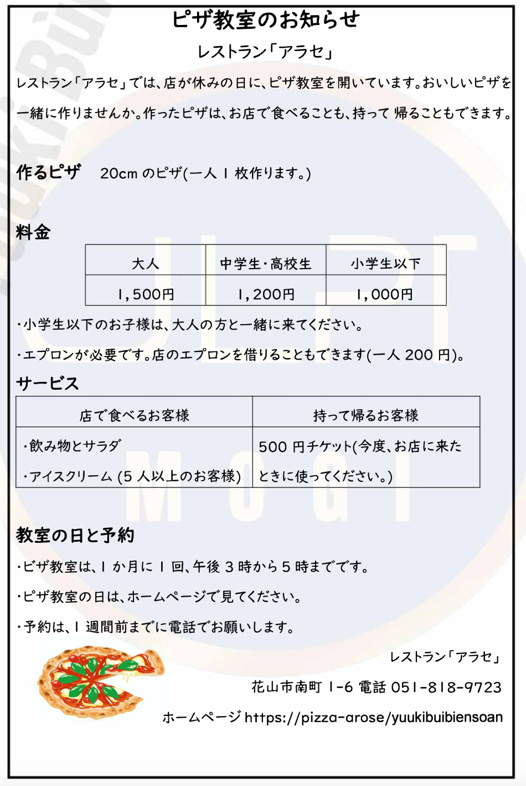

#### Question 28

ジェイさんは、小学生の娘と二人でピザを作りに行きたいです。ジェイさんのエプロンは持っていきますが、娘のものは借りるつもりです。ジェイさんたちが、ピザ教室に払う料金はどうなりますか。

1. ジェイさん1,000円だけ、娘1,000円と200円
2. ジェイさん1,500円だけ、娘1,000円だけ
3. **ジェイさん1,500円だけ、娘1,000円と200円**
4. ジェイさん1,500円と200円、娘1,000円と200円

**Correct answer:** 3. ジェイさん1,500円だけ、娘1,000円と200円

**Translation**
Ms. Jay wants to go make pizza with her elementary school daughter.
Ms. Jay will bring her own apron, but plans to borrow one for her daughter.
How much will they have to pay for the pizza class?

**Explanation**

From the pizza class notice:
| Category | Fee |
| ------------------------------------- | --------- |
| Adults | 1,500 yen |
| Junior high / high school students | 1,200 yen |
| Elementary school students or younger | 1,000 yen |

Other information:

Apron is required (エプロンが必要です).
Borrowing an apron costs 200 yen per person.

🧮 Calculation

| Person | Pizza Class Fee | Apron Fee | Total |
| -------- | --------------- | -------------------- | ------ |
| Jay | 1,500円 | 0円 (brings her own) | 1,500円 |
| Daughter | 1,000円 | 200円 (borrows apron) | 1,200円 |

✅ Correct Answer: ③

**Other Answer Choices**
ジェイさん1,000円だけ、娘1,000円と200円
→ Ms. Jay pays only 1,000 yen; her daughter pays 1,000 yen + 200 yen.
❌ Wrong — Jay is an adult, so her fee is 1,500 yen, not 1,000 yen.

ジェイさん1,500円だけ、娘1,000円だけ
→ Ms. Jay pays only 1,500 yen; her daughter pays only 1,000 yen.
❌ Wrong — The daughter is borrowing an apron, so add 200 yen.

ジェイさん1,500円だけ、娘1,000円と200円 ✅
→ Ms. Jay pays 1,500 yen; her daughter pays 1,000 yen + 200 yen (for the apron).
✅ Correct — total: 1,500 + 1,200 = 2,700 yen.

ジェイさん1,500円と200円、娘1,000円と200円
→ Ms. Jay pays 1,500 yen + 200 yen; her daughter pays 1,000 yen + 200 yen.
❌ Wrong — Jay brings her own apron, so no extra 200 yen.

#### Question 29

ナムさんは、大学の友達と3人で、ピザ教室の予約をしました。ナムさんたちはピザ教室のあと、作ったピザを食べて帰ろうと思っています。ピザを食べるときに、何をサービスしてもらえますか。

1. **飲み物とサラダ**
2. 飲み物とサラダとアイスクリーム
3. アイスクリーム
4. 500円チケット

**Correct answer:** 1. 飲み物とサラダ

**Translation**
Mr. Nam made a reservation for the pizza class with two university friends (three people total).After the pizza class, they plan to eat the pizza they made at the restaurant before going home.What kind of service will they receive when eating the pizza?

**Explanation**

📖 From the poster — Service section
| Eat at the restaurant | Take home |
| ----------------------------------------------------- | ---------------------------------------- |
| 飲み物とサラダ (drink & salad) | 500円チケット (500 yen coupon for next visit) |
| アイスクリーム（5人以上のお客様） (ice cream for groups of 5 or more) | — |

🧠 Reasoning

Nam’s group = 3 people

They will eat at the restaurant (not take home)

→ They qualify for: 飲み物とサラダ
→ But they don’t qualify for ice cream (needs 5 or more people)

✅ Correct Answer: ①

**Answer Choices**
飲み物とサラダ ✅
→ Drink and salad.
✅ Correct — because they’re eating in the restaurant, and they have fewer than 5 people.

飲み物とサラダとアイスクリーム
→ Drink, salad, and ice cream.
❌ Wrong — Ice cream is only for groups of 5 or more.

アイスクリーム
→ Ice cream only.
❌ Wrong — They do get drinks and salad instead.

500円チケット
→ 500-yen coupon.
❌ Wrong — That’s for customers who take the pizza home, not those who eat at the restaurant.

## 聴解

### もんだい1: Task-based Comprehension

> もんだい1では、まず 　しつもんを　聞いて　ください。それから　話を　聞いて、もんだいようしの　1から4の　中から、いちばん　いい　ものを　一つ えらんで　ください。

#### Question 1

ばん

1. 今日のひる休み
2. **今日のゆうがた**
3. あしたのひる休み
4. あしたのゆうがた

**Correct answer:** 2. 今日のゆうがた

**Transcript**

授業（じゅぎょう）の後（あと）で女（おんな）の留学生（りゅうがくせい）と先生（せんせい）が話（はな）しています。女（おんな）の留学生（りゅうがくせい）はいつ先生（せんせい）の部屋（へや）に行（い）きますか。

F： 先生（せんせい）、昨日（きのう）習（なら）った文法（ぶんぽう）について質問（しつもん）があります。
M： あ、これからすぐ次（つぎ）の授業（じゅぎょう）があるんです。昼休（ひるやす）みでもいいですか。
F： すみません、午後（ごご）の授業（じゅぎょう）のテキストを家（いえ）に忘（わす）れてしまって、昼休（ひるやす）みに取（と）りに帰（かえ）るんです。あ、明日（あした）でも大丈夫（だいじょうぶ）です。
M： 明日（あした）はちょっと時間（じかん）がないので、夕方（ゆうがた）、今日（きょう）午後（ごご）の授業（じゅぎょう）の後（あと）で私（わたし）の部屋（へや）に来（こ）られますか。
F： はい、よろしくおねがいします。

女（おんな）の留学生（りゅうがくせい）はいつ先生（せんせい）の部屋（へや）に行（い）きますか。

**Explanation**

After class, a female international student is talking with her teacher. When will she go to the teacher’s office?

F: Teacher, I have a question about the grammar we learned yesterday.
M: Oh, I have another class right after this. Would lunch break be okay?
F: Sorry, I forgot the afternoon class textbook at home, so I’m going back to get it during lunch break. Ah, tomorrow is also fine.
M: Tomorrow I don’t have time, so could you come to my office this evening, after today’s afternoon class?
F: Yes, thank you very much.

When will the female student go to the teacher’s office?

#### Question 2

ばん

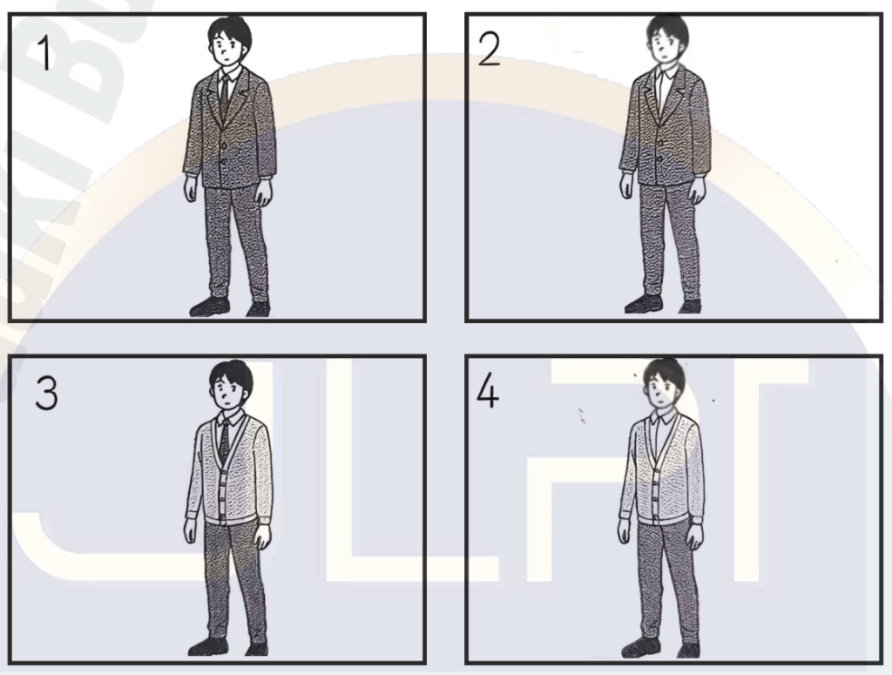

1. 1
2. 2
3. 3
4. **4**

**Correct answer:** 4. 4

**Transcript**

大学（だいがく）で女（おんな）の学生（がくせい）と男（おとこ）の学生（がくせい）が話（はな）しています。男（おとこ）の学生（がくせい）は研究会（けんきゅうかい）でどんな服（ふく）を着（き）ますか。

F： 山本（やまもと）さん、明日（あした）の研究会（けんきゅうかい）では受付（うけつけ）の係（かかり）をおねがいします。
M： はい。あのう、係（かかり）をするのが初（はじ）めてなんですが、服（ふく）はスーツがいいですか。[ネクタイ]は持（も）っていないんですが、しなくても大丈夫（だいじょうぶ）でしょうか。
F： [ネクタイ]は必要（ひつよう）ないです。寒（さむ）いから上着（うわぎ）はいるけど、荷物（にもつ）を運（はこ）ぶのも手伝（てつだ）ってもらうから、[ジャケット]じゃなくて、動（うご）きやすい[カーディガン]がいいですよ。
M： わかりました。そうします。

男（おとこ）の学生（がくせい）は研究会（けんきゅうかい）でどんな服（ふく）を着（き）ますか。

**Explanation**

At the university, a female and a male student are talking. What kind of clothes will the male student wear at the study meeting?

F: Yamamoto, please be in charge of reception at tomorrow’s study meeting.
M: Okay. Um, it’s my first time doing that, so should I wear a suit? I don’t have a tie, but is it okay without one?
F: You don’t need a tie. It’s cold, so you’ll need a jacket, but since you’ll also help carry things, something easy to move in, like a cardigan, is better than a suit jacket.
M: Got it. I’ll do that.

What kind of clothes will the male student wear at the study meeting?

#### Question 3

ばん

1. うけつけ
2. プール
3. **エレベーターの中**
4. ダンスのきょうしつ

**Correct answer:** 3. エレベーターの中

**Transcript**

[スポーツクラブ]で受付（うけつけ）の女（おんな）の人（ひと）と男（おとこ）の人（ひと）が話（はな）しています。女（おんな）の人（ひと）はこの後（あと）どこに[パーティー]の[お知らせ]を貼（は）りますか。

F： 先週（せんしゅう）から受付（うけつけ）にお花見（おはなみ）[パーティー]の[お知らせ]が貼（は）ってあるんですが、[パーティー]があることを知（し）らないお客様（おきゃくさま）が多（おお）いようなんです。それで、[プール]の入口（いりぐち）にも貼（は）ったんですが、まだ人（ひと）が集（あつ）まらないんです。
M： 受付（うけつけ）は他（ほか）の[お知らせ]も多（おお）いから、気（き）がつきにくいかもしれないね。[エレベーター]の中（なか）に貼（は）ってみない？
F： あっ、乗（の）っている時（とき）に見（み）てもらえそうですね。貼（は）ってみます。
M： 僕（ぼく）も今日（きょう）、[ダンス]の教室（きょうしつ）でお客様（おきゃくさま）に声（こえ）をかけてみるね。

女（おんな）の人（ひと）はこの後（あと）どこに[パーティー]の[お知らせ]を貼（は）りますか。

**Explanation**

At a sports club, a receptionist and a man are talking. Where will the woman post the party notice after this?

F: Since last week, we’ve had the cherry-blossom party notice posted at the reception, but it seems many customers don’t know about it. So, I also put one at the pool entrance, but still not many people are coming.
M: There are lots of other notices at the reception, so it might be hard to notice. How about posting one inside the elevator?
F: Ah, that’s a good idea — people can see it while riding. I’ll put one there.
M: I’ll also mention it to customers in the dance class today.

Where will the woman post the party notice after this?

#### Question 4

ばん

1. くろのえんぴつ
2. くろのペン
3. **あかのペン**
4. あおのペン

**Correct answer:** 3. あかのペン

**Transcript**

学校（がっこう）で先生（せんせい）が話（はな）しています。学生（がくせい）は何で書（か）きますか。

皆（みな）さん、漢字（かんじ）の宿題（しゅくだい）は持（も）って来（き）ましたか。[いつも]は私（わたし）が見（み）ていますが、今日（きょう）は[みんな]で[チェック]しましょう。隣（となり）の人（ひと）の漢字（かんじ）を見（み）てあげてください。正（ただ）しく書（か）けていますか。間違（まちが）っているところがあったら、直（なお）しましょう。
黒（くろ）の鉛筆（えんぴつ）や[ペン]では分（わ）かりにくいですから、必（かなら）ず赤（あか）の[ペン]を使（つか）ってください。持（も）っていない人（ひと）はここにありますから、使（つか）ってください。後（あと）で私（わたし）が青（あお）の[ペン]を使（つか）って[チェック]します。じゃ、自分（じぶん）の宿題（しゅくだい）を隣（となり）の人（ひと）に渡（わた）してください。

学生（がくせい）は何で書（か）きますか。

**Explanation**

At school, the teacher is speaking. What will the students use to write?

Teacher: Everyone, did you bring your kanji homework? Usually, I check it, but today let’s check together. Please look at your neighbor’s kanji. Are they written correctly? If there are mistakes, let’s correct them.
It’s hard to see with black pencils or pens, so please be sure to use a red pen. If you don’t have one, there are some here — please use them. Later, I’ll check with a blue pen. Okay, please pass your homework to your neighbor.

What will the students use to write?

#### Question 5

ばん

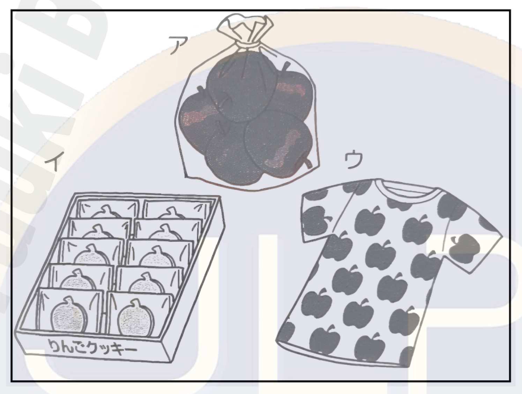

1. ア
2. イ
3. アウ
4. **イウ**

**Correct answer:** 4. イウ

**Transcript**

お土産屋（みやげや）で男（おとこ）の人（ひと）と女（おんな）の人（ひと）が話（はな）しています。男（おとこ）の人（ひと）は何を買（か）いますか。

M： 友達（ともだち）の家（うち）にお土産（おみやげ）を買（か）って行（い）きたいんだ。6歳（さい）の女（おんな）の子（こ）がいるんだけど、何がいいと思（おも）う？
F： この辺（へん）りは林檎（りんご）が有名（ゆうめい）だから、林檎（りんご）のお菓子（おかし）はどう？前（まえ）に、この店（みせ）の[クッキー]を[もら]ったんだけど、美味（おい）しかったよ。
M： いいね。じゃ、それを買（か）って…子供（こども）には他（ほか）にも何か上（あ）げたいなあ。
F： 私（わたし）はあそこにある林檎（りんご）がたくさん書（か）いてあるＴシャツを妹（いもうと）に買（か）ったよ。同（おな）じので子供（こども）のも売（う）っていて、可愛（かわい）かったよ。
M： 子供（こども）が喜（よろこ）びそうだね。[ありがとう]、あれにするよ。

男（おとこ）の人（ひと）は何を買（か）いますか。

**Explanation**

At a souvenir shop, a man and a woman are talking. What will the man buy?

M: I want to buy a souvenir for my friend’s house. They have a six-year-old girl — what do you think would be good?
F: Apples are famous around here, so how about an apple sweet? I got some cookies from this shop before — they were delicious.
M: Sounds good. I’ll buy that… but I’d like to give the child something else too.
F: I bought that T-shirt over there with lots of apples on it for my little sister. They sell the same one for kids, and it was really cute.
M: She’ll love that. Thanks — I’ll get that one.

What will the man buy?

#### Question 6

ばん

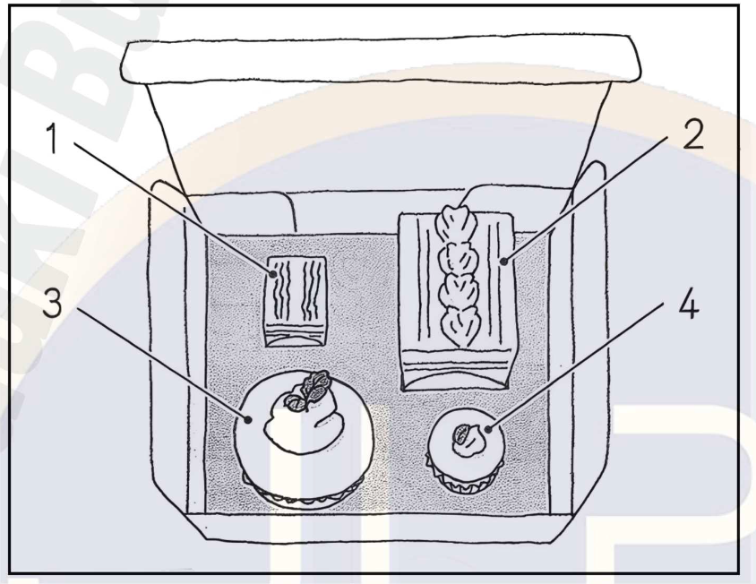

1. **1**
2. 2
3. 3
4. 4

**Correct answer:** 1. 1

**Transcript**

うちでお母さん（おかあさん）と子供（こども）が話（はな）しています。子供（こども）は、お客さん（おきゃくさん）のところにどれを持（も）って行（い）きますか。

母（はは）：一郎（いちろう）、今（いま）お客さん（おきゃくさん）が来（き）ているんだけど、そこにあるケーキをお客さん（おきゃくさん）に出（だ）してくれる？
子供（こども）：うん、いいよ。どれを持（も）って行（い）く？この大（おお）きくて丸（まる）いの？
母（はは）：あ、丸（まる）いのじゃなくて、その四角（しかく）のを出（だ）して。小（ちい）さいほうだよ。それは美味（おい）しいから、お客さん（おきゃくさん）に出（だ）しましょう。
子供（こども）：うん、わかった。あとで、この大（おお）きくて丸（まる）いのを食（た）べてもいい？
母（はは）：いいよ。

子供（こども）は、お客さん（おきゃくさん）のところにどれを持（も）って行（い）きますか。

**Explanation**

At home, a mother and a child are talking. Which cake will the child take to the guest?

M: Ichiro, our guest just arrived. Can you serve the cake over there to them?
C: Sure. Which one should I take? This big round one?
M: Oh, not the round one—take the square one. The smaller one. It’s delicious, so let’s give that to the guest.
C: Okay, got it. Then, can I eat this big round one later?
M: Sure.

Which cake will the child take to the guest?

#### Question 7

ばん

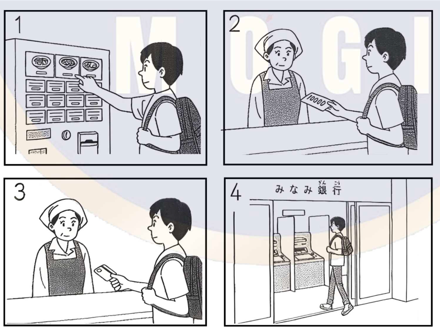

1. 1
2. 2
3. 3
4. **4**

**Correct answer:** 4. 4

**Transcript**

ラーメン屋（や）で店員（てんいん）と男（おとこ）の人（ひと）が話（はな）しています。男（おとこ）の人（ひと）はこの後（あと）、まず何をしますか。

女（おんな）：いらっしゃいませ。
男（おとこ）：あのう、しょうゆラーメンをお願い（おねがい）したいんですが。
女（おんな）：店（みせ）の外（そと）にある機械（きかい）で、ラーメンのチケットを買（か）って出（だ）してもらえますか。
男（おとこ）：いえ、外（そと）の機械（きかい）は1万（まん）えんが使（つか）えないようなので、店（みせ）の中（なか）で1万（まん）えんかクレジットカードで払（はら）えませんか。
女（おんな）：できないんですよ。南銀行（なんぎんこう）のATMなら、2件隣（けんとなり）にあるんですが。でも他（ほか）の銀行（ぎんこう）のキャッシュカードを使（つか）うと、少（すこ）し料金（りょうきん）がかかってしまいますね。
男（おとこ）：いえ、大丈夫（だいじょうぶ）です。そうします。

男（おとこ）の人（ひと）はこの後（あと）、まず何をしますか。

**Explanation**

At a ramen shop, a male customer and a female employee are talking. What will the man do next?

F: Welcome.
M: Um, I’d like to order shoyu ramen.
F: Please buy a ramen ticket from the machine outside and bring it to me.
M: Oh, the outside machine doesn’t accept 10,000-yen bills. Can I pay with a 10,000-yen bill or credit card inside the shop?
F: Sorry, you can’t. There’s a South Bank ATM two doors down, but if you use another bank’s cash card, there will be a small fee.
M: That’s fine. I’ll do that.

What will the man do next?

#### Question 8

ばん

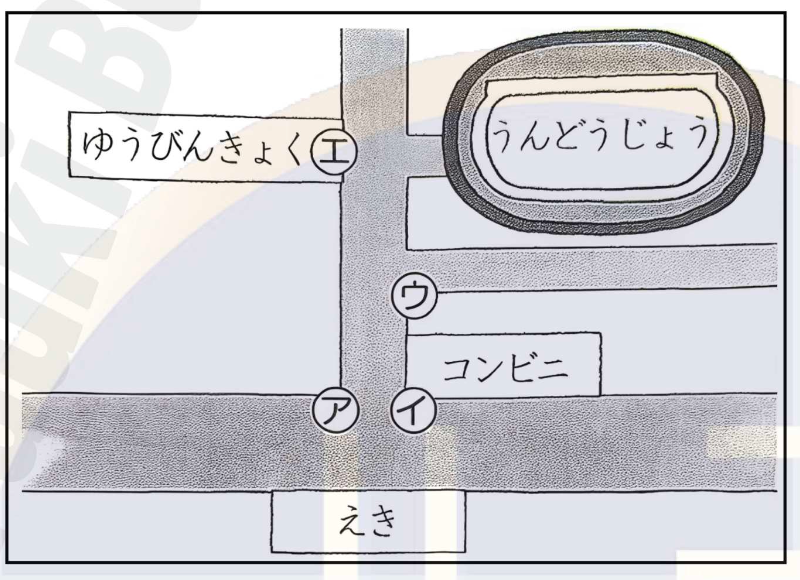

1. **アウ**
2. アエ
3. イウ
4. イエ

**Correct answer:** 1. アウ

**Transcript**

男（おとこ）の人（ひと）と女（おんな）の人（ひと）が話（はな）しています。女（おんな）の人（ひと）は係（かかり）の人（ひと）をどこに立（た）たせますか。

男（おとこ）：来週（らいしゅう）の会社（かいしゃ）の運動会（うんどうかい）、駅（えき）から運動場（うんどうじょう）まで道（みち）に立（た）って案内（あんない）してくれる係（かかり）の人（ひと）はもう見（み）つかった？
女（おんな）：はい、係（かかり）は2人（にん）なんですが、どこに立（た）ってもらいましょうか。
男（おとこ）：まず、駅（えき）を出（で）てすぐ違（ちが）う道（みち）に行（い）ってしまったら、運動場（うんどうじょう）に着（つ）けないから、駅（えき）の前（まえ）には必要（ひつよう）だね。[コンビニ]の前（まえ）は人（ひと）が多（おお）いから、[コンビニ]がない方（ほう）の角（かど）にしよう。
女（おんな）：はい。
男（おとこ）：それから、次（つぎ）の角（かど）にも1人（にん）立（た）ってもらう。角（かど）を曲（ま）がってしまう人（ひと）がいるかもしれないからね。
女（おんな）：わかりました。そこからは、まっすぐ行（い）けば右手（みぎて）に運動場（うんどうじょう）が見（み）えますし、郵便局（ゆうびんきょく）の前（まえ）に大（おお）きな地図（ちず）があるので大丈夫（だいじょうぶ）ですね。そうします。

女（おんな）の人（ひと）は係（かかり）の人（ひと）をどこに立（た）たせますか。

**Explanation**

A man and a woman are talking. Where will the woman have the staff members stand?

M: For next week’s company sports day, have you already found people to guide everyone from the station to the sports ground?
F: Yes, there will be two staff members. Where should they stand?
M: First, since people might go the wrong way right after leaving the station, we’ll need someone in front of the station. There are too many people near the convenience store, so let’s place them on the corner without the convenience store.
F: Okay.
M: Then, let’s have the other one stand at the next corner too — some people might turn there by mistake.
F: Got it. From there, if they go straight, they can see the sports ground on the right, and there’s a big map in front of the post office, so that should be fine. I’ll do that.

Where will the woman have the staff members stand?

### もんだい2: Comprehension of Key Points

> もんだい2では、まず　しつもんを　聞いて　ください。そのあと、もんだいようしを　見て　ください。読む　時間が　あります。それから　話を　聞いて、もんだいようしの　1から4の　中から、いちばん　いい　ものを 一つ えらんで　ください。

#### Question 1

ばん

1. 5日の午後2時から
2. 5日の午後5時から
3. 12日の午後2時から
4. **12日の午後5時から**

**Correct answer:** 4. 12日の午後5時から

**Transcript**

電話（でんわ）で電気屋（でんきや）の人（ひと）と女（おんな）の人（ひと）が話（はな）しています。[クーラー]の工事（こうじ）はいつになりましたか。

男（おとこ）：はい、西川電機（にしかわでんき）です。
女（おんな）：今月5日（にち）の午後（ごご）2時（じ）に[クーラー]の工事（こうじ）を予約（よやく）している森田（もりた）です。すみませんが、都合（つごう）が悪（わる）くなってしまったので、違（ちが）う日（ひ）に変（か）えてもらうことはできますか。
男（おとこ）：そうですか。次（つぎ）の週（しゅう）になりますが、12日（にち）の午後（ごご）2時（じ）か5時（じ）はいかがでしょうか。
女（おんな）：じゃ、5時（じ）にお願い（おねがい）できますか。
男（おとこ）：わかりました。

[クーラー]の工事（こうじ）はいつになりましたか。

**Explanation**

A woman is talking on the phone with a man from an electronics shop. When was the air conditioner installation rescheduled?

M: Hello, this is Nishikawa Electric.
F: Hello, this is Morita. I reserved an air conditioner installation for the 5th of this month at 2 p.m., but something came up. Could I change it to another day?
M: I see. The following week would be possible — how about the 12th at either 2 p.m. or 5 p.m.?
F: Then, could we make it 5 p.m., please?
M: Certainly.

When was the air conditioner installation rescheduled?

#### Question 2

ばん

1. よやくした本がとどいたから
2. **マフラーをさがしたいから**
3. かりるのをわすれた本があるから
4. しりょうをおいてきたから

**Correct answer:** 2. マフラーをさがしたいから

**Transcript**

家（いえ）で息子（むすこ）とお母さん（おかあさん）が話（はな）しています。息子（むすこ）はどうして、また図書館（としょかん）へ行（い）きますか。

息子（むすこ）：もう一度図書館（としょかん）に行（い）ってくる。
母（はは）：えっ、予約（よやく）した本（ほん）を取（と）りに行（い）って、今帰（かえ）ってきたところなのに、また？
息子（むすこ）：うん。今（いま）気（き）がついたんだけど、[マフラー]を置（お）いてきたかもしれない。図書館（としょかん）に着（つ）いて、初（はじ）めはしていたんだけど、冬休（ふゆやす）みの宿題（しゅくだい）に使（つか）う資料（しりょう）をいろいろ探（さが）していて、暑（あつ）くなって、椅子（いす）かどこかに置（お）いたと思う。ちょっと見（み）てくる。
母（はは）：そう。じゃ、行（い）ってらっしゃい、気（き）をつけてね。

息子（むすこ）はどうして、また図書館（としょかん）へ行（い）きますか。

**Explanation**

At home, a mother and her son are talking. Why is the son going to the library again?

S: I’m going to the library again.
M: What? You just came back after picking up the book you reserved! Again?
S: Yeah, I just realized I might have left my scarf there. When I got to the library, I had it on, but I got warm while searching for materials for my winter homework, so I think I left it on a chair or something. I’ll go check.
M: I see. All right, be careful.

Why is the son going to the library again?

#### Question 3

ばん

1. **日本のだいがくいんでべんきょうする**
2. じぶんの国でべんきょうをつづける
3. じぶんの国で会社をつくる
4. 日本の会社ではたらく

**Correct answer:** 1. 日本のだいがくいんでべんきょうする

**Transcript**

大学（だいがく）で女（おんな）の学生（がくせい）と男（おとこ）の留学生（りゅうがくせい）が話（はな）しています。男（おとこ）の留学生（りゅうがくせい）は大学（だいがく）を卒業（そつぎょう）した後（あと）、初（はじ）めに何をしたいと言（い）っていますか。

女（おんな）：[ワン]さんは大学（だいがく）を卒業（そつぎょう）したらどうするんですか。国（くに）に帰（かえ）るんですか。
男（おとこ）：あ、大学（だいがく）を卒業（そつぎょう）したら、日本（にほん）の大学院（だいがくいん）へ行（い）って貿易（ぼうえき）について勉強（べんきょう）するつもりです。将来（しょうらい）、国（くに）に帰（かえ）って貿易（ぼうえき）の会社（かいしゃ）を作（つく）りたいので、たくさん勉強（べんきょう）しておきたいんです。
女（おんな）：ああ、そうですか。
男（おとこ）：大学院（だいがくいん）を出（で）た後（あと）は、日本（にほん）の貿易（ぼうえき）会社（かいしゃ）で働（はたら）いて、いろいろな経験（けいけん）をしてから国（くに）へ帰（かえ）ろうと思（おも）っています。
女（おんな）：そうですか、楽（たの）しみですね。

男（おとこ）の留学生（りゅうがくせい）は大学（だいがく）を卒業（そつぎょう）した後（あと）、初（はじ）めに何をしたいと言（い）っていますか。

**Explanation**

At a university, a female student and a male exchange student are talking. What does the male student say he wants to do first after graduating?

F: Mr. Wang, what will you do after graduating? Are you going back to your country?
M: Oh, after graduating, I plan to go to graduate school in Japan to study trade. In the future, I want to return home and start a trading company, so I want to study a lot now.
F: I see.
M: After finishing graduate school, I’d like to work at a trading company in Japan to gain experience before returning to my country.
F: That sounds exciting.

What does the male student say he wants to do first after graduating?

#### Question 4

ばん

1. ほかのにも行ってみたいから
2. 店のばしょがとおくなったから
3. **こんでいてよやくがとれないから**
4. りょうきんが高くなったから

**Correct answer:** 3. こんでいてよやくがとれないから

**Transcript**

会社（かいしゃ）で男（おとこ）の人（ひと）と女（おんな）の先輩（せんぱい）が話（はな）しています。男（おとこ）の人（ひと）はどうしていつもの店（みせ）に髪（かみ）を切（き）りに行（い）かないと言（い）っていますか。

男（おとこ）：先輩（せんぱい）、髪（かみ）を切（き）りたいんですけど、どこかいい店（みせ）を知（し）りませんか。
女（おんな）：えっ、いつも行（い）っている店（みせ）は？
男（おとこ）：学生（がくせい）の時（とき）からずっと家（いえ）の近（ちか）くの店（みせ）に行（い）っていたんですけど、最近（さいきん）全然（ぜんぜん）予約（よやく）が取（と）れなくなってしまったんです。
女（おんな）：どうして？
男（おとこ）：切（き）るのがすごく上手（じょうず）で、料金（りょうきん）も高（たか）くないから、[テレビ]で紹介（しょうかい）されたんです。それで人気（にんき）が出（で）て、昼（ひる）も夜（よる）もお客（きゃく）さんがいっぱいなんですよ。
女（おんな）：そう。じゃ、私（わたし）がよく行（い）く店（みせ）の名刺（めいし）をあげるね。

男（おとこ）の人（ひと）はどうしていつもの店（みせ）に髪（かみ）を切（き）りに行（い）かないと言（い）っていますか。

**Explanation**

At a company, a man and his female senior are talking. Why does the man say he can’t go to his usual barber?

M: Senpai, I’d like to get a haircut. Do you know any good places?
F: Huh? What about the place you always go to?
M: I’ve gone to the one near my home since I was a student, but recently I haven’t been able to get an appointment at all.
F: Why’s that?
M: The barber is really good and not expensive, and they were featured on TV. So now they’re super popular — full of customers day and night.
F: I see. Then I’ll give you the card for the salon I usually go to.

Why does the man say he can’t go to his usual barber?

#### Question 5

ばん

1. びじゅつかん前
2. しみんびょういん
3. **さくら小学校前**
4. あさひやデパート

**Correct answer:** 3. さくら小学校前

**Transcript**

バスの中（なか）で、男（おとこ）の人（ひと）と女（おんな）の人（ひと）が話（はな）しています。男（おとこ）の人（ひと）はどのバス停（ばすてい）で下（お）りますか。

男（おとこ）：あのう、すみません、今止（と）まったのはどこですか。
女（おんな）：美術館前（びじゅつかんまえ）のバス停（ばすてい）です。
男（おとこ）：あ、そうですか。市民病院（しみんびょういん）へ行（い）きたいんですが。
女（おんな）：市民病院（しみんびょういん）というバス停（てい）はないんですよ。
男（おとこ）：あ、そうですか。
女（おんな）：ええ、桜小学校前（さくらしょうがっこうまえ）のバス停（ばすてい）が近（ちか）いですね。次（つぎ）止（と）まるのが[あさひやデパート]なんですが、その次（つぎ）です。ここ（ここ）から2つ目（め）のバス停（ばすてい）です。
男（おとこ）：[あさひやデパート]の次（つぎ）ですね。ありがとうございます。

男（おとこ）の人（ひと）はどのバス停（ばすてい）で下（お）りますか。

**Explanation**

On a bus, a man and a woman are talking. At which bus stop will the man get off?

M: Excuse me, which stop is this?
F: This is Bijutsukan-mae (Art Museum Stop).
M: Oh, I see. I’d like to go to Shimin Hospital.
F: There isn’t a stop called “Shimin Hospital.”
M: Oh, really?
F: Yes, the closest one is Sakura Elementary School Stop. The next stop is Asahiya Department Store, and the one after that is Sakura Elementary School. That’s two stops from here.
M: After Asahiya Department Store, right? Thank you.

At which stop will the man get off?

#### Question 6

ばん

1. 一日中雨
2. **一日中はれ**
3. 午前ははれ、午後は雨
4. 午前は雨、午後ははれ

**Correct answer:** 2. 一日中はれ

**Transcript**

ラジオでアナウンサーが話（はな）しています。明日（あした）の天気（てんき）はどうなると言（い）っていますか。

アナウンサー：天気予報（てんきよほう）です。今日（きょう）は雨（あめ）が降（ふ）って、昨日（きのう）より寒（さむ）い1日（にち）でしたが、雨（あめ）は今晩（こんばん）には止（や）むでしょう。明日（あした）金曜日（きんようび）は1日中（にちじゅう）、青（あお）い空（そら）が見（み）られるでしょう。晴（は）れの天気（てんき）は明後日（あさって）土曜日（どようび）の午前中（ごぜんちゅう）までで、午後（ごご）からは雨（あめ）が降（ふ）るでしょう。雨（あめ）は日曜日（にちようび）の午前（ごぜん）まで続（つづ）きますが、午後（ごご）は晴（は）れるでしょう。

明日（あした）の天気（てんき）はどうなると言（い）っていますか。

**Explanation**

On the radio, an announcer is speaking. What does the announcer say about tomorrow’s weather?

Announcer: Here’s the weather forecast. Today it rained and was colder than yesterday, but the rain should stop by tonight. Tomorrow, Friday, you’ll be able to see blue skies all day. The clear weather will last until Saturday morning, and then it will rain in the afternoon. The rain will continue until Sunday morning, but it should clear up in the afternoon.

What does the announcer say about tomorrow’s weather?

#### Question 7

ばん

1. 読みたい本だけ読むこと
2. やさしい本をえらんで読むこと
3. とちゅうでべつの本を読むこと
4. **ことばのいみをしらべながら読むこと**

**Correct answer:** 4. ことばのいみをしらべながら読むこと

**Transcript**

日本語のクラスで先生（せんせい）が話（はな）しています。本（ほん）の読（よ）み方（かた）についてダメなことは何ですか。ダメなことです。

先生（せんせい）：この授業（じゅぎょう）では、私（わたし）がいろいろな本（ほん）をたくさん持（も）って行（い）きます。皆（みな）さんは自分（じぶん）が読（よ）みたい本（ほん）を1冊（さつ）ずつ選（えら）んでください。易（やさ）しい本（ほん）から読（よ）みましょう。話（はなし）が詰（つま）らなかったら、途中（とちゅう）で別（べつ）の本（ほん）に移（うつ）ってもいいです。
でも、この授業（じゅぎょう）では読（よ）む時（とき）のルールがあります。途中（とちゅう）で分（わ）からない言葉（ことば）があっても意味（いみ）を調（しら）べないで進（すす）んでください。大事（だいじ）な言葉（ことば）は繰（く）り返（かえ）されるので、だんだん分（わ）かるようになりますから。

本（ほん）の読（よ）み方（かた）についてダメなことは何ですか。

**Explanation**

In a Japanese class, the teacher is speaking. What are you *not allowed* to do when reading a book?

Teacher: In this class, I’ll bring many different books. Each of you should choose one book you’d like to read. Let’s start with easy ones. If the story is boring, you can switch to another book halfway through.
However, there’s a rule for reading in this class. Even if you come across words you don’t understand, please don’t look up their meanings — just keep reading. Important words will be repeated, so you’ll gradually understand them.

What are you not allowed to do when reading a book?

### もんだい3: Verbal Expressions

> もんだい3では、えを　見ながら　しつもんを　聞いて　ください。rn➡ （やじるし）の　人は 何と　言いますか。1から3の　中から、いちばん　いい　ものを 一つ　えらんで　ください。

#### Question 1

ばん

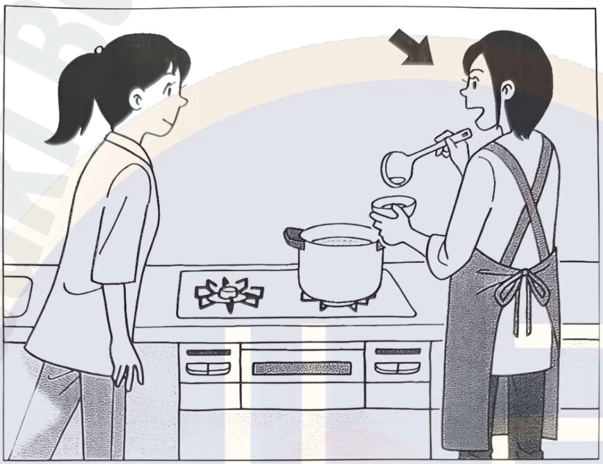

1. **1**
2. 2
3. 3

**Correct answer:** 1. 1

**Transcript**

スープを作（つく）っています。友達（ともだち）に味（あじ）をチェックしてもらいます。何と言（い）いますか。
1 ちょっと飲（の）んでみて？
2 少しスープをもらおう
3 美味（おい）しくしてね

**Explanation**

You are making soup and ask your friend to check the taste. What do you say?
1. Would you taste it for a bit?
2. I’ll take some soup.
3. Make it delicious, okay?

#### Question 2

ばん

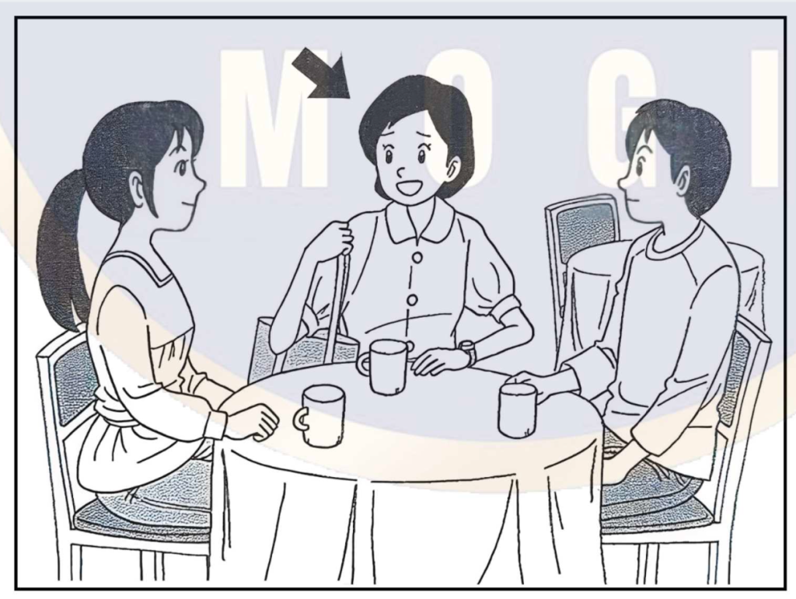

1. 1
2. 2
3. **3**

**Correct answer:** 3. 3

**Transcript**

用事（ようじ）があるので、先（さき）に帰（かえ）ります。友達（ともだち）に何と言（い）いますか。
1 今帰（かえ）ったところです
2 えっ、もう行（い）くんですか
3 そろそろ、出（で）ないといけないんです

**Explanation**

You have something to do and will go home first. What do you say to your friend?
1. I just got home.
2. Huh, are you leaving already?
3. I have to get going soon.

#### Question 3

ばん

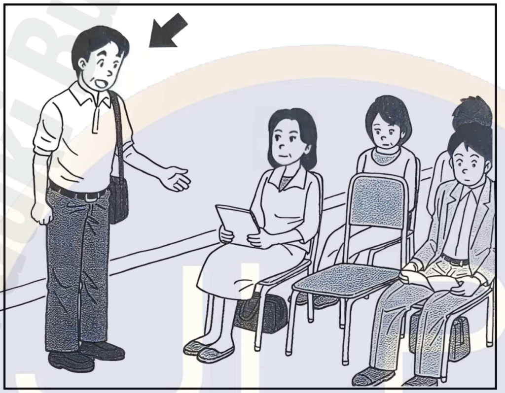

1. 1
2. 2
3. **3**

**Correct answer:** 3. 3

**Transcript**

席（せき）に座（すわ）りたいです。何と言（い）いますか。
1 そちらの席（せき）に座（すわ）ってください
2 そちらの席（せき）はいかがですか
3 そちらの席（せき）は空（あ）いていますか

**Explanation**

You want to sit down. What do you say?
1. Please sit in that seat.
2. How about that seat?
3. Is that seat free?

#### Question 4

ばん

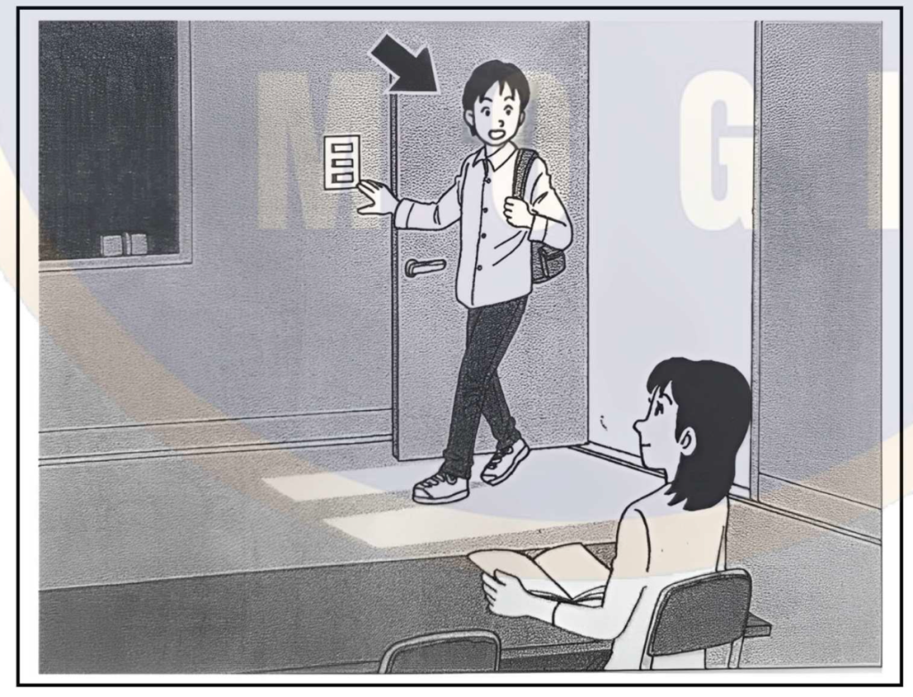

1. 1
2. **2**
3. 3

**Correct answer:** 2. 2

**Transcript**

友達（ともだち）が暗（くら）い教室（きょうしつ）で本（ほん）を読（よ）んでいます。何と言（い）いますか。
1 電気（でんき）、消（け）してもいい？
2 電気（でんき）、つけようか？
3 電気（でんき）、つけたままだよ

**Explanation**

Your friend is reading a book in a dark classroom. What do you say?
1. Can I turn off the light?
2. Shall I turn on the light?
3. The light is still on.

#### Question 5

ばん

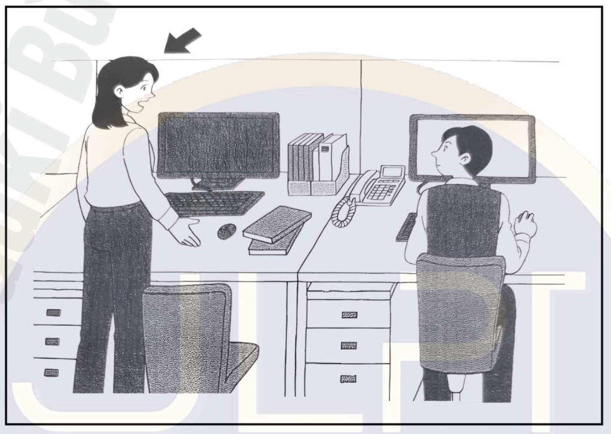

1. **1**
2. 2
3. 3

**Correct answer:** 1. 1

**Transcript**

机（つくえ）の上（うえ）に置（お）いておいたメモがありません。何と言（い）いますか。
1 ここにあったメモを知（し）らない？
2 メモすることがある？
3 私（わたし）のメモのどこを見（み）た？

**Explanation**

The memo you left on the desk is missing. What do you say?
1. Do you know about the memo that was here?
2. Do you have something to note down?
3. Which part of my memo did you look at?

### もんだい4: Quick Response

> もんだい4では、えなどが　ありません。まず　ぶんを　聞いて　ください。それから、そのへんじを　聞いて、1から3の　中から、いちばん　いい　ものを 一つ　えらんで　ください。

#### Question 1

1. 1
2. 2
3. **3**

**Correct answer:** 3. 3

**Transcript**

昼ご飯（ひるごはん）、食堂（しょくどう）で一緒（いっしょ）にどうですか。
1 どういたしまして
2 美味（おい）しいです
3 ええ、行（い）きましょう

**Explanation**

How about having lunch together in the cafeteria?
1. You’re welcome.
2. It’s delicious.
3. Yes, let’s go.

#### Question 2

1. 1
2. **2**
3. 3

**Correct answer:** 2. 2

**Transcript**

林（りん）さん、林（りん）さんの字（じ）は丁寧（ていねい）で読（よ）みやすいね。
1 すみません、気（き）をつけます
2 そうですか、ありがとうございます
3 本当（ほんとう）に読（よ）めませんか

**Explanation**

Lin, your handwriting is neat and easy to read.
1. I’m sorry, I’ll be careful.
2. Oh, really? Thank you.
3. Can’t you really read it?

#### Question 3

1. 1
2. 2
3. **3**

**Correct answer:** 3. 3

**Transcript**

日本（にほん）に来（き）たのは初（はじ）めてですか。
1 もう一度（いちど）来（き）たいです
2 日本語（にほんご）を勉強（べんきょう）するためです
3 いいえ、2回（かい）目です

**Explanation**

Is this your first time coming to Japan?
1. I want to come again.
2. It’s to study Japanese.
3. No, it’s my second time.

#### Question 4

1. **1**
2. 2
3. 3

**Correct answer:** 1. 1

**Transcript**

昨日（きのう）、道（みち）で乗（の）っていた自転車（じてんしゃ）が壊（こわ）れて、歩（ある）いて帰（かえ）ったんだよ。
1 大変（たいへん）だったね
2 難（むずか）しかったね
3 悪（わる）そうだったね

**Explanation**

Yesterday, my bicycle broke on the road, so I walked home.
1. That must’ve been tough.
2. That was difficult, huh.
3. It looked bad, huh.

#### Question 5

1. 1
2. 2
3. **3**

**Correct answer:** 3. 3

**Transcript**

大学（だいがく）を卒業（そつぎょう）して何年（なんねん）ですか。
1 4年間（ねんかん）行（い）きました
2 はい、卒業（そつぎょう）しました
3 ちょうど10年（ねん）です

**Explanation**

How many years has it been since you graduated from university?
1. I attended for four years.
2. Yes, I graduated.
3. It’s been exactly ten years.

#### Question 6

1. 1
2. **2**
3. 3

**Correct answer:** 2. 2

**Transcript**

私（わたし）が風邪（かぜ）で休（やす）んでいる間（あいだ）、日本語（にほんご）の授業（じゅぎょう）で宿題（しゅくだい）が出（で）た？
1 それはできないよ
2 何もなかったよ
3 僕（ぼく）は授業（じゅぎょう）に出（で）たよ

**Explanation**

While I was home sick, was there any homework given in Japanese class?
1. That’s not possible.
2. Nothing was assigned.
3. I attended the class.

#### Question 7

1. **1**
2. 2
3. 3

**Correct answer:** 1. 1

**Transcript**

部長（ぶちょう）に午後（ごご）の会議（かいぎ）の資料（しりょう）を渡（わた）して来（き）てくれませんか。
1 はい、すぐに届（とど）けます
2 資料（しりょう）がいるかどうか、聞（き）くんですね
3 じゃ、部長（ぶちょう）にもら（もら）って来（き）ます

**Explanation**

Could you take these materials for the afternoon meeting to the section chief?
1. Yes, I’ll deliver them right away.
2. You mean to ask if the materials are needed?
3. Then I’ll go get them from the section chief.

#### Question 8

1. 1
2. 2
3. **3**

**Correct answer:** 3. 3

**Transcript**

今から買（か）い物（もの）に行（い）くけど、冷蔵庫（れいぞうこ）にまだ卵（たまご）ある？
1 食（た）べたこと、ないよ
2 まだないよ
3 ひとつしかないよ

**Explanation**

I’m going shopping now — are there still any eggs in the fridge?
1. I’ve never eaten them.
2. There aren’t any yet.
3. There’s only one left.
