# JLPT N4 Mock Test – July 2025

## げんごちしき（もじ・ごい）

### もんだい１: Kanji Reading

> もんだい１　____の　ことばは　ひらがなで　どう　かきますか。1・2・3・4から　いちばん　いい　ものを　ひとつ　えらんで　ください。

#### Question 1

すぐに　<u>集めて</u>　ください。

1. やめて
2. きめて
3. **あつめて**
4. とめて

**Correct answer:** 3. あつめて

**Correct Answer**

Answer 3: あつめて is correct. It means "collect" or "gather."

**Question Translation**

Please **collect** (them) immediately.

**Explanation**

The kanji **集** reads as **あつ** (atsu) in the verb **集める** (atsumeru - to collect/gather something). Note the tree (木) at the bottom and birds (隹) gathering on top.

**Why Other Options Are Incorrect**

1. やめて (yamete) means "stop it" (from 止める/辞める).
2. きめて (kimete) means "decide" (from 決める).
4. とめて (tomete) means "stop" (movement) or "fasten" (from 止める/留める).

**Test-Taking Tip**

Be careful with transitive vs. intransitive verbs.
**集める (Atsumeru)** = You collect something.
**集まる (Atsumaru)** = People/Things gather naturally.

#### Question 2

あそこに　いるのが　わたしの　<u>姉</u>です。

1. おとうと
2. あに
3. いもうと
4. **あね**

**Correct answer:** 4. あね

**Correct Answer**

Answer 4: あね is correct. It means "(my) older sister."

**Question Translation**

The person over there is my **older sister**.

**Explanation**

The kanji **姉** is read as **あね** (ane) when referring to one's own older sister to others.

**Why Other Options Are Incorrect**

1. おとうと (otouto) means "younger brother" (弟).
2. あに (ani) means "older brother" (兄).
3. いもうと (imouto) means "younger sister" (妹).

**Test-Taking Tip**

Family Terms Rule:
* Talking about **your own** family to others: Use the humble short forms (**母、父、姉、兄**).
* Talking about **someone else's** family (or addressing yours directly): Use the polite forms (**お母さん、お父さん、お姉さん、お兄さん**).

#### Question 3

むこうで　何か　<u>光って</u>　いますね。

1. **ひかって**
2. かざって
3. うって
4. なって

**Correct answer:** 1. ひかって

**Correct Answer**

Answer 1: ひかって is correct. It means "shining."

**Question Translation**

Something is **shining** over there, isn't it?

**Explanation**

The kanji **光** reads as **ひか** (hika) in the verb **光る** (hikaru - to shine/glow).

**Why Other Options Are Incorrect**

2. かざって (kazatte) means "decorate" (from 飾る).
3. うって (utte) means "hit" (打つ) or "sell" (売る).
4. なって (natte) means "ring" (鳴る) or "become" (なる).

**Test-Taking Tip**

Visual Memory Aid: The kanji **光** looks like a fire (火) on top of legs (儿). Imagine a running fire **shining** brightly.

#### Question 4

<u>今度</u>の　日よう日に　きこくします。

1. こんどう
2. **こんど**
3. こんと
4. こんとう

**Correct answer:** 2. こんど

**Correct Answer**

Answer 2: こんど is correct. It means "next time" or "this coming."

**Question Translation**

I will return to my country **this coming** Sunday.

**Explanation**

The word **今度** is read as **こんど** (kondo). It refers to the nearest upcoming occasion or "next time."

**Why Other Options Are Incorrect**

1. こんどう (kondou) is incorrect. The 'do' is short.
3. こんと (konto) is incorrect. The sound must be voiced (ten-ten).
4. こんとう (kontou) is incorrect.

**Test-Taking Tip**

JLPT loves to trick you with **Long Vowels** (ou) vs **Short Vowels** (o).
**度** is read **do** (short), not **dou**. (e.g., 温度 - ondo, 一度 - ichido).

#### Question 5

その　<u>赤い</u>　サンダルを　ください。

1. あおい
2. **あかい**
3. しろい
4. くろい

**Correct answer:** 2. あかい

**Correct Answer**

Answer 2: あかい is correct. It means "red."

**Question Translation**

Please give me those **red** sandals.

**Explanation**

The kanji **赤** is read as **あか** (aka). **赤い** is the i-adjective for red.

**Why Other Options Are Incorrect**

1. あおい (aoi) means "blue" (青い).
3. しろい (shiroi) means "white" (白い).
4. くろい (kuroi) means "black" (黒い).

**Test-Taking Tip**

Color Kanji checklist:
赤 (Red) - 2 legs at bottom.
黒 (Black) - Fire (4 dots) at bottom.
白 (White) - Simple shape with a tick on top.
青 (Blue) - 'Moon' radical at the bottom.

#### Question 6

<u>火</u>に　気を　つけて　ください。

1. いし
2. あぶら
3. **ひ**
4. えだ

**Correct answer:** 3. ひ

**Correct Answer**

Answer 3: ひ is correct. It means "fire."

**Question Translation**

Please be careful of **fire**.

**Explanation**

The kanji **火** is read as **ひ** (hi) when standing alone. The phrase "火に気をつける" is a common set phrase for fire safety.

**Why Other Options Are Incorrect**

1. いし (ishi) means "stone" (石).
2. あぶら (abura) means "oil" (油).
4. えだ (eda) means "branch" (枝).

**Test-Taking Tip**

Watch out for On-yomi vs Kun-yomi!
Alone: **火 (Hi)** = Fire.
Combined (Days of week): **火曜日 (KA-youbi)** = Tuesday.

#### Question 7

日本で　こめは　どれくらい　<u>生産</u>されて　いますか。

1. **せいさん**
2. せいせい
3. せいざん
4. せいぜい

**Correct answer:** 1. せいさん

**Correct Answer**

Answer 1: せいさん is correct. It means "production."

**Question Translation**

How much rice is **produced** in Japan?

**Explanation**

**生産** is formed by **生** (sei - life/birth) and **産** (san - give birth/products). Together it means production.

**Why Other Options Are Incorrect**

2. せいせい (seisei) is incorrect here.
3. せいざん (seizan) is incorrect. The 's' does not become 'z' (rendaku) here.
4. せいぜい (seizei) means "at most" (written as 精々).

**Test-Taking Tip**

In Sino-Japanese (On-yomi) compounds, the 'San' sound usually does NOT become 'Zan' unless it's a specific exception. Default to **San**.

### もんだい2: Orthography

> もんだい2　_____の　ことばは　どう　かきますか。1・2・3・4から　いちばん　いい ものを　ひとつ　えらんで　ください。

#### Question 8

この　へやは　<u>あかるい</u>ですね。

1. 暗るい
2. **明るい**
3. 暑るい
4. 寒るい

**Correct answer:** 2. 明るい

**Correct Answer**

Answer 2: 明るい is correct. It means "bright."

**Question Translation**

This room is **bright**, isn't it?

**Explanation**

**あかるい** (bright) uses the kanji **明**. It is made of the Sun (日) and the Moon (月) — the two brightest things in the sky.

**Why Other Options Are Incorrect**

1. 暗るい uses the kanji for "dark" (暗い - kurai). The opposite meaning.
3. 暑るい uses the kanji for "hot" (暑い - atsui).
4. 寒るい uses the kanji for "cold" (寒い - samui).

**Test-Taking Tip**

Always check the **Okurigana** (the hiragana after the kanji).
**明** can be 明るい (Aka-rui) or 明らか (Aki-raka). Make sure the hiragana matches the reading.

#### Question 9

わたしは　<u>うんてん</u>が　すきじゃ　ありません。

1. 連転
2. 運動
3. **運転**
4. 連動

**Correct answer:** 3. 運転

**Correct Answer**

Answer 3: 運転 is correct. It means "driving."

**Question Translation**

I do not like **driving**.

**Explanation**

**運転** (unten) consists of **運** (carry/luck) and **転** (revolve/turn). This combination refers to operating a machine.

**Why Other Options Are Incorrect**

1. 連転 uses 連 (ren - connect) which is incorrect.
2. 運動 (undou) means "exercise."
4. 連動 (rendou) means "interlocking/linking."

**Test-Taking Tip**

Look at the Radicals!
**運** (Carry) has the "Army" (軍) inside the movement radical.
**連** (Connect) has the "Car" (車) inside the movement radical.
Driving requires "carrying" yourself, so look for the Army.

#### Question 10

どんな　<u>あじ</u>でしたか。

1. 声
2. 色
3. 音
4. **味**

**Correct answer:** 4. 味

**Correct Answer**

Answer 4: 味 is correct. It means "taste" or "flavor."

**Question Translation**

What kind of **taste** was it?

**Explanation**

**あじ** (aji) corresponds to the kanji **味**. Note the **Mouth radical (口)** on the left, because you taste with your mouth.

**Why Other Options Are Incorrect**

1. 声 (koe) means "voice."
2. 色 (iro) means "color."
3. 音 (oto) means "sound."

**Test-Taking Tip**

Group senses by Kanji:
**味** (Taste) has a Mouth.
**音** (Sound) has a Sun standing on a Day.
**声** (Voice) has a Samurai (士) on top (mnemonic).

#### Question 11

10時に　<u>おわる</u>　そうです。

1. 始わる
2. **終わる**
3. 閉わる
4. 開わる

**Correct answer:** 2. 終わる

**Correct Answer**

Answer 2: 終わる is correct. It means "to end" or "to finish."

**Question Translation**

I heard it **ends** at 10 o'clock.

**Explanation**

**おわる** (owaru) uses the kanji **終** (End). It has the **Thread radical (糸)** on the left and Winter (冬) on the right (End of the year).

**Why Other Options Are Incorrect**

1. 始わる uses 始 (Start) - usually 始まる (hajimaru).
3. 閉わる uses 閉 (Close) - usually 閉まる (shimaru).
4. 開わる uses 開 (Open) - usually 開く (aku).

**Test-Taking Tip**

Remember opposites:
**始** (Start - Woman radical)
**終** (End - Thread radical)

#### Question 12

その　いけんには　<u>はんたい</u>です。

1. **反対**
2. 半対
3. 反体
4. 半体

**Correct answer:** 1. 反対

**Correct Answer**

Answer 1: 反対 is correct. It means "opposition" or "against."

**Question Translation**

I am **against** that opinion.

**Explanation**

**はんたい** (hantai) uses **反** (Anti/Opposite) and **対** (Versus/Pair).

**Why Other Options Are Incorrect**

2. 半対 uses **半** (Half), which is a visual trick.
3. 反体 uses **体** (Body - tai), which sounds the same but has the wrong meaning.
4. 半体 is a combination of incorrect kanji.

**Test-Taking Tip**

Distinguish **反** vs **半**:
**反** (Opposite/Anti) - The top line is flat. No vertical line crossing it.
**半** (Half) - The vertical line goes all the way through the top. (Like cutting something in half).

### もんだい３: Contextually-defined Expressions

> もんだい３　(　　　)に　なにを　いれますか。1・2・3・4から　いちばん　いい　ものを ひとつ　えらんで　ください。

#### Question 13

（　　　）が　あったら、わたしも　外国で　しごとが　したいです。

1. サイン
2. メニュー
3. ニュース
4. **チャンス**

**Correct answer:** 4. チャンス

**Correct Answer**

Answer 4: チャンス (Chance) is correct.

**Question Translation**

If I have a **chance/opportunity**, I also want to work in a foreign country.

**Explanation**

The sentence expresses a desire to do something if the condition permits. **チャンス** (chance) fits the context of "opportunity."

**Why Other Options Are Incorrect**

1. サイン means "signature" or "autograph."
2. メニュー means "menu."
3. ニュース means "news."

**Test-Taking Tip**

For Katakana words, try saying the sentence in English with the loan word. "If I have a **chance**, I want to work abroad." It usually makes perfect sense.

#### Question 14

友だちが　来たので、わたしの　すんで　いる　まちを　（　　　）して　あげました。

1. しゅっぱつ
2. **あんない**
3. よやく
4. じゅんび

**Correct answer:** 2. あんない

**Correct Answer**

Answer 2: あんない (guide) is correct.

**Question Translation**

Since my friend came, I **guided** (showed them around) the town I live in.

**Explanation**

**案内** (annai) means to show someone around or guide them. It is the most natural action when a friend visits your town.

**Why Other Options Are Incorrect**

1. しゅっぱつ means "departure" (出発).
3. よやく means "reservation" (予約).
4. じゅんび means "preparation" (準備).

**Test-Taking Tip**

Look for the object! **「町を」** (The town). You don't "depart" the town (usually requires から), or "reserve" the town. You **guide** (show around) the town.

#### Question 15

この　魚は、日本には　ほとんど　いない　（　　　）　魚です。

1. **めずらしい**
2. はずかしい
3. きびしい
4. かなしい

**Correct answer:** 1. めずらしい

**Correct Answer**

Answer 1: めずらしい (rare) is correct.

**Question Translation**

This fish is a **rare** fish that hardly exists in Japan.

**Explanation**

The sentence defines the word in the first half: "日本にはほとんどいない" (hardly exists in Japan). This definition matches **珍しい** (mezurashii - rare/uncommon).

**Why Other Options Are Incorrect**

2. はずかしい means "embarrassing" or "shy" (恥ずかしい).
3. きびしい means "strict" (厳しい).
4. かなしい means "sad" (悲しい).

**Test-Taking Tip**

Vocabulary questions often act like riddles.
"Hardly exists" = **Rare**.
"Very popular" = **Famous**.
Find the definition in the sentence.

#### Question 16

ちかくに　スーパーが　ないので、かいものを　するのに　（　　　）です。

1. ざんねん
2. きけん
3. **ふべん**
4. むり

**Correct answer:** 3. ふべん

**Correct Answer**

Answer 3: ふべん (inconvenient) is correct.

**Question Translation**

Since there is no supermarket nearby, it is **inconvenient** for shopping.

**Explanation**

The lack of facilities (no supermarket) makes life difficult. **不便** (fuben) is the correct word for "inconvenient."

**Why Other Options Are Incorrect**

1. ざんねん means "regrettable" or "a pity" (残念) - used for feelings, not convenience.
2. きけん means "dangerous" (危険).
4. むり means "impossible" (無理).

**Test-Taking Tip**

Pairs:
No shops / No trains = **不便** (Inconvenient).
Many shops / Good trains = **便利** (Convenient).

#### Question 17

しゃしんを　この　かみに　はりたいんですが、（　　　）は　ありますか。

1. はさみ
2. **のり**
3. いと
4. はり

**Correct answer:** 2. のり

**Correct Answer**

Answer 2: のり (glue) is correct.

**Question Translation**

I want to paste a photo onto this paper; do you have any **glue**?

**Explanation**

The verb **はる** (to paste/stick) requires an adhesive. **のり** is glue.

**Why Other Options Are Incorrect**

1. はさみ means "scissors" (used for **切る** - cutting).
3. いと means "thread" (used for **縫う** - sewing).
4. はり means "needle" (used for sewing) or "pin."

**Test-Taking Tip**

Associate tools with verbs:
**切る (Cut)** -> **はさみ (Scissors)**
**貼る (Paste)** -> **のり (Glue)**
**書く (Write)** -> **えんぴつ (Pencil)**

#### Question 18

きのうの　じこの　ことが　けさの　新聞に　（　　　）　いました。

1. **のって**
2. たって
3. のぼって
4. かかって

**Correct answer:** 1. のって

**Correct Answer**

Answer 1: のって is correct. It means "appeared (in print)."

**Question Translation**

The incident from yesterday **was in** (appeared in) this morning's newspaper.

**Explanation**

When an article or story appears in a newspaper or magazine, the verb **載る** (noru) is used. In te-form, it is **載って** (notte).

**Why Other Options Are Incorrect**

2. たって means "stood" (from 立つ).
3. のぼって means "climbed" (from 登る).
4. かかって means "took time/hung" (from 掛かる).

**Test-Taking Tip**

Pay attention to the particle!
**新聞に** (In the newspaper) + **載る** (Appear/Be printed).
**山に** (Mountain) + **登る** (Climb).

#### Question 19

来週は、月よう日は　ようじが　ありますが、それ（　　　）の　日は　だいじょうぶです。

1. いない
2. いじょう
3. いか
4. **いがい**

**Correct answer:** 4. いがい

**Correct Answer**

Answer 4: いがい (except/other than) is correct.

**Question Translation**

Next week, I have errands on Monday, but days **other than** that are fine.

**Explanation**

The sentence contrasts Monday (busy) with other days (fine). **それ以外** (sore igai) means "other than that" or "except for that."

**Why Other Options Are Incorrect**

1. いない means "within" (以内) or "not exist" (いない).
2. いじょう means "more than" (以上).
3. いか means "less than" (以下).

**Test-Taking Tip**

Suffixes help define range:
* **以外 (Igai)** = Outside/Except
* **以内 (Inai)** = Inside/Within
* **以上 (Ijou)** = Above
* **以下 (Ika)** = Below

#### Question 20

この　みちを　まっすぐ　（　　　）と、右がわに　としょかんが　あります。

1. でかける
2. うごく
3. たずねる
4. **すすむ**

**Correct answer:** 4. すすむ

**Correct Answer**

Answer 4: すすむ (advance/proceed) is correct.

**Question Translation**

If you **go** (proceed) straight along this road, there is a library on the right side.

**Explanation**

For moving forward along a path or street, **進む** (susumu) is used. "まっすぐ進む" (go straight ahead) is a standard direction phrase.

**Why Other Options Are Incorrect**

1. でかける means "to go out" (leave home) - used for the start of a trip, not continuing down a street.
2. うごく means "to move" (shake/operate) - used for machines or body parts.
3. たずねる means "to visit" or "to ask."

**Test-Taking Tip**

For directions:
**まっすぐ** (Straight) usually pairs with **行く** (go) or **進む** (proceed).

### もんだい４: Paraphrases

> もんだい４　_____の　ぶんと　だいたい　おなじ　いみの　ぶんが　あります。1・2・3・4から　いちばん　いい　ものを　ひとつ　えらんで　ください。

#### Question 21

もりさんは　何が　<u>ひつよう</u>ですか。

1. もりさんは　何が　できますか。
2. **もりさんは　何が　いりますか。**
3. もりさんは　何が　すきですか。
4. もりさんは　何が　きらいですか。

**Correct answer:** 2. もりさんは　何が　いりますか。

**Correct Answer**

Answer 2: もりさんは　何が　いりますか。 is correct.

**Question Translation**

Original: What is **necessary** for Mori-san?
Paraphrase: What does Mori-san **need**?

**Explanation**

**必要** (hitsuyou) means "necessary." The verb **要る** (iru - to need/require) expresses the same meaning.

**Why Other Options Are Incorrect**

1. できますか means "What **can** Mori-san do?" (Potential).
3. すきですか means "What does Mori-san **like**?"
4. きらいですか means "What does Mori-san **dislike**?"

**Test-Taking Tip**

Memorize these N4 Synonyms:
**必要** (Hitsuyou) = **要る** (Iru)
**準備** (Junbi) = **用意** (Youi)
**参加** (Sanka) = **出る** (Deru)

#### Question 22

にんじんを　こまかく　<u>きって</u>　ください。

1. にんじんを　みじかく　きって　ください。
2. **にんじんを　小さく　きって　ください。**
3. にんじんを　ほそく　きって　ください。
4. にんじんを　まるく　きって　ください。

**Correct answer:** 2. にんじんを　小さく　きって　ください。

**Correct Answer**

Answer 2: にんじんを　小さく　きって　ください。 is correct.

**Question Translation**

Original: Please cut the carrots **finely**.
Paraphrase: Please cut the carrots **small**.

**Explanation**

**こまかく** (komakaku) means "finely" or "into small pieces." In the context of cooking/cutting, this is closest in meaning to **小さく** (chiisaku - small).

**Why Other Options Are Incorrect**

1. みじかく means "short" (reducing length, but not volume/fineness).
3. ほそく means "thin" (slender strips).
4. まるく means "round" (circles).

**Test-Taking Tip**

For cooking verbs:
**細かく (Komakaku)** implies mincing or chopping into tiny bits → **Small (小さい)**.

#### Question 23

あそこに　いるのが　<u>ちょうじょ</u>です。

1. あそこに　いるのが　１ばんめの　むすこです。
2. あそこに　いるのが　２ばんめの　むすめです。
3. **あそこに　いるのが　１ばんめの　むすめです。**
4. あそこに　いるのが　２ばんめの　むすこです。

**Correct answer:** 3. あそこに　いるのが　１ばんめの　むすめです。

**Correct Answer**

Answer 3: あそこに　いるのが　１ばんめの　むすめです。 is correct.

**Question Translation**

Original: That person over there is the **eldest daughter**.
Paraphrase: That person over there is the **first daughter**.

**Explanation**

**長女** (choujo) specifically means the eldest (first born) daughter. This matches **１ばんめの むすめ** (number one daughter).

**Why Other Options Are Incorrect**

1. １ばんめの むすこ means "first son" (長男 - chounan). -> Incorrect (Wrong gender).
2. ２ばんめの むすめ means "second daughter" (次女 - jijo). > Incorrect (Wrong number).
4. ２ばんめの むすこ means "second son" (次男 - jinan). -> Incorrect (Wrong gender and number).

**Test-Taking Tip**

Break down the Kanji:
**長** (Long/Chief/First) + **女** (Woman/Daughter) = **First Daughter**.

#### Question 24

たなかさんは　<u>にこにこして</u>　いました。

1. たなかさんは　つかれて　いました。
2. たなかさんは　こまって　いました。
3. **たなかさんは　わらって　いました。**
4. たなかさんは　休んで　いました。

**Correct answer:** 3. たなかさんは　わらって　いました。

**Correct Answer**

Answer 3: たなかさんは　わらって　いました。 is correct.

**Question Translation**

Original: Tanaka-san was **smiling**.
Paraphrase: Tanaka-san was **laughing/smiling**.

**Explanation**

**にこにこする** is a mimetic word describing the action of smiling peacefully. This falls under the general definition of **笑う** (warau - to laugh/smile).

**Why Other Options Are Incorrect**

1. つかれて means "tired" (疲れて).
2. こまって means "troubled" (困って).
4. 休んで means "resting" (休んで).

**Test-Taking Tip**

Mimetic Word Pairs:
**にこにこ** = Happy/Smile
**ペラペラ** = Fluent Speaking
**イライラ** = Annoyed/Angry

### もんだい5: Usage

> もんだい5　つぎの　ことばの　つかいかたで　いちばん　いい　ものを 1・2・3・4から ひとつ　えらんで　ください。

#### Question 25

ていねい

1. **ホテルの　人は　とても　<u>ていねい</u>な　ことばで　話します。**
2. にゅうがくしきの　ときは　みんな　<u>ていねい</u>な　ふくを　きて　いました。
3. かぞくの　たんじょうびに　<u>ていねい</u>な　レストランに　行きました。
4. この　まちには　古くて　<u>ていねい</u>な　おてらが　たくさん　あります。

**Correct answer:** 1. ホテルの　人は　とても　<u>ていねい</u>な　ことばで　話します。

**Correct Answer**

Answer 1 is correct.

**Word Translation**

ていねい (丁寧) — polite, courteous, careful

**Correct Sentence Translation**

The hotel staff speaks with very **polite** language.

**Explanation**

The word **ていねい** is widely used to describe language (**言葉**), attitude, or work that is done with care and manners. "ていねいな言葉" (polite language) is a very common collocation.

**Other Options**

② にゅうがくしきの　ときは　みんな　ていねいな　ふくを　きて　いました。
→ At the entrance ceremony, everyone was wearing polite clothes. ❌ Incorrect Usage
Clothes are described as "formal" or "splendid" (**立派な**), not "polite."

③ かぞくの　たんじょうびに　ていねいな　レストランに　行きました。
→ On my family's birthday, we went to a polite restaurant. ❌ Incorrect Usage
Restaurants are described as "high-class" (**高級な**) or "nice" (**すてきな**). The staff can be polite, but the building itself cannot.

④ この　まちには　古くて　ていねいな　おてらが　たくさん　あります。
→ This town has many old and polite temples. ❌ Incorrect Usage
Temples are described as "magnificent" (**立派な**) or "famous" (**有名な**).

**Usage Note**

**丁寧 (ていねい)** is mostly used for human actions/behavior (polite speaking, careful writing, thorough cleaning).

**Test-Taking Tip**

Check the noun being modified!
Can a building be polite? No. Can a shirt be polite? No.
Can **language** be polite? Yes. Use this logic.

#### Question 26

たおれる

1. **つよい　かぜで、にわの　木が　<u>たおれました</u>。**
2. いすの　上に　コートが　<u>たおれて</u>　います。
3. 本を　いれすぎて、かばんから　本が　<u>たおれました</u>。
4. 木の　まわりに　りんごが　たくさん　<u>たおれて</u>　います。

**Correct answer:** 1. つよい　かぜで、にわの　木が　<u>たおれました</u>。

**Correct Answer**

Answer 1 is correct.

**Word Translation**

たおれる (倒れる) — to fall over, to collapse, to topple

**Correct Sentence Translation**

Because of the strong wind, the tree in the garden **fell over**.

**Explanation**

**倒れる** (taoreru) describes something that was standing upright losing its balance and falling to a horizontal position (like a tree, a person, or a building).

**Other Options**

② いすの　上に　コートが　たおれて　います。
→ A coat is toppling on the chair. ❌ Incorrect Usage
A coat doesn't "stand" in the first place, so it cannot topple. Natural phrasing: "置いてあります" (is placed there).

③ 本を　いれすぎて、かばんから　本が　たおれました。
→ I put too many books in, and a book toppled out of the bag. ❌ Incorrect Usage
When things drop from a container, we use **落ちました** (ochimashita - fell/dropped).

④ 木の　まわりに　りんごが　たくさん　たおれて　います。
→ Many apples have toppled around the tree. ❌ Incorrect Usage
Apples falling from a tree use **落ちて** (ochite - dropped/fallen).

**Usage Note**

Key difference:
* **倒れる (taoreru)**: Stand ➔ Lie flat (Tree, Person fainting, Building).
* **落ちる (ochiru)**: High ➔ Low (Apple from tree, Book from desk).

**Test-Taking Tip**

Visualize the motion.
If it falls **down** (gravity pulls it from high to low), it is **落ちる**.
If it falls **over** (tips from vertical to horizontal), it is **倒れる**.

#### Question 27

きんじょ

1. この　国の　人口は、40さいの　<u>きんじょ</u>の　人が　いちばん　多いです。
2. きょねんの　11月の　<u>きんじょ</u>は　日本に　いました。
3. くちの　<u>きんじょ</u>に　ソースが　ついて　いますよ。
4. **うちの　<u>きんじょ</u>には　大きな　スーパーが　ありません。**

**Correct answer:** 4. うちの　<u>きんじょ</u>には　大きな　スーパーが　ありません。

**Correct Answer**

Answer 4 is correct.

**Word Translation**

きんじょ (近所) — neighborhood, vicinity, nearby area

**Correct Sentence Translation**

In my **neighborhood**, there are no big supermarkets.

**Explanation**

**近所** refers to the physical area surrounding one's home. "うちの近所" (my neighborhood) is a very standard usage.

**Other Options**

① この　国の　人口は、40さいの　きんじょの　人が　いちばん　多いです。
→ In this country's population, people in the neighborhood of 40 years old are the most common. ❌ Incorrect Usage
For approximate age, use **前後** (zengo - around) or **代** (dai - in their 40s).

② きょねんの　11月の　きんじょは　日本に　いました。
→ I was in Japan in the neighborhood of last November. ❌ Incorrect Usage
**近所** is for space/place, not time. For time, use **ごろ** (around).

③ くちの　きんじょに　ソースが　ついて　いますよ。
→ There is sauce in the neighborhood of your mouth. 🔶 Awkward Usage
We don't use "neighborhood" for body parts. We use **まわり** (mawari - around).

**Usage Note**

**近所** specifically implies the local community or streets around a house.

**Test-Taking Tip**

Is it Time? Space? or Body?
**近所** is ONLY for **Geographical Space** (near a house).

#### Question 28

ひろう

1. そこの　れいぞうこから　のみものを　<u>ひろって</u>　ください。
2. **はやしさんの　かばんが　いすから　おちたので、<u>ひろって</u>　あげました。**
3. かべに　はって　ある　ポスターを　ぜんぶ　<u>ひろいました</u>。
4. その　ほんだなの　上に　ある　はこを　<u>ひろって</u>　もらえませんか。

**Correct answer:** 2. はやしさんの　かばんが　いすから　おちたので、<u>ひろって</u>　あげました。

**Correct Answer**

Answer 2 is correct.

**Word Translation**

ひろう (拾う) — to pick up, to find (something on the ground)

**Correct Sentence Translation**

Hayashi-san's bag fell from the chair, so I **picked it up** for him.

**Explanation**

**拾う** describes the action of taking something that is on the ground (or a lower surface) and lifting it up.

**Other Options**

① そこの　れいぞうこから　のみものを　ひろって　ください。
→ Please pick up a drink from that refrigerator. ❌ Incorrect Usage
Taking something out of a container/fridge is **出して** (dashite - take out) or **とって** (totte - hand me/pass me).

③ かべに　はって　ある　ポスターを　ぜんぶ　ひろいました。
→ I picked up all the posters stuck to the wall. ❌ Incorrect Usage
Removing something attached to a wall is **はがしました** (peeled off/removed).

④ その　ほんだなの　上に　ある　はこを　ひろって　もらえませんか。
→ Could you pick up the box on top of that bookshelf? ❌ Incorrect Usage
Retrieving something from a high place is **とって** (totte - take/get).

**Usage Note**

**拾う** generally implies acquiring something that was dropped, discarded, or is lying on the ground (e.g., picking up trash, finding a wallet).

**Test-Taking Tip**

Direction Matters:
**拾う (Hirou)** = Ground to Hand (Upward motion).
**取る (Toru)** = Shelf to Hand / Fridge to Hand (Reaching motion).

## 言語知識（文法）・読解

### もんだい1: Sentential Grammar 1 (Selecting grammar form)

> もんだい1　(　　　) に　何を　入れますか。1・2・3・4から　いちばん　いい　ものを 一つ　えらんで　ください。

#### Question 1

私の　家（いえ）は　スーパーが　近（ちか）くて、買い物（かいもの）　（　　　）便利（べんり）です。

1. へ
2. の
3. を
4. **に**

**Correct answer:** 4. に

**Correct Answer**

Answer 4 is correct. It means "convenient for shopping."

**Question Translation**

"My house is close to a supermarket, so it is **convenient for shopping**."

**Explanation**

The adjective **便利（べんり）** (convenient) is often used with the particle **に** to indicate the purpose or activity for which something is useful. The pattern is **[Noun/Verb-dict] + に + 便利です**.

**Why Other Options Are Incorrect**

1. へ (to) ❌
→ Indicates direction. "Convenient to shopping" is unnatural in Japanese.

2. の (of/'s) ❌
→ Indicates possession. "Shopping's convenient" implies the shopping itself possesses the quality, but the sentence is about the *house* being convenient *for* the act of shopping.

3. を (object marker) ❌
→ **便利** is a Na-adjective, not a transitive verb, so it cannot take the direct object marker `を`.

**Grammar/Vocabulary Note**

Common Pattern: `生活（せいかつ）に便利です` (convenient for daily life) or `行くのに便利です` (convenient for going).

**Test-Taking Tip**

Memorize the pair: **～に便利** (Convenient *for* X). If you see `便利`, look for `に` (purpose) or `が` (subject, e.g., `交通が便利`).

#### Question 2

この　ジャムは、庭（にわ）で　育（そだ）てた　いちご　（　　　）作（つく）りました。

1. も
2. に
3. **で**
4. を

**Correct answer:** 3. で

**Correct Answer**

Answer 3 is correct. It means "made with/from strawberries."

**Question Translation**

"I made this jam **with/using** strawberries grown in the garden."

**Explanation**

The particle **で** indicates the **material** or **ingredients** used to make something. When the material is still visible or obvious in the final product (like strawberries in jam), `で` is commonly used.

**Why Other Options Are Incorrect**

1. も (also) ❌
→ Means "strawberries also made it," which implies the strawberry is the creator, which is impossible.

2. に (to/at) ❌
→ Indicates a target or location, not the material used.

4. を (object marker) ❌
→ While you do "make jam" (`ジャムを作る`), the strawberries are the material. If you said `いちごを作りました`, it would mean you created/grew the strawberries themselves, not the jam.

**Test-Taking Tip**

**Material Particles:**
* Use **で** when the material is still visible (e.g., building a house *with* wood = `木で作る`).
* Use **から** when the material changes completely (e.g., making sake *from* rice = `米から作る`).
* In N4, `で` is the safest guess for "means/method/material."

#### Question 3

Ａ「すみません。この　近（ちか）くに　バス停（てい）は　ありますか。」

Ｂ「ああ、バス停（てい）　（　　　）あの　スーパーの　前（まえ）ですよ。」

1. では
2. が
3. **なら**
4. に

**Correct answer:** 3. なら

**Correct Answer**

Answer 3 is correct. It means "If it's the bus stop (you are asking about)..."

**Question Translation**

A: "Excuse me. Is there a bus stop near here?"
B: "Ah, **(if it's) the bus stop**, it's in front of that supermarket."

**Explanation**

The pattern **Nなら** is used to pick up a topic introduced by someone else and provide specific information about it. It translates to "Speaking of X..." or "If it is X you are looking for..."

**Why Other Options Are Incorrect**

1. では (at/in) ❌
→ `バス停では` means "At the bus stop (an action happens)." It doesn't identify the location of the stop itself.

2. が (subject marker) ❌
→ `バス停があります` is valid, but here B is responding to A's topic. `なら` is the natural choice for "Oh, *that* thing you mentioned? It's here."

4. に (location) ❌
→ `に` marks existence location, but it usually follows the *place*, not the object (e.g., `スーパーの前にバス停があります`).

**Grammar/Vocabulary Note**

**Topic Re-confirmation:** When someone asks "Where is X?" or "Do you have X?", answering with "Ah, X **nara**..." is a very common, polite way to direct their attention.

**Test-Taking Tip**

If Person A introduces a topic (like a place or item), and Person B repeats that word at the start of their sentence to give advice or info, the answer is almost always **なら**.

#### Question 4

（会社で）

青木（あおき）「林（はやし）さん、北山銀行（きたやまぎんこう）の　田中（たなか）さん　（　　　）電話が　ありましたよ。 　　　聞きたいことが　あるそうです。」

1. で
2. **から**
3. までに
4. によると

**Correct answer:** 2. から

**Correct Answer**

Answer 2 is correct. It means "from Mr. Tanaka."

**Question Translation**

(At work)
Aoki: "Mr. Hayashi, there was a phone call **from** Mr. Tanaka of Kitayama Bank. He says he has something he wants to ask."

**Explanation**

When receiving a phone call, email, letter, or gift, the sender or source is marked with **から** (from).

**Why Other Options Are Incorrect**

1. で (method/location) ❌
→ `田中さんで` would mean "by means of Mr. Tanaka" or "at Mr. Tanaka," which is incorrect.

3. までに (by/deadline) ❌
→ Means "by the time of Mr. Tanaka." This marks a deadline, not a source.

4. によると (according to) ❌
→ Used for hearsay sources (e.g., "According to the news..."). You don't say "A phone call *according to* Tanaka."

**Test-Taking Tip**

Always look at the verb!
`電話 / 手紙 / メール` (Phone/Letter/Email) + `ありました / 来ました` (Came/Was)
The person it came **from** is always marked with **から**.

#### Question 5

今朝（けさ）、ねぼうして　しまったので、学校まで　走（はし）って　いったが、（　　　）ちこくした。

1. かならず
2. ときどき
3. そろそろ
4. **やはり**

**Correct answer:** 4. やはり

**Correct Answer**

Answer 4 is correct. It means "as expected" or "after all."

**Question Translation**

"I overslept this morning, so I ran to school, but **as expected/after all**, I was late."

**Explanation**

**やはり** (often shortened to `やっぱり` in casual speech) is used when a result matches what you thought might happen or the general expectation. The speaker feared they would be late, tried to run, but the result was the same as the fear: they were late.

**Why Other Options Are Incorrect**

1. かならず (without fail/always) ❌
→ "I was always late" doesn't fit a specific single event narrative (`今朝` - this morning).

2. ときどき (sometimes) ❌
→ "I was sometimes late" contradicts the specific story of "this morning."

3. そろそろ (soon/it's about time) ❌
→ Used for current/future actions (e.g., "I should be going soon"), not for past results.

**Test-Taking Tip**

Look for the structure: **[Tried X], but [Bad Result Y]**.
The word that fits in the result is usually **やはり** (As I thought/After all).

#### Question 6

きのう　私は　一日（いちにち）　（　　　）家（いえ）に　いました。

1. しか
2. ごろ
3. 間（あいだ）
4. **中（じゅう）**

**Correct answer:** 4. 中（じゅう）

**Correct Answer**

Answer 4 is correct. It means "all day long."

**Question Translation**

"Yesterday, I was at home **all day long**."

**Explanation**

The suffix **中** is read as **じゅう** when indicating "throughout the entire time/place."
**一日中（いちにちじゅう）** is a fixed phrase meaning "all day long."

**Why Other Options Are Incorrect**

1. しか (only) ❌
→ Requires a negative verb (e.g., `一日しかいませんでした` = I was there for only one day). The verb `いました` is positive.

2. ごろ (approximate time) ❌
→ `一日ごろ` (around one day) is unnatural. `ごろ` is used for specific time points like `3時ごろ` (around 3:00).

3. 間 (period/duration) ❌
→ While it refers to a span, you usually need a particle like `の`: `一日の間` (during the day). However, `一日中` is the most natural collocation for "the whole day."

**Test-Taking Tip**

Memorize the **-juu** suffix list:
* **一日中** (ichinichi-juu) = All day
* **世界中** (sekai-juu) = All over the world
* **部屋中** (heya-juu) = All over the room
It emphasizes the *entirety* of the time or place.

#### Question 7

ズボンの　ポケットに　レシートを　（　　　）まま、洗濯（せんたく）して　しまいました。

1. 入れ
2. **入れた**
3. 入れる
4. 入れて

**Correct answer:** 2. 入れた

**Correct Answer**

Answer 2 is correct. It means "left in."

**Question Translation**

"I ended up doing the laundry **with** the receipt **left inside** my trouser pocket."

**Explanation**

The grammar pattern **V-た + まま** expresses doing something while a certain state remains unchanged (usually a state that should have been changed).
Here, the state is "put in" (`入れた`), so `入れたまま` means "left it inside (and then did something else)."

**Why Other Options Are Incorrect**

1. 入れ (stem form) ❌
→ Grammatically incomplete before `まま`.

3. 入れる (dictionary form) ❌
→ `入れるまま` is incorrect. `まま` connects to Past (Ta-form) for resulting states.

4. 入れて (Te-form) ❌
→ `入れてまま` is incorrect syntax.

**Grammar/Vocabulary Note**

Common Usage: `靴をはいたまま` (with shoes still on), `テレビをつけたまま` (with the TV left on).

**Test-Taking Tip**

**~まま** (Mama) acts like a "freeze frame." It freezes the action in the past state. Therefore, it almost always follows the **Ta-form** of the verb: **V-た + まま**.

#### Question 8

ともだちの　けっこんしきに　（　　　）、来月　東京（とうきょう）へ　行きます。

1. **出るために**
2. 出るように
3. 出ながら
4. 出なかったり

**Correct answer:** 1. 出るために

**Correct Answer**

Answer 1 is correct. It means "in order to attend."

**Question Translation**

"I am going to Tokyo next month **in order to attend** my friend's wedding."

**Explanation**

The pattern **Dictionary Form + ために** indicates **purpose** or **aim**.
`結婚式に出るために` = "For the purpose of attending the wedding."

**Why Other Options Are Incorrect**

2. 出るように (so that/hoping to) ❌
→ `ように` is used for states or potential verbs (e.g., "so that I *can* go"). For deliberate actions with volition (like `行く`), `ために` is standard for purpose.

3. 出ながら (while attending) ❌
→ Means doing something *while* attending. You can't go to Tokyo *while* simultaneously attending the wedding. The travel happens first.

4. 出なかったり (not attending and such) ❌
→ `たり` lists examples. It doesn't express purpose.

**Grammar/Vocabulary Note**

**出る (でる)** here means "to attend/participate" (like `会議に出る`).

**Test-Taking Tip**

**Tame ni vs. You ni:**
* **ために**: Used with volitional verbs (actions you control). "I do X *in order to* do Y."
* **ように**: Used with potential verbs (can do) or states. "I do X *so that* Y becomes possible."
Since "Attending" is a controlled action, use **ために**.

#### Question 9

山下（やました）「シンさん、日本語の　クラスの　先生は　どんな　人？」

シン「ええと、しゅくだいが　多いのは　ちょっと　（　　　）、 　　　おもしろくて　いい　先生だよ。」

1. 大変（たいへん）だから
2. **大変（たいへん）だけど**
3. 大変（たいへん）じゃないから
4. 大変（たいへん）じゃないけど

**Correct answer:** 2. 大変（たいへん）だけど

**Correct Answer**

Answer 2 is correct. It means "It is tough, but..."

**Question Translation**

Yamashita: "Shin, what kind of person is your Japanese teacher?"
Shin: "Umm, the large amount of homework is a little **tough, but** (he/she) is interesting and a good teacher."

**Explanation**

The speaker is contrasting a negative point (lots of homework = `大変`) with positive points (interesting/good).
**だけど** (informal form of `ですが`) connects contradictory ideas.

**Why Other Options Are Incorrect**

1. 大変だから (Because it is tough) ❌
→ This would imply the teacher is good *because* the homework is tough. While possible in strict logic, the standard flow here is contrast (tough vs. fun).

3. 大変じゃないから (Because it is not tough) ❌
→ Contradicts the phrase "homework is frequent/many" (`宿題が多い`). Usually, lots of homework implies it *is* tough.

4. 大変じゃないけど (It is not tough, but...) ❌
→ Again, "lots of homework" naturally aligns with being `大変`. Saying "it's not tough" doesn't fit the complaint nuance of "homework is frequent."

**Test-Taking Tip**

Check the **Polarity (+/-)** of the sentence parts.
Part A: "Homework is many" (Negative nuance)
Part B: "Interesting/Good teacher" (Positive nuance)
When you go from Negative to Positive, you MUST use a contrast connector like **が**, **けど**, or **でも**.

#### Question 10

私は　子どもの　ころ、よく　父に　動物園（どうぶつえん）に　（　　　）。

1. **つれて　いって　もらいました**
2. つれて　いって　くれました
3. つれて　いって　あげました
4. つれて　いって　やりました

**Correct answer:** 1. つれて　いって　もらいました

**Correct Answer**

Answer 1 is correct. It means "(I) had my father take me."

**Question Translation**

"When I was a child, I often **had my father take me** to the zoo."

**Explanation**

The structure is **Person A に V-て もらう** (Receive the favor of V from Person A).
Here, the subject is "I" (implied by `私は`). I received the favor of "being taken" (`つれていって`) from "Father" (`父に`).

**Why Other Options Are Incorrect**

2. つれていってくれました (Gave me the favor) ❌
→ If you use `くれる`, the subject must be the Giver (`父`). The sentence starts with `私は`, so you cannot use `くれる`.

3. つれていってあげました (I gave the favor) ❌
→ This means "I took my father." Contextually (childhood), the parent takes the child, not the other way around.

4. つれていってやりました (I gave the favor [to inferior]) ❌
→ Same as #3 but ruder/used for pets/plants. Incorrect direction of action.

**Test-Taking Tip**

Check the **Subject (`は`)** and the **Agent (`に`)**.
* `私` **は** `父` **に** ... = **もらう** (I receive from Father).
* `父` **は** `私` **に** ... = **くれる** (Father gives to me).
Since the sentence starts with `私は` and has `父に`, the only answer is **もらう**.

#### Question 11

（会社で）

かちょう「田中（たなか）さん、午後の　会議（かいぎ）で　使（つか）う　しりょうの　コピーは　もう 　　　　　終（お）わりましたか。」

田中（たなか）　「あ、これから　（　　　）。」

1. コピーして　います
2. **コピーする　ところです**
3. コピーして　あります
4. コピーした　ところです

**Correct answer:** 2. コピーする　ところです

**Correct Answer**

Answer 2 is correct. It means "I am just about to copy."

**Question Translation**

Section Chief: "Tanaka, have you finished copying the materials for the afternoon meeting?"
Tanaka: "Ah, I am **just about to do it now**."

**Explanation**

**Dictionary Form + ところです** indicates an action is **just about to begin**.
Combined with **これから** (from now), it emphasizes that the speaker is on the verge of starting.

**Why Other Options Are Incorrect**

1. コピーしています (am copying) ❌
→ Means the action is currently in progress. The use of `これから` (from now) suggests it hasn't started yet.

3. コピーしてあります (has been copied) ❌
→ Means it is already done and ready (`Te-form` + `arimasu`). Tanaka wouldn't say "from now" if it was done.

4. コピーしたところです (just finished) ❌
→ **Ta-form + ところ** means "just finished." Contradicts `これから`.

**Test-Taking Tip**

**Time & Tokoro:**
* **これから** + Dict-form (`する`) + ところ = Just about to start.
* **今** + Te-form (`している`) + ところ = In the middle of doing.
* **たった今** + Ta-form (`した`) + ところ = Just finished.

#### Question 12

（交番（こうばん）で） 　

森田（もりた）　「あのう、さくらデパートへ　（　　　）。」

けいさつかん「さくらデパートですね。あの　しんごうを　右に曲（ま）がって、まっすぐ　行って　ください。」

1. 行きませんが
2. 行きませんか
3. **行きたいんですが**
4. 行きたいんですか

**Correct answer:** 3. 行きたいんですが

**Correct Answer**

Answer 3 is correct. It means "I would like to go..."

**Question Translation**

(At a police box)
Morita: "Um, **I would like to go** to Sakura Department Store..."
Policeman: "Sakura Department Store, right? Turn right at that signal..."

**Explanation**

**～たいんですが** (I want to ..., but/so...) is a standard, polite way to state your desire or situation and indirectly ask for assistance (in this case, directions). The `が` at the end acts as a softener, implying "...so could you tell me how?"

**Why Other Options Are Incorrect**

1. 行きませんが (I won't go, but...) ❌
→ Doesn't make sense to ask for directions if you aren't going.

2. 行きませんか (Won't you go?) ❌
→ Inviting the policeman to go with you. Incorrect.

4. 行きたいんですか (Do you want to go?) ❌
→ Asking oneself or the policeman if they want to go. Unnatural.

**Test-Taking Tip**

When you see a dialogue starting with `すみません` or `あのう`, the speaker is usually asking for help. The most common pattern is **V-たい + んですが** ("I want to do X, but [need your help]").

#### Question 13

（駅（えき）で）

Ａ「飲（の）み物（もの）が　ほしいので、急（いそ）いで　買って　きますね。」

Ｂ「わかりました。出発（しゅっぱつ）まで　時間は　ありますから、（　　　）よ。」

1. 急（いそ）がなくなります
2. 急（いそ）がなければ　なりません
3. 急（いそ）いだほうが　いいです
4. **急（いそ）がなくても　いいです**

**Correct answer:** 4. 急（いそ）がなくても　いいです

**Correct Answer**

Answer 4 is correct. It means "You don't have to hurry."

**Question Translation**

A: "I want a drink, so I'll go buy one quickly."
B: "Understood. We have time before departure, so **you don't have to hurry**."

**Explanation**

**V-なくて + もいいです** indicates lack of necessity (it is okay not to do X).
Context: There is plenty of time (`時間はありますから`), so rushing is not necessary.

**Why Other Options Are Incorrect**

1. 急がなくなります (will stop hurrying) ❌
→ Describes a change in habit/state (will become non-hurrying), not permission/advice.

2. 急がなければなりません (must hurry) ❌
→ Contradicts the context that there is plenty of time.

3. 急いだほうがいいです (you should hurry) ❌
→ Also contradicts the context. This is advice *to* hurry.

**Test-Taking Tip**

Always look for the reason clause.
"We have time" (`時間はあります`) → Result: "No need to hurry" (`なくてもいい`).
Logic checks are key in N4!

### もんだい2: Sentential Grammar 2 (Sentence composition)

> もんだい2　★　に　入る　ものは　どれですか。1・2・3・4から　いちばん　いい　ものを　一つ　えらんで　ください。

#### Question 14

母の　料理（りょうり）は　とても　おいしいです。私も　母　＿＿＿　＿＿＿　★　＿＿＿　なりたいです。

1. みたいに
2. 上手（じょうず）に
3. **が**
4. 料理（りょうり）

**Correct answer:** 3. が

**Answer (★ Position)**

Answer 3: が

**Correct Order**

1 → 4 → 3 → 2 📌 みたいに → 料理 → が → 上手に

**Chunk-by-Chunk Breakdown**

① みたいに — "like" (modifies the target)
④ 料理 — "cooking" (noun)
③ が — subject marker (used with potential/skill adjectives)
② 上手に — "good at / skillfully" (adverbial use)

**Reconstructed Sentence**

私も　母　**みたいに　料理　★が　上手に**　なりたいです。
→ "I want to become good at cooking **like** my mother."

**Why This Order Works**

1. `母みたいに` (like mother) sets the standard.
2. `料理が上手` (good at cooking) is the core phrase. `上手` requires `が` for the skill subject.
3. `上手になりたい` (want to become good). `上手` becomes `上手に` to modify `なる`.

**Test-Taking Tip**

Pair **上手 (jouzu)** with **が** immediately when talking about skills.
`[Skill] が 上手`.
Also, adjectives + `なる` turn into adverbs (`Na-adj + に + なる`).

#### Question 15

この　くつは、私が　＿＿＿　＿＿＿　★　＿＿＿　歩（ある）きやすいです。

1. くつの
2. 持（も）って　いる
3. いちばん
4. **中で**

**Correct answer:** 4. 中で

**Answer (★ Position)**

Answer 4: 中で

**Correct Order**

2 → 1 → 4 → 3 📌 持っている → くつの → 中で → いちばん

**Chunk-by-Chunk Breakdown**

② 持っている — "(that I) have/own"
① くつの — "shoes'" (modifies Inside)
④ 中で — "inside / among"
③ いちばん — "number one / the most"

**Reconstructed Sentence**

この　くつは、私が　**持っている　くつの　★中で　いちばん**　歩きやすいです。
→ "These shoes are **the easiest** to walk in **among the shoes** I own."

**Why This Order Works**

1. `私が持っている` is a relative clause modifying `くつ` (the shoes I own).
2. `くつの中で` means "among the shoes."
3. `いちばん` (most) connects to the adjective `歩きやすい`.
4. Full phrase: `[私が持っているくつの] 中で`.

**Test-Taking Tip**

The pattern for superlatives is: **[Group] + の中で + [A] が + いちばん + [Property]**.
Example: `クラスの中で、田中さんがいちばん背が高いです。`

#### Question 16

私は　山に　のぼるのが　好（す）きで、ふじ山には　ずっと　＿＿＿　＿＿＿　★　＿＿＿　。

1. **のぼることが　できて**
2. うれしかった
3. のぼりたかった
4. から

**Correct answer:** 1. のぼることが　できて

**Answer (★ Position)**

Answer 1: のぼることが　できて

**Correct Order**

3 → 4 → 1 → 2 📌 のぼりたかった → から → のぼることが　できて → うれしかった

**Chunk-by-Chunk Breakdown**

③ のぼりたかった — "wanted to climb"
④ から — "because"
① のぼることができて — "was able to climb and..." (Reason)
② うれしかった — "was happy" (Result)

**Reconstructed Sentence**

私は　山に　のぼるのが　好きで、ふじ山には　ずっと　**のぼりたかった　から　★のぼることが　できて　うれしかった**　。
→ "I like climbing mountains, and **because I had always wanted to climb** Mt. Fuji, **I was happy that I was able to climb it**."

**Why This Order Works**

1. **Reason 1:** `ずっとのぼりたかった` (wanted to climb for a long time) + `から` (so/because). This explains *why* the event was special.
2. **Reason 2:** `のぼることができて` (able to climb, Te-form). The Te-form indicates the cause of the emotion.
3. **Result:** `うれしかった` (was happy).

**Test-Taking Tip**

When you see an emotion adjective like `うれしい` or `悲しい` at the end, look for a **Te-form verb** before it. The Te-form tells you *why* you felt that emotion.
`[Cause-Te] + [Emotion]`.

#### Question 17

（家（いえ）で）

姉（あね）「旅行（りょこう）の　じゅんびは　終（お）わった？」

弟（おとうと）「うん、終（お）わったよ。」

姉（あね）「え、その　かばん？　小さすぎるよ。帰（かえ）りは　荷物（にもつ）が　　＿＿＿　＿＿＿　★　＿＿＿　いいと　思（おも）うよ。」

1. **もっと　大きい**
2. 増（ふ）える
3. かもしれないし
4. かばんが

**Correct answer:** 1. もっと　大きい

**Answer (★ Position)**

Answer 1: もっと　大きい

**Correct Order**

2 → 3 → 1 → 4 📌 増える → かもしれないし → もっと　大きい → かばんが

**Chunk-by-Chunk Breakdown**

② 増える — "increase"
③ かもしれないし — "might ..., and" (Reason listing)
① もっと 大きい — "bigger"
④ かばんが — "bag (subject)"

**Reconstructed Sentence**

帰りは　荷物が　**増える　かもしれないし、　★もっと　大きい　かばんが**　いいと　思うよ。
→ "On the way back, your luggage **might increase, so I think a bigger bag** would be better."

**Why This Order Works**

1. `荷物が増える` + `かもしれない` (might increase).
2. `し` adds a reason/listing nuance: "It might increase (and implies this is a reason for the advice)."
3. `もっと大きい` modifies `かばん`.
4. `かばんがいい` (bag is good/better).

**Test-Taking Tip**

When you see **し**, it marks the end of a clause (a reason). Group the words into two thoughts:
Thought 1: Luggage might increase (`増えるかもしれないし`)
Thought 2: Big bag is better (`大きいかばんがいい`)

### もんだい３: Text Grammar

> もんだい3　[18]　から　[21]　に　何を　入れますか。文章の　意味を　考えて、1・2・3・4から　いちばん　いい　ものを 一つ　えらんで　ください。

下の　文章（ぶんしょう）は、留学生（りゅうがくせい）の　作文（さくぶん）です。

**お皿（さら）**

グリーン　リンダ

　日本に来てから、私は　よく　料理（りょうり）を　するように　なりました。 日本に　来る　前は　いつも　家族（かぞく）が　料理（りょうり）を　作（つく）って　くれました。 だから、最初（さいしょ）は　自分（じぶん）で　[18]　のが　大変（たいへん）でしたが、すぐに　楽（たの）しく　なりました。

　最近（さいきん）は、お皿（さら）にも　きょうみが　あります。先月、たんじょうびに ともだちが　きれいな　お皿（さら）を　くれました。色（いろ）は　緑（みどり）で、形（かたち）は 四角（しかく）でした。ともだちに　お皿（さら）を　もらうまで、私は　白（しろ）くて　丸（まる）い お皿（さら）　[19]　持（も）って　いませんでした。プレゼントが　きれいな お皿（さら）で、とても　うれしかったです。次（つぎ）の　日、もらった　お皿（さら）を [20]。緑（みどり）の　お皿（さら）に　入れた　料理（りょうり）は　いつもより　おいしそうだと 思（おも）いました。私は　ほかの　お皿（さら）も　ほしく　なりました。　[21]、 最近（さいきん）　いろいろな　お皿（さら）を　買（か）って　います。お皿（さら）が　増（ふ）えて、料理（りょうり）が もっと　楽（たの）しく　なりました。

**Passage translation**

The text below is an essay by an international student.

**Plates**

Green Linda

　Since coming to Japan, I have started cooking often. Before coming to Japan, my family always cooked for me. So, at first, [18] by myself was hard, but it soon became fun.

　Recently, I am also interested in plates. Last month, for my birthday, a friend gave me a beautiful plate. The color was green, and the shape was square. Until receiving the plate from my friend, I did not own [19] white and round plates. The present was a beautiful plate, and I was very happy. The next day, [20] the plate I received. I thought the food put on the green plate looked more delicious than usual. I started wanting other plates too. [21], recently I am buying various plates. The number of plates has increased, and cooking has become more fun.

#### Question 18

1. **作（つく）る**
2. 作（つく）らせる
3. 作（つく）って　あげる
4. 作（つく）って　もらう

**Correct answer:** 1. 作（つく）る

**Correct Answer**

Answer 1 is correct. It means "making (it myself)."

**Question Translation**

"So, at first, **making** (it) by myself was difficult..."

**Explanation**

The sentence discusses the transition from family cooking to self-cooking.
`自分で` (by myself) requires a verb that implies doing the action oneself.
**自分で作る** = To make it oneself.
The dictionary form `作る` is used to modify the noun `の` (`作るのが大変` = making is difficult).

**Why Other Options Are Incorrect**

2. 作らせる (make/let someone cook) ❌
→ Causative form. "Making myself cook" is awkward phrasing here.

3. 作ってあげる (cook for someone) ❌
→ "Cooking for someone by myself" is possible, but the context focuses simply on the struggle of doing the task alone, not on doing it for a beneficiary.

4. 作ってもらう (have someone cook) ❌
→ Contradicts `自分で` (by myself). You cannot "receive the favor of cooking" *by yourself*.

**Test-Taking Tip**

Look for context clues like **自分で** (by myself).
If you see `自分で`, the verb must be an action **the speaker does**. It cannot be `もらう` (receive from someone) or `くれる` (someone gives).

#### Question 19

1. は
2. を
3. だけ
4. **しか**

**Correct answer:** 4. しか

**Correct Answer**

Answer 4 is correct. It means "nothing but."

**Question Translation**

"Until I got a plate from my friend, I had **nothing but** white, round plates."

**Explanation**

The sentence ends with a negative verb: `持っていませんでした` (did not have).
The pattern **[Noun] + しか + Negative Verb** means "Only [Noun] (and nothing else)" or "Nothing but [Noun]."
It emphasizes the lack of variety (only white plates).

**Why Other Options Are Incorrect**

1. は (Topic) ❌
→ `お皿は持っていませんでした` means "I didn't have white plates" (implying I might have had others). This doesn't fit the context of discovering new types.

2. を (Object) ❌
→ Grammatically correct but lacks the "only" nuance required to contrast with the new, colorful plate.

3. だけ (Only) ❌
→ `だけ` usually goes with positive verbs. `だけ...ない` (only didn't have X) is possible but means "I had everything *except* X," which contradicts the story.

**Test-Taking Tip**

**The Negative Magnet:**
If the verb is **Negative** (`ない / ません`), look for **しか**.
Pattern: **しか ... ない** (Nothing but X / Only X).

#### Question 20

1. 使（つか）って　みたからです
2. **使（つか）って　みました**
3. 使（つか）ったことが　あるからです
4. 使（つか）ったことが　あります

**Correct answer:** 2. 使（つか）って　みました

**Correct Answer**

Answer 2 is correct. It means "I tried using (it)."

**Question Translation**

"The next day, I **tried using** the plate I received."

**Explanation**

The sentence describes a specific past action (`次の日` - next day).
**～てみました** (tried doing / did and saw what happened) fits perfectly as she used the plate to see how it was.

**Why Other Options Are Incorrect**

1. 使ってみたからです (Because I tried using) ❌
→ Ends with "because," which leaves the sentence hanging without a main clause or result.

3. 使ったことがあるからです (Because I have used) ❌
→ Experience form + Because. Doesn't fit the narrative flow.

4. 使ったことがあります (I have used) ❌
→ "I have the experience of using" (`Ta-form + ことがある`) refers to a general life experience, not a specific action performed on "the next day."

**Test-Taking Tip**

**Time Clues:**
If the sentence mentions a specific time like "The next day" or "Yesterday," do **not** use the Experience form (`ことがある`). Use the simple Past Tense (`ました`) or Trial form (`てみました`).

#### Question 21

1. たとえば
2. でも
3. **それで**
4. まず

**Correct answer:** 3. それで

**Correct Answer**

Answer 3 is correct. It means "That is why / Therefore."

**Question Translation**

"I started wanting other plates too. **That is why**, recently, I am buying various plates."

**Explanation**

The previous sentence establishes a **cause** (wanted other plates). The current sentence describes the **result** (buying plates).
**それで** connects Cause → Result.

**Why Other Options Are Incorrect**

1. たとえば (For example) ❌
→ Buying plates isn't an example of wanting plates; it's the result of the desire.

2. でも (But/However) ❌
→ There is no contradiction between wanting plates and buying them.

4. まず (First of all) ❌
→ Usually starts a sequence. Here, it is concluding the story based on previous feelings.

**Test-Taking Tip**

**Conjunctions Check:**
* **それで**: Cause → Result (So, Therefore)
* **それに**: Adding info (Moreover, Besides)
* **でも**: Contrast (But)
Read the sentence *before* and *after* the blank to check the logic flow.

### もんだい4: Comprehension (Short passages)

> もんだい4　つぎの(1)から(4)の文章を読んで、質問に答えてください。答えは、1・2・3・4から、いちばんいいものを一つえらんでください。

(1)

これはリサさんが大学のクラスメートに書いたメールです。

Aグループのみなさん

今日、先生に「グループ研究で何をするか決めましたか。明日の３時までですよ。」 と言われました。先週考えた二つのアイデアのどちらにするか、明日の昼休みに、 学生食堂で食べながら決めませんか。来られない人は、メールで意見を知らせて ください。

リサ

**Passage translation**

(1)

This is an email Lisa wrote to her university classmates.

To everyone in Group A,

Today, the teacher asked me, "Have you decided what to do for the group research? The deadline is 3:00 tomorrow." Why don't we decide which of the two ideas we thought of last week to use while eating in the student cafeteria during tomorrow's lunch break?
People who cannot come, please let me know your opinion by email.

Lisa

#### Question 22

グループ研究について、リサさんがこのメールで言いたいことはどれですか。

1. 何をするか、先生にメールで知らせてください。
2. 何をするか、新しいアイデアを私にメールで知らせてください。
3. **何をするか、明日の昼休みに集まって決めましょう。**
4. 何をするか、相談（そうだん）する時間を決めましょう。

**Correct answer:** 3. 何をするか、明日の昼休みに集まって決めましょう。

**Correct Answer**

Answer 3 is correct. It means "Let's gather during tomorrow's lunch break to decide what to do."

**Question Translation**

"Regarding the group research, what does Lisa want to say in this email?"

**Explanation**

Lisa is emailing her group members about the teacher's deadline. She explicitly proposes a plan in the sentence: "明日の昼休みに、学生食堂で食べながら決めませんか" (Why don't we decide while eating at the student cafeteria during tomorrow's lunch break?). Therefore, her main point is proposing a meeting time and place to make the decision.

**Why Other Options Are Incorrect**

1. 何をするか、先生にメールで知らせてください。
→ "Please let the teacher know what we will do by email."
❌ **Incorrect.** The teacher asked them to decide, but Lisa is asking group members who *cannot* come to the meeting to email *her*, not the teacher.

2. 何をするか、新しいアイデアを私にメールで知らせてください。
→ "Please email me new ideas about what to do."
❌ **Incorrect.** She suggests deciding between the "two ideas thought of last week" (先週考えた二つのアイデアのどちらにするか), not creating new ones.

4. 何をするか、[相談|そうだん]する時間を決めましょう。
→ "Let's decide a time to consult on what to do."
❌ **Incorrect.** Lisa is not asking to *decide a time*; she has already proposed a specific time (tomorrow's lunch break) and is asking them to meet then.

**Grammar/Vocabulary Note**

**〜ませんか** (won't we...?) is a standard way to issue an invitation or suggestion.
Example: 決めませんか (Why don't we decide? / Let's decide.)

**Test-Taking Tip**

In email comprehension questions, pay close attention to **who** is supposed to do **what**. The distractor often swaps the target (emailing the teacher vs. emailing Lisa) or the action (deciding a time vs. meeting at a specific time).

(2)

　映画を見てよく泣（な）く私は、だれかと一緒（いっしょ）に映画を見に行ったことがありません。 知っている人に泣（な）いている自分を見られるのが嫌（いや）なので、いつも映画館へは一人で 行きます。ですから、もし好きな人に映画に誘（さそ）われても、一緒（いっしょ）に行かないかもしれません。

**Passage translation**

(2)

　I cry often when watching movies, so I have never gone to watch a movie with anyone. I hate being seen crying by people I know, so I always go to the movie theater alone. Therefore, even if I am invited to a movie by someone I like, I might not go with them.

#### Question 23

<u>一緒（いっしょ）に行かないかもしれません</u>とありますが、どうしてですか。

1. 好きな人と一緒（いっしょ）にいる自分を、だれかに見られるのが嫌（いや）だから
2. だれかと一緒（いっしょ）に映画を見に行ったことがないから
3. 好きな人が泣（な）いているところを、見たくないから
4. **泣（な）いているところを、好きな人に見られたくないから**

**Correct answer:** 4. 泣（な）いているところを、好きな人に見られたくないから

**Correct Answer**

Answer 4 is correct. It means "Because I don't want the person I like to see me crying."

**Question Translation**

"It says '[I] might not go together.' Why is that?"

**Explanation**

The author states: "知っている人に泣いている自分を見られるのが嫌なので" (Because I hate being seen crying by people I know). This is the core reason they go alone. Therefore, even if invited by someone they like (who counts as a "person they know"), they wouldn't go because they don't want that person to witness them crying.

**Why Other Options Are Incorrect**

1. 好きな人と一緒にいる自分を、だれかに見られるのが嫌だから
→ "Because I hate for someone to see me being together with the person I like."
❌ **Incorrect.** The text says they hate being seen *crying*, not being seen *dating* or being with someone.

2. だれかと一緒に映画を見に行ったことがないから
→ "Because I have never gone to see a movie with anyone."
❌ **Incorrect.** This is a fact mentioned in the first sentence, but it is not the *reason* for the refusal. The reason is the dislike of being seen crying.

3. 好きな人が泣いているところを、見たくないから
→ "Because I don't want to see the person I like crying."
❌ **Incorrect.** The author is the one who cries (よく泣く私), not the partner.

**Grammar/Vocabulary Note**

**Passive Form (受身形):** 見られる (to be seen).
Phrase: "知っている人に... 見られる" (To be seen by someone I know).
The particle **に** indicates the agent (the person doing the looking).

**Test-Taking Tip**

Be careful with **Causative/Passive** verb forms in answer choices. Option 3 says "I don't want to see" (見たくない), while Option 4 implies "I don't want to *be seen*" (見られたくない). Confusing who is looking and who is being looked at is a common trap.

このお知らせが、スーパーの入口にはってあります。

お知らせ

水道工事を行いますので、7月11日（水）は営業時間が変（か）わります。

営業時間：午前9時〜午後10時

⬇

午後1時〜午後10時

※雨のときは工事を行いませんので、営業時間は変（か）わりません。

よろしくお願（ねが）いします。

スーパーたかだや

**Passage translation**

This notice is posted at the entrance of a supermarket.

Notice

Because we will be conducting waterworks, business hours will change on July 11th (Wed).

Business Hours: 9:00 AM - 10:00 PM

⬇

1:00 PM - 10:00 PM

※We will not conduct construction if it rains, so business hours will not change.

Thank you for your cooperation.

Supermarket Takadaya

#### Question 24

７月１１日の営業時間について、このポスターからわかることは、どれですか。

1. 雨が降（ふ）ったら、店が開く時間がいつもより早くなります。
2. 雨が降（ふ）ったら、店が開く時間がいつもより遅（おそ）くなります。
3. 雨が降（ふ）らなかったら、店が開く時間がいつもより早くなります。
4. **雨が降（ふ）らなかったら、店が開く時間がいつもより遅（おそ）くなります。**

**Correct answer:** 4. 雨が降（ふ）らなかったら、店が開く時間がいつもより遅（おそ）くなります。

**Correct Answer**

Answer 4 is correct. It means "If it does not rain, the store opening time will become later than usual."

**Question Translation**

"Regarding the business hours on July 11, what can be understood from this poster?"

**Explanation**

The poster states two main things:
1. Due to construction, hours change: **Start 1 PM** (Changed from standard 9 AM).
2. Note: "**When it rains, we do not do construction, so business hours will not change.**" (Meaning: Rain = Standard 9 AM start).

Therefore:
* **Rain:** No construction → Standard hours (9 AM).
* **No Rain:** Construction happens → Changed hours (1 PM).

Since 1 PM is *later* than 9 AM, the correct logic is: "If it does NOT rain (construction happens), the opening time becomes later (1 PM)."

**Why Other Options Are Incorrect**

1. 雨が降ったら、店が開く時間がいつもより早くなります。
→ "If it rains, the opening time will be earlier than usual."
❌ **Incorrect.** If it rains, hours don't change (9 AM). 9 AM is "usual," not earlier.

2. 雨が降ったら、店が開く時間がいつもより遅くなります。
→ "If it rains, the opening time will be later than usual."
❌ **Incorrect.** If it rains, construction is canceled, and hours return to normal (9 AM). They do not get later.

3. 雨が降らなかったら、店が開く時間がいつもより早くなります。
→ "If it does not rain, the opening time will be earlier than usual."
❌ **Incorrect.** If it doesn't rain, construction happens, and the store opens at 1 PM (which is *later*, not earlier).

**Grammar/Vocabulary Note**

**営業時間は変わりません** (Business hours will not change) implies they stay at the *original* schedule listed (typically the "usual" hours implied before the arrow).

**Test-Taking Tip**

This implies a logic puzzle pattern: **Condition A (Rain) → Result X (No Change)** vs. **Condition B (No Rain) → Result Y (Change).** Map out the timeline before selecting the answer. "1 PM" is later than "9 AM", so the construction causes a *delay*.

### もんだい5: Comprehension (Mid-size passages)

> もんだい5　つぎの文章を読んで、質問に答えてください。答えは、1・2・3・4から、いちばんいいものを一つえらんでください。

　日本のデパートでは、いつも音楽が聞こえていますが、私は最近、面白（おもしろ）いことを 知りました。

　先週、さくらデパートへ買い物に行きました。シャツを買って袋（ふくろ）に入れて もらっているとき、店員が「外は雨のようですから、袋（ふくろ）は紙じゃないのにします ね。」と言いました。私は<u>①「えっ？」と思いました</u>が、「お願（ねが）いします。」と 言いました。私が来たときはいい天気だったのに、どうして店員が雨だと思ったか、 わからなかったのです。周（まわ）りには窓（まど）もないし、傘（かさ）を持っている人もいませんでした。 私は買い物のあと、すぐにデパートを出ました。外は本当（ほんとう）に雨が降（ふ）っていました。

　次（つぎ）の日、大学の先輩（せんぱい）の北村さんに会いました。北村さんはデパートでアルバイトを しているので、何か知っているかもしれないと思って、前の日のことを<u>②話してみました</u>。北村さんは笑（わら）って、「日本のデパートでは普通（ふつう）、雨が降（ふ）ったときや やんだときに特別な音楽に変（か）えるんだよ。だから、店員は天気がわかるんだよ。」 と教えてくれました。

　デパートの音楽は、客（きゃく）を楽しい気持ちにするためのものだと思っていました。 でも、ほかにも意味があるのです。面白（おもしろ）いと思いました。

**Passage translation**

　In Japanese department stores, music can always be heard, but recently I learned something interesting.

　Last week, I went shopping at Sakura
Department Store. When I bought a shirt and was having it put in a bag, the clerk said, "It looks like rain outside, so I will use a bag that isn't paper." I <u>① thought, "Huh?"</u>, but I said, "Please do." Although the weather was fine when I arrived, I didn't understand why the clerk thought it was raining. There were no windows nearby, and no one was holding an umbrella. After shopping, I left the department store immediately. It was really raining outside.

　The next day, I met Ms. Kitamura, a senior at my university. Since Ms. Kitamura works part-time at a department store,
I thought she might know something, so <u>② I tried talking to her about what happened the previous day</u>.
Ms. Kitamura laughed and taught me, "In Japanese department stores, normally, when it rains or stops raining, they change the music to special music. That's how the clerks know the weather."

　I thought department store music was for making customers feel happy. But, it has other meanings too. I thought that was interesting.

#### Question 25

どうして「私」は①<u>「えっ？」と思いました</u>か。

1. **店員が雨だと思った理由（りゆう）が、わからなかったから**
2. 店員の言ったことが、よく聞こえなかったから
3. 店員がシャツを袋（ふくろ）に入れてくれなかったから
4. シャツを袋（ふくろ）に入れる必要（ひつよう）はないと思ったから

**Correct answer:** 1. 店員が雨だと思った理由（りゆう）が、わからなかったから

**Correct Answer**

Answer 1 is correct. It means "Because (the author) didn't understand the reason why the clerk thought it was raining."

**Question Translation**

"Why did 'I' think 'Eh?'"

**Explanation**

The author says they came when the weather was fine, there were no windows, and no one had umbrellas. Yet, the clerk suddenly said, "It looks like rain outside." The author thought "Eh?" because they couldn't understand *how* the clerk knew it was raining given the surroundings (no windows, etc.).

**Why Other Options Are Incorrect**

2. 店員の言ったことが、よく聞こえなかったから
→ "Because I couldn't hear what the clerk said well."
❌ **Incorrect.** The author clearly heard the clerk and quotes them directly.

3. 店員がシャツを袋に入れてくれなかったから
→ "Because the clerk didn't put the shirt in a bag for me."
❌ **Incorrect.** The clerk *did* put it in a bag (paper vs. plastic covers), they were just discussing *which* cover to use.

4. シャツを袋に入れる必要はないと思ったから
→ "Because I thought it wasn't necessary to put the shirt in a bag."
❌ **Incorrect.** The author said "Please" (お願いします) when the clerk suggested the rain cover, accepting the service.

**Grammar/Vocabulary Note**

**〜のに** expresses surprise or dissatisfaction (contrary to expectation).
"私が来たときはいい天気だった**のに**" (Even though the weather was fine when I came...)

**Test-Taking Tip**

When a question asks about a reaction like "Eh?" or "Why was he surprised?", look at the sentence immediately following the reaction. Often the explanation starts with "Why..." or uses a contradiction word like "Noni" (even though).

#### Question 26

<u>②話してみました</u>とありますが、どうして「私」は北村さんに話しましたか。

1. 北村さんが働（はたら）いているデパートでアルバイトをしたかったから
2. 北村さんが、前の日の天気のことを覚（おぼ）えていると思ったから
3. **北村さんが、デパートのことをよく知っていると思ったから**
4. 北村さんと好きな音楽のことを話したかったから

**Correct answer:** 3. 北村さんが、デパートのことをよく知っていると思ったから

**Correct Answer**

Answer 3 is correct. It means "Because I thought Kitamura might know a lot about department stores."

**Question Translation**

"It says 'I tried talking to him,' but why did 'I' talk to Kitamura?"

**Explanation**

The text explicitly states: "Kitamura works part-time at a department store, so **I thought he might know something**" (北村さんはデパートでアルバイトをしているので、何か知っているかもしれないと思って). The author wanted to solve the mystery of how the clerk knew about the rain.

**Why Other Options Are Incorrect**

1. 北村さんが働いているデパートでアルバイトをしたかったから
→ "Because I wanted to work part-time at the department store where Kitamura works."
❌ **Incorrect.** There is no mention of the author wanting a job.

2. 北村さんが、前の日の天気のことを覚えていると思ったから
→ "Because I thought Kitamura remembered the weather from the previous day."
❌ **Incorrect.** The author asked about the *mechanism* of how clerks know, not just what the weather was.

4. 北村さんと好きな音楽のことを話したかったから
→ "Because I wanted to talk about favorite music with Kitamura."
❌ **Incorrect.** While the topic involves background music, the motivation was understanding the clerk's knowledge, not discussing music preferences.

**Grammar/Vocabulary Note**

**〜てみる** (e.g., 話してみる) means "to try doing something" or "to do something and see what happens." The author tried asking to see if he got an answer.

**Test-Taking Tip**

Look for the **〜ので** (because/so) pattern immediately before the underlined action. The clause before "node" usually contains the direct answer to "Why did they do X?"

#### Question 27

「私」は、北村さんと話して、どんなことを知りましたか。

1. デパートでは、どの店員もいつも天気を調べていること
2. **デパートでは、音楽で店員に天気を知らせていること**
3. デパートの音楽が、店員を楽しい気持ちにしていること
4. デパートの音楽が、客（きゃく）を楽しい気持ちにしていること

**Correct answer:** 2. デパートでは、音楽で店員に天気を知らせていること

**Correct Answer**

Answer 2 is correct. It means "That department stores use music to inform clerks about the weather."

**Question Translation**

"What did 'I' learn after talking to Kitamura?"

**Explanation**

Kitamura explains: "Usually, they change to special music when it rains or stops. **That's why the clerks know the weather.**" The author concludes that the music has meanings other than just being enjoyable.

**Why Other Options Are Incorrect**

1. デパートでは、どの店員もいつも天気を調べていること
→ "That at department stores, every clerk is always checking the weather."
❌ **Incorrect.** They don't check it manually; the music tells them.

3. デパートの音楽が、店員を楽しい気持ちにしていること
→ "That department store music makes the clerks feel happy."
❌ **Incorrect.** The text mentions making *customers* happy, not clerks.

4. デパートの音楽が、客を楽しい気持ちにしていること
→ "That department store music makes customers feel happy."
❌ **Incorrect.** The author *already* thought this (〜だと思っていました). The *new* information was the signal about the rain.

**Grammar/Vocabulary Note**

**〜ためのもの** (thing for the purpose of...). The author originally thought music was only for the purpose of making customers happy.

**Test-Taking Tip**

When asked "What did they learn?" or "What did they find out?", look for the change in understanding. Often expressed as: "I thought A, but actually B" (Aだと思っていた。でも、B...).

### もんだい6: Information Retrieval

> もんだい6　右のページのお知らせを見て、下の質問に答えてください。答えは、1・2・3・4から、いちばんいいものを一つえらんでください。

前山ガラス美（び）術（じゅつ）館

ガラス教室のご案（あん）内（ない）

前山ガラス美（び）術（じゅつ）館では、お皿やアクセサリーを作る教室を開いています。

| クラス | 曜日 | 時間 | 料金※ |
| --- | --- | --- | --- |
| ① お皿 | 土曜日 | 10時〜10時30分 | 1,500円 |
| ② グラス | 日曜日 | 11時〜11時40分 | 1,800円 |
| ③ アクセサリー | 土曜日 | 10時〜10時30分 | 2,500円 |
| ④ 花（か）瓶（びん） | 土曜日 | 11時〜12時30分 | 1,800円 |

※ クラスを受（う）ける人は、前山ガラス美（び）術（じゅつ）館に入る料金はかかりません。

＜予（よ）約（やく）＞

受（う）けたいクラスがある日の2日前の12時までに、電話で予（よ）約（やく）してください。
電話は美（び）術（じゅつ）館の営業時間にお願（ねが）いします。

＜集まる場所＞

クラスが始まる時間の10分前までに、美（び）術（じゅつ）館の受（うけ）付（つけ）に来てください。

＜注意＞

クラスで作った物は、ガラスの温（おん）度（ど）が下がるまで一晩（ばん）かかるので、持って
帰ることができるのは、次（つぎ）の日からです。別料金で、家に送ることも
できます。

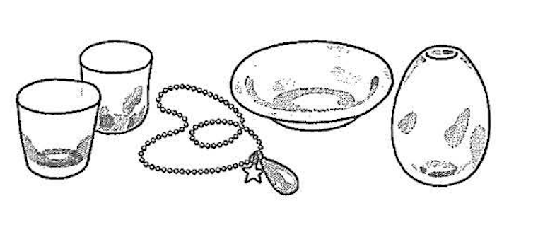

前山ガラス美（び）術（じゅつ）館

営業時間：8時30分〜18時

電話：036-665-4998

**Passage translation**

Maeyama Glass Museum

Information on Glass Classes

At Maeyama Glass Museum, we are holding classes to make plates and accessories.

| Class | Day | Time | Fee※ |
| --- | --- | --- | --- |
| 1. Plate | Saturday | 10:00 - 10:30 | 1,500 yen |
| 2. Glass | Sunday | 11:00 - 11:40 | 1,800 yen |
| 3. Accessories | Saturday | 10:00 - 10:30 | 2,500 yen |
| 4. Vase | Saturday | 11:00 - 12:30 | 1,800 yen |

※ People taking classes are not charged the admission fee to enter Maeyama Glass Museum.

＜Reservation＞

Please make a reservation by phone by 12:00 two days before the day of the class you want to take.
Please call during the museum's business hours.

＜Meeting Place＞

Please come to the museum reception by 10 minutes before the class starts.

＜Caution＞

Items made in the class take overnight for the glass temperature to drop, so you can take them
home starting from the next day. For an extra fee, we can also send them to your home.

Maeyama Glass Museum

Business Hours: 8:30 - 18:00

Phone: 036-665-4998

#### Question 28

ハンナさんは、土曜日にガラス教室のクラスを受（う）けたいと思っています。 １時間以内に終わって、クラスの料金が2,000円より安いものがいいです。 ハンナさんが選（えら）べるクラスはどれですか。

1. **①**
2. ②
3. ③
4. ④

**Correct answer:** 1. ①

**Correct Answer**

Answer 1 is correct. It refers to Class ① (Plates).

**Question Translation**

"Hanna wants to take a glass class on Saturday. She wants one that finishes within 1 hour and costs less than 2,000 yen. Which class can Hanna choose?"

**Explanation**

Let's check the conditions against the table:
1. **Day:** Saturday (土曜日).
2. **Duration:** Within 1 hour (1時間以内).
3. **Price:** Cheaper than 2,000 yen (2,000円より安い).

* **Class ① (Plate):** Saturday, 10:00-10:30 (**30 mins** ✅), **1,500 yen** ✅. **(Matches all)**
* Class ② (Glass): Sunday. (Wrong Day ❌)
* Class ③ (Accessory): Saturday, 10:00-10:30, **2,500 yen**. (Too expensive ❌)
* Class ④ (Vase): Saturday, 11:00-12:30 (**1 hour 30 mins**). (Too long ❌)

**Why Other Options Are Incorrect**

2. ② is on Sunday.
3. ③ costs 2,500 yen (condition is < 2,000).
4. ④ takes 90 minutes (condition is < 60 mins).

**Grammar/Vocabulary Note**

**〜より安い** (cheaper than X) means strictly less than X.
**以内 (inai)** means "within". 1時間以内 = 1 hour or less.

**Test-Taking Tip**

For Information Retrieval questions, eliminate options one by one based on the constraints. Start with the easiest constraint to check (e.g., "Saturday")."

#### Question 29

ヨハンさんは、10月15日（土）の③のクラスを受（う）けたいと思っています。 ヨハンさんは、いつまでに予約（よやく）しなければなりませんか。そして、15日は 何時までに受付（うけつけ）に行かなければなりませんか。

1. 13日の12時までに予約（よやく）します。15日は10時までに行きます。
2. **13日の12時までに予約（よやく）します。15日は10時の10分前までに行きます。**
3. 14日の12時までに予約（よやく）します。15日は10時までに行きます。
4. 14日の12時までに予約（よやく）します。15日は10時の10分前までに行きます。

**Correct answer:** 2. 13日の12時までに予約（よやく）します。15日は10時の10分前までに行きます。

**Correct Answer**

Answer 2 is correct. It means "Reserve by 12:00 on the 13th. Go by 10 minutes to 10:00 on the 15th."

**Question Translation**

"Johan wants to take Class ③ on October 15th (Sat). By when must he reserve? And by what time must he go to the reception on the 15th?"

**Explanation**

**Condition 1: Reservation Deadline**
* Text says: "2 days before the class day, by 12:00." (受けたいクラスがある日の2日前の12時までに)
* Class date: Oct 15.
* 2 days before: Oct 13.
* Deadline: **Oct 13, 12:00**.

**Condition 2: Meeting Time**
* Text says: "By 10 minutes before the class starts." (クラスが始まる時間の10分前までに)
* Class ③ Start Time (from table): 10:00.
* 10 mins before: **9:50** (10 o'clock minus 10 mins = 10時の10分前).

Combining these, Answer 2 matches exactly.

**Why Other Options Are Incorrect**

1. Arriving at 10:00 is too late (must be 10 mins early).
3. Reserving on the 14th is too late (must be 2 days before).
4. Reserving on the 14th is too late.

**Grammar/Vocabulary Note**

**〜までに** (by...) indicates a deadline. You must complete the action *before* this time.
**10時の10分前** is a common way to say "10 minutes to 10" (9:50).

**Test-Taking Tip**

Be careful with date calculations. "2 days before" (2日前) does not mean subtracting 24 hours, but counting back two calendar days. 15th minus 2 days = 13th.

## 聴解

### もんだい1: Task-based Comprehension

> もんだい1では、まず 　しつもんを　聞いて　ください。それから　話を　聞いて、もんだいようしの　1から4の　中から、いちばん　いい　ものを　一つ えらんで　ください。

#### Question 1

１ばん

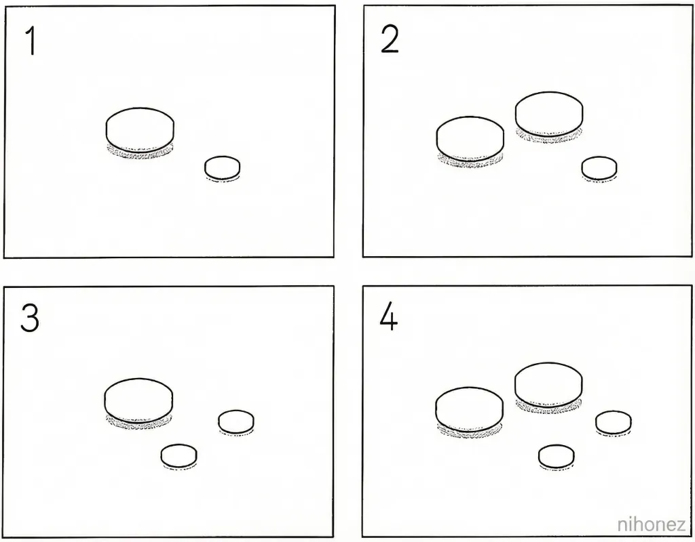

1. **1**
2. 2
3. 3
4. 4

**Correct answer:** 1. 1

**Transcript**

病院（びょういん）で医者（いしゃ）と男（おとこ）の人（ひと）が話（はな）しています。男（おとこ）の人（ひと）は今晩（こんばん）どの薬（くすり）をいくつ飲（の）みますか。

医者（いしゃ）： 薬（くすり）は2種類（しゅるい）出（だ）します。大（おお）きい方（ほう）は1日（にち）に2回（かい）、朝（あさ）と晩（ばん）の食事（しょくじ）の後（あと）で1つ飲（の）んでください。
男（おとこ）： 朝（あさ）、晩（ばん）に1つずつですね。
医者（いしゃ）： はい。小（ちい）さい方（ほう）は熱（ねつ）を下（さ）げる薬（くすり）で、夜（よる）寝（ね）る前（まえ）に1つ飲（の）んでください。明日（あした）からは熱（ねつ）がなければ飲（の）まなくてもいいです。どちらの薬（くすり）も1回（かい）に2つ以上（いじょう）飲（の）まないでくださいね。
男（おとこ）： わかりました。

男（おとこ）の人（ひと）は今晩（こんばん）どの薬（くすり）をいくつ飲（の）みますか。

**Explanation**

At the hospital, a doctor and a man are talking. Which medicine and how much will the man take tonight?

Doctor: I am prescribing two types of medicine. Please take one of the big ones twice a day, after breakfast and dinner.
Man: One each in the morning and evening, right?
Doctor: Yes. The smaller one is to lower your fever, so please take one at night before you sleep. From tomorrow, if you don't have a fever, you don't need to take it. Please do not take more than two of either medicine at one time.
Man: Understood.

Which medicine and how much will the man take tonight?

#### Question 2

２ばん

1. ４こ
2. ５こ
3. ９こ
4. **１０こ**

**Correct answer:** 4. １０こ

**Transcript**

大学（だいがく）で同（おな）じクラブの男（おとこ）の学生（がくせい）と女（おんな）の学生（がくせい）が話（はな）しています。女（おんな）の学生（がくせい）はプレゼントを何個（なんこ）用意（ようい）しますか。

男（おとこ）： あ、ちょっと、お願（ねが）いがあるんだけど、いい？
女（おんな）： うん、何（なに）？
男（おとこ）： 来月（らいげつ）卒業（そつぎょう）するクラブの先輩（せんぱい）にプレゼントをあげたいんだけど、用意（ようい）してくれる？僕（ぼく）は花（はな）を用意（ようい）するから。
女（おんな）： わかった。
男（おとこ）： ええっと、男（おとこ）の先輩（せんぱい）が5人（にん）、女（おんな）の先輩（せんぱい）が4人（にん）だね。
女（おんな）： じゃあプレゼントは9つだね。
男（おとこ）： うん。あ、留学生（りゅうがくせい）のキムさんが国（くに）に帰（かえ）るからキムさんにもあげよう。
女（おんな）： うん。もう一（ひと）つだね。わかった。

女（おんな）の学生（がくせい）はプレゼントを何個（なんこ）用意（ようい）しますか。

**Explanation**

At the university, a male student and a female student from the same club are talking. How many presents will the female student prepare?

Male: Ah, hey, I have a favor to ask, is that okay?
Female: Yeah, what is it?
Male: I want to give presents to the seniors graduating from the club next month, could you prepare them? I'll prepare the flowers.
Female: Okay.
Male: Let's see, there are 5 male seniors and 4 female seniors.
Female: So, that's 9 presents.
Male: Yeah. Oh, Kim, the international student, is returning to her country, so let's give one to Kim as well.
Female: Okay. That's one more. Understood.

How many presents will the female student prepare?

#### Question 3

３ばん

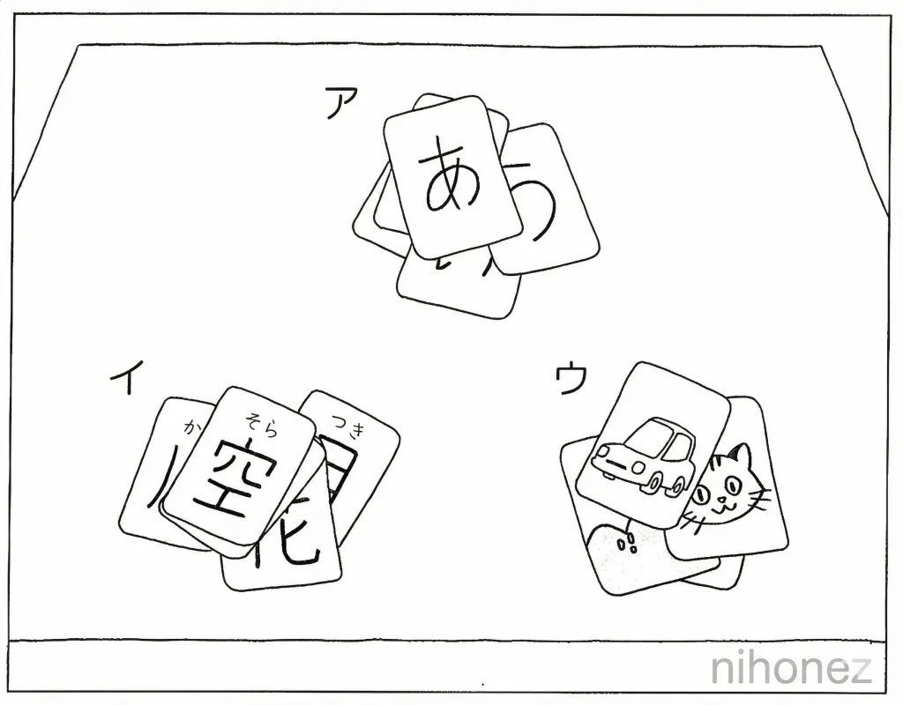

1. アイウ
2. アイ
3. **アウ**
4. イ

**Correct answer:** 3. アウ

**Transcript**

日本語（にほんご）の授業（じゅぎょう）の後（あと）で、男（おとこ）の学生（がくせい）と先生（せんせい）が話（はな）しています。男（おとこ）の学生（がくせい）はどのカードを箱（はこ）に入（い）れますか。

男（おとこ）： 先生（せんせい）、何（なに）かお手伝（てつだ）いしましょうか。
先生（せんせい）： ああ、ありがとう。じゃあ机（つくえ）の上（うえ）にあるカードを片付（かたづ）けてもらえますか。
男（おとこ）： はい。
先生（せんせい）： ひらがなのカードと絵（え）のカードはこの箱（はこ）に入（い）れてください。
男（おとこ）： はい。漢字（かんじ）のカードもありますけど、これも入（い）れましょうか。
先生（せんせい）： それは、この後（あと）の授業（じゅぎょう）で使（つか）いますから入（い）れないでください。
男（おとこ）： わかりました。

男（おとこ）の学生（がくせい）はどのカードを箱（はこ）に入（い）れますか。

**Explanation**

After the Japanese class, a male student and the teacher are talking. Which cards will the male student put in the box?

Male: Teacher, shall I help you with anything?
Teacher: Ah, thank you. Well then, could you tidy up the cards on the desk?
Male: Yes.
Teacher: Please put the hiragana cards and the picture cards in this box.
Male: Okay. There are also Kanji cards; should I put these in too?
Teacher: I will use those in the next class, so please don't put them in.
Male: Understood.

Which cards will the male student put in the box?

#### Question 4

４ばん

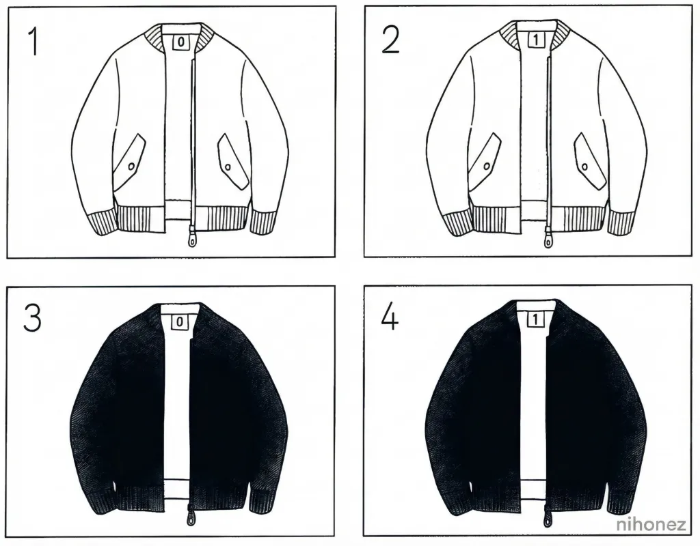

1. **1**
2. 2
3. 3
4. 4

**Correct answer:** 1. 1

**Transcript**

電話（でんわ）で夫（おっと）と妻（つま）が話（はな）しています。夫（おっと）はどれを買（か）いますか。

男（おとこ）： もしもし、リサさん、今（いま）ね、デパートにいるんだけど、リサさんが欲（ほ）しいと言（い）っていた上着（うわぎ）があるよ。買（か）っていこうか。
女（おんな）： 買（か）ってきて。色（いろ）は白（しろ）と黒（くろ）があると思|おも]うけど、白（しろ）がいい。
男（おとこ）： わかった。
女（おんな）： 白（しろ）で大（おお）きさはMがいいんだ。首（くび）のところに番号（ばんごう）が書（か）いてある？
男（おとこ）： うん、ゼロかイチだね。
女（おんな）： その店（みせ）はゼロがエムだよ。イチはエルで、私（わたし）には大（おお）きいから間違（まちが）えないでね。
男（おとこ）： わかった。じゃあ買（か）っていくね。

夫（おっと）はどれを買（か）いますか。

**Explanation**

A husband and wife are talking on the phone. Which one will the husband buy?

Man: Hello, Lisa? I'm at the department store right now, and they have the jacket you said you wanted. Shall I buy it and bring it home?
Woman: Please buy it. I think they have white and black colors, but I want white.
Man: Okay.
Woman: White, and for the size, M is good. Is there a number written on the neck?
Man: Yeah, it's either zero or one.
Woman: At that store, zero is M. One is L, which is too big for me, so don't make a mistake.
Man: Understood. I'll buy it then.

Which one will the husband buy?

#### Question 5

５ばん

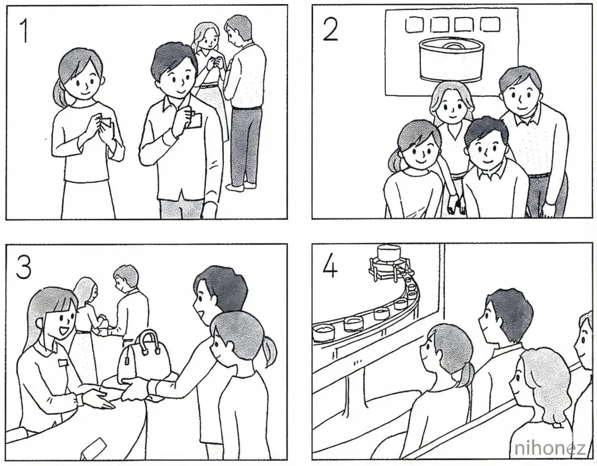

1. 1
2. **2**
3. 3
4. 4

**Correct answer:** 2. 2

**Transcript**

缶詰（かんづめ）の工場（こうじょう）の入口（いりぐち）で、案内（あんない）の人（ひと）が、お客（きゃく）さんに話（はな）しています。お客（きゃく）さんはこの後（あと）、まず何（なに）をしますか。

では工場（こうじょう）の中（なか）に入（はい）ります。あちらに受付（うけつけ）があります。工場（こうじょう）では名札（なふだ）を服（ふく）につけて見学（けんがく）しますが、えー、受付（うけつけ）を通（とお）ったら中（なか）では写真（しゃしん）が撮（と）れないので、入（はい）る前（まえ）に一緒（いっしょ）に写真（しゃしん）を撮（と）ります。缶詰（かんづめ）のポスターの前（まえ）に並（なら）んでください。それから名札（なふだ）を渡（わた）します。えー、名札（なふだ）をつけたら受付（うけつけ）で荷物（にもつ）を渡（わた）してください。鞄（かばん）を持（も）ったまま見学（けんがく）はできません。見学（けんがく）ではまず工場（こうじょう）紹介（しょうかい）のビデオを見（み）て、それから缶詰（かんづめ）を作（つく）っているところに行（い）きます。

お客（きゃく）さんはこの後（あと）、まず何（なに）をしますか。

**Explanation**

At the entrance of a canned food factory, a guide is talking to the guests. What will the guests do first after this?

Now, we will enter the factory. The reception is over there. Inside the factory, you will wear name tags while touring, but, um, since you cannot take photos inside once you pass the reception, we will take a photo together before entering. Please line up in front of the canned food poster. After that, I will hand out name tags. Um, once you put on your name tag, please hand over your luggage at the reception. You cannot tour while holding bags. For the tour, we will first watch a factory introduction video, and then go to the area where cans are being made.

What will the guests do first after this?

#### Question 6

６ばん

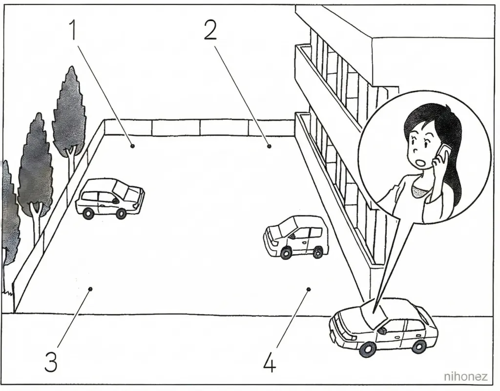

1. 1
2. **2**
3. 3
4. 4

**Correct answer:** 2. 2

**Transcript**

男（おとこ）： はい。駐車場（ちゅうしゃじょう）の中（なか）に入（はい）って一番（いちばん）奥（おく）に止（と）めてください。一番（いちばん）奥（おく）のアパートに近（ちか）い方（ほう）です。

**Explanation**

Man: Yes. Please enter the parking lot and park at the very back. It is the side closer to the apartment at the very back.

#### Question 7

７ばん

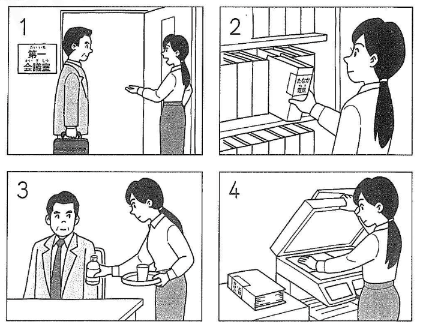

1. **1**
2. 2
3. 3
4. 4

**Correct answer:** 1. 1

**Transcript**

会社（かいしゃ）で男（おとこ）の人（ひと）と女（おんな）の人（ひと）が話（はな）しています。女（おんな）の人（ひと）はこの後（あと）何（なに）をしますか。

男（おとこ）： 受付（うけつけ）に田中（たなか）電機（でんき）の田中（たなか）社長（しゃちょう）がいらっしゃっているそうだよ。
女（おんな）： え？今日（きょう）来（く）るという連絡（れんらく）は特（とく）になかったですが、どうしたんでしょうか。
男（おとこ）： うん。急（いそ）いで受付（うけつけ）に行（い）って、田中（たなか）社長（しゃちょう）を第（だい）1会議室（かいぎしつ）まで案内（あんない）して。私（わたし）も資料（しりょう）とお茶（ちゃ）を持（も）ってすぐ行（い）くよ。
女（おんな）： 資料（しりょう）のコピーなど手伝（てつだ）いましょうか。
男（おとこ）： 大丈夫（だいじょうぶ）だから早（はや）く行（い）って待（ま）たせたらいけないよ。
女（おんな）： わかりました。

女（おんな）の人（ひと）はこの後（あと）何（なに）をしますか。

**Explanation**

At the company, a man and a woman are talking. What will the woman do after this?

Man: I heard President Tanaka from Tanaka Electronics is at the reception.
Woman: Eh? There wasn't any specific notification that he was coming today; I wonder what happened.
Man: Yeah. Hurry to the reception and guide President Tanaka to Conference Room 1. I'll come right away with materials and tea.
Woman: Shall I help with copying the materials?
Man: I'm fine, so go quickly; we mustn't keep him waiting.
Woman: Understood.

What will the woman do after this?

#### Question 8

８ばん

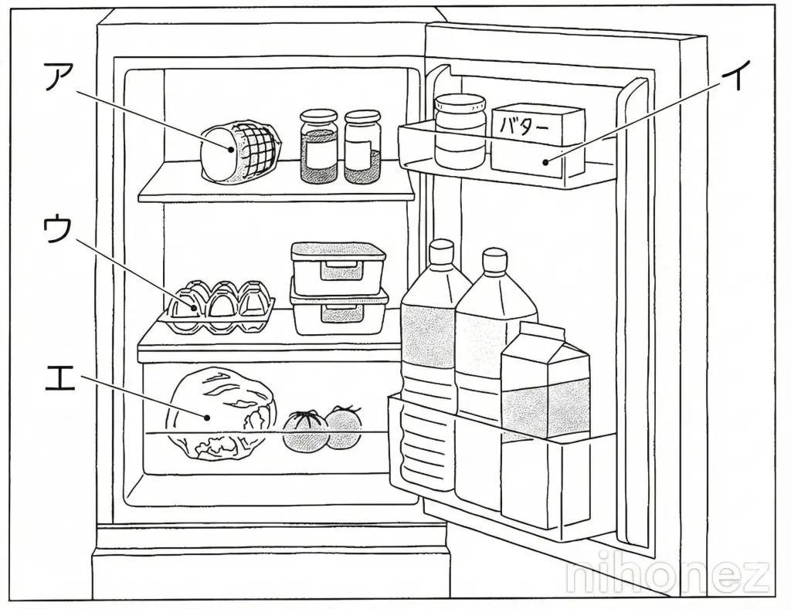

1. アイウ
2. **アイエ**
3. アウエ
4. イウエ

**Correct answer:** 2. アイエ

**Transcript**

妻（つま）と夫（おっと）が話（はな）しています。夫（おっと）は冷蔵庫（れいぞうこ）から何（なに）を出（だ）しますか。

女（おんな）： もうお昼（ひる）だね。サンドイッチを作（つく）ろうか。
男（おとこ）： うん。
女（おんな）： 私（わたし）はパンを準備（じゅんび）するから、冷蔵庫（れいぞうこ）からきゅうりとハムを出（だ）して。
男（おとこ）： きゅうりはないよ。朝（あさ）食（た）べたのが最後（さいご）の1本（ほん）だったよ。
女（おんな）： ああ、じゃあ代（か）わりにレタスをとって、それからバターも使（つか）うよ。
男（おとこ）： わかった。卵|たまご]も焼（や）いて入（い）れる？
女（おんな）： ハムがあるからいらないよ。ハムを厚（あつ）く切（き）ろう。
男（おとこ）： うん。

夫（おっと）は冷蔵庫（れいぞうこ）から何（なに）を出（だ）しますか。

**Explanation**

A wife and husband are talking. What will the husband take out of the refrigerator?

Wife: It's already lunch time. Shall we make sandwiches?
Husband: Yeah.
Wife: I'll prepare the bread, so take the cucumber and ham out of the fridge.
Husband: There are no cucumbers. The one we ate this morning was the last one.
Wife: Ah, then get the lettuce instead, and we'll use butter too.
Husband: Understood. Should I fry some eggs to put in too?
Wife: We have ham so we don't need them. Let's cut the ham thickly.
Husband: Okay.

What will the husband take out of the refrigerator?

### もんだい2: Comprehension of Key Points

> もんだい2では、まず　しつもんを　聞いて　ください。そのあと、もんだいようしを　見て　ください。読む　時間が　あります。それから　話を　聞いて、もんだいようしの　1から4の　中から、いちばん　いい　ものを 一つ えらんで　ください。

#### Question 1

１ばん

1. 今週（こんしゅう）の　木（もく）ようび
2. 今週（こんしゅう）の　金（きん）ようび
3. **来週（らいしゅう）の　木（もく）ようび**
4. 来週（らいしゅう）の　金（きん）ようび

**Correct answer:** 3. 来週（らいしゅう）の　木（もく）ようび

**Transcript**

女（おんな）の人（ひと）と男（おとこ）の人（ひと）が話（はな）しています。女（おんな）の人（ひと）はいつ男（おとこ）の人（ひと）にスーツケースを返（かえ）しますか。

F：松本（まつもと）君、ちょっといい？
M：うん、何（なに）？
F：私（わたし）、今週（こんしゅう）の金曜日（きんようび）から旅行（りょこう）に行（い）くんだけど、スーツケースが壊（こわ）れてしまったんで貸（か）してくれない？
M：僕（ぼく）も来週（らいしゅう）使（つか）うんだよ。いつ旅行（りょこう）から帰（かえ）ってくる？
F：えっと来週（らいしゅう）の水曜日（すいようび）８月（がつ）１０日（か）の晩（ばん）。
M：僕（ぼく）は金曜日（きんようび）出発（しゅっぱつ）なんだ。間（ま）に合（あ）う？
F：帰（かえ）ってきたらすぐに返（かえ）すから、お願（ねが）い。
M：わかった。じゃあ木曜日（もくようび）の朝（あさ）に持（も）ってこられる？
F：大丈夫（だいじょうぶ）。ありがとう。

女（おんな）の人（ひと）はいつ男（おとこ）の人（ひと）にスーツケースを返（かえ）しますか。

**Explanation**

A woman and a man are talking. When will the woman return the suitcase to the man?

F: Matsumoto-kun, do you have a moment?
M: Yeah, what is it?
F: I'm going on a trip starting this Friday, but my suitcase broke, so could you lend me yours?
M: I'm using it next week too. When do you come back from the trip?
F: Um, next Wednesday, the night of August 10th.
M: I leave on Friday. Will it be back in time?
F: I'll return it as soon as I get back, so please.
M: Okay. Then can you bring it over on Thursday morning?
F: That's fine. Thank you.

When will the woman return the suitcase to the man?

#### Question 2

２ばん

1. 二（ふた）つで　350円（えん）
2. **二（ふた）つで　500円（えん）**
3. 二（ふた）つで　600円（えん）
4. 二（ふた）つで　700円（えん）

**Correct answer:** 2. 二（ふた）つで　500円（えん）

**Transcript**

スーパーで女（おんな）の店員（てんいん）と男（おとこ）の人（ひと）が話（はな）しています。ケーキは今日（きょう）２つでいくらですか。今日（きょう）です。

F：お客様（きゃくさま）こちらのケーキは豆腐（とうふ）でできているんですよ。どうぞ食（た）べてみてください。
M：あ、どうも美味（おい）しいですね。
F：こちらのケーキ、いつもは１つ３５０円（えん）なんですが、今日（きょう）は特別（とくべつ）に安（やす）くなっていて１つ３００円（えん）なんです。
M：そうですか。じゃあ２つください。６００円（えん）ですね。
F：いいえ、今日（きょう）は２つで５００円（えん）になるんです。いつもは７００円（えん）だから、今日（きょう）はとっても安（やす）いんですよ。
M：そうなんですか。
F：はい。じゃあこちらをどうぞ。

ケーキは今日（きょう）２つでいくらですか。

**Explanation**

At a supermarket, a female clerk and a man are talking. How much are two cakes today? Today.

F: Sir, this cake is made from tofu. Please try some.
M: Ah, thank you. It's delicious.
F: This cake is usually 350 yen for one, but today it is specially discounted to 300 yen each.
M: Is that so? Then I'll take two. That's 600 yen, right?
F: No, today it becomes 500 yen for two. Usually it's 700 yen, so it's very cheap today.
M: Is that right?
F: Yes. Here you go.

How much are two cakes today?

#### Question 3

３ばん

1. しゅくだいを　していたから
2. **手紙（てがみ）を　書（か）いていたから**
3. 本（ほん）を　読（よ）んでいたから
4. 電話（でんわ）を　していたから

**Correct answer:** 2. 手紙（てがみ）を　書（か）いていたから

**Transcript**

学校（がっこう）で男（おとこ）の留学生（りゅうがくせい）と女（おんな）の学生（がくせい）が話（はな）しています。男（おとこ）の留学生（りゅうがくせい）はどうして昨日（きのう）の夜（よる）遅（おそ）く寝（ね）ましたか。

M：昨日（きのう）の晩（ばん）、寝（ね）るのが遅（おそ）かったから、今日（きょう）はちょっと眠（ねむ）いな。昨日（きのう）は宿題（しゅくだい）がなかったから早（はや）く寝（ね）ようと思（おも）っていたんだけど、手紙（てがみ）を書（か）いて時間（じかん）がかかってしまったんだ。
F：ああ、国（くに）の家族（かぞく）に？
M：うん、お婆（ばあ）ちゃんが先週（せんしゅう）本（ほん）をたくさん送（おく）ってくれたからお礼（れい）を書（か）いたんだよ。いつもは電話（でんわ）で話（はな）しているんだけど、たまには気持（きも）ちを書（か）いて伝（つた）えたいと思（おも）ったんだ。
F：それは、いいね。

男（おとこ）の留学生（りゅうがくせい）はどうして、昨日（きのう）の夜（よる）遅（おそ）く寝（ね）ましたか。

**Explanation**

At school, a male international student and a female student are talking. Why did the male international student go to sleep late last night?

M: I went to sleep late last night, so I'm a little sleepy today. I didn't have homework yesterday so I thought I'd go to bed early, but writing a letter took a long time.
F: Oh, to your family back home?
M: Yeah, my grandmother sent me a lot of books last week, so I wrote a thank-you note. We usually talk on the phone, but I thought I wanted to convey my feelings in writing once in a while.
F: That's nice.

Why did the male international student go to sleep late last night?

#### Question 4

４ばん

1. **休（やす）みが　とりやすいこと**
2. お金（かね）が　たくさん　もらえること
3. うちから　ちかいこと
4. しごとが　たのしいこと

**Correct answer:** 1. 休（やす）みが　とりやすいこと

**Transcript**

テレビでアナウンサーが話（はな）しています。アナウンサーは大学生（だいがくせい）がアルバイトを選（えら）ぶとき、何（なに）が一番（いちばん）大切（たいせつ）だと言（い）っていますか。

大学生（だいがくせい）がアルバイトを選（えら）ぶ時（とき）、何（なに）が大切（たいせつ）だと思（おも）っているのでしょうか。大学生（だいがくせい）にアンケートをとった結果（けっか）、休（やす）みが取（と）りやすいことが一番（いちばん）大切（たいせつ）だと思（おも）っていることがわかりました。他（ほか）には、お金（かね）がたくさんもらえる、うちから近（ちか）いことなどの理由（りゆう）もありました。また、新（あたら）しくて綺麗（きれい）な店（みせ）で楽（たの）しく働（はたら）きたいという意見（いけん）もありました。

アナウンサーは大学生（だいがくせい）がアルバイトを選（えら）ぶとき、何（なに）が一番（いちばん）大切（たいせつ）だと言（い）っていますか。

**Explanation**

An announcer is talking on TV. What does the announcer say is the most important thing for university students when choosing a part-time job?

When university students choose a part-time job, what do they think is important? As a result of surveying university students, it was found that being able to take time off easily is what they think is the most important. Other reasons included getting a lot of money and being close to home. There were also opinions that they want to work happily in a new and clean shop.

What does the announcer say is the most important thing for university students when choosing a part-time job?

#### Question 5

５ばん

1. 友（とも）だちが　来（く）るのを　まっている
2. 店（みせ）の　せきが　空（あ）くのを　まっている
3. 雨（あめ）が　やむのを　まっている
4. **タクシーが　来（く）るのを　まっている**

**Correct answer:** 4. タクシーが　来（く）るのを　まっている

**Transcript**

会社（かいしゃ）の近（ちか）くで男（おとこ）の人（ひと）と女（おんな）の人（ひと）が話（はな）しています。女（おんな）の人（ひと）は何（なに）を待（ま）っていますか。

M：あれ、本田（ほんだ）さん、結構（けっこう）前（まえ）に会社（かいしゃ）を出（で）たのにここで何（なに）をしているんですか。
F：近（ちか）くの店（みせ）で友達（ともだち）と食事（しょくじ）をしていたんですが、店（みせ）を出（で）たら雨（あめ）が降（ふ）っていたので、タクシーを呼（よ）んだんです。もうすぐ来（く）ると思（おも）うので待（ま）っています。
M：友達（ともだち）は？
F：家（いえ）がこの近（ちか）くなので歩（ある）いて帰（かえ）りました。

女（おんな）の人（ひと）は何（なに）を待（ま）っていますか。

**Explanation**

A man and a woman are talking near the company. What is the woman waiting for?

M: Oh, Honda-san, you left the office quite a while ago, what are you doing here?
F: I was having a meal with a friend at a nearby restaurant, but when we left the restaurant it was raining, so I called a taxi. I think it will come soon, so I'm waiting.
M: What about your friend?
F: Their house is nearby, so they walked home.

What is the woman waiting for?

#### Question 6

６ばん

1. 車（くるま）を　かりるため
2. **あるきやすい　くつを　はくため**
3. ぼうしを　とりに　行（い）くため
4. ひるごはんを　食（た）べるため

**Correct answer:** 2. あるきやすい　くつを　はくため

**Transcript**

大学（だいがく）で男（おとこ）の学生（がくせい）と女（おんな）の学生（がくせい）が話（はな）しています。この後（あと）、何（なに）をするために女（おんな）の人（ひと）の家（いえ）に行（い）きますか。

M：これからドライブに行（い）かない？今日（きょう）、兄（あに）に車（くるま）を借（か）りているんだ。
F：じゃあ緑山（みどりやま）に行（い）こうよ。綺麗（きれい）な空気（くうき）の中（なか）で散歩（さんぽ）をしたい。あ、でも今日（きょう）新（あたら）しい靴（くつ）だからたくさん歩（ある）くと足（あし）が痛（いた）くなるかもしれない。
M：家（いえ）に寄（よ）ってあげるから歩（ある）きやすい靴（くつ）にかえる？帽子（ぼうし）も持（も）った方（ほう）がいいよ。
F：ありがとう。そうする。帽子（ぼうし）は持（も）ってきているから大丈夫（だいじょうぶ）。ねえ、昼（ひる）ご飯（はん）まだだから途中（とちゅう）でどこかに寄（よ）って食（た）べていかない？
M：うん、そうしよう。

この後（あと）、何（なに）をするために女（おんな）の人（ひと）の家（いえ）に行（い）きますか。

**Explanation**

At the university, a male and a female student are talking. Why are they going to the woman's house after this?

M: Do you want to go for a drive now? I'm borrowing my older brother's car today.
F: Then let's go to Mount Midori. I want to take a walk in the fresh air. Ah, but I'm wearing new shoes today, so my feet might hurt if I walk a lot.
M: Shall we stop by your house so you can change into shoes that are easier to walk in? You should probably bring a hat too.
F: Thank you. I'll do that. I brought a hat so that's fine. Hey, I haven't had lunch yet, so shall we stop somewhere on the way to eat?
M: Yeah, let's do that.

Why are they going to the woman's house after this?

#### Question 7

７ばん

1. **ぶちょうの　ところに　行（い）くから**
2. かいぎの　じゅんびを　するから
3. パソコンを　さがしているから
4. 今（いま）から　ひる休（やす）みを　とるから

**Correct answer:** 1. ぶちょうの　ところに　行（い）くから

**Transcript**

会社（かいしゃ）で女（おんな）の人（ひと）と男（おとこ）の人（ひと）が話（はな）しています。男（おとこ）の人（ひと）はどうして今（いま）女（おんな）の人（ひと）を手伝（てつだ）うことができませんか。

F：これから午後（ごご）の会議（かいぎ）の準備（じゅんび）をするので、会場（かいじょう）の準備（じゅんび）を手伝（てつだ）ってもらえませんか。
M：手伝（てつだ）いたいんですが、部長（ぶちょう）にパソコンの具合（ぐあい）が悪（わる）いから見（み）てもらいたいと呼（よ）ばれて、今（いま）から席（せき）に伺（うかが）うんです。簡単（かんたん）に直（なお）せたらすぐに会場（かいじょう）に行（い）けるんですが、直（なお）せなかったら、代（か）わりのパソコンを探（さが）したりするので時間（じかん）がかかりそうです。
F：そうですか。準備（じゅんび）は昼休（ひるやす）みの前（まえ）には終（お）わらせるつもりです。昼休（ひるやす）みまでに来（こ）られたら来（き）てください。
M：わかりました。

男（おとこ）の人（ひと）はどうして今（いま）女（おんな）の人（ひと）を手伝（てつだ）うことができませんか。

**Explanation**

At the company, a woman and a man are talking. Why can't the man help the woman right now?

F: I'm going to prepare for the afternoon meeting now, so could you help me set up the venue?
M: I want to help, but the department manager called me to look at his computer because it's not working well, so I'm going to his desk now. If I can fix it easily, I can go to the venue right away, but if I can't fix it, it looks like it will take time to find a replacement computer.
F: I see. I plan to finish the preparation before the lunch break. Please come if you can make it by lunch.
M: Understood.

Why can't the man help the woman right now?

### もんだい3: Verbal Expressions

> もんだい3では、えを　見ながら　しつもんを　聞いて　ください。rn➡ （やじるし）の　人は 何と　言いますか。1から3の　中から、いちばん　いい　ものを 一つ　えらんで　ください。

#### Question 1

１ばん

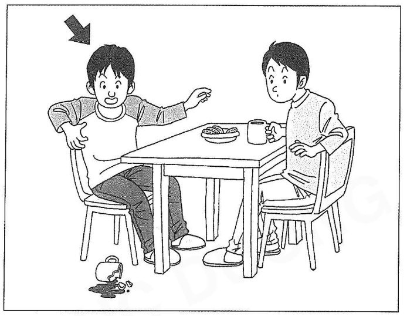

1. 1
2. 2
3. **3**

**Correct answer:** 3. 3

**Transcript**

友達（ともだち）の家（いえ）でコーヒーカップを割（わ）りました。なんと言（い）いますか。
1　失礼（しつれい）します。
2　痛（いた）いですか。
3　ごめんなさい。

**Explanation**

You broke a coffee cup at a friend's house. What do you say?
1 Excuse me.
2 Does it hurt?
3 I am sorry.

#### Question 2

２ばん

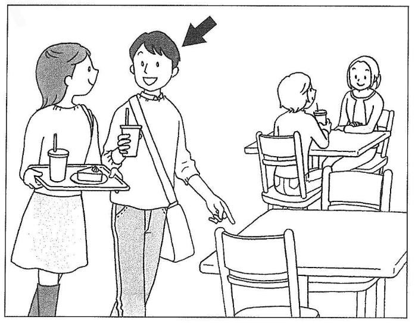

1. **1**
2. 2
3. 3

**Correct answer:** 1. 1

**Transcript**

店（みせ）の中（なか）で空（あ）いている席（せき）を見（み）つけました。友達（ともだち）に何（なん）と言（い）いますか。
1　ここにする？
2　席（せき）が空（あ）きそうだよ。
3　椅子（いす）の近（ちか）くにある？

**Explanation**

You found an empty seat inside a shop. What do you say to your friend?
1 Shall we take this one?
2 It looks like a seat is about to open up.
3 Is it near the chair?

#### Question 3

３ばん

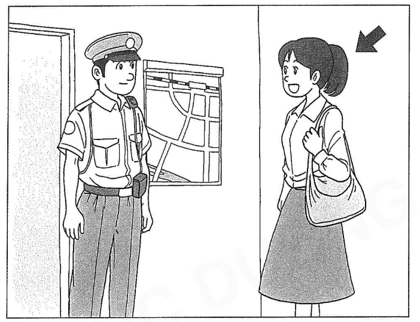

1. 1
2. **2**
3. 3

**Correct answer:** 2. 2

**Transcript**

南大学（みなみだいがく）に行（い）きたいですが行（い）き方（かた）がわかりません。何（なん）と言（い）いますか。
1　南大学（みなみだいがく）に行（い）くのはどうですか。
2　南大学（みなみだいがく）へはどうやって行（い）きますか。
3　南大学（みなみだいがく）はどんなところですか。

**Explanation**

You want to go to Minami University, but you don't know the way. What do you say?
1 How about going to Minami University?
2 How do I get to Minami University?
3 What kind of place is Minami University?

#### Question 4

４ばん

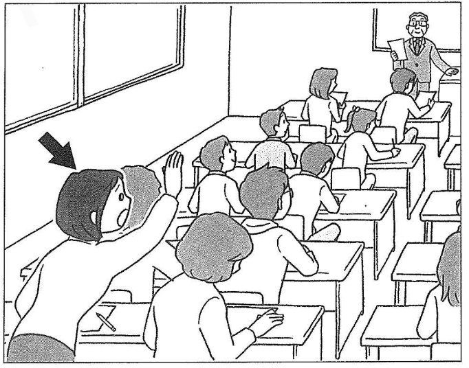

1. **1**
2. 2
3. 3

**Correct answer:** 1. 1

**Transcript**

先生（せんせい）が話（はな）しています。先生（せんせい）の声（こえ）が小（ちい）さいので大（おお）きい声（こえ）で話（はな）してもらいたいです。何（なん）と言（い）いますか。
1　すみません。よく聞（き）こえないんですが。
2　先生（せんせい）、大（おお）きい声（こえ）で話（はな）したいです。
3　あの、もう少（すこ）しゆっくり言（い）ってください。

**Explanation**

The teacher is speaking. Because the teacher's voice is quiet, you want them to speak with a louder voice. What do you say?
1 Excuse me. I can't hear you very well.
2 Teacher, I want to speak in a loud voice.
3 Um, please say it a little more slowly.

#### Question 5

５ばん

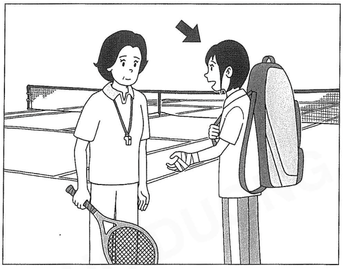

1. 1
2. **2**
3. 3

**Correct answer:** 2. 2

**Transcript**

怪我（けが）をしたので練習（れんしゅう）ができません。今日（きょう）は見学（けんがく）したいです。何（なん）と言（い）いますか。
1　今日（きょう）は練習（れんしゅう）しないでください。
2　今日（きょう）は見学（けんがく）させてください。
3　今日（きょう）はぜひ練習（れんしゅう）を見学（けんがく）してください。

**Explanation**

You got injured so you cannot practice. You want to observe today. What do you say?
1 Please do not practice today.
2 Please let me observe today.
3 Please by all means observe the practice today.

### もんだい4: Quick Response

> もんだい4では、えなどが　ありません。まず　ぶんを　聞いて　ください。それから、そのへんじを　聞いて、1から3の　中から、いちばん　いい　ものを 一つ　えらんで　ください。

#### Question 1

１ばん

1. 1
2. **2**
3. 3

**Correct answer:** 2. 2

**Transcript**

山本（やまもと）さん、山本（やまもと）さんは何（なに）か運動（うんどう）をしている？
1　いいね。何（なに）かしよう。
2　たまに泳（およ）いでいるよ。
3　運動（うんどう）は、しなかった。

**Explanation**

Yamamoto, are you doing any exercise?
1 Good idea. Let's do something.
2 I swim occasionally.
3 I didn't exercise.

#### Question 2

２ばん

1. 1
2. **2**
3. 3

**Correct answer:** 2. 2

**Transcript**

あの先輩（せんぱい）、明日（あした）のテニスの試合（しあい）ですが、雨（あめ）が降（ふ）ってもありますか。
1　試合（しあい）勝（か）ったそうだね。
2　たぶんないと思（おも）うよ。
3　え、そう決（き）まったんだ。

**Explanation**

Um, Senpai, regarding tomorrow's tennis match, will it be held even if it rains?
1 I heard you won the match.
2 I don't think so.
3 Oh, so it's decided.

#### Question 3

３ばん

1. **1**
2. 2
3. 3

**Correct answer:** 1. 1

**Transcript**

駅（えき）まで遠（とお）いですから、車（くるま）で送（おく）りますよ。
1　え、いいんですか？
2　いいえ、車（くるま）じゃありません。
3　いってらっしゃい。

**Explanation**

It's far to the station, so I'll drive you there.
1 Oh, are you sure?
2 No, it's not a car.
3 Take care.

#### Question 4

４ばん

1. 1
2. 2
3. **3**

**Correct answer:** 3. 3

**Transcript**

森（もり）さん、会社（かいしゃ）の花見（はなみ）に行（い）きますか。返事（へんじ）が森（もり）さんだけまだなんです。
1　みんな返事（へんじ）がまだなんですね。僕（ぼく）、行（い）きます。
2　え、行（い）くのは僕（ぼく）だけですか。じゃあ、やめます。
3　あ、すみません忘（わす）れていました。行（い）きます。

**Explanation**

Mori-san, are you going to the company cherry blossom viewing? Only you haven't replied yet.
1 Everyone hasn't replied yet, right? I'll go.
2 Eh, am I the only one going? Then, I'll pass.
3 Ah, sorry, I forgot. I will go.

#### Question 5

５ばん

1. 1
2. **2**
3. 3

**Correct answer:** 2. 2

**Transcript**

来週（らいしゅう）からちょっと入院（にゅういん）することになったんだ。
1　まだ病院（びょういん）に行（い）っていないんですか。
2　どこか悪（わる）いんですか。
3　ずっと入院（にゅういん）していたんですか。

**Explanation**

I have to be hospitalized for a short while starting next week.
1 You haven't gone to the hospital yet?
2 Is something wrong?
3 Have you been hospitalized the whole time?

#### Question 6

６ばん

1. 1
2. 2
3. **3**

**Correct answer:** 3. 3

**Transcript**

田中（たなか）さん、誰（だれ）か英語（えいご）が話（はな）せる人（ひと）を知（し）りませんか。
1　誰（だれ）が知（し）っているんですか。
2　知（し）らない人（ひと）です。
3　一人（ひとり）いますよ。

**Explanation**

Tanaka-san, do you know anyone who can speak English?
1 Who knows?
2 It's a person I don't know.
3 There is one person.

#### Question 7

７ばん

1. **1**
2. 2
3. 3

**Correct answer:** 1. 1

**Transcript**

初（はじ）めて日本（にほん）に来（き）たとき、どうでしたか。
1　言葉（ことば）がわからなくて困（こま）りました。
2　いえ、初（はじ）めてじゃありませんでした。
3　日本（にほん）に行（い）きたいと思（おも）いました。

**Explanation**

How was it when you first came to Japan?
1 I had trouble because I didn't understand the language.
2 No, it wasn't my first time.
3 I thought I wanted to go to Japan.

#### Question 8

８ばん

1. 1
2. **2**
3. 3

**Correct answer:** 2. 2

**Transcript**

正月（しょうがつ）の休（やす）みの間（あいだ）、どこかへ出（で）かけましたか。
1　学校（がっこう）と駅（えき）の間（あいだ）にありました。
2　風邪（かぜ）でずっと寝（ね）ていました。
3　スキーに行（い）ったことがあります。

**Explanation**

Did you go anywhere during the New Year's holidays?
1 It was between the school and the station.
2 I was sleeping the whole time because of a cold.
3 I have been skiing before.
